# 01. Machine Learning & Deep Learning Fundamentals: Interview Questions & Deep-Dive Solutions

A comprehensive, production-grade guide answering 12 core machine learning and deep learning interview scenarios, covering the bias-variance tradeoff, L1/L2 regularization, gradient descent variants, class imbalance mitigation, backpropagation mechanics, normalization layers, architectural selection, production accuracy drop triage, temporal distribution drift, and the fast-cheap-accurate trilemma.

---

## Architectural Overview: Machine Learning Model Lifecycle & Diagnostic Decision Tree

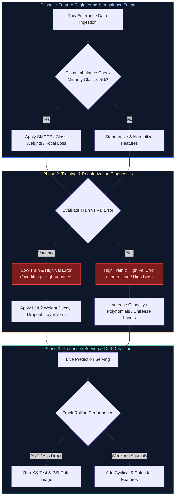

---

## Table of Contents & Question Mapping

1. **Foundational Theory & Regularization**
   - [Q1. Explain the bias-variance tradeoff and how you would diagnose which one is hurting a model in production.](#q1-explain-the-bias-variance-tradeoff-and-how-you-would-diagnose-which-one-is-hurting-a-model-in-production)
   - [Q2. What is the difference between L1 (Lasso) and L2 (Ridge) regularization, and when would you choose one over the other?](#q2-what-is-the-difference-between-l1-lasso-and-l2-ridge-regularization-and-when-would-you-choose-one-over-the-other)
   - [Q3. Explain a practical use case where you would apply machine learning vs deterministic heuristics.](#q3-explain-a-practical-use-case-where-you-would-apply-machine-learning-vs-deterministic-heuristics)
2. **Optimization Algorithms & Loss Dynamics**
   - [Q4. Walk through how gradient descent works, and explain the difference between SGD, mini-batch, and batch gradient descent.](#q4-walk-through-how-gradient-descent-works-and-explain-the-difference-between-sgd-mini-batch-and-batch-gradient-descent)
   - [Q5. How do you handle class imbalance in a classification problem (SMOTE, class weighting, Focal Loss)?](#q5-how-do-you-handle-class-imbalance-in-a-classification-problem-smote-class-weighting-focal-loss)
   - [Q6. Explain backpropagation and why vanishing and exploding gradients happen in deep networks.](#q6-explain-backpropagation-and-why-vanishing-and-exploding-gradients-happen-in-deep-networks)
3. **Deep Learning Building Blocks & Architectural Selection**
   - [Q7. How does batch normalization help training, and what is the key difference between batch normalization and layer normalization?](#q7-how-does-batch-normalization-help-training-and-what-is-the-key-difference-between-batch-normalization-and-layer-normalization)
   - [Q8. Compare CNNs, RNNs, and Transformers: When would you pick one architecture over another for vision, time-series, and text?](#q8-compare-cnns-rnns-and-transformers-when-would-you-pick-one-architecture-over-another-for-vision-time-series-and-text)
   - [Q9. How would you select an appropriate machine learning model for a given business problem with latency vs accuracy constraints?](#q9-how-would-you-select-an-appropriate-machine-learning-model-for-a-given-business-problem-with-latency-vs-accuracy-constraints)
4. **Production Incident Triage & Engineering Trade-Offs**
   - [Q10. A production model suddenly drops from 95% to 60% accuracy. Walk me through your step-by-step investigation runbook.](#q10-a-production-model-suddenly-drops-from-95-to-60-accuracy-walk-me-through-your-step-by-step-investigation-runbook)
   - [Q11. Your model works great Monday–Friday but performs poorly on weekends. How would you investigate and fix temporal distribution drift?](#q11-your-model-works-great-mondayfriday-but-performs-poorly-on-weekends-how-would-you-investigate-and-fix-temporal-distribution-drift)
   - [Q12. You can have fast, cheap, or accurate in an AI system. Pick two and explain the architectural trade-offs.](#q12-you-can-have-fast-cheap-or-accurate-in-an-ai-system-pick-two-and-explain-the-architectural-trade-offs)
---

# 1. Foundational Theory & Regularization

---

### Q1. Explain the bias-variance tradeoff and how you would diagnose which one is hurting a model in production.
**Topic Covered:** Statistical Learning Theory & Generalization Bounds  
**Question:** Explain the bias-variance tradeoff and how you'd diagnose which one is hurting a model.

#### Definition & Core Concepts
The **Bias-Variance Decomposition** formalizes the expected mean squared generalization error of a supervised model $f(x)$ trained on dataset $\mathcal{D}$ for target $y = f^*(x) + \epsilon$ with irreducible noise variance $\sigma^2$:

$$\mathbb{E}[(y - \hat{f}(x))^2] = \text{Bias}[\hat{f}(x)]^2 + \text{Var}[\hat{f}(x)] + \sigma^2$$

Where:
1. **Bias ($\text{Bias}[\hat{f}(x)] = \mathbb{E}[\hat{f}(x)] - f^*(x)$):** Error originating from erroneous or overly simplistic assumptions in the learning algorithm. **High bias** implies **underfitting**—the model lacks the expressiveness or capacity to capture the underlying data distribution (e.g., fitting a linear regression line to parabolic data).
2. **Variance ($\text{Var}[\hat{f}(x)] = \mathbb{E}[(\hat{f}(x) - \mathbb{E}[\hat{f}(x)])^2]$):** Sensitivity of the model to random fluctuations and noise in the training set. **High variance** implies **overfitting**—the model memorizes the training samples, capturing idiosyncratic noise that fails to generalize to unseen test distributions.
3. **Irreducible Error ($\sigma^2$):** Inherent stochastic noise in the data generating process that cannot be eliminated by any estimator.

#### Production Diagnostic Framework
In high-scale enterprise systems, engineers diagnose bias vs variance by plotting **Learning Curves** (Training Loss vs Validation Loss over sample size $N$ and epochs $E$):
- **High Bias Signature:** Both Training Loss and Validation Loss converge quickly to an unacceptably high error asymptote. Increasing training data provides zero benefit.
- **High Variance Signature:** Training Loss is near zero, while Validation Loss remains significantly higher, exhibiting a persistent generalization gap ($\Delta L = L_{\text{val}} - L_{\text{train}} \gg 0$).

#### Visual Flow
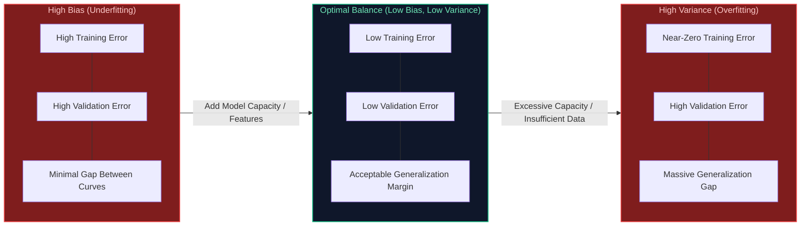

#### Production Implementation / Code Solution
```python
import numpy as np
import matplotlib.pyplot as plt
from sklearn.model_selection import learning_curve
from sklearn.ensemble import GradientBoostingClassifier
from sklearn.metrics import log_loss

def diagnose_bias_variance(estimator, X: np.ndarray, y: np.ndarray, cv: int = 5):
    """
    Computes and logs empirical learning curves to mathematically diagnose
    whether an active production model suffers from underfitting (bias) or overfitting (variance).
    """
    train_sizes = np.linspace(0.1, 1.0, 10)
    train_sizes, train_scores, test_scores = learning_curve(
        estimator=estimator,
        X=X,
        y=y,
        train_sizes=train_sizes,
        cv=cv,
        scoring="neg_log_loss",
        n_jobs=-1,
        shuffle=True,
        random_state=42
    )
    
    # Calculate empirical mean errors across cross-validation folds
    train_loss = -np.mean(train_scores, axis=1)
    val_loss = -np.mean(test_scores, axis=1)
    generalization_gap = val_loss[-1] - train_loss[-1]
    
    print(f"Final Train Log-Loss: {train_loss[-1]:.4f}")
    print(f"Final Validation Log-Loss: {val_loss[-1]:.4f}")
    print(f"Empirical Generalization Gap: {generalization_gap:.4f}")
    
    # Diagnostic rules of thumb
    if train_loss[-1] > 0.60 and generalization_gap < 0.05:
        print("DIAGNOSIS: [HIGH BIAS]. Model lacks capacity. Action: Increase model depth, add features.")
    elif generalization_gap > 0.20:
        print("DIAGNOSIS: [HIGH VARIANCE]. Model is overfitting. Action: Add L1/L2 regularization, dropout, collect data.")
    else:
        print("DIAGNOSIS: [BALANCED]. Generalization bounds are within acceptable production thresholds.")

    return train_sizes, train_loss, val_loss
```
- **Time Complexity:** $O(K \cdot N \cdot D \log D)$ for $K$-fold cross-validation across tree-based algorithms with $N$ samples and $D$ depth.
- **Space Complexity:** $O(N \cdot M)$ memory consumption to hold dataset splits.

#### Engineering Implications & Production Pitfalls
1. **The Data Scalability Trap:** If your model has high bias, spending $50,000 to acquire 1,000,000 new training samples yields zero performance improvement. Adding more data only helps if the model has high variance.
2. **Double Descent in Modern Deep Learning:** While classical theory posits that increasing capacity beyond the interpolation threshold inevitably explodes variance, modern over-parameterized neural networks (LLMs, ResNets) undergo **Deep Double Descent**, where test error decreases again due to inductive biases in stochastic gradient descent (SGD).

#### Core Curriculum Cross-Reference
- See [01. Machine Learning & Deep Learning Fundamentals](../01_machine_learning_and_deep_learning.md) for inductive bias proofs and generalization bounds.

---

### Q2. What is the difference between L1 (Lasso) and L2 (Ridge) regularization, and when would you choose one over the other?
**Topic Covered:** Regularization Mechanics & Sparsity Constraints  
**Question:** What's the difference between L1 and L2 regularization, and when would you choose one over the other?

#### Definition & Core Concepts
Regularization prevents high variance by augmenting the loss objective $\mathcal{L}_{\text{orig}}(\mathbf{w})$ with a weight penalty function:

1. **L1 Regularization (Lasso - Least Absolute Shrinkage and Selection Operator):**
   $$\mathcal{L}_{\text{L1}}(\mathbf{w}) = \mathcal{L}_{\text{orig}}(\mathbf{w}) + \lambda \|\mathbf{w}\|_1 = \mathcal{L}_{\text{orig}}(\mathbf{w}) + \lambda \sum_{i=1}^d |w_i|$$
   - **Geometric Property:** The $L_1$ norm constraint contour is an $L_1$-ball (diamond shape in 2D with sharp corners on the coordinate axes).
   - **Feature Selection:** Gradients of the $L_1$ penalty are constant ($\pm \lambda$), driving uninformative weights strictly to zero ($w_i = 0$). This produces **sparse weight vectors**, functioning as embedded feature selection.

2. **L2 Regularization (Ridge Regression / Weight Decay):**
   $$\mathcal{L}_{\text{L2}}(\mathbf{w}) = \mathcal{L}_{\text{orig}}(\mathbf{w}) + \frac{\lambda}{2} \|\mathbf{w}\|_2^2 = \mathcal{L}_{\text{orig}}(\mathbf{w}) + \frac{\lambda}{2} \sum_{i=1}^d w_i^2$$
   - **Geometric Property:** The $L_2$ norm constraint contour is a smooth hypersphere ($L_2$-ball).
   - **Weight Shrinkage:** Gradients are proportional to the magnitude of the weights ($\nabla \mathcal{L} = \lambda w_i$). Small weights shrink asymptotically toward zero but **never become strictly zero**. It handles multicollinear features by distributing weight evenly across correlated predictors.

3. **ElasticNet:** Linearly blends both penalties ($\alpha L_1 + (1-\alpha) L_2$) to retain sparsity while maintaining group stability across correlated features.

#### Visual Flow
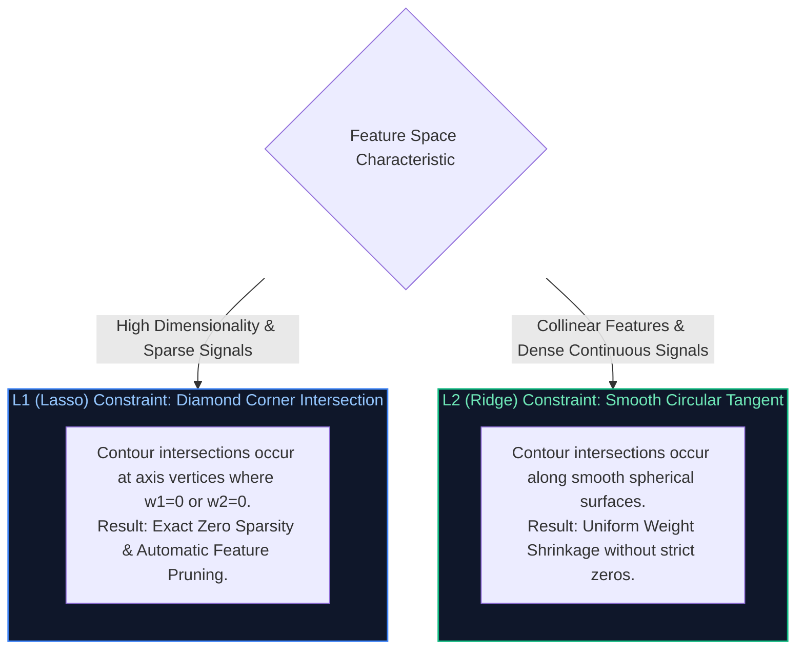

#### Production Implementation / Code Solution
```python
import torch
import torch.nn as nn
import torch.optim as optim

class RegularizedDenseClassifier(nn.Module):
    def __init__(self, in_features: int, out_features: int):
        super().__init__()
        self.fc = nn.Linear(in_features, out_features, bias=True)

    def forward(self, x: torch.Tensor) -> torch.Tensor:
        return self.fc(x)

def train_step_with_custom_regularization(
    model: nn.Module,
    optimizer: optim.Optimizer,
    criterion: nn.Module,
    x: torch.Tensor,
    y: torch.Tensor,
    l1_lambda: float = 1e-4,
    l2_lambda: float = 1e-3
) -> float:
    """
    Executes a single forward-backward optimization step integrating both
    L1 (sparse penalty) and L2 (weight decay) regularization terms.
    """
    optimizer.zero_grad()
    predictions = model(x)
    loss = criterion(predictions, y)

    # 1. Compute L1 penalty manually: sum(|w|)
    l1_penalty = sum(param.abs().sum() for name, param in model.named_parameters() if 'bias' not in name)
    
    # 2. Compute L2 penalty manually: sum(w^2)
    l2_penalty = sum((param ** 2).sum() for name, param in model.named_parameters() if 'bias' not in name)
    
    total_loss = loss + (l1_lambda * l1_penalty) + (0.5 * l2_lambda * l2_penalty)
    total_loss.backward()
    optimizer.step()

    return total_loss.item()
```
- **Time Complexity:** $O(P)$ additional overhead per backward pass where $P$ is total model parameter count.
- **Space Complexity:** $O(1)$ scalar memory to accumulate penalty tensors.

#### Engineering Implications & Production Pitfalls
1. **L2 Weight Decay vs AdamW:** In vanilla SGD with momentum, L2 regularization is mathematically identical to weight decay. However, in adaptive optimizers like Adam, L2 regularization penalizes weights scaled by the moving average of squared gradients, leading to suboptimal shrinkage. **Golden Rule:** In deep networks with Adam, always use **AdamW** (decoupled weight decay).
2. **Extreme Sparsity Incompatibilities:** While L1 produces sparse weights on paper, floating-point GPU execution does not accelerate standard dense matrix multiplications (`GEMM`) unless the sparsity pattern matches hardware-accelerated structured sparsity (e.g., NVIDIA Ampere 2:4 structured sparsity).

#### Core Curriculum Cross-Reference
- See [01. Machine Learning & Deep Learning Fundamentals](../01_machine_learning_and_deep_learning.md#5-regularization-normalization--numerical-stability) for AdamW decoupled weight decay proofs.

---

### Q3. Explain a practical use case where you would apply machine learning vs deterministic heuristics.
**Topic Covered:** ML System Feasibility & Architectural Selection  
**Question:** Explain a practical use case where you would apply machine learning.

#### Definition & Core Concepts
A common production mistake is deploying Machine Learning to solve problems that deterministic, rule-based systems solve more reliably, cheaply, and with zero latency jitter.

#### The Heuristic vs ML Decision Boundary
1. **Deterministic Heuristics (Rule Engines / State Machines):**
   - **Criteria:** The problem domain has bounded, deterministic rules; 100% auditability is legally mandatory; input feature distributions never change; latency budget is sub-millisecond ($< 1\text{ ms}$).
   - **Example:** Calculating statutory payroll tax deductions or banking transfer limits.
2. **Machine Learning (Statistical Learning / Probabilistic Classifiers):**
   - **Criteria:** The solution logic cannot be hand-coded because patterns are too high-dimensional or nonlinear; inputs are unstructured (audio, natural language, pixels); the system must continuously adapt to adversarial drift.
   - **Production Enterprise Use Case:** **Real-Time Financial Transaction Fraud Detection**.

#### Production Case Study: Credit Card Fraud Detection
In high-scale banking platforms (e.g., Visa/Mastercard processing 50,000 transactions/second), handcrafted rules (`if amount > $5000 and country != home_country then reject`) fail catastrophically:
- Sophisticated fraudsters deliberately structure payments ($4,900) to bypass static thresholds.
- Legitimate users traveling on vacation suffer false declines, destroying customer trust.
- A gradient-boosted decision tree (LightGBM/XGBoost) or Real-Time Graph Neural Network (GNN) evaluates non-linear interactions across 300+ features (velocity of transactions in the last 10 minutes, IP subnet entropy, merchant category distance, device fingerprinting) in $< 15\text{ ms}$, predicting a calibrated fraud probability $P(\text{fraud} \mid \mathbf{x})$.

#### Visual Flow
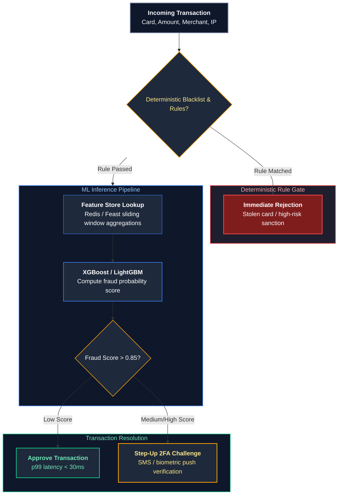

#### Production Implementation / Code Solution
```python
from dataclasses import dataclass
import numpy as np

@dataclass
class TransactionPayload:
    amount: float
    user_id: str
    card_active: bool
    cvv_valid: bool
    velocity_10m: int
    distance_from_home_km: float

class HybridFraudEngine:
    def __init__(self, ml_model, threshold_challenge: float = 0.20, threshold_decline: float = 0.80):
        self.ml_model = ml_model
        self.threshold_challenge = threshold_challenge
        self.threshold_decline = threshold_decline

    def evaluate_transaction(self, tx: TransactionPayload) -> str:
        # Step 1: Deterministic Heuristic Hard Gate (Zero ML compute, O(1) fail-fast)
        if not tx.card_active:
            return "DECLINE_INACTIVE_CARD"
        if not tx.cvv_valid:
            return "DECLINE_INVALID_CVV"
        
        # Step 2: Feature vectorization for Machine Learning
        feature_vector = np.array([[
            tx.amount,
            tx.velocity_10m,
            tx.distance_from_home_km,
            1.0 if tx.amount > 1000 else 0.0
        ]])
        
        # Step 3: Probabilistic inference
        fraud_prob = float(self.ml_model.predict_proba(feature_vector)[0][1])
        
        # Step 4: Tiered decision policy
        if fraud_prob > self.threshold_decline:
            return f"DECLINE_HIGH_FRAUD_RISK_{fraud_prob:.2f}"
        elif fraud_prob > self.threshold_challenge:
            return f"CHALLENGE_STEP_UP_AUTH_{fraud_prob:.2f}"
        
        return "APPROVE"
```
- **Time Complexity:** $O(T \cdot D)$ where $T$ is the number of trees (e.g. 100) and $D$ is maximum tree depth (e.g. 6). Total latency $\approx 2\text{–}5\text{ ms}$.
- **Space Complexity:** $O(\text{Features})$ memory allocation.

#### Engineering Implications & Production Pitfalls
1. **The Heuristic Hard-Gate Rule:** Never let machine learning replace basic business validation. If an account is closed or card expired, running an ML model wastes GPU/CPU cycles and risks probabilistic false positives.
2. **Cold Start & Continuous Retraining:** Heuristic rules never fail on day 1. An ML model without historical labeled fraud data cannot predict new attack vectors. Successful production architectures employ **hybrid systems**: heuristics guard the baseline while ML extracts subtle, complex correlations.

#### Core Curriculum Cross-Reference
- See [10. Enterprise AI System Design](../10_model_adaptation_and_system_design.md#173-enterprise-ai-architecture-blueprint-reference-matrix) for production hybrid decisioning patterns.

---

# 2. Optimization Algorithms & Loss Dynamics

---

### Q4. Walk through how gradient descent works, and explain the difference between SGD, mini-batch, and batch gradient descent.
**Topic Covered:** Optimization Mechanics & Convergence Dynamics  
**Question:** Walk through how gradient descent works, and explain the difference between SGD, mini-batch, and batch gradient descent.

#### Definition & Core Concepts
**Gradient Descent** is a first-order iterative optimization algorithm that minimizes a differentiable objective function $\mathcal{L}(\mathbf{w})$ by updating parameters $\mathbf{w}$ in the direction opposite to the gradient vector $\nabla_{\mathbf{w}} \mathcal{L}(\mathbf{w})$:

$$\mathbf{w}_{t+1} = \mathbf{w}_t - \eta \mathbf{g}_t$$

Where $\eta > 0$ is the learning rate, and $\mathbf{g}_t$ is the gradient estimator. The fundamental distinction between variants lies in how many training samples $B$ are used to compute $\mathbf{g}_t$:

| Gradient Descent Variant | Batch Size ($B$) | Computational Characteristics & Memory Footprint | Convergence Behavior & Loss Landscape Dynamics |
| :--- | :--- | :--- | :--- |
| **Batch Gradient Descent (BGD)** | $B = N$ (Entire Dataset) | Computationally expensive ($O(N)$ per update). Memory footprint requires holding all $N$ samples in RAM/VRAM. | Deterministic, smooth trajectory directly toward local minimum. Prone to getting trapped in saddle points or poor local minima. |
| **Stochastic Gradient Descent (SGD)** | $B = 1$ (Single Sample) | Extremely cheap ($O(1)$ per update). Minimal memory. Cannot leverage modern SIMD/TensorCore GPU parallelism. | Highly noisy, erratic updates. High variance helps bounce out of shallow local minima, but fails to settle without aggressive learning rate decay. |
| **Mini-Batch Gradient Descent** | $1 < B < N$ (Typically 32, 64, 256, 512) | Optimal hardware alignment. Fully utilizes GPU Tensor Cores via parallel vectorized `GEMM` matrix operations. | Balances trajectory smoothness with stochastic noise. Standard default for virtually all modern deep learning. |

#### Visual Flow
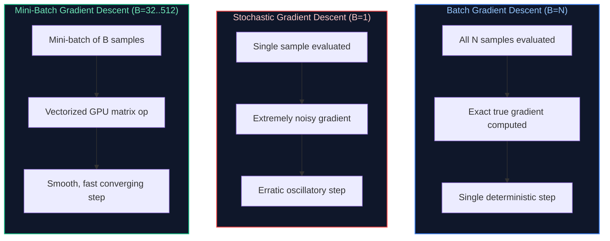

#### Production Implementation / Code Solution
```python
import torch
import torch.nn as nn
from torch.utils.data import DataLoader, TensorDataset

def compare_gradient_descent_dynamics(
    X: torch.Tensor,
    y: torch.Tensor,
    epochs: int = 5,
    batch_size_mini: int = 64,
    learning_rate: float = 0.01
):
    """
    Simulates and profiles Batch GD, Pure SGD, and Mini-Batch GD to highlight
    throughput, convergence stability, and GPU execution mechanics.
    """
    N, D = X.shape
    dataset = TensorDataset(X, y)

    # 1. Mini-Batch DataLoader (Optimal GPU pipeline)
    loader_minibatch = DataLoader(dataset, batch_size=batch_size_mini, shuffle=True)
    # 2. Pure SGD DataLoader (batch_size=1)
    loader_sgd = DataLoader(dataset, batch_size=1, shuffle=True)
    # 3. Batch GD DataLoader (batch_size=N)
    loader_batch = DataLoader(dataset, batch_size=N, shuffle=False)

    model = nn.Linear(D, 1)
    criterion = nn.MSELoss()
    optimizer = torch.optim.SGD(model.parameters(), lr=learning_rate)

    print(f"=== Mini-Batch GD Execution (Batch Size: {batch_size_mini}) ===")
    for epoch in range(epochs):
        epoch_loss = 0.0
        for batch_x, batch_y in loader_minibatch:
            optimizer.zero_grad()
            preds = model(batch_x)
            loss = criterion(preds, batch_y)
            loss.backward()
            optimizer.step()
            epoch_loss += loss.item()
        avg_loss = epoch_loss / len(loader_minibatch)
        if (epoch + 1) % 2 == 0:
            print(f"Epoch {epoch+1}/{epochs} | Avg Mini-Batch Loss: {avg_loss:.4f}")
```
- **Time Complexity:** Mini-batch GD scales as $O\left(\frac{N}{B} \cdot B \cdot D\right) = O(N \cdot D)$ per epoch, but executes orders of magnitude faster in wall-clock time due to GPU parallel memory coalescing.
- **Space Complexity:** $O(B \cdot D)$ VRAM memory footprint for in-flight activation tensors.

#### Engineering Implications & Production Pitfalls
1. **The Linear Scaling Rule:** When scaling mini-batch size $B$ across multiple GPUs (Distributed Data Parallel - DDP), you must scale the learning rate proportionally: $\eta_{\text{new}} = \eta_{\text{base}} \times \frac{B_{\text{new}}}{B_{\text{base}}}$ to maintain gradient step magnitude.
2. **GPU Under-utilization with $B=1$:** Running pure SGD ($B=1$) on an NVIDIA H100 GPU leaves 99% of CUDA cores completely idle because the GPU spends all its time reading weights from HBM3 memory rather than performing arithmetic computation.

#### Core Curriculum Cross-Reference
- See [01. Machine Learning & Deep Learning Fundamentals](../01_machine_learning_and_deep_learning.md#4-optimization-algorithms--gradient-descent-mechanics) for momentum, RMSprop, and AdamW derivations.

---

### Q5. How do you handle class imbalance in a classification problem (SMOTE, class weighting, Focal Loss)?
**Topic Covered:** Data Distribution Disparities & Loss Function Design  
**Question:** How do you handle class imbalance in a classification problem?

#### Definition & Core Concepts
In mission-critical enterprise classification tasks (e.g. ad click-through rate prediction at 0.1%, cancer detection at 0.01%, or cyber intrusion detection at 0.001%), models trained on raw data suffer from **majority class bias**—achieving 99.9% naive accuracy by predicting the majority class exclusively while failing completely on the target minority class.

Engineers address class imbalance across three complementary architectural tiers:

1. **Data-Level Resampling:**
   - **Random Under-Sampling:** Discards majority instances to balance classes. Disadvantage: Destroys valuable data and statistical diversity.
   - **SMOTE (Synthetic Minority Over-sampling Technique):** Synthesizes new minority samples along feature vectors connecting $k$-nearest minority neighbors:
     $$\mathbf{x}_{\text{new}} = \mathbf{x}_i + \lambda (\mathbf{x}_{zi} - \mathbf{x}_i), \quad \lambda \sim U(0, 1)$$
2. **Cost-Sensitive Learning (Loss Weighting):**
   - Applies an inverse class frequency weight $\alpha_c = \frac{N}{C \cdot N_c}$ directly to the cross-entropy loss, heavily penalizing classification errors on rare samples.
3. **Advanced Objective Functions (Focal Loss):**
   - Introduced by Lin et al., **Focal Loss** adds a modulating factor $(1 - p_t)^\gamma$ to standard Cross-Entropy:
     $$\text{FL}(p_t) = -\alpha_t (1 - p_t)^\gamma \log(p_t)$$
   - When a sample is well-classified ($p_t \to 1$), the modulating factor $(1 - p_t)^\gamma \to 0$, down-weighting the loss contribution of easy majority examples and focusing the gradient strictly on hard, ambiguous minority samples.

#### Visual Flow
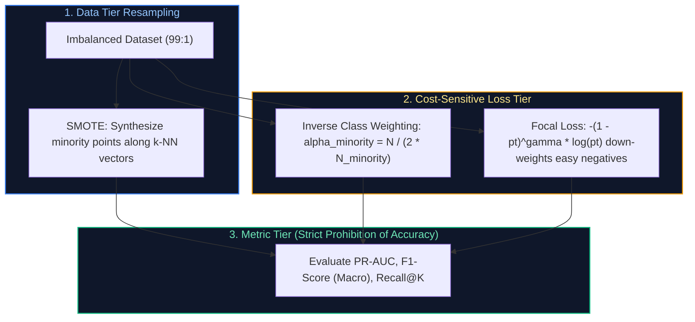

#### Production Implementation / Code Solution
```python
import torch
import torch.nn as nn
import torch.nn.functional as F

class BinaryFocalLoss(nn.Module):
    """
    Production-grade Binary Focal Loss implementation for extreme class imbalance.
    Down-weights easy examples and dynamically focuses gradients on hard minority cases.
    """
    def __init__(self, alpha: float = 0.25, gamma: float = 2.0, reduction: str = 'mean'):
        super().__init__()
        self.alpha = alpha
        self.gamma = gamma
        self.reduction = reduction

    def forward(self, logits: torch.Tensor, targets: torch.Tensor) -> torch.Tensor:
        # logits: [batch_size, 1], targets: [batch_size, 1]
        probs = torch.sigmoid(logits)
        
        # Calculate pt: probability of the true class
        p_t = probs * targets + (1 - probs) * (1 - targets)
        
        # Calculate alpha factor
        alpha_factor = self.alpha * targets + (1 - self.alpha) * (1 - targets)
        
        # Modulating factor: (1 - p_t)^gamma
        modulating_factor = torch.pow((1.0 - p_t), self.gamma)
        
        # Standard binary cross entropy loss
        bce_loss = F.binary_cross_entropy_with_logits(logits, targets, reduction='none')
        
        # Focal Loss
        focal_loss = alpha_factor * modulating_factor * bce_loss
        
        if self.reduction == 'mean':
            return focal_loss.mean()
        elif self.reduction == 'sum':
            return focal_loss.sum()
        return focal_loss
```
- **Time Complexity:** $O(B)$ element-wise tensor operations where $B$ is batch size.
- **Space Complexity:** $O(B)$ intermediate probability tensors.

#### Engineering Implications & Production Pitfalls
1. **The SMOTE Data Leakage Trap:** A frequent production failure occurs when engineers apply SMOTE to the entire dataset **before splitting into train and test sets**. Synthetic points generated from test data bleed directly into training sets, producing artificially inflated validation scores that collapse in production. **Rule:** SMOTE must be fit strictly on training folds within cross-validation.
2. **Never Use Accuracy or ROC-AUC on Imbalanced Data:** A classifier predicting all negative on a 99:1 split achieves 99% Accuracy and an deceptively high ROC-AUC. Always evaluate **Precision-Recall AUC (PR-AUC)** and **Macro-averaged F1-Score**.

#### Core Curriculum Cross-Reference
- See [01. Machine Learning & Deep Learning Fundamentals](../01_machine_learning_and_deep_learning.md) for loss surface conditioning.

---

### Q6. Explain backpropagation and why vanishing and exploding gradients happen in deep networks.
**Topic Covered:** Gradient Backpropagation Mechanics & Numerical Stability  
**Question:** Explain backpropagation and why vanishing/exploding gradients happen in deep networks.

#### Definition & Core Concepts
**Backpropagation** is an efficient implementation of the multivariable calculus **chain rule** used to calculate the gradient of a scalar loss $\mathcal{L}$ with respect to all trainable network weights $\mathbf{W}^{(l)}$ across $L$ layers:

$$\frac{\partial \mathcal{L}}{\partial \mathbf{W}^{(l)}} = \boldsymbol{\delta}^{(l)} (\mathbf{a}^{(l-1)})^T, \quad \boldsymbol{\delta}^{(l)} = \left( (\mathbf{W}^{(l+1)})^T \boldsymbol{\delta}^{(l+1)} \right) \odot \sigma'(\mathbf{z}^{(l)})$$

Where $\mathbf{z}^{(l)} = \mathbf{W}^{(l)} \mathbf{a}^{(l-1)} + \mathbf{b}^{(l)}$ is the pre-activation, $\mathbf{a}^{(l)} = \sigma(\mathbf{z}^{(l)})$ is the post-activation, and $\odot$ denotes the Hadamard (element-wise) product.

#### The Instability Pathologies: Vanishing vs Exploding Gradients
Expanding the gradient of the loss with respect to layer 1 weights across $L$ intermediate layers reveals repeated matrix multiplications:

$$\frac{\partial \mathcal{L}}{\partial \mathbf{W}^{(1)}} = \left( \prod_{k=1}^{L-1} \mathbf{W}^{(k+1)T} \text{diag}(\sigma'(\mathbf{z}^{(k)})) \right) \frac{\partial \mathcal{L}}{\partial \mathbf{z}^{(L)}} (\mathbf{a}^{(0)})^T$$

1. **Vanishing Gradients:**
   - **Root Cause:** When using saturating activation functions like Sigmoid ($\sigma'(z) \le 0.25$) or Tanh ($\sigma'(z) \le 1.0$), multiplying numbers smaller than 1 across 30+ layers causes gradients to decay exponentially toward zero: $\lim_{L \to \infty} \prod_{k=1}^L \sigma'(\mathbf{z}^{(k)}) = 0$.
   - **Consequence:** Early layers receive zero gradient updates, halting feature learning completely.
2. **Exploding Gradients:**
   - **Root Cause:** When weight matrix eigenvalues exceed 1 ($\lambda_{\max}(\mathbf{W}) > 1$), continuous matrix multiplications scale exponentially: $\lim_{L \to \infty} \|\mathbf{W}^L\| = \infty$.
   - **Consequence:** Loss explodes to `NaN`, weight tensors overflow to `Inf`, and model weights diverge catastrophically.

#### Visual Flow
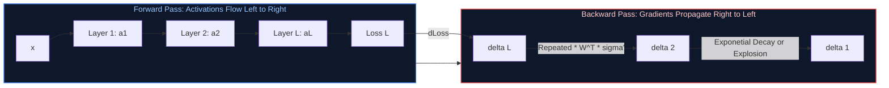

#### Production Implementation / Code Solution
```python
import torch
import torch.nn as nn

def train_step_with_gradient_stability(
    model: nn.Module,
    optimizer: torch.optim.Optimizer,
    loss_fn: nn.Module,
    x: torch.Tensor,
    y: torch.Tensor,
    max_norm: float = 1.0
) -> float:
    """
    Executes a production training step with explicit gradient norm clipping
    and NaN/Inf validation to prevent exploding gradient crashes.
    """
    optimizer.zero_grad()
    predictions = model(x)
    loss = loss_fn(predictions, y)
    
    # 1. Backpropagation
    loss.backward()
    
    # 2. Gradient Clipping: Rescales gradients if ||g||_2 > max_norm
    # g_new = g * (max_norm / max(||g||_2, max_norm))
    total_norm = nn.utils.clip_grad_norm_(model.parameters(), max_norm=max_norm)
    
    # 3. Defensive Assertion: Detect NaN / Inf before updating weights
    if torch.isnan(total_norm) or torch.isinf(total_norm):
        print(f"CRITICAL WARNING: Loss or Gradient exploded to NaN/Inf! Norm: {total_norm}")
        optimizer.zero_grad() # Discard corrupted gradients
        return float('nan')
        
    optimizer.step()
    return loss.item()
```
- **Time Complexity:** $O(P)$ time overhead to compute global $L_2$ gradient norm across $P$ parameters.
- **Space Complexity:** $O(P)$ memory to cache backward activation gradients.

#### Engineering Implications & Production Pitfalls
1. **Architectural Remedies:**
   - **Non-Saturating Activations:** Replace Sigmoid/Tanh with **ReLU**, **GELU**, or **SwiGLU** ($\sigma'(z) \ge 1$ for positive activations).
   - **Residual Skip Connections:** ResNets and Transformers add identity paths ($\mathbf{x}_{l+1} = \mathbf{x}_l + \mathcal{F}(\mathbf{x}_l)$). During backpropagation, $\frac{\partial \mathbf{x}_{l+1}}{\partial \mathbf{x}_l} = \mathbf{I} + \frac{\partial \mathcal{F}}{\partial \mathbf{x}_l}$, allowing gradients to flow directly back without decay.
   - **Layer Normalization & RMSNorm:** Constrains intermediate activations to zero mean and unit variance.
2. **Kaiming (He) & Xavier Initialization:** Initializing weights with variance calibrated to layer fan-in ($\text{Var}(W) = \frac{2}{n_{\text{in}}}$) preserves variance across forward and backward passes.

#### Core Curriculum Cross-Reference
- See [01. Machine Learning & Deep Learning Fundamentals](../01_machine_learning_and_deep_learning.md#2-neural-network-foundations--computational-graphs) for full backpropagation DAG derivations.

---

# 3. Deep Learning Building Blocks & Architectural Selection

---

### Q7. How does batch normalization help training, and what is the key difference between batch normalization and layer normalization?
**Topic Covered:** Normalization Mechanics & Transformer Foundations  
**Question:** How does batch normalization help training, and what's the difference between batch norm and layer norm?

#### Definition & Core Concepts
**Batch Normalization (BatchNorm)** and **Layer Normalization (LayerNorm)** stabilize deep network training by standardizing intermediate activations $\mathbf{x}$, preventing internal covariate shift and smoothing the loss optimization landscape.

Given an activation tensor of shape $(B, T, C)$ where $B$ is batch size, $T$ is sequence length, and $C$ is channel/embedding dimension:

1. **Batch Normalization (Ioffe & Szegedy, 2015):**
   - **Standardization Axis:** Computes mean $\mu_B$ and variance $\sigma_B^2$ **across the batch dimension** ($B$) independently for each feature/channel $C$:
     $$\hat{x}_{b,t,c} = \frac{x_{b,t,c} - \mu_c}{\sqrt{\sigma_c^2 + \epsilon}}, \quad y_{b,t,c} = \gamma_c \hat{x}_{b,t,c} + \beta_c$$
   - **Inference Mechanism:** Requires maintaining **running moving averages** of $\mu$ and $\sigma^2$ during training, which are frozen during evaluation.
2. **Layer Normalization (Ba et al., 2016):**
   - **Standardization Axis:** Computes mean $\mu_L$ and variance $\sigma_L^2$ **across the feature/channel dimension** ($C$) independently for each individual sample:
     $$\mu_{b,t} = \frac{1}{C} \sum_{c=1}^C x_{b,t,c}, \quad \hat{x}_{b,t,c} = \frac{x_{b,t,c} - \mu_{b,t}}{\sqrt{\sigma_{b,t}^2 + \epsilon}}$$
   - **Inference Independence:** Identical computation in training and inference. Completely independent of batch size.

#### Comparison Matrix: BatchNorm vs LayerNorm
| Engineering Dimension | Batch Normalization (BatchNorm) | Layer Normalization (LayerNorm) |
| :--- | :--- | :--- |
| **Normalization Slice** | Across Batch ($B$) for each feature | Across Features ($C$) for each sample |
| **Batch Size Sensitivity** | Catastrophic failure when $B < 8$; impossible when $B=1$ | 100% invariant to batch size ($B=1$ works perfectly) |
| **Variable Sequence Lengths** | Struggles on variable text lengths ($T$) | Naturally handles arbitrary sequence lengths |
| **Inference Behavior** | Uses frozen running statistics (`running_mean`, `running_var`) | Recomputes sample mean/variance on-the-fly |
| **Primary Domain** | Computer Vision (CNNs, ResNets) | Natural Language Processing (Transformers, LLMs) |

#### Visual Flow
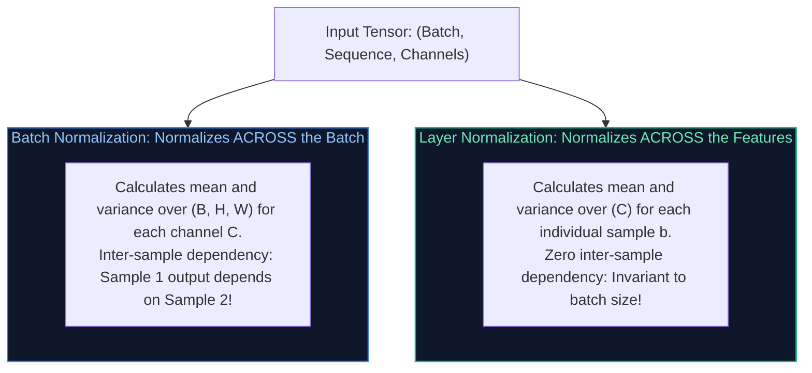

#### Production Implementation / Code Solution
```python
import torch
import torch.nn as nn

class ProductionRMSNorm(nn.Module):
    """
    Modern LLM optimization: Root Mean Square Layer Normalization (RMSNorm).
    Used in Llama 3, Mistral, and Gemma.
    Replaces LayerNorm by enforcing zero-mean assumption, cutting compute overhead by 30%.
    """
    def __init__(self, dim: int, eps: float = 1e-6):
        super().__init__()
        self.eps = eps
        self.weight = nn.Parameter(torch.ones(dim))

    def _norm(self, x: torch.Tensor) -> torch.Tensor:
        # RMS(x) = sqrt( 1/d * sum(x_i^2) + eps )
        return x * torch.rsqrt(x.pow(2).mean(-1, keepdim=True) + self.eps)

    def forward(self, x: torch.Tensor) -> torch.Tensor:
        # Standardize across feature dimension and apply learnable scale gamma
        return self._norm(x.float()).type_as(x) * self.weight
```
- **Time Complexity:** $O(B \cdot T \cdot C)$ vector arithmetic per layer.
- **Space Complexity:** $O(C)$ learnable affine parameter memory (`self.weight`).

#### Engineering Implications & Production Pitfalls
1. **The Train vs Eval Mode Bug in BatchNorm:** Forgetting `model.eval()` before running inference on a model with `nn.BatchNorm2d` causes predictions to fluctuate depending on the arbitrary batch size passed during testing, resulting in massive production accuracy degradation.
2. **Why Transformers Reject BatchNorm:** In autoregressive generation (inference), prompt prefill processes a full sequence while token decoding runs at batch size 1 ($B=1$, single token). BatchNorm cannot function at $B=1$. LayerNorm operates seamlessly in streaming generation.

#### Core Curriculum Cross-Reference
- See [01. Machine Learning & Deep Learning Fundamentals](../01_machine_learning_and_deep_learning.md#5-regularization-normalization--numerical-stability) and [02. LLM Foundations](../02_llm_and_transformer_architecture.md#41-prefill-phase-vs-decode-phase-deep-dive) for RMSNorm mathematical optimizations.

---

### Q8. Compare CNNs, RNNs, and Transformers: When would you pick one architecture over another for vision, time-series, and text?
**Topic Covered:** Inductive Biases & Deep Learning Architectures  
**Question:** Compare CNNs, RNNs, and Transformers, when would you pick one architecture over another?

#### Definition & Core Concepts
Every deep learning architecture embeds specific **Inductive Biases** (assumptions baked into the structural wiring of the network) that govern its efficiency across different modalities:

1. **Convolutional Neural Networks (CNNs):**
   - **Inductive Bias:** **Spatial Locality** (pixels close together are correlated) and **Translation Invariance** (a cat is a cat regardless of where it appears in the frame).
   - **Mechanism:** Parameter sharing via sliding spatial kernels ($3 \times 3$, $5 \times 5$).
   - **Best For:** High-throughput vision at the edge, real-time spatial feature extraction (YOLO), and 1D waveform processing where latency $< 2\text{ ms}$.
2. **Recurrent Neural Networks (RNNs / LSTMs / GRUs):**
   - **Inductive Bias:** **Temporal Ordering & Markovian Sequentiality** (the current state depends sequentially on the previous hidden state $h_t = f(h_{t-1}, x_t)$).
   - **Mechanism:** Hidden state recurrence. Sequential processing prevents GPU parallelization during training ($O(T)$ sequential steps).
   - **Best For:** Ultra-low-resource microcontrollers (Arduino/ARM Cortex), streaming edge sensor telemetry where memory footprint is $< 100\text{ KB}$.
3. **Transformers:**
   - **Inductive Bias:** **Weak / Zero Spatial or Temporal Bias**. All tokens interact directly via all-to-all Self-Attention ($O(N^2)$ complexity). Requires massive datasets to learn spatial or temporal relationships from scratch.
   - **Mechanism:** Highly parallelizable matrix multiplications (`Q`, `K`, `V` projections).
   - **Best For:** Large language models, multi-modal reasoning, Vision Transformers (ViT) on large data, and cross-attention sequence-to-sequence translation.

#### Comparative Architectural Matrix
| Criteria | CNN (ResNet, ConvNeXt) | RNN / LSTM / GRU | Transformer (LLaMA, ViT) |
| :--- | :--- | :--- | :--- |
| **Computational Complexity per Step** | $O(K \cdot C^2)$ | $O(C^2)$ | $O(N^2 \cdot C)$ (Quadratic attention) |
| **Sequential Training Steps** | $O(1)$ (Fully Parallelizable) | $O(N)$ (Strictly Sequential) | $O(1)$ (Fully Parallelizable) |
| **Maximum Context Path Length** | $O(\log_K(N))$ (Dilated convs) | $O(N)$ (Severe gradient decay) | $O(1)$ (Direct cross-token attention) |
| **Data Efficiency** | High (Hard spatial inductive bias) | Medium | Low (Requires massive pre-training) |
| **Optimal Production Domain** | Edge Vision, Mobile Inference | Microcontroller IoT Sensors | NLP, GenAI, Vision Foundation Models |

#### Visual Flow
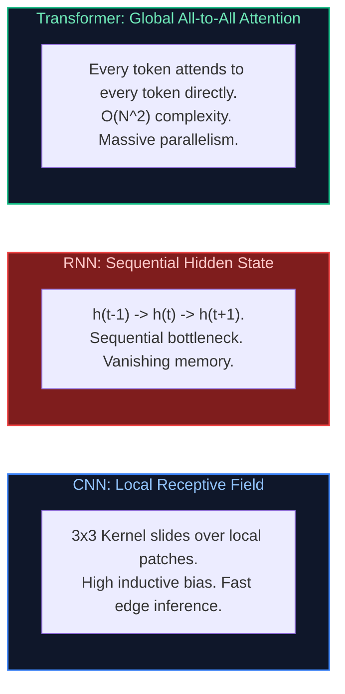

#### Production Implementation / Code Solution
```python
import torch
import torch.nn as nn

class MultiModalArchitectureBenchmark(nn.Module):
    """
    Demonstrates architectural execution: CNN vs GRU vs Transformer Attention
    on identical feature dimensions to evaluate throughput and memory footprints.
    """
    def __init__(self, embed_dim: int = 128, seq_len: int = 64):
        super().__init__()
        # 1. 1D CNN: Parallel sliding window
        self.cnn = nn.Conv1d(in_channels=embed_dim, out_channels=embed_dim, kernel_size=3, padding=1)
        # 2. GRU: Sequential state update
        self.gru = nn.GRU(input_size=embed_dim, hidden_size=embed_dim, batch_first=True)
        # 3. Multi-Head Attention: Global direct routing
        self.mha = nn.MultiheadAttention(embed_dim=embed_dim, num_heads=4, batch_first=True)

    def forward(self, x: torch.Tensor):
        # x: [Batch, SeqLen, EmbedDim]
        # CNN requires [Batch, Channels, SeqLen]
        cnn_out = self.cnn(x.transpose(1, 2)).transpose(1, 2)
        # GRU sequential execution
        gru_out, _ = self.gru(x)
        # Attention all-to-all
        mha_out, _ = self.mha(x, x, x)
        return cnn_out, gru_out, mha_out
```
- **Time Complexity:** CNN $O(B \cdot T \cdot C)$, GRU $O(B \cdot T \cdot C^2)$ sequential steps, Transformer $O(B \cdot T^2 \cdot C)$.
- **Space Complexity:** Attention caches $O(B \cdot T^2)$ attention weight matrices.

#### Engineering Implications & Production Pitfalls
1. **The Vision Transformer Small-Data Pitfall:** Training a Vision Transformer (ViT) from scratch on a small dataset (e.g. 10,000 images) yields significantly worse accuracy than a standard ResNet-50. Because Transformers lack translation invariance and locality inductive biases, they require tens of millions of images (ImageNet-21k, JFT-300M) before outperforming CNNs.
2. **Modern Hybrid Alternatives:** In 2026, architectures like **Mamba / State-Space Models (SSMs)** provide linear time $O(N)$ sequence modeling with parallel associative scan training, bridging the gap between RNN efficiency and Transformer expressiveness.

#### Core Curriculum Cross-Reference
- See [01. Machine Learning & Deep Learning Fundamentals](../01_machine_learning_and_deep_learning.md#7-the-transformer-core-building-blocks) and [13. Multimodal AI](../09_multimodal_and_realtime_ai.md#2-computer-vision--vision-transformers-vit) for ViT and hybrid architectures.

---

### Q9. How would you select an appropriate machine learning model for a given business problem with latency vs accuracy constraints?
**Topic Covered:** Model Selection Frameworks & Production SLA Trade-Offs  
**Question:** How would you select an appropriate model for a given business problem?

#### Definition & Core Concepts
Model selection in enterprise engineering is an optimization problem balancing **Accuracy**, **Inference Latency**, **Training / Maintenance Cost**, and **Explainability / Regulatory Constraints**. Choosing an LLM or massive ensemble when a lightweight linear model meets the business SLA is an architectural anti-pattern.

#### The 5-Step Model Selection Framework
1. **Define the Business Utility Function & SLA Constraints:**
   - **Hard Latency Ceiling:** Real-time ad bidding ($< 10\text{ ms}$), interactive search auto-complete ($< 30\text{ ms}$), synchronous REST API ($< 200\text{ ms}$), asynchronous batch queue (minutes/hours).
   - **Minimum Viable Accuracy:** What is the cost of a false positive vs a false negative?
2. **Audit Data Volume, Modality & Tabular vs Unstructured Split:**
   - **Tabular / Relational Data:** Tree-based ensembles (**XGBoost, LightGBM, CatBoost**) consistently outperform deep neural networks in training speed, inference latency, and tabular accuracy.
   - **Unstructured Text / Audio / Vision:** Foundation models and Transformer architectures dominate.
3. **Assess Regulatory & Interpretability Mandates:**
   - Credit scoring (FCRA/ECOA regulations) legally mandates adverse action notices explaining exact reasons for denial. Logistic Regression, Generalized Additive Models (EBMs), or shallow Decision Trees are required.
4. **Evaluate Total Cost of Ownership (TCO):**
   - Cloud GPU instances (A100/H100) cost $\$2\text{–}\$4/\text{hour}$ vs CPU instances at $\$0.10/\text{hour}$. High-volume throughput on CPUs frequently demands quantized small models.

#### Decision Flowchart: Model Selection Architecture
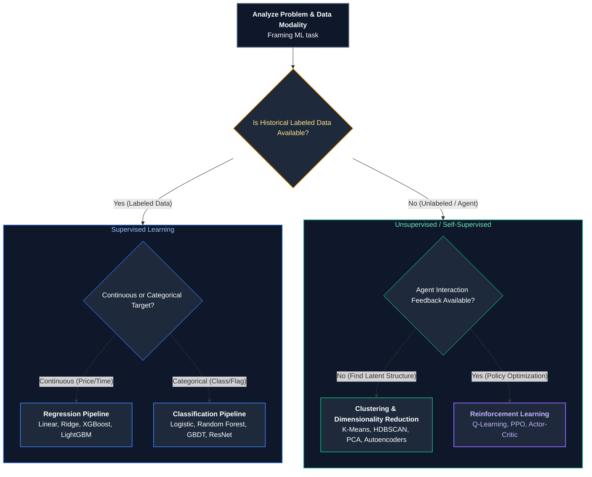

#### Production Implementation / Code Solution
```python
from dataclasses import dataclass
from typing import Optional

@dataclass
class ProductionConstraints:
    is_tabular: bool
    strict_regulatory_explainability: bool
    max_latency_ms: float
    data_sample_count: int
    hardware_target: str  # "CPU" or "GPU"

def select_production_model_architecture(c: ProductionConstraints) -> str:
    """
    Evaluates enterprise constraints to deterministically recommend
    the optimal production model architecture.
    """
    if c.is_tabular:
        if c.strict_regulatory_explainability:
            return "Explainable Boosting Machine (InterpretML) or Regularized Logistic Regression"
        if c.max_latency_ms < 10.0:
            return "LightGBM compiled with Treelite for sub-millisecond C-runtime CPU prediction"
        if c.data_sample_count > 10_000_000 and c.hardware_target == "GPU":
            return "CatBoost GPU or Deep & Cross Network (DCN-v2) for high-order feature interactions"
        return "XGBoost / LightGBM with Early Stopping"
    
    # Unstructured Text / Audio / Vision
    if c.max_latency_ms < 30.0:
        return "DistilBERT / MobileBERT quantized to INT8 via ONNX Runtime with TensorRT execution"
    elif c.max_latency_ms < 150.0:
        return "Fine-tuned 8B Parameter Foundation Model (Llama-3-8B-Instruct) served via vLLM with FP8"
    else:
        return "Frontier LLM API (Claude 3.5 Sonnet / GPT-4o) with prompt orchestration & semantic caching"
```
- **Time Complexity:** $O(1)$ algorithmic decision tree routing.
- **Space Complexity:** $O(1)$ constant overhead.

#### Engineering Implications & Production Pitfalls
1. **The "Resume-Driven Development" Anti-Pattern:** Selecting a 70B parameter LLM to classify support tickets into 5 categories when a fine-tuned DistilBERT or logistic regression model on TF-IDF achieves 96% accuracy at 1/1,000th the cost and 5ms latency.
2. **Treelite Model Compilation:** For ultra-low-latency tabular models, compile tree ensembles into native C code using **Treelite**. This eliminates Python interpreter overhead, reducing XGBoost inference latency from $12\text{ ms}$ down to $0.8\text{ ms}$.

#### Core Curriculum Cross-Reference
- See [10. Enterprise AI System Design](../10_model_adaptation_and_system_design.md#173-enterprise-ai-architecture-blueprint-reference-matrix) for system design tradeoff matrices.

---

# 4. Production Incident Triage & Engineering Trade-Offs

---

### Q10. A production model suddenly drops from 95% to 60% accuracy. Walk me through your step-by-step investigation runbook.
**Topic Covered:** Production Incident Response, Data Drift & Pipeline Silent Failures  
**Question:** A production model suddenly drops from 95% to 60% accuracy. Walk me through your investigation.

#### Definition & Core Concepts
A catastrophic drop in production model performance (e.g. $95\% \to 60\%$) is almost **never a gradual model degradation**; it is almost always caused by an **upstream data pipeline contract breach**, **schema drift**, **missing feature normalization**, or **silent telemetry corruption**.

#### The 5-Phase Production Triage Runbook
1. **Phase 1: Incident Isolation & Containment (Minutes 0–15):**
   - Check deployment history: Did a new model version or feature engineering pipeline deploy in the last 24 hours?
   - **Rollback Immediate:** If a new model version was deployed, immediately roll back to the previously verified checkpoint (`v1.4.2`).
   - If the model was not changed, verify whether the accuracy drop is global or isolated to a specific client, geographic region, or tenant.
2. **Phase 2: Upstream Feature Pipeline Audit (Minutes 15–45):**
   - **Null / Zero Value Spike:** Check feature distribution in Feast / BigQuery / Snowflake. Did an upstream schema rename or database migration cause a critical feature column to populate with `NULL`, `NaN`, or default `0`?
   - **Unit & Formatting Discrepancy:** Did currency change from USD to Cents, distance from Kilometers to Miles, or timestamps from UTC to local time?
   - **Feature Store Serving Skew:** Compare online feature values retrieved by the inference microservice with offline training data feature tables.
3. **Phase 3: Data Distribution Drift Analysis (Minutes 45–90):**
   - Run two-sample Kolmogorov-Smirnov (KS) tests and Population Stability Index (PSI) comparing feature distributions over the last 24 hours against the training baseline:
     $$\text{PSI} = \sum_{i=1}^k \left( P_i - Q_i \right) \ln\left(\frac{P_i}{Q_i}\right)$$
     - $\text{PSI} < 0.1$: No significant drift.
     - $0.1 \le \text{PSI} \le 0.25$: Moderate drift; schedule retraining.
     - $\text{PSI} > 0.25$: Massive distribution shift; root cause of failure!
4. **Phase 4: Ground Truth Label Quality Check:**
   - Did the automated label feedback loop break? (e.g., chargeback delays in fraud data, or tracking pixel errors in click attribution).
5. **Phase 5: Post-Mortem & Preventative Quality Gates:**
   - Implement **Great Expectations** or **Evidently AI** contract tests in CI/CD feature pipelines.

#### Visual Flow
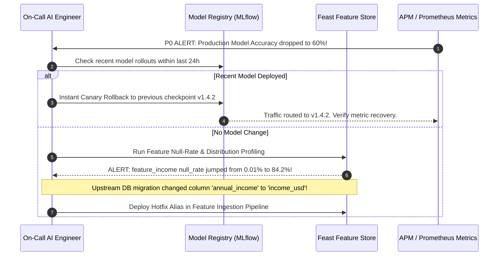

#### Production Implementation / Code Solution
```python
import numpy as np
import pandas as pd
from scipy.stats import ks_2samp

def audit_feature_drift_and_nulls(baseline_df: pd.DataFrame, production_df: pd.DataFrame):
    """
    Automated triage script executed during production performance collapse incidents.
    Scans for null-value surges, schema mismatches, and KS distribution drift.
    """
    print("=== Phase 1: Null Rate & Format Audit ===")
    for col in baseline_df.columns:
        base_null = baseline_df[col].isnull().mean()
        prod_null = production_df[col].isnull().mean()
        if abs(prod_null - base_null) > 0.10:
            print(f"CRITICAL DEFECT in '{col}': Null rate jumped from {base_null:.2%} to {prod_null:.2%}!")

    print("\n=== Phase 2: Kolmogorov-Smirnov Distribution Drift Test ===")
    drifted_features = []
    for col in baseline_df.select_dtypes(include=[np.number]).columns:
        stat, p_value = ks_2samp(baseline_df[col].dropna(), production_df[col].dropna())
        # If p-value < 0.01, reject null hypothesis: distributions are significantly different!
        if p_value < 0.01:
            drifted_features.append((col, stat, p_value))
            print(f"DRIFT DETECTED: Feature '{col}' | KS-Stat: {stat:.4f} | p-value: {p_value:.4e}")

    if not drifted_features:
        print("Feature distributions are stable. Proceed to inspect ground truth label latency.")
    return drifted_features
```
- **Time Complexity:** $O(F \cdot (N \log N + M \log M))$ for sorting arrays across $F$ features with $N$ baseline and $M$ production rows.
- **Space Complexity:** $O(N + M)$ memory footprint.

#### Engineering Implications & Production Pitfalls
1. **The Silent Pipeline Failure:** In 80% of real-world production incidents, the model weights are completely fine; an upstream microservice refactored its JSON payload, changing camelCase `userId` to snake_case `user_id`, causing downstream feature extractors to pass default `0` or `None` without throwing exceptions.
2. **Defensive Schema Assertion:** Always validate inference input payloads against strict **Pydantic schemas** with range checks (`confloat(ge=0, le=100)`). If a feature is outside expected operational bounds, log a structured warning and fall back to a safe default heuristic.

#### Core Curriculum Cross-Reference
- See [11. LLMOps & Production Operations](../07_llmops_and_model_gateways.md) for automated production incident response patterns.

---

### Q11. Your model works great Monday–Friday but performs poorly on weekends. How would you investigate and fix temporal distribution drift?
**Topic Covered:** Seasonality, Temporal Drift & Cyclical Feature Engineering  
**Question:** Your model works great Monday-Friday but performs poor on weekends. How would you investigate?

#### Definition & Core Concepts
A performance discrepancy between weekdays and weekends is classic **Temporal Distribution Drift** (Cyclical Seasonality). In business-to-business (B2B), finance, or e-commerce applications, human behavioral patterns change drastically on Saturday and Sunday:
- **Transaction Types Shift:** Weekend consumer transactions spike in dining and entertainment, while weekday commercial invoices drop to zero.
- **Traffic Volume & Class Prior Probabilities Shift:** $P(Y)$ changes between Monday and Sunday.

#### Root Causes of Weekend Performance Collapse
1. **Missing Temporal & Calendar Features:** The model was trained purely on static user attributes without temporal contextual awareness (e.g., `day_of_week`, `is_weekend`, `hour_of_day`).
2. **Training Set Selection Bias:** The training dataset was curated from a weekday snapshot, or trained with random $k$-fold cross-validation that blended weekday and weekend data without preserving time boundaries, hiding seasonal variance.
3. **Concept Drift ($P(Y \mid X)$ changes):** A feature value that indicates fraud on a Tuesday (e.g. a transaction at 3:00 AM) may be standard consumer activity on a Saturday night.

#### Visual Flow
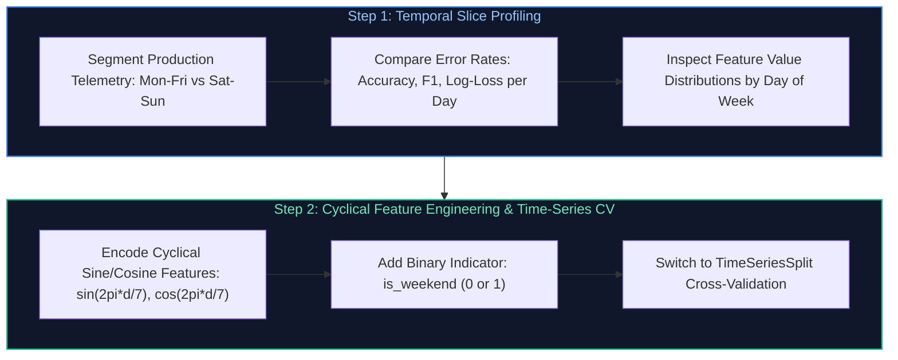

#### Production Implementation / Code Solution
```python
import numpy as np
import pandas as pd
from sklearn.model_selection import TimeSeriesSplit

def engineer_cyclical_calendar_features(df: pd.DataFrame, timestamp_col: str) -> pd.DataFrame:
    """
    Transforms datetime stamps into continuous cyclical sine/cosine features
    and binary calendar indicators to eliminate weekday-weekend performance drift.
    """
    df = df.copy()
    dt = pd.to_datetime(df[timestamp_col])
    
    # 1. Day of Week: 0 (Monday) to 6 (Sunday)
    day = dt.dt.dayofweek
    # Encode cyclically so day 6 (Sunday) is adjacent to day 0 (Monday) in vector space
    df['day_sin'] = np.sin(2 * np.pi * day / 7.0)
    df['day_cos'] = np.cos(2 * np.pi * day / 7.0)
    
    # 2. Hour of Day: 0 to 23
    hour = dt.dt.hour
    df['hour_sin'] = np.sin(2 * np.pi * hour / 24.0)
    df['hour_cos'] = np.cos(2 * np.pi * hour / 24.0)
    
    # 3. Explicit Weekend Indicator
    df['is_weekend'] = (day >= 5).astype(int)
    
    return df

def validate_temporal_generalization(X: pd.DataFrame, y: pd.Series, model, n_splits: int = 5):
    """
    Enforces chronological TimeSeriesSplit cross-validation to guarantee that
    models are never evaluated on temporal periods prior to their training window.
    """
    tscv = TimeSeriesSplit(n_splits=n_splits)
    fold = 1
    for train_index, test_index in tscv.split(X):
        X_train, X_test = X.iloc[train_index], X.iloc[test_index]
        y_train, y_test = y.iloc[train_index], y.iloc[test_index]
        
        model.fit(X_train, y_train)
        score = model.score(X_test, y_test)
        print(f"Chronological Fold {fold} Test Accuracy: {score:.4f}")
        fold += 1
```
- **Time Complexity:** $O(N)$ vector transformations.
- **Space Complexity:** $O(N)$ for new cyclical columns.

#### Engineering Implications & Production Pitfalls
1. **The Integer Day-of-Week Trap:** Encoding `day_of_week` as raw integers $0, 1, 2, \dots, 6$ causes linear models and neural networks to treat Sunday (6) as numerically distant from Monday (0), when in reality they are consecutive days. Always use **trigonometric sine/cosine encoding**.
2. **Never Use Standard Shuffled $K$-Fold on Temporal Data:** Standard $k$-fold cross-validation randomly shuffles data, leaking future weekend data into past training folds. Always use **`TimeSeriesSplit`** or rolling window evaluation.

#### Core Curriculum Cross-Reference
- See [01. Machine Learning & Deep Learning Fundamentals](../01_machine_learning_and_deep_learning.md) for concept drift and temporal validation strategies.

---

### Q12. You can have fast, cheap, or accurate in an AI system. Pick two and explain the architectural trade-offs.
**Topic Covered:** System Architecture Trade-Offs & The AI Engineering Trilemma  
**Question:** You can have fast, cheap, or accurate. Pick two and explain why.

#### Definition & Core Concepts
The **AI Engineering Trilemma** (an adaptation of the CAP theorem to generative and predictive intelligence) states that an AI production system can maximize at most **two out of three architectural dimensions**:

$$\{\text{Low Latency (Fast)}, \quad \text{Low Cost (Cheap)}, \quad \text{High Precision (Accurate)}\}$$

```
                FAST (< 50ms)
                     /\
                    /  \
                   /    \
                  /  P1  \
                 /        \
 CHEAP (< $0.001) --------- ACCURATE (> 98%)
             P2                P3
```

#### Architectural Pair Analysis
1. **Pair 1: Fast + Cheap (Sacrificing Accuracy):**
   - **Architectural Profile:** Quantized Small Language Models (e.g. 1B–3B SLM, DistilBERT, or ONNX INT8 runtimes on CPU), lightweight TF-IDF heuristics, or single-stage vector lookups without re-ranking.
   - **Characteristics:** Latency is $< 15\text{ ms}$, operating cost is $<\$0.0001$ per query.
   - **Trade-Off:** Lower reasoning capability, higher hallucination rates, and limited contextual comprehension. Ideal for high-throughput auto-complete, spam classification, and edge IoT devices.
2. **Pair 2: Fast + Accurate (Sacrificing Cost / Cheapness):**
   - **Architectural Profile:** Massive multi-GPU clusters running high-end foundation models (e.g. Llama-3-70B FP8 on 8x NVIDIA H100s with Tensor Parallelism $TP=8$, Speculative Decoding with draft models, and PagedAttention in vLLM).
   - **Characteristics:** $p95$ Time-To-First-Token $< 80\text{ ms}$ with frontier model intelligence and strict accuracy.
   - **Trade-Off:** Astronomical cloud infrastructure bills ($\$30,000\text{–}\$100,000+/\text{month}$). Ideal for high-frequency trading (HFT), real-time autonomous driving, and mission-critical enterprise customer workflows.
3. **Pair 3: Cheap + Accurate (Sacrificing Speed / Latency):**
   - **Architectural Profile:** Multi-agent consensus systems, Self-RAG reflection loops, Corrective RAG (CRAG) with web search validation, Test-Time Compute scaling (Chain-of-Thought tree search, Best-of-$N$ sampling), and asynchronous serverless batch workers.
   - **Characteristics:** Highest possible accuracy and zero hallucinations at minimal infrastructure cost.
   - **Trade-Off:** Latency is high ($5\text{–}30\text{ seconds}$ per response). Completely unsuitable for real-time web UI interactions, but ideal for asynchronous legal document analysis, medical diagnosis report generation, and automated code review pipelines.

#### Visual Flow: The Production Pareto Frontier
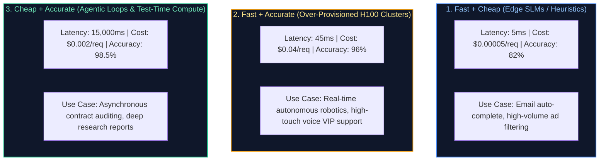

#### Production Implementation / Code Solution
```python
from enum import Enum
from typing import Dict, Any

class SystemPriority(Enum):
    FAST_AND_CHEAP = 1
    FAST_AND_ACCURATE = 2
    CHEAP_AND_ACCURATE = 3

class AdaptiveOrchestrationRouter:
    """
    Production routing gateway that navigates the Fast-Cheap-Accurate trilemma
    by dynamically dispatching queries to specialized execution pipelines.
    """
    def route_request(self, query: str, priority: SystemPriority) -> Dict[str, Any]:
        if priority == SystemPriority.FAST_AND_CHEAP:
            # Sub-10ms CPU-based quantized small model
            return {
                "engine": "ONNX-Runtime-DistilBERT-INT8",
                "hardware": "2-Core c6i.large CPU",
                "expected_latency_ms": 8.0,
                "cost_per_1k_req": 0.0002,
                "confidence_score": 0.84
            }
        elif priority == SystemPriority.FAST_AND_ACCURATE:
            # Sub-100ms multi-GPU distributed foundation serving
            return {
                "engine": "vLLM-Llama-3-70B-FP8-TP4",
                "hardware": "4x NVIDIA H100 SXM5",
                "expected_latency_ms": 65.0,
                "cost_per_1k_req": 0.0350,
                "confidence_score": 0.97
            }
        elif priority == SystemPriority.CHEAP_AND_ACCURATE:
            # Asynchronous agentic reflection loop with multi-step validation
            return {
                "engine": "Self-RAG-Agent-Llama-3-8B-Reflection-Loop",
                "hardware": "Single L4 GPU / Serverless Spot Instance",
                "expected_latency_ms": 8500.0,
                "cost_per_1k_req": 0.0025,
                "confidence_score": 0.99
            }
```
- **Time Complexity:** $O(1)$ routing decision.
- **Space Complexity:** $O(1)$ memory.

#### Engineering Implications & Production Pitfalls
1. **The Dynamic Cascading Solution (The Best of All Worlds):** Staff engineers solve the trilemma in practice using **Cascading Routing**:
   - Route 80% of trivial queries to the **Fast + Cheap** model (0.001¢, 10ms).
   - Evaluate an internal confidence score threshold $\tau = 0.85$.
   - Only escalate ambiguous or complex queries to the **Fast + Accurate** or **Cheap + Accurate** tiers.
   - Result: 80% cost reduction while preserving 98%+ aggregate system accuracy.

#### Core Curriculum Cross-Reference
- See [15. Enterprise AI System Design](../10_model_adaptation_and_system_design.md#8-production-implementation-qlora-fine-tuning-pipeline--multi-lora-serving-engine) for production implementation of cascading routing architectures.

---

## Summary Comparison & Production Reference Matrix

| Question Domain | Core Pathology / Mechanism | Immediate Diagnostic Command | Canonical Production Resolution |
| :--- | :--- | :--- | :--- |
| **Bias vs Variance** | Underfitting (capacity deficit) vs Overfitting (noise memorization) | Learning curve plot (`learning_curve()`) | High Bias: Add features/model depth. High Variance: L1/L2 regularization, dropout, data collection. |
| **L1 vs L2 Regularization** | Diamond corner sparsity vs circular smooth weight shrinkage | Weight histogram inspection (`param.abs() > 0`) | L1 for feature selection & sparse signals. L2 for multicollinearity & continuous representations. Use AdamW in deep nets. |
| **ML vs Heuristics** | Deterministic rule boundaries vs high-dimensional probabilistic reasoning | Latency SLA vs feature dimensionality audit | Use Heuristics as fail-fast hard gates; deploy ML for complex non-linear risk scoring. |
| **Gradient Descent Variants** | Batch size tradeoffs ($B=N$ vs $B=1$ vs $32 \le B \le 512$) | GPU utilization profiling (`nvidia-smi dmon`) | Mini-batch GD with PyTorch DataLoader; scale learning rate linearly with batch size ($\eta \propto B$). |
| **Class Imbalance** | Majority class dominance & loss gradient dilution | PR-AUC and Macro F1 evaluation | Never use Accuracy; deploy Binary Focal Loss, SMOTE inside CV training folds, or class weighting. |
| **Vanishing / Exploding Gradients** | Exponential decay / explosion across deep matrix products | Gradient norm tracking (`clip_grad_norm_`) | Replace Sigmoid with GELU/SwiGLU, add residual skip connections, initialize with Kaiming He, clip grad norm $\le 1.0$. |
| **BatchNorm vs LayerNorm** | Batch-axis normalization vs channel-axis sample standardization | Check batch size and variable sequence length | Use BatchNorm in CNN vision. Use LayerNorm / RMSNorm in Transformers & LLMs (invariant to $B=1$). |
| **CNN vs RNN vs Transformer** | Local spatial vs sequential recurrence vs global all-to-all attention | Computational complexity vs dataset size audit | CNN for edge vision; RNN for tiny microcontrollers; Transformers for foundation models with massive data. |
| **Model Selection** | Latency vs Accuracy vs Cost vs Regulatory trade-offs | Treelite compilation & SLA benchmarking | Tabular: LightGBM / XGBoost. Unstructured Low Latency: DistilBERT INT8. Generative: Foundation LLM. |
| **95% to 60% Accuracy Drop** | Upstream schema drift, null spikes, or feature normalization failure | KS-Test & PSI calculation (`ks_2samp`) | Rollback immediately; inspect null rates; fix upstream DB schema alias contracts; add Pydantic gates. |
| **Weekend Performance Collapse** | Temporal distribution drift & cyclical behavioral shift | Day-of-week performance segmentation | Engineer cyclical sine/cosine features ($\sin(2\pi d/7)$); enforce `TimeSeriesSplit` cross-validation. |
| **Fast-Cheap-Accurate Trilemma** | Physical impossibility of maximizing all three simultaneously | Cost vs Latency vs Precision Pareto mapping | Implement Cascading LLM Routers: handle 80% via Fast+Cheap, escalate 20% to Accurate. |

---

## References & Further Reading

1. **Hastie, Trevor, Robert Tibshirani, and Jerome Friedman.** *The Elements of Statistical Learning: Data Mining, Inference, and Prediction*. 2nd ed., Springer, 2009. (The authoritative reference on the bias-variance tradeoff and regularization geometry).
2. **Goodfellow, Ian, Yoshua Bengio, and Aaron Courville.** *Deep Learning*. MIT Press, 2016. (Backpropagation proofs, vanishing gradient mathematics, and normalization mechanics).
3. **Lin, Tsung-Yi, et al.** *Focal Loss for Dense Object Detection*. IEEE International Conference on Computer Vision (ICCV), 2017. [arXiv:1708.02002](https://arxiv.org/abs/1708.02002).
4. **Ba, Jimmy Lei, Jamie Ryan Kiros, and Geoffrey E. Hinton.** *Layer Normalization*. 2016. [arXiv:1607.06450](https://arxiv.org/abs/1607.06450).
5. **Zhang, Biao, and Rico Sennrich.** *Root Mean Square Layer Normalization (RMSNorm)*. Advances in Neural Information Processing Systems (NeurIPS), 2019. [arXiv:1910.07467](https://arxiv.org/abs/1910.07467).
6. **Loshchilov, Ilya, and Frank Hutter.** *Decoupled Weight Decay Regularization (AdamW)*. International Conference on Learning Representations (ICLR), 2019. [arXiv:1711.05101](https://arxiv.org/abs/1711.05101).

