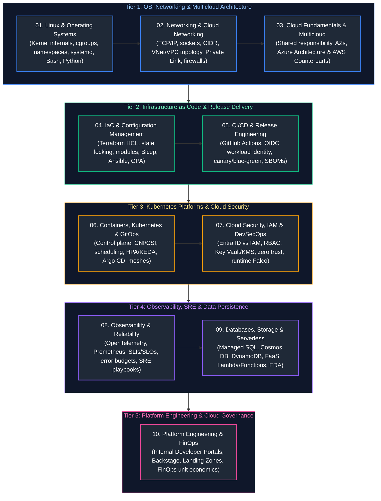

# 00. Cloud Engineering Master Curriculum & Comprehensive Study Guide

This master curriculum guide provides the authoritative, production-grade learning roadmap, conceptual index, and chronological reading order for modern Cloud & Infrastructure Engineering. The curriculum is concept-focused and systems-first, spanning Linux kernel subsystems, low-level OS internals, TCP/IP networking, cloud infrastructure paradigms (with Microsoft Azure as the primary reference architecture and AWS as the equivalent counterpart), software-defined cloud networking, Infrastructure as Code (Terraform, Bicep, Ansible), enterprise CI/CD release engineering, advanced Kubernetes orchestration and GitOps, cloud security and DevSecOps, full-stack observability (OpenTelemetry, Prometheus, Grafana), Site Reliability Engineering (SRE), distributed databases and event streaming, serverless cloud-native design, internal developer platforms (IDP / Platform Engineering), and FinOps cloud financial governance.

Every guide includes formal architectural definitions, Mermaid dark-mode topological diagrams, runtime mechanics, production code and IaC implementations with detailed line-by-line commentary, edge-case mitigation, and production troubleshooting playbooks.

---

## 5-Tier Chronological Mermaid Study Roadmap

---

## Master Topic Guides & Curriculum Coverage Overview

| Study Order | Guide File | Conceptual Domain | Key Architectural Topics & Implementations Covered |
| :---: | :--- | :--- | :--- |
| **01** | [`01_linux_systems_and_scripting.md`](01_linux_systems_and_scripting.md) | **OS Internals & Scripting** | Linux kernel architecture, VFS, inodes, file permissions, process states, signals (`SIGTERM`/`SIGKILL`), systemd service units, CPU scheduling (`CFS`), memory management, cgroups v2, Linux namespaces, TCP/IP troubleshooting (`ss`, `tcpdump`), and defensive scripting. |
| **02** | [`02_networking_and_cloud_connectivity.md`](02_networking_and_cloud_connectivity.md) | **Computer & Cloud Networking** | OSI vs. TCP/IP model, TCP 3-way handshake, TLS 1.3 cryptographic handshake, IPv4 CIDR subnetting, DNS resolution, Linux routing tables, enterprise VNet/VPC topology, Private Link, UDRs, NAT Gateways, firewalls, and ExpressRoute/Direct Connect. |
| **03** | [`03_cloud_foundations_and_multicloud.md`](03_cloud_foundations_and_multicloud.md) | **Cloud Architecture & Multicloud** | Cloud delivery models (IaaS, PaaS, SaaS, FaaS), shared responsibility model, control plane vs data plane isolation, Well-Architected Framework, Azure resource hierarchy, compute virtualization (Nitro/Boost), and core AWS service equivalents. |
| **04** | [`04_infrastructure_as_code.md`](04_infrastructure_as_code.md) | **IaC & Config Management** | Declarative infrastructure with Terraform/OpenTofu, HCL syntax, remote state backends with distributed locking, reusable modules, automated drift detection, security scanning (checkov), Azure Bicep native DSL, Ansible playbooks, and Policy as Code (OPA). |
| **05** | [`05_cicd_and_release_engineering.md`](05_cicd_and_release_engineering.md) | **CI/CD & Delivery Engineering** | Modern continuous delivery pipelines, GitHub Actions workflows, Azure DevOps Pipelines, OIDC Workload Identity Federation (keyless auth), multi-stage Docker builds, build caching, artifact registries, progressive delivery (blue-green, canary), and SBOM generation. |
| **06** | [`06_containers_kubernetes_and_gitops.md`](06_containers_kubernetes_and_gitops.md) | **Kubernetes & GitOps** | Kubernetes internals: API server, etcd Raft consensus, kube-scheduler, kubelet, CNI networking, CSI volume provisioning, Pod scheduling, affinity, taints/tolerations, HPA, KEDA autoscaling, NetworkPolicy, Gateway API, and Argo CD GitOps pipelines. |
| **07** | [`07_cloud_security_iam_and_devsecops.md`](07_cloud_security_iam_and_devsecops.md) | **Cloud Security & DevSecOps** | Identity architecture: Microsoft Entra ID vs. AWS IAM, principle of least privilege, Azure RBAC roles vs IAM policies, managed identities, Key Vault/KMS envelope encryption, TLS automation, Azure Policy vs SCPs, CSPM, and container runtime security with Falco. |
| **08** | [`08_observability_and_reliability.md`](08_observability_and_reliability.md) | **Observability & SRE Protocols** | Telemetry pillars (Metrics, Logs, Traces), RED/USE diagnostic methods, Google SRE Four Golden Signals, OpenTelemetry Collector pipelines, Prometheus PromQL, Grafana, SLI/SLO/SLA mathematical definitions, error budgets, and incident triage runbooks. |
| **09** | [`09_cloud_databases_and_storage.md`](09_cloud_databases_and_storage.md) | **Databases, Storage & Serverless** | Managed relational systems (Azure SQL, Aurora), globally distributed NoSQL (Cosmos DB, DynamoDB), block vs object storage, Redis caching, enterprise messaging (Service Bus, SQS), CAP/PACELC trade-offs, and serverless compute (Azure Functions, AWS Lambda microVMs). |
| **10** | [`10_platform_engineering_and_finops.md`](10_platform_engineering_and_finops.md) | **Platform Engineering & FinOps** | Internal Developer Platforms (IDP, Spotify Backstage), golden paths, Crossplane control planes, admission control with Kyverno, FinOps lifecycle (Inform, Optimize, Operate), cloud landing zones, cost-allocation tagging, Spot instances, and unit economics. |

---

## Production Problem-Solution Cross-Reference Index (50 Canonical Failures)

The table below maps the **50 canonical Cloud, Infrastructure, Kubernetes, Networking, and SRE production failures** directly to their architectural solutions and corresponding curriculum chapters.

| Problem | Canonical Solution | Module Reference |
| :--- | :--- | :--- |
| **Linux Kernel Out-Of-Memory (OOM) Panic** | Set `vm.panic_on_oom=0`, tune `oom_score_adj`, and enforce cgroups v2 `memory.max` hard caps | [`01_linux_systems_and_scripting.md`](01_linux_systems_and_scripting.md#13-cpu-memory-and-io-resource-management) |
| **Exhausted Linux File Descriptors (`Too many open files`)** | Elevate `fs.file-max` in `/etc/sysctl.conf` and configure systemd `LimitNOFILE=65536` | [`01_linux_systems_and_scripting.md`](01_linux_systems_and_scripting.md#1-linux-filesystem-internals-permissions-and-vfs) |
| **Zombie Process Saturation** | Configure container init system (e.g. `tini` / dumb-init) to adopt and reap orphan processes via `waitpid()` | [`01_linux_systems_and_scripting.md`](01_linux_systems_and_scripting.md#7-processes-threads-signals-and-systemd-internals) |
| **Subnet IP Exhaustion in Cloud VNet/VPC** | Adopt non-contiguous secondary IPv4 CIDR blocks and transition pod networking to overlay CNI / IPv6 | [`02_networking_and_cloud_connectivity.md`](02_networking_and_cloud_connectivity.md#3-ip-addressing-cidr-subnet-math-and-ipv6) [`02_networking_and_cloud_connectivity.md`](02_networking_and_cloud_connectivity.md#11-enterprise-cloud-network-architecture--cidr-planning) |
| **DNS Resolution Timeout / Throttling** | Deploy local CoreDNS node-caching (`NodeLocal DNSCache`) and implement DNS search path truncation | [`02_networking_and_cloud_connectivity.md`](02_networking_and_cloud_connectivity.md#4-dns-architecture-resolution-internals-and-records) [`06_containers_kubernetes_and_gitops.md`](06_containers_kubernetes_and_gitops.md#10-kubernetes-networking-cni-plugins-and-gateway-api) |
| **MTU Black Hole / Packet Fragmentation** | Enable Path MTU Discovery (PMTUD) and clamp TCP MSS (`iptables -A FORWARD -p tcp --tcp-flags SYN,RST SYN -j TCPMSS --clamp-mss-to-pmtu`) | [`02_networking_and_cloud_connectivity.md`](02_networking_and_cloud_connectivity.md#10-senior-sre-network-troubleshooting-runbooks) |
| **Cross-Availability Zone Latency Spikes** | Implement topology-aware traffic routing and co-locate chattier microservice tiers within the same AZ | [`03_cloud_foundations_and_multicloud.md`](03_cloud_foundations_and_multicloud.md#3-physical-topologies-regions-availability-zones-and-fault-domains) [`06_containers_kubernetes_and_gitops.md`](06_containers_kubernetes_and_gitops.md#83-taints-tolerations-node-affinity-and-topology-spread-constraints) |
| **Cloud Service Quota / Rate Limit Reached** | Submit proactive quota increases and distribute requests across multiple subscriptions or accounts | [`03_cloud_foundations_and_multicloud.md`](03_cloud_foundations_and_multicloud.md#6-enterprise-resource-governance-quotas-and-api-throttling) |
| **Split-Brain in Multi-Region Failover** | Implement an automated quorum-based health probe with an authoritative global arbiter (e.g., Azure Traffic Manager / Route 53 ARC) | [`03_cloud_foundations_and_multicloud.md`](03_cloud_foundations_and_multicloud.md#7-high-availability-ha-vs-disaster-recovery-dr) |
| **Asymmetric Routing over ExpressRoute/Direct Connect** | Configure BGP Local Preference on inbound routes and AS-Path Prepending on outbound backup routes | [`02_networking_and_cloud_connectivity.md`](02_networking_and_cloud_connectivity.md#17-hybrid-cloud-backbones-expressroute-and-direct-connect) |
| **Transitive VNet Peering Routing Failure** | Deploy Azure Virtual WAN or centralized Azure Route Server / Transit Gateway with UDR propagations | [`02_networking_and_cloud_connectivity.md`](02_networking_and_cloud_connectivity.md#16-hub-and-spoke-topology-vs-scaled-transit-fabrics) |
| **Public Internet Exposure of PaaS Databases** | Implement Private Endpoints / AWS PrivateLink and disable public network access flags on database resources | [`02_networking_and_cloud_connectivity.md`](02_networking_and_cloud_connectivity.md#15-private-link-and-private-endpoints) |
| **Outbound SNAT Port Exhaustion** | Deploy managed NAT Gateway with multiple public IPs to expand ephemeral SNAT port allocations | [`02_networking_and_cloud_connectivity.md`](02_networking_and_cloud_connectivity.md#13-route-tables-gateways-and-traffic-redirection) |
| **Terraform State Lock Deadlock** | Inspect active lock ID in Azure Blob / DynamoDB and execute controlled `terraform force-unlock <LOCK-ID>` | [`04_infrastructure_as_code.md`](04_infrastructure_as_code.md#8-remote-state-management-distributed-locking--state-surgery) |
| **Silent Terraform Configuration Drift** | Schedule scheduled CI/CD pipeline running `terraform plan -detailed-exitcode` with alert webhooks | [`04_infrastructure_as_code.md`](04_infrastructure_as_code.md#10-drift-detection-alerting--reconciliation-automation) |
| **IaC Security Misconfiguration Leaks** | Enforce pre-commit and CI pull request scanning gates using `checkov` and `tfsec` SARIF reporting | [`04_infrastructure_as_code.md`](04_infrastructure_as_code.md#11-shift-left-security-static-analysis--policy-as-code) |
| **Hardcoded Cloud Secrets in CI/CD Runners** | Migrate to OpenID Connect (OIDC) Workload Identity Federation with short-lived STS tokens | [`05_cicd_and_release_engineering.md`](05_cicd_and_release_engineering.md#4-workload-identity-federation-keyless-oidc-cloud-authentication) |
| **Container Build Cache Invalidation in CI** | Structure Dockerfiles with ordered layer caching (`COPY package.json` before code) and use GitHub Actions cache backend | [`05_cicd_and_release_engineering.md`](05_cicd_and_release_engineering.md#3-container-image-builds--artifact-registry-engineering) |
| **Production Rollback Failure from Broken DB Schema** | Adopt the Expand and Contract (Parallel Run) schema migration pattern using Flyway / Liquibase | [`05_cicd_and_release_engineering.md`](05_cicd_and_release_engineering.md#7-zero-downtime-database-migrations-the-expand-and-contract-pattern) |
| **Malicious Tampering in CI Container Supply Chain** | Sign container images with Sigstore Cosign and verify cryptographic provenance in Kubernetes via Kyverno | [`05_cicd_and_release_engineering.md`](05_cicd_and_release_engineering.md#8-software-supply-chain-security-slsa--container-signing) |
| **Kubernetes `CrashLoopBackOff` on Container Startup** | Check liveness probe initial delays (`initialDelaySeconds`), inspect `kubectl logs --previous`, and audit entrypoint | [`06_containers_kubernetes_and_gitops.md`](06_containers_kubernetes_and_gitops.md#14-senior-sre-kubernetes-troubleshooting-runbooks) |
| **Kubernetes Pod CPU Throttling Despite Low Usage** | Remove CFS CPU limits while keeping CPU requests accurate, or switch to proportional scheduling | [`06_containers_kubernetes_and_gitops.md`](06_containers_kubernetes_and_gitops.md#83-taints-tolerations-node-affinity-and-topology-spread-constraints) |
| **etcd Cluster Leader Election Delays & High Fsync** | Migrate etcd to ultra-low latency NVMe disks and isolate etcd nodes from noisy neighbor workloads | [`06_containers_kubernetes_and_gitops.md`](06_containers_kubernetes_and_gitops.md#2-kubernetes-control-plane-internals--etcd-mechanics) |
| **Horizontal Pod Autoscaler Metric Lag** | Deploy KEDA to scale directly on external queue depths (Service Bus / SQS) rather than lagging CPU metrics | [`06_containers_kubernetes_and_gitops.md`](06_containers_kubernetes_and_gitops.md#93-autoscaling-fleets-hpa-vpa-and-event-driven-keda) |
| **GitOps Sync Loop Conflict / Drift Storm** | Configure Argo CD ignore differences on dynamically mutated fields (e.g., HPA replica count) | [`06_containers_kubernetes_and_gitops.md`](06_containers_kubernetes_and_gitops.md#13-gitops-continuous-delivery-with-argo-cd) |
| **Over-Privileged Cloud IAM Roles** | Run Azure Access Review / AWS IAM Access Advisor to discover unused permissions and enforce least privilege | [`07_cloud_security_iam_and_devsecops.md`](07_cloud_security_iam_and_devsecops.md#2-cloud-identity--access-management-entra-id-vs-aws-iam) |
| **Compromised Long-Lived Service Principal Key** | Immediately revoke credentials, roll application registration keys, and migrate to Managed Identities | [`07_cloud_security_iam_and_devsecops.md`](07_cloud_security_iam_and_devsecops.md#3-managed-identities--workload-identity-federation-oidc) |
| **Unencrypted Cloud Storage Bucket Data** | Enforce organization-wide Azure Policy / AWS SCP requiring default SSE-KMS / customer-managed keys (CMEK) | [`07_cloud_security_iam_and_devsecops.md`](07_cloud_security_iam_and_devsecops.md#8-cryptographic-engineering-kms--envelope-encryption) |
| **Zero-Day Vulnerability in Running Pod** | Deploy Falco daemonset with eBPF probes to detect abnormal syscalls and trigger automated pod quarantine | [`07_cloud_security_iam_and_devsecops.md`](07_cloud_security_iam_and_devsecops.md#10-container--kubernetes-runtime-security-falco-and-ebpf) |
| **High Metric Cardinality OOM in Prometheus** | Drop high-cardinality labels (e.g. `user_id`, `ip_address`) in `metric_relabel_configs` before ingestion | [`08_observability_and_reliability.md`](08_observability_and_reliability.md#3-prometheus-tsdb-storage-architecture--promql-mastery) |
| **Distributed Trace Disconnection across Services** | Standardize on W3C `traceparent` HTTP header injection and extraction across all API client middlewares | [`08_observability_and_reliability.md`](08_observability_and_reliability.md#9-distributed-tracing-and-context-propagation-mechanics) |
| **Log Ingestion Cost Explosion** | Implement log level filtering at OpenTelemetry / Fluent Bit collectors and route raw debug logs to cold Blob storage | [`08_observability_and_reliability.md`](08_observability_and_reliability.md#10-centralized-logging-architecture-loki-vs-opensearch) |
| **Alert Fatigue from Flapping Monitors** | Implement multi-window multi-burn-rate SLO alert rules and enforce minimum sustain intervals | [`08_observability_and_reliability.md`](08_observability_and_reliability.md#11-alerting-strategy-multi-window-multi-burn-rate-slo-alerts) |
| **Cascading Microservice Failure Under Load** | Implement client-side circuit breakers (Resilience4j / Envoy) and server-side rate-limiting load shedding | [`08_observability_and_reliability.md`](08_observability_and_reliability.md#23-distributed-systems-resilience-patterns) |
| **Retry Storm Overwhelming Degraded Backend** | Implement exponential backoff with full jitter to decorrelate client retry arrival times | [`08_observability_and_reliability.md`](08_observability_and_reliability.md#23-distributed-systems-resilience-patterns) |
| **Production Deploy Violating Error Budget** | Enforce automated CI/CD deployment freezes when 30-day rolling SLO error budget drops below 0% | [`08_observability_and_reliability.md`](08_observability_and_reliability.md#15-sli-slo-and-error-budget-mathematical-foundations) |
| **Database Connection Pool Starvation** | Deploy PgBouncer / AWS RDS Proxy to multiplex database client connections into a compact pool | [`09_cloud_databases_and_storage.md`](09_cloud_databases_and_storage.md#2-cloud-relational-database-architecture-azure-sql-postgresql--aurora) |
| **DynamoDB / Cosmos DB Hot Partition Throttling** | Prepend synthetic random hash salts to high-cardinality partition keys to uniformly distribute throughput | [`09_cloud_databases_and_storage.md`](09_cloud_databases_and_storage.md#3-globally-distributed-nosql-architecture-cosmos-db-and-dynamodb) |
| **Redis Cache Stampede (Thundering Herd)** | Implement mutual exclusion locking (mutex) on cache misses or adopt probabilistic early expiration (XFetch) | [`09_cloud_databases_and_storage.md`](09_cloud_databases_and_storage.md#4-distributed-in-memory-caching-with-redis) |
| **Duplicate Consumer Processing in Message Queues** | Implement idempotent consumers using Redis distributed locks and unique message business transaction keys | [`09_cloud_databases_and_storage.md`](09_cloud_databases_and_storage.md#5-enterprise-messaging--distributed-event-streaming) |
| **Serverless Cold Start Latency Spike** | Configure Provisioned Concurrency / Always-On instances and trim runtime dependencies/package sizes | [`09_cloud_databases_and_storage.md`](09_cloud_databases_and_storage.md#152-cold-start-physics-phases-of-execution-and-root-causes) |
| **Cloud Function Timeout on Long Processing** | Refactor synchronous HTTP functions into asynchronous event pipelines using queues and orchestrators (Step Functions / Durable Functions) | [`09_cloud_databases_and_storage.md`](09_cloud_databases_and_storage.md#18-distributed-workflow-orchestration-durable-functions--aws-step-functions) |
| **Serverless Workload Exhausting Downstream DB Connections**| Constrain function maximum concurrent instances and route queries through connection poolers | [`09_cloud_databases_and_storage.md`](09_cloud_databases_and_storage.md#231-scenario-1-uncontrolled-autoscaling-crashing-downstream-relational-databases) |
| **Multi-Tenant Namespace Resource Hoarding in K8s** | Enforce Kubernetes `ResourceQuota` and `LimitRange` per tenant namespace | [`10_platform_engineering_and_finops.md`](10_platform_engineering_and_finops.md#7-kubernetes-multi-tenancy--platform-abstractions) |
| **Drift Between Cloud Resources and Git in Crossplane** | Set continuous reconciliation intervals on Composite Resource Definitions (XRDs) with alerting webhooks | [`10_platform_engineering_and_finops.md`](10_platform_engineering_and_finops.md#6-infrastructure-control-planes-with-crossplane) |
| **Slow Developer Onboarding & Service Proliferation** | Publish Backstage Software Templates with built-in CI/CD, linting, security, and infrastructure pipelines | [`10_platform_engineering_and_finops.md`](10_platform_engineering_and_finops.md#2-internal-developer-portals-spotify-backstage-architecture) |
| **Unattached Orphaned Cloud Storage Disks** | Run automated cron jobs using Azure CLI / AWS CLI to identify and delete unattached disks after retention periods | [`10_platform_engineering_and_finops.md`](10_platform_engineering_and_finops.md#24-production-code-implementation-automated-cloud-waste--zombie-asset-auditor) |
| **Runaway Cloud NAT Gateway Egress Costs** | Route traffic to AWS/Azure services internally via VPC/VNet Gateway Endpoints to bypass NAT Gateways | [`10_platform_engineering_and_finops.md`](10_platform_engineering_and_finops.md#18-network-egress-and-data-transfer-economics) |
| **Spot Instance Termination Causing Workload Outage** | Intercept 2-minute Spot Interruption notices and configure graceful pod draining with Karpenter / PDBs | [`10_platform_engineering_and_finops.md`](10_platform_engineering_and_finops.md#173-spot-instances--spot-vms-auction-physics--graceful-imds-drain-handling) |
| **Untagged Cloud Resource Cost Attribution Blackhole** | Implement automated Azure Policy / AWS Config rules that deny creation of untagged resources | [`10_platform_engineering_and_finops.md`](10_platform_engineering_and_finops.md#152-mandatory-cost-allocation-tagging-governance-via-policy-as-code) |

---

## Foundational Cross-Discipline Integration Links

Cloud Engineering provides the foundational platform, networking, compute runtime, and security guardrails for distributed data platforms, modern microservices, and AI training/inference infrastructure. Refer to the companion guides across sibling tracks:

- [Linux & Python Foundations for Data Engineering](../../Data%20Engineering/02_python_for_data_engineering.md) — Asynchronous I/O, process management, and high-performance scripting.
- [Database Internals & Storage Engines](../../Data%20Engineering/04_database_internals_and_distributed_systems.md) — B+ Trees, LSM-Trees, storage layouts, and transaction locks.
- [Distributed Systems & Network APIs](../../Data%20Engineering/04_database_internals_and_distributed_systems.md) — CAP theorem, consensus protocols, and rate limiting.
- [Azure Data Engineering & DevOps Pipelines](../../Data%20Engineering/09_etl_pipelines_and_orchestration.md) — Azure Data Factory, Synapse, Databricks, and CI/CD pipelines.
- [Cloud Native, Containers & DevOps for Java](../../Java%20Backend%20Engineering/10_cloud_devops_and_observability.md) — JVM container tuning, Kubernetes liveness/readiness probes, and Spring Boot cloud configs.
- [LLMOps & Production Gateways](../AI%20Engineering/07_llmops_and_model_gateways.md) — Production LLM gateways, semantic caching, rate limiting, and observability.
- [AI Infrastructure & Inference Serving](../AI%20Engineering/08_ai_infrastructure_and_serving.md) — High-performance GPU clusters, NVIDIA H100s, vLLM, and KEDA autoscaling.

---

## Production Engineering Takeaways & Architectural Invariants

1. **Infrastructure as Code (IaC) Immutability:**
   Never perform manual configuration changes in production environments. Enforce all infrastructure updates declaratively through version-controlled Terraform modules with automated state locking.

2. **Least Privilege & Workload Identity:**
   Eliminate long-lived cloud credentials. Require short-lived token exchanges using cloud workload identity federation, IAM role assumption, and fine-grained ABAC policies.

3. **Container & Orchestration Resilience:**
   Configure multi-zone high-availability clusters. Always specify resource requests and limits, PodDisruptionBudgets, and graceful termination handling (`SIGTERM` traps with proper preStop hooks).

4. **Multi-Region Disaster Recovery:**
   Establish automated backup replication and continuous recovery testing with well-defined RTO (Recovery Time Objective) and RPO (Recovery Point Objective) budgets.

---

## References & Further Reading

- [The Linux Kernel Documentation](https://www.kernel.org/doc/html/latest/)
- [Kubernetes Documentation & Architecture Guide](https://kubernetes.io/docs/home/)
- [Terraform Language Documentation](https://developer.hashicorp.com/terraform/docs)
- [Site Reliability Engineering: How Google Runs Production Systems (Beyer et al.)](https://sre.google/sre-book/table-of-contents/)
- [CIS Cloud Security Benchmarks](https://www.cisecurity.org/benchmark)
