# 01. Linux, Operating Systems & Scripting: Master Engineering Guide

A comprehensive, production-grade guide to Linux kernel architecture, Virtual File System (VFS), process lifecycle, systemd unit mechanics, CPU scheduling, memory management, cgroups v2, network namespaces, Bash shell scripting, and Python infrastructure automation tailored for Cloud Engineers, Systems Architects, and SREs.

---

## Architectural Overview: Linux OS Subsystems & Kernel Space

To master Linux for cloud and infrastructure engineering, one must look past the command prompt and understand how hardware, the operating system kernel, and user applications interact. The Linux operating system operates on a hardware-enforced CPU privilege separation model known as **Protection Rings** (primarily Ring 0 for Kernel Space and Ring 3 for User Space on x86_64 architecture).

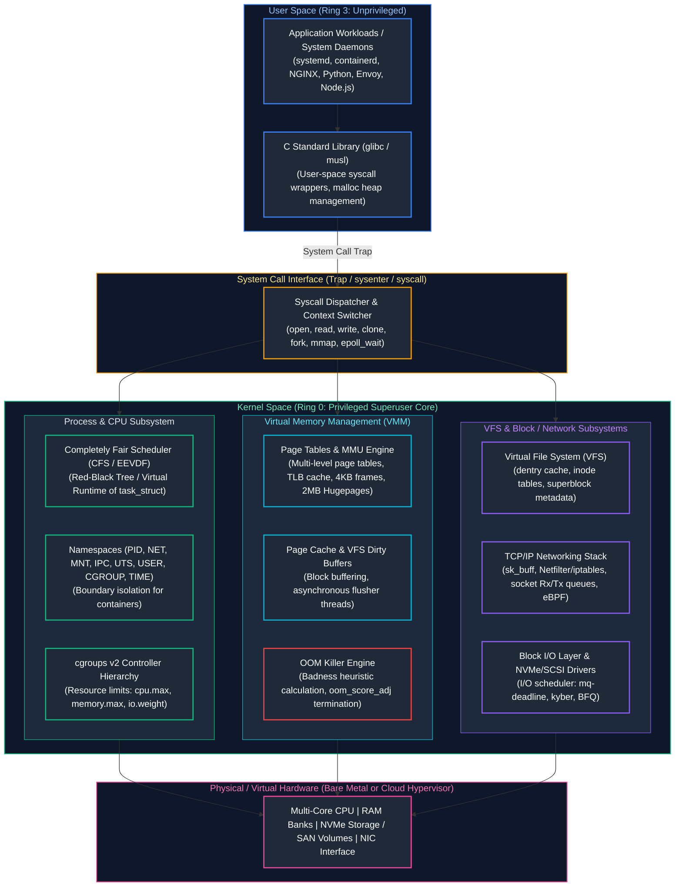

### The Ring 3 to Ring 0 Boundary
1. **User Space (Ring 3):** User code and software run in an isolated memory environment without direct access to physical devices or raw memory. When an application needs to read a file, send network packets, or spawn a process, it cannot execute CPU instructions that touch hardware directly.
2. **System Call (`syscall`):** The application invokes a system call wrapper (e.g. via `glibc`). The CPU transitions from Ring 3 to Ring 0 via an architecture-specific interrupt or instruction (`syscall` on x86_64). The CPU switches stacks from the user stack to the kernel task stack, saves register states, and executes the designated kernel routine.
3. **Kernel Space (Ring 0):** The Linux kernel has total control over CPU, physical memory, and devices. It verifies user permissions, validates pointers to prevent buffer overruns or privilege escalation, performs the requested hardware operation, and returns the result back to Ring 3.

---

## Table of Contents
1. [Linux Filesystem Internals, Permissions and VFS](#1-linux-filesystem-internals-permissions-and-vfs)
   - [1.1 The Virtual File System (VFS), Inodes, Dentries, and File Descriptors](#11-the-virtual-file-system-vfs-inodes-dentries-and-file-descriptors)
   - [1.2 POSIX Permissions, Umask Math, Special Bits, and ACLs](#12-posix-permissions-umask-math-special-bits-and-acls)
   - [1.3 The Deleted Open File Dilemma (The Phantom Disk Space Leak)](#13-the-deleted-open-file-dilemma-the-phantom-disk-space-leak)
2. [Processes, Threads, Signals, and systemd Internals](#2-processes-threads-signals-and-systemd-internals)
   - [2.1 Process Lifecycle, Fork-Exec, Copy-On-Write, and Zombie/Orphan States](#21-process-lifecycle-fork-exec-copy-on-write-and-zombieorphan-states)
   - [2.2 Linux Signals and Graceful Microservice Termination](#22-linux-signals-and-graceful-microservice-termination)
   - [2.3 systemd Service Units, Sandboxing, Cgroups Integration, and Journald](#23-systemd-service-units-sandboxing-cgroups-integration-and-journald)
3. [CPU, Memory, and I/O Resource Management](#3-cpu-memory-and-io-resource-management)
   - [3.1 Completely Fair Scheduler (CFS) and the Container CPU Throttling Trap](#31-completely-fair-scheduler-cfs-and-the-container-cpu-throttling-trap)
   - [3.2 Virtual Memory, Page Cache, Swappiness, and the OOM Killer](#32-virtual-memory-page-cache-swappiness-and-the-oom-killer)
4. [Linux Namespaces, Cgroups v2, and Container Foundations](#4-linux-namespaces-cgroups-v2-and-container-foundations)
   - [4.1 Demystifying Containers: The 8 Linux Namespaces](#41-demystifying-containers-the-8-linux-namespaces)
   - [4.2 Cgroups v2 Unified Hierarchy & Hands-On Resource Limiting](#42-cgroups-v2-unified-hierarchy--hands-on-resource-limiting)
5. [Linux Networking and Low-Level Diagnostic Toolkit](#5-linux-networking-and-low-level-diagnostic-toolkit)
   - [5.1 Socket Mechanics, Ring Buffers, and the Ingress Packet Journey](#51-socket-mechanics-ring-buffers-and-the-ingress-packet-journey)
   - [5.2 Production Network Troubleshooting Commands](#52-production-network-troubleshooting-commands)
6. [Defensive Shell Scripting & Automation Patterns](#6-defensive-shell-scripting--automation-patterns)
   - [6.1 Production Bash Engineering Standards](#61-production-bash-engineering-standards)
   - [6.2 Production Node Health Audit & Automated Backup Engine](#62-production-node-health-audit--automated-backup-engine)
7. [Python for Systems & Infrastructure Automation](#7-python-for-systems--infrastructure-automation)
   - [7.1 Concurrency, Subprocesses, and Direct Kernel Telemetry](#71-concurrency-subprocesses-and-direct-kernel-telemetry)
   - [7.2 Production System Telemetry & PSI Log Parser](#72-production-system-telemetry--psi-log-parser)
8. [Automated Bootstrapping, Cloud-Init, and OS Hardening](#8-automated-bootstrapping-cloud-init-and-os-hardening)
   - [8.1 Cloud-Init Execution Stages & Boot Mechanics](#81-cloud-init-execution-stages--boot-mechanics)
   - [8.2 CIS Benchmark Baseline & Kernel Parameter Hardening](#82-cis-benchmark-baseline--kernel-parameter-hardening)
9. [Senior SRE Troubleshooting Playbooks & Diagnostic Runbooks](#9-senior-sre-troubleshooting-playbooks--diagnostic-runbooks)
   - [9.1 Playbook 1: High CPU / Runaway Process Triage](#91-playbook-1-high-cpu--runaway-process-triage)
   - [9.2 Playbook 2: Memory Pressure & OOM Investigation](#92-playbook-2-memory-pressure--oom-investigation)
   - [9.3 Playbook 3: Network Connection & Port Starvation Triage](#93-playbook-3-network-connection--port-starvation-triage)
10. [Summary Comparison & Production Engineering Reference Matrix](#10-summary-comparison--production-engineering-reference-matrix)
    - [10.1 Linux Subsystem Operational Mechanics & Triage Matrix](#101-linux-subsystem-operational-mechanics--triage-matrix)
11. [References & Further Reading](#11-references--further-reading)
---

# 1. Linux Filesystem Internals, Permissions and VFS

### 1.1 The Virtual File System (VFS), Inodes, Dentries, and File Descriptors

#### The Beginner Intuition: The Library Analogy
Imagine a vast public library. 
- The physical pages bound with ink are the **Data Blocks on Disk**.
- The librarian’s master index card recording the book's author, page count, publication date, shelf location, and checkout permissions—*without containing the title itself*—is the **Inode**.
- The public catalog index where human-readable titles point to an index card number is the **Dentry (Directory Entry)**.
- When you sit at a desk with an open book, your desk reading slip is the **File Descriptor (FD)**. You can have five different readers (processes) with five different reading slips (FDs) open to the same index card (inode).

#### The Low-Level Kernel Mechanism
In Linux, the UNIX adage "everything is a file" means virtually every I/O resource—regular files, directories, socket endpoints, character devices (`/dev/urandom`), block devices (`/dev/nvme0n1`), and pseudo-filesystems (`/proc`, `/sys`)—is abstracted as an ordered sequence of bytes via the **Virtual File System (VFS)**.

#### Linux Filesystem Hierarchy Standard (FHS) VFS Mount Treeview

All Linux storage begins at a single virtual root (`/`). Hardware block devices and virtual kernel interfaces are grafted onto this unified tree via mount points:

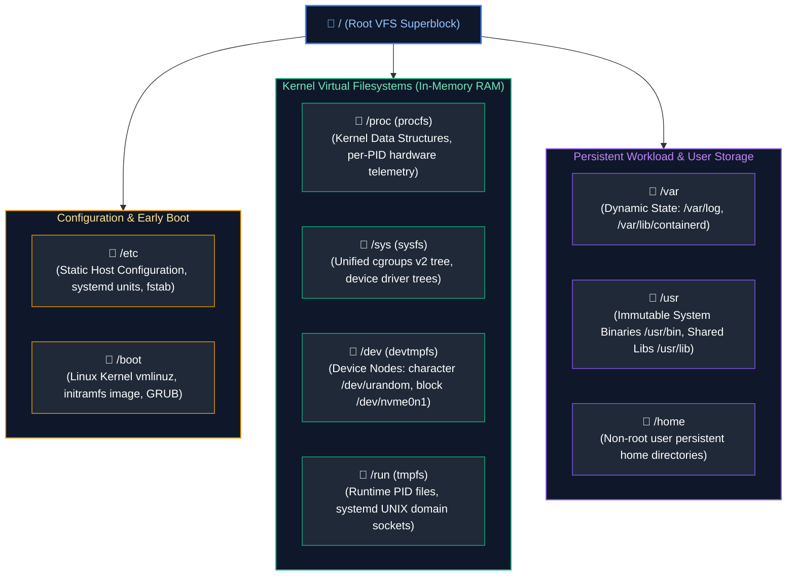

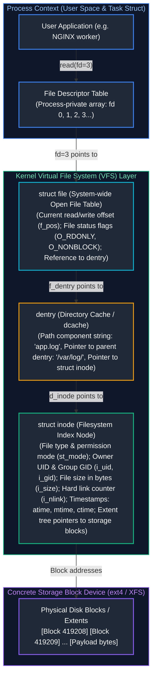

#### Step-by-Step Resolution: What Happens When You Open `/var/log/app.log`?
1. **Syscall Invocation:** The process executes `openat(AT_FDCWD, "/var/log/app.log", O_RDONLY)`.
2. **Dentry Traversal:** The kernel checks the in-memory directory cache (`dcache`). It starts at root (`/`), finds dentry `var`, follows it to `log`, and then to `app.log`. If not in `dcache`, it reads the directory data blocks from disk and populates the cache.
3. **Inode Verification:** The dentry resolves to an **inode number** (e.g., `1441852`). The kernel reads the inode metadata, validates that the calling process's effective UID/GID has read permission, and checks whether the file is locked.
4. **File Object Creation:** The kernel allocates a `struct file` in kernel RAM. It sets the file offset `f_pos = 0`.
5. **FD Assignment:** The kernel finds the lowest unused integer in the process's `task_struct->files->fd_array` (e.g. `fd = 3`), points it to the `struct file`, and returns `3` to user space.

#### Deep-Dive: Inode Attributes & Inspection
To inspect an inode on a live Linux system:
```bash
# Inspect complete inode metadata using stat
stat /etc/hosts
```
Sample Terminal Output:
```text
  File: /etc/hosts
  Size: 221             Blocks: 8          IO Block: 4096   regular file
Device: nvme0n1p1       Inode: 262149      Links: 1
Access: (0644/-rw-r--r--)  Uid: (    0/    root)   Gid: (    0/    root)
Access: 2026-10-10 14:22:01.000000000 +0000
Modify: 2026-10-08 09:15:30.149201822 +0000
Change: 2026-10-08 09:15:30.149201822 +0000
 Birth: 2026-10-08 09:15:30.149201822 +0000
```

The fields displayed in the `stat` output correspond directly to the internal `struct stat` POSIX metadata tracked in the VFS inode structure. Understanding each field is essential for storage capacity planning, permission auditing, and troubleshooting storage anomalies:

| Inode Metadata Attribute | Linux Kernel Representation | Systems Engineering Significance & Production Failure Modes |
| :--- | :--- | :--- |
| **`Size` & `Blocks`** | `st_size` (bytes), `st_blocks` (512-byte sectors). | `Size` is logical; `Blocks` is physical. A sparse file (e.g. QCOW2 image) may have logical Size of 100GB but allocate only 2GB in physical blocks. |
| **`IO Block`** | `st_blksize` (typically 4,096 bytes). | Preferred file system block size for efficient page cache aligned I/O without partial sector thrashing. |
| **`Device` & `Inode`** | `st_dev` device major/minor, `st_ino` (64-bit integer). | Inode number is globally unique **only within this specific storage device**. Different block partitions can reuse inode numbers. |
| **`Links`** | `st_nlink` (Hard link counter). | Represents how many directory dentries point to this inode. Storage blocks are only freed when `Links == 0` AND no process has an open file descriptor. |
| **`Access (Mode / UID / GID)`**| `st_mode`, `st_uid`, `st_gid`. | 12-bit POSIX permission mode (special bits, owner, group, other) and numerical identity credentials. |
| **`Access Time (atime)`** | `st_atime` (nanosecond epoch timestamp). | Last time file contents were read. In high-throughput cloud I/O, writing `atime` on every read saturates NVMe SSDs. Production standard: mount with `noatime`. |
| **`Modify Time (mtime)`** | `st_mtime` (nanosecond epoch timestamp). | Last time file **content** was altered (`write()`, `truncate()`). Used by build systems (Make) to trigger recompilation. |
| **`Change Time (ctime)`** | `st_ctime` (nanosecond epoch timestamp). | Last time the **inode metadata** was altered (`chmod`, `chown`, filename rename). Cannot be spoofed by `touch` utility. |
| **`Birth Time (crtime)`** | `st_btime` (ext4/XFS only). | Exact physical timestamp when the inode was first allocated on the storage volume. |

#### Hard Links vs. Symbolic Links
- **Hard Link (`ln source.txt link.txt`):** Creates another dentry pointing to the *exact same inode number*.
  - Modifying either file modifies the underlying data blocks.
  - The inode's `i_nlink` counter increments by 1.
  - Deleting one file decrements `i_nlink`. The underlying storage blocks are only returned to the free block pool when `i_nlink == 0` **and** no active process has the file descriptor open.
  - *Limitation:* Hard links cannot span across different filesystem partitions (because inode numbers are unique only within a specific block device) and cannot link directories (to prevent infinite filesystem tree loops).
- **Symbolic Link (`ln -s source.txt symlink.txt`):** Creates an entirely *new inode* whose data block contains only a text string representing the target file's path.
  - If the original file is deleted, the symlink becomes a "dangling" or "broken" link.
  - Can cross filesystem boundaries and link directories freely.

#### Inode Exhaustion: The Hidden Outage
A filesystem can run out of space even when 90% of disk capacity is free! Every filesystem format (ext4, XFS) creates a fixed or dynamically expandable number of inodes during creation.
- If an application (e.g. an unmonitored Node.js session store or an email queue) generates millions of tiny 1-byte files, all available inodes are consumed.
- System error: `No space left on device` — yet `df -h` shows plenty of gigabytes available!

**Diagnostic & Remediation Command:**
```bash
# Check inode utilization across all mounted filesystems
df -i

# Identify the exact directories consuming millions of inodes
find / -xdev -printf '%h\n' 2>/dev/null | sort | uniq -c | sort -k 1 -nr | head -n 20
```

---

### 1.2 POSIX Permissions, Umask Math, Special Bits, and ACLs

#### 1. Binary Representation & Octal Bitfields
Standard POSIX file permissions are stored in the inode’s 12-bit `st_mode` integer. The lowest 9 bits define read ($r$), write ($w$), and execute ($x$) for User Owner (`u`), Group (`g`), and Others (`o`).

| Bit Position | 11 | 10 | 9 | 8 | 7 | 6 | 5 | 4 | 3 | 2 | 1 | 0 |
| :--- | :---: | :---: | :---: | :---: | :---: | :---: | :---: | :---: | :---: | :---: | :---: | :---: |
| **Category** | Special: SUID | Special: SGID | Special: Sticky | Owner Read | Owner Write | Owner Exec | Group Read | Group Write | Group Exec | Other Read | Other Write | Other Exec |
| **Octal Weight** | 4 | 2 | 1 | 4 | 2 | 1 | 4 | 2 | 1 | 4 | 2 | 1 |
| **Symbolic** | `s` | `s` | `t` | `r` | `w` | `x` | `r` | `w` | `x` | `r` | `w` | `x` |

#### 2. File vs. Directory Permission Semantics (Crucial SRE Distinction)
Permissions behave fundamentally differently depending on whether the object is a regular file or a directory:

| Permission Bit | Regular File Meaning | Directory Meaning | Failure Consequence If Missing |
| :--- | :--- | :--- | :--- |
| **Read (`r` = 4)** | Read byte stream contents (`cat`, `less`). | List file names inside the directory (`ls`). | Cannot see names of files inside folder. |
| **Write (`w` = 2)** | Modify/truncate byte content (`echo >>`, `vim`). | Create, delete, or rename files in this folder. | Cannot create or delete files (even if child file has `777`!). |
| **Execute (`x` = 1)** | Execute binary or script via `execve()`. | Traverse (`cd`), access child inodes, run `stat`. | **Total directory block:** Cannot `cd` in, cannot read files inside even if you know their names! |

> [!WARNING]
> **The Directory Deletion Trap:** In Linux, permission to delete a file is governed by the **parent directory's write and execute bits**, *not* the file's own permission bits! A user with write permission on `/opt/app` can execute `rm -f /opt/app/secret.key` even if `secret.key` has permissions `0000` owned by `root`.

#### 3. Mathematical Umask Calculation: The Bitwise Formula
When a process creates a file, it specifies an initial permission mode (typically `0666` for files and `0777` for directories). The operating system applies the process's **umask** (creation mask) to strip unwanted permissions.

The kernel does **NOT** subtract numbers arithmetically ($666 - 022 = 644$ is a coincidence, not the algorithm!). The kernel applies bitwise logical AND with the bitwise NOT of the umask:

$$\text{Effective Mode} = \text{Base Mode} \ \& \ (\sim\text{umask})$$

##### Proof: Why Arithmetic Subtraction Fails
Suppose an administrator sets `umask = 0111` (aiming to disable execute permissions on created scripts).
- **Naive Arithmetic Subtraction:** $0666 - 0111 = 0555$ (`r-xr-xr-x`). This would absurdly *grant* execute permissions to files!
- **Kernel Bitwise Logic:**
  - Base Mode `0666` = `110 110 110` (binary)
  - Umask `0111` = `001 001 001` (binary) $\implies$ Bitwise NOT ($\sim$): `110 110 110`
  - Calculation: `(110 110 110) & (110 110 110) = 110 110 110` = `0666` (`rw-rw-rw-`).
  - Result: Files remain non-executable because the base mode never contained execute bits.

#### 4. Special Permissions: SUID, SGID, and Sticky Bit
The upper 3 bits of `st_mode` provide specialized system privileges:

| Special Permission Bit | Octal Value | Symbol Representation | Target Resource Scope | Runtime Execution Semantics | Enterprise Production Example |
| :--- | :---: | :---: | :--- | :--- | :--- |
| **SetUID (`SUID`)** | `4000` | `rwsr-xr-x` (`s` on owner) | Executable Binary Files | Process temporarily executes with the permissions of the **file owner** rather than the calling user. | `/usr/bin/passwd`: Owned by `root`; allows standard unprivileged users to update their password hash in `/etc/shadow`. |
| **SetGID (`SGID`)** | `2000` | `rwxr-sr-x` (`s` on group) | Executables & Directories | On binaries: runs with group GID. **On Directories:** Any newly created file automatically inherits the parent directory's group owner instead of user's primary group. | Shared engineering collaboration directories (`/opt/shared_team`): guarantees all team members can edit newly created files. |
| **Sticky Bit** | `1000` | `rwxrwxrwt` (`t` on other) | World-Writable Directories | Only the file owner, directory owner, or `root` can rename or delete files within the directory. | `/tmp` and `/var/tmp`: Prevents malicious users from deleting or overwriting other users' temporary socket files. |

- **SetUID (`chmod 4755 /usr/bin/binary` or `chmod u+s`):** When executed, the process's **Effective UID (`euid`)** temporarily becomes the UID of the file owner (usually `root`), while **Real UID (`ruid`)** remains the calling user.
- **SetGID (`chmod 2775 /shared/project` or `chmod g+s`):** On directories, any newly created file inherits the group ownership of the directory rather than the creator's default primary group.
- **Sticky Bit (`chmod 1777 /tmp` or `chmod +t`):** In world-writable directories, prevents unprivileged users from deleting or renaming files owned by other users.
- **The Case Representation:**
  - Lowercase `s` or `t`: Special bit is active and the underlying execute bit is **set** (`-rwsr-xr-x` = `4755`, `drwxrwxrwt` = `1777`).
  - Uppercase `S` or `T`: Special bit is active, but underlying execute bit is **unset** (`-rwSr-xr-x` = `4655`). This represents a misconfiguration where the executable cannot run.

#### 5. POSIX Access Control Lists (ACLs)
When traditional Owner/Group/Other permissions are too coarse for multi-tenant cloud environments (e.g., granting read access to a specific monitoring user without changing group ownership), POSIX ACLs provide fine-grained permissions:

```bash

# 2. Inspect existing ACLs on a production application directory

getfacl /var/www/releases

# 3. Grant specific user 'datadog-agent' read and execute access

setfacl -m u:datadog-agent:rx /var/www/releases

# 4. Grant specific group 'dev-ops' full read, write, execute access

setfacl -m g:dev-ops:rwx /var/www/releases

# 5. Set DEFAULT ACLs on a directory (automatically inherited by all future child files and subdirectories)

setfacl -d -m u:datadog-agent:rx /var/www/releases
setfacl -d -m g:dev-ops:rwx /var/www/releases

# 6. Remove all extended ACLs and restore pure POSIX mode

setfacl -b /var/www/releases
```

---

### 1.3 The Deleted Open File Dilemma (The Phantom Disk Space Leak)

#### The Incident Scenario
You receive a critical PagerDuty alert: `Disk Space on /var/log is at 99%!`. You SSH into the server and run `rm -f /var/log/app/huge_traffic.log` (a 150GB log file). You immediately run `df -h` to verify recovery, but the disk is **still 99% full**! Yet when you run `du -sh /var/log/*`, the file is nowhere to be found.

#### The Root Cause Under the Hood
1. When you run `rm file.log`, the command executes the `unlink()` syscall.
2. `unlink()` removes the filename from the directory entry (dentry) and decrements the inode's link count (`i_nlink`).
3. However, if an active process (such as a Java JVM, Python daemon, or NGINX) currently holds an open file descriptor pointing to that inode, the kernel **keeps the inode in memory and retains all physical disk blocks allocated**.
4. `df` (disk free) queries the filesystem superblock and reports all allocated disk blocks. `du` (disk usage) traverses directory trees via dentries. Because the dentry is gone, `du` cannot see the file, but `df` accurately reflects that the blocks are still held captive by the running process.

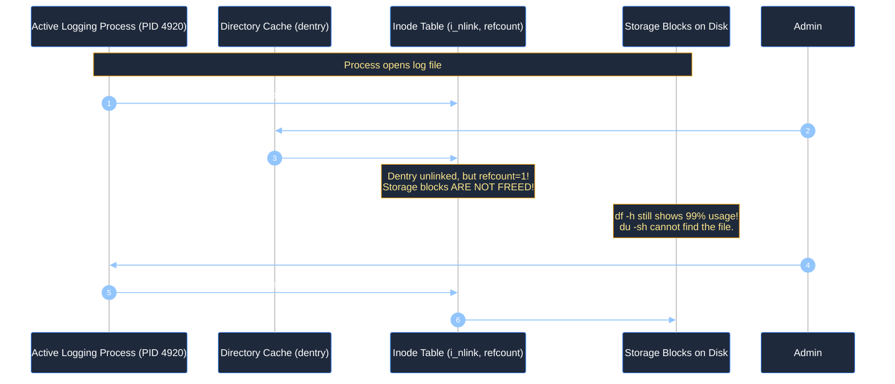

#### The Production Solution
```bash
# Step 1: Identify all deleted files held open by running processes
lsof +L1
# Or inspect the proc filesystem directly:
ls -l /proc/*/fd/* 2>/dev/null | grep deleted

# Sample output:
# java  4920  root  3w  REG  259,1  161061273600  0  1441852 /var/log/huge.log (deleted)

# Step 2: Zero-out (truncate) the file through its file descriptor WITHOUT restarting the service
# Syntax: > /proc/<PID>/fd/<FD_NUMBER>
> /proc/4920/fd/3

# Step 3: Verify disk space is instantly reclaimed in df -h
df -h /var/log
```

---

# 2. Processes, Threads, Signals, and systemd Internals

### 2.1 Process Lifecycle, Fork-Exec, Copy-On-Write, and Zombie/Orphan States

#### The Beginner Intuition: The Cloning and Reaping Cycle
- When a process wants to start new work, it does not create a process from thin air. It creates an identical biological twin of itself (**`fork()`**). 
- Once the twin is born, it goes to the costume wardrobe and changes into an entirely new program (**`execve()`**).
- When a child finishes its life work, it dies and leaves behind a death certificate containing its exit code. It enters the **Zombie** state.
- The parent process is legally required to pick up the death certificate (**`wait()`**). Once picked up, the child's spirit and memory are completely erased from the world. If the parent abandons the child, the child becomes an **Orphan** and is adopted by the town mayor (PID 1: `systemd`), who diligently collects all death certificates.

#### Kernel Architecture: `task_struct` and the Process State Machine
In the Linux kernel, every process is tracked by an instance of `struct task_struct` defined in `<linux/sched.h>`.

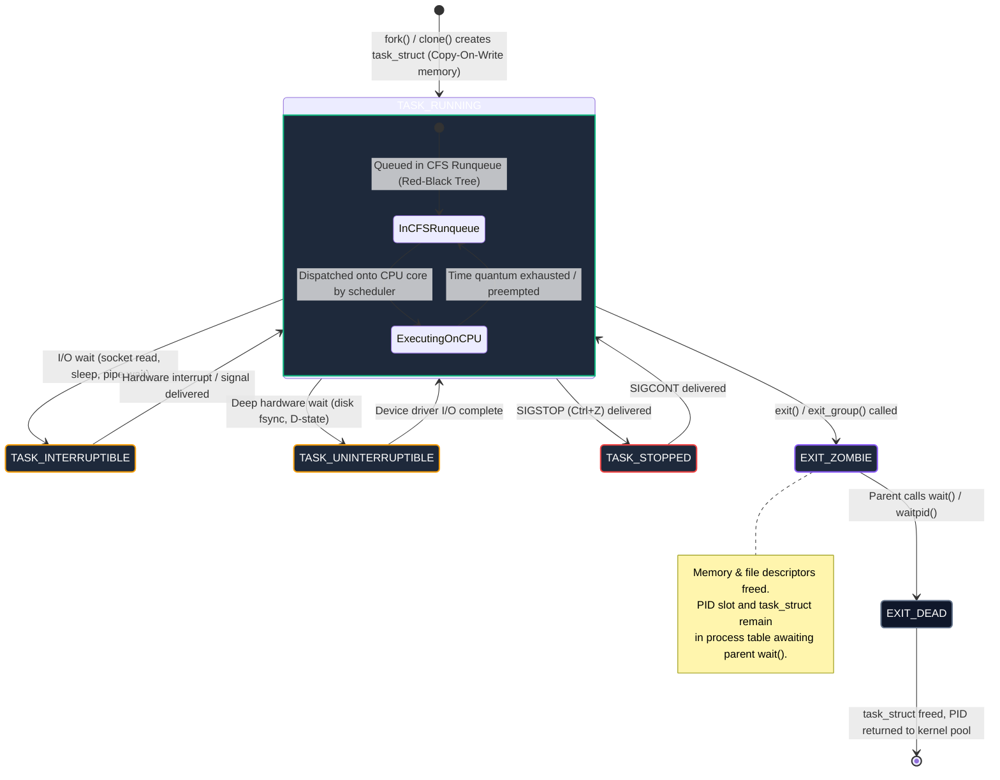

#### Detailed State Breakdown
1. **`TASK_RUNNING` (Code `R`):** The process is either actively executing on a CPU core or sitting in the CFS scheduler runqueue ready to execute as soon as a core opens up.
2. **`TASK_INTERRUPTIBLE` (Code `S`):** The process is sleeping, waiting for an event (e.g. data arriving on a network socket). It will instantly wake up if data arrives **or** if an asynchronous signal (like `SIGTERM`) is delivered.
3. **`TASK_UNINTERRUPTIBLE` (Code `D`):** The process is waiting for direct hardware/disk I/O (e.g. waiting for an NFS write confirmation or NVMe flush). **A process in D-state cannot be killed by any signal, not even `kill -9` (`SIGKILL`)!** If a process hangs in D-state due to an unresponsive SAN or NFS share, the only resolution is fixing the storage device or rebooting the node.
4. **`TASK_STOPPED` (Code `T`):** The process has been suspended by a debugger or by signals `SIGSTOP` or `SIGTSTP` (terminal `Ctrl+Z`).
5. **`EXIT_ZOMBIE` (Code `Z`):** The process has completed its execution via `exit()`, freed its virtual memory, closed all open files, and released its sockets. However, its entry in the kernel process table (`task_struct`) is retained so its parent process can read its termination status code.

#### Fork and Copy-On-Write (COW) Mechanics
When a process executes `fork()`:
1. The kernel does **not** copy the physical memory of the parent. Doing so for a 16GB Redis instance would cause a massive latency freeze.
2. Instead, the kernel duplicates the **page tables** of the parent process and marks all physical memory pages as **read-only**.
3. Both parent and child read from the same physical RAM frames.
4. If either process attempts to write to a page, the CPU's Memory Management Unit (MMU) traps a **Minor Page Fault** (page permission violation).
5. The kernel intervenes, allocates a new physical 4KB memory frame, copies the content of that specific page, updates the writing process's page table with read-write permissions, and resumes execution.

#### Zombies vs. Orphans in Containers
- **Orphan:** A child process whose parent died while the child was still running. In Linux, orphan processes are instantly re-parented to PID 1 (`systemd` or container entrypoint).
- **Zombie:** A dead process waiting for its parent to call `wait()` or `waitpid()`. Zombies consume **0 CPU and 0 bytes of RAM**, but they consume an integer entry in the kernel's process table.
- **The Kubernetes Container Disaster:** If you run a custom script as PID 1 in a Docker container without an init system (like `tini` or `dumb-init`), child subprocesses that terminate will never be reaped. Over time, the container accumulates thousands of zombie processes until `/proc/sys/kernel/pid_max` is hit, crashing the entire node with: `fork: Cannot allocate memory`.

---

### 2.2 Linux Signals and Graceful Microservice Termination

#### Signal Dispatch Mechanics
Signals are asynchronous software interrupts generated by the kernel or user space. When a signal is generated, the kernel sets a bit in the target process’s `task_struct->pending` signal mask. The next time the process transitions from kernel space back to user space, the kernel forces the process to jump to the designated signal handler function.

| Signal Name | Number | Default Action | Interceptable / Catchable? | Production & Cloud Engineering Role |
| :--- | :---: | :--- | :---: | :--- |
| **`SIGHUP`** | 1 | Terminate | **Yes** | Reload configuration without dropping TCP connections (e.g. `kill -HUP $(pgrep nginx)`). |
| **`SIGINT`** | 2 | Terminate | **Yes** | Sent by terminal interrupt (`Ctrl+C`). Clean shutdown request. |
| **`SIGQUIT`**| 3 | Core Dump | **Yes** | Sent by terminal quit (`Ctrl+\`). Generates a memory core dump for debugging. |
| **`SIGKILL`**| 9 | Immediate Kill | **NO** | Kernel destroys the process instantly. Cannot be caught, blocked, or ignored. No destructors run. |
| **`SIGUSR1`**| 10 | Terminate | **Yes** | User-defined custom logic (e.g., NGINX log file rotation trigger). |
| **`SIGSEGV`**| 11 | Core Dump | **Yes** | Segmentation fault: Process attempted to access invalid/unmapped virtual memory. |
| **`SIGPIPE`**| 13 | Terminate | **Yes** | Broken pipe: Process wrote to a socket/pipe after the receiving peer closed connection. |
| **`SIGTERM`**| 15 | Terminate | **Yes** | Standard graceful termination request. Issued by Kubernetes and `systemctl stop`. |

#### The Kubernetes Graceful Pod Teardown Protocol
When Kubernetes terminates a Pod (e.g., during a rolling deployment):
1. **Endpoint Removal:** The Pod is removed from Service endpoints and kube-proxy stops sending traffic.
2. **`SIGTERM` Dispatched:** The container runtime sends `SIGTERM` to PID 1 inside the container.
3. **Graceful Draining:** The application must stop accepting new requests, complete in-flight transactions, flush database writes, and close connection pools.
4. **Grace Period Countdown:** Kubernetes waits for `terminationGracePeriodSeconds` (default 30 seconds).
5. **`SIGKILL`:** If the process is still running after the timer expires, the kernel dispatches `SIGKILL` (`kill -9`), brutally terminating the process.

```python
# Production Python example: Handling SIGTERM gracefully
import signal
import sys
import time

shutdown_requested = False

def handle_sigterm(signum, frame):
    global shutdown_requested
    print(f"Received signal {signum} (SIGTERM). Draining connections...")
    shutdown_requested = True

signal.signal(signal.SIGTERM, handle_sigterm)
signal.signal(signal.SIGINT, handle_sigterm)

print("Service started. Awaiting work...")
while not shutdown_requested:
    time.sleep(1)

print("Completing in-flight jobs and closing database connections...")
# [Perform database pool close, flush buffers]
print("Clean exit complete.")
sys.exit(0)
```

---

### 2.3 systemd Service Units, Sandboxing, Cgroups Integration, and Journald

#### systemd Architecture: PID 1
`systemd` is the unified system and service manager that bootstraps the Linux user space, organizes background services into cgroups, enforces security sandboxing via Linux capabilities, and manages structured logging via `systemd-journald`.

#### Production-Grade Service Unit File
Below is an enterprise-grade service unit demonstrating security isolation, resource constraints, and health notification:

```ini
# /etc/systemd/system/cloud-api.service
[Unit]
Description=Enterprise Cloud Payment API Service
Documentation=https://docs.corp.internal/cloud-api
After=network-online.target
Wants=network-online.target
# Refuse to start if storage mount is missing
RequiresMountsFor=/var/log/cloud-api

[Service]
# Type=notify requires the application to send sd_notify("READY=1") via UNIX socket
Type=notify
User=appuser
Group=appgroup
WorkingDirectory=/opt/cloud-api
ExecStart=/opt/cloud-api/bin/server --config=/etc/cloud-api/config.yaml
ExecReload=/bin/kill -HUP $MAINPID
Restart=on-failure
RestartSec=5s
TimeoutStopSec=30s
WatchdogSec=10s

# ==============================================================================
# Security Hardening & Linux Kernel Sandboxing
# ==============================================================================
# Prevent process and child threads from gaining new privileges (prctl PR_SET_NO_NEW_PRIVS)
NoNewPrivileges=true
# Mount /usr, /boot, /etc as read-only for this process
ProtectSystem=strict
# Hide /home, /root, and /run/user from this process
ProtectHome=true
# Allocate an isolated /tmp namespace invisible to other host processes
PrivateTmp=true
# Block access to physical hardware devices (/dev/sda, etc.)
PrivateDevices=true
# Prevent writes to /proc/sys, /sys, /proc/fs
ProtectKernelTunables=true
# Prevent modifying cgroup files directly
ProtectControlGroups=true
# Prevent creating child namespaces (user, network, mount)
RestrictNamespaces=true
# Drop all Linux capabilities except permission to bind to low ports (< 1024)
CapabilityBoundingSet=CAP_NET_BIND_SERVICE
AmbientCapabilities=CAP_NET_BIND_SERVICE

# ==============================================================================
# Resource Isolation via cgroups v2
# ==============================================================================
LimitNOFILE=65536
MemoryMax=2G
MemoryHigh=1.8G
CPUQuota=200%
TasksMax=4096

[Install]
WantedBy=multi-user.target
```

#### systemd Lifecycle & Journald Operations
```bash

# 8. Reload the systemd daemon after modifying unit definitions

sudo systemctl daemon-reload

# 9. Enable service at boot and start it immediately

sudo systemctl enable --now cloud-api.service

# 10. Check service status, cgroup slice placement, and recent log entries

sudo systemctl status cloud-api.service

# 11. Stream real-time logs from journald in human-readable or JSON format

journalctl -u cloud-api.service -f -o json-pretty

# 12. Filter journald logs by time window and priority (errors only)

journalctl -u cloud-api.service --since "1 hour ago" -p err
```

---

# 3. CPU, Memory, and I/O Resource Management

### 3.1 Completely Fair Scheduler (CFS) and the Container CPU Throttling Trap

#### The Beginner Intuition: The Shared Coffee Machine
Imagine an office with 1 coffee machine (CPU core) and 5 workers (threads). 
- If worker Alice runs for 10 minutes continuously, workers Bob and Charlie starve.
- The **Completely Fair Scheduler (CFS)** gives every worker an internal stopwatch measuring "virtual coffee time" (`vruntime`).
- The scheduler always calls the worker whose stopwatch shows the *least amount of consumed time*. If Alice runs for 2 seconds, her stopwatch ticks up; the scheduler steps in and gives Bob the next turn.

#### Deep Technical Architecture
CFS (and the newer EEVDF scheduler in Linux 6.6+) tracks runnable threads using a self-balancing **Red-Black Tree** ordered by `vruntime`:
- The leftmost node of the tree is the task that has received the least CPU time.
- The scheduler always picks the leftmost task (`rb_leftmost`).
- `vruntime` increases at a rate determined by the process's **nice value** (priority from `-20` highest priority to `+19` lowest priority). A task with a lower nice value accumulates `vruntime` slower, receiving proportionally more physical CPU time.

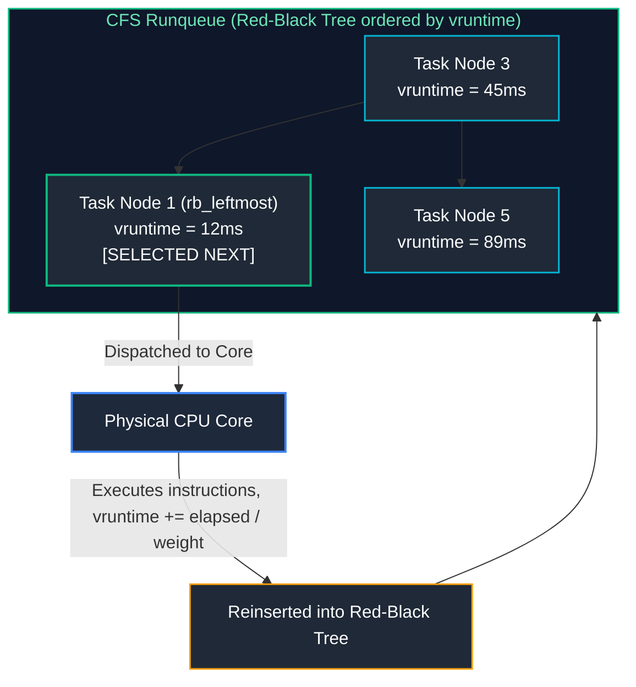

#### The Container CPU Throttling Trap (The Latency Disaster)
In Kubernetes and Docker, setting a CPU limit (e.g. `resources.limits.cpu: "2"`) translates directly to CFS bandwidth controls in cgroups:
- `cpu.cfs_period_us` = `100000` (100 milliseconds)
- `cpu.cfs_quota_us` = `200000` (200 milliseconds of total CPU time per 100ms period, or 2 cores).

##### The Hidden Trap:
Suppose a Java or Go microservice runs 8 concurrent worker threads.
1. At the beginning of the 100ms window, all 8 threads wake up to process an incoming HTTP burst.
2. 8 threads $\times$ 25ms of execution = **200ms of CPU quota exhausted in the first 25ms** of the 100ms window!
3. The Linux kernel **throttles the container immediately**. The process is forcibly suspended from executing for the remaining 75 milliseconds!
4. **Symptom:** The Prometheus dashboard reports average CPU usage is only 25% (200ms out of a possible 800ms across 8 cores), but API P99 latency suddenly jumps from 5ms to 85ms!

##### Detection & Diagnostic Command:
```bash
# Check CFS throttling statistics directly from cgroup v2
cat /sys/fs/cgroup/system.slice/docker-*.scope/cpu.stat

# Output metrics:
# nr_periods 148202          (Total 100ms periods evaluated)
# nr_throttled 34810         (Periods in which the process was forcibly throttled!)
# throttled_usec 2459102910  (Total microsecond execution delay incurred)
```

> [!TIP]
> **Production Recommendation:** In Kubernetes clusters, many enterprise platform teams disable CPU limits entirely or set them significantly higher than CPU requests, relying instead on CPU requests for placement and CFS fair-share shares to prevent severe P99 latency penalties.

---

### 3.2 Virtual Memory, Page Cache, Swappiness, and the OOM Killer

#### The Beginner Intuition: The Illusion of Infinite Memory
Every process in Linux is given the illusion that it is the sole program on the computer, possessing its own pristine 128 Terabyte private address space. In reality, the physical RAM may only be 16GB. The hardware **Memory Management Unit (MMU)** and the kernel translate the process's imaginary "Virtual Addresses" into real "Physical RAM Frames".

#### Memory Subsystem Components
Physical RAM is categorized into two main functional areas:
1. **Anonymous Memory:** Process-private dynamic allocations (the Heap, Stack, `malloc()` buffers, and data structures). This memory cannot be discarded without swapping to disk.
2. **Page Cache (File-Backed Memory):** Disk blocks cached in RAM by the kernel to speed up file I/O (`read()`, `write()`, binary code). If memory runs low, clean page cache can be instantly thrown away because it can be re-read from disk at any time.

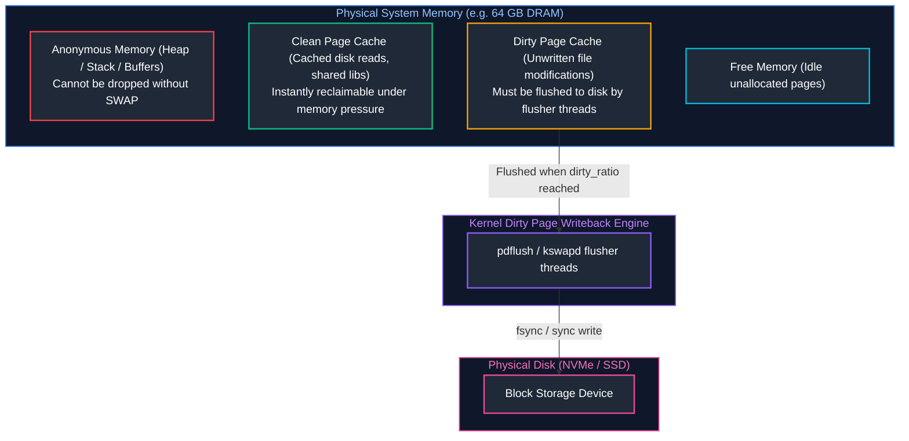

#### Why is My Linux Server at 98% Memory Usage? (The "Free Memory" Myth)
Beginners frequently panic seeing `free -h` reporting only 500MB free out of 64GB. 
- In Linux, **unused RAM is wasted RAM**.
- The kernel uses all idle memory for the **Page Cache** to accelerate disk reads.
- When an application requests more memory via `malloc()`, the kernel instantly evicts pages from the clean Page Cache and hands the RAM to the application in nanoseconds.
- **Always read the `available` column in `free -h`, NOT the `free` column!**

```bash
# Inspect real memory availability
free -m
```
Sample Output:
```text
               total        used        free      shared  buff/cache   available
Mem:           64120       18240         520         810       45360       44510
Swap:           8192         110        8082
```
*Analysis:* While `free` is only 520MB, `available` is **44,510MB** (~44.5GB). The node has massive available headroom!

#### The Dirty Page Flush Mechanics
When an application calls `write()`, data is written to the Page Cache in RAM, marking the page as "dirty", and the syscall immediately returns success. The data is not yet on physical disk!
Kernel flusher threads asynchronously write dirty pages to disk based on `/etc/sysctl.conf`:
- `vm.dirty_background_ratio = 5`: When dirty pages reach 5% of memory, background threads start writing to disk. Application execution is not interrupted.
- `vm.dirty_ratio = 10`: If write traffic is so heavy that dirty pages reach 10%, the kernel **suspends the writing application processes** and forces them to wait for disk synchronization (causing massive I/O latency spikes).

#### The Out-Of-Memory (OOM) Killer
When both free RAM and reclaimable page cache are depleted, the kernel triggers `mm/oom_kill.c`. The OOM killer must terminate a process to preserve kernel stability.

It computes a **badness score** ($0 \text{ to } 1000$) for every active process:
$$\text{Points} = \left( \frac{\text{RSS Memory Consumed}}{\text{Total RAM}} \times 1000 \right) + \text{oom\_score\_adj}$$

- `oom_score_adj` is configurable via `/proc/<PID>/oom_score_adj`:
  - `-1000`: Completely immune from OOM killing (e.g. `sshd`, `systemd`, `kubelet`).
  - `+1000`: First in line to be executed when memory runs out.
- **Kubernetes QoS Mapping:**
  - **Guaranteed Pods:** `oom_score_adj = -997` (Killed last).
  - **Burstable Pods:** `oom_score_adj = min(max(2, 1000 - (1000 * req) / alloc), 999)`.
  - **BestEffort Pods:** `oom_score_adj = 1000` (Instantly killed first).

---

# 4. Linux Namespaces, Cgroups v2, and Container Foundations

### 4.1 Demystifying Containers: The 8 Linux Namespaces

#### The Fundamental Truth: Containers Do Not Exist in the Linux Kernel
There is no Linux kernel struct called `container`. A "container" is simply an ordinary Linux process running with:
1. **Namespaces:** What the process is allowed to **see**.
2. **Cgroups:** What the process is allowed to **use**.
3. **Seccomp / AppArmor:** What system calls the process is allowed to **execute**.

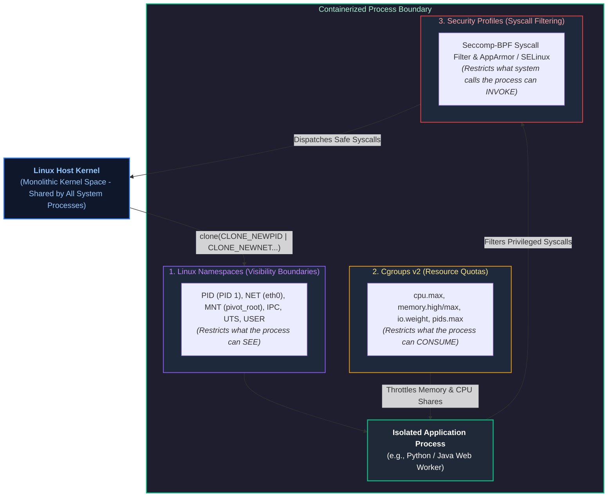

#### Hands-On: Building a "Container" From Scratch Using Standard Linux Tools
You can create an isolated container environment using standard core utilities without installing Docker or containerd:

```bash

# 15. Create a root directory for our minimal container

mkdir -p /tmp/my_container/bin /tmp/my_container/lib /tmp/my_container/lib64

# 16. Copy the bash binary and its shared library dependencies

cp /bin/bash /tmp/my_container/bin/
# (In production, use ldd /bin/bash to copy all required .so libraries)

# 17. Spawn a shell isolated into brand new PID, Mount, Network, and UTS namespaces

sudo unshare --pid --net --mount --uts --fork /bin/bash

# 18. Inside this shell, set a private hostname

hostname container-node-01

# 19. Check hostname outside the namespace:

# On the host: hostname remains unchanged!
# Inside the namespace: hostname is container-node-01!
```

---

### 4.2 Cgroups v2 Unified Hierarchy & Hands-On Resource Limiting

Control groups (cgroups) are the foundational Linux kernel primitive responsible for metering, bounding, and isolating physical hardware resources—CPU compute cycles, memory allocations, block I/O throughput, and process count limits—across groups of processes. While Linux namespaces provide the illusion of isolation (what a container can *see*), cgroups enforce the physical boundary limits (what a container can *use*).

#### Architectural Evolution: The Journey to Cgroups v2

In legacy **cgroups v1**, each resource subsystem (CPU, memory, blkio, net_cls) was designed as an independent, fragmented hierarchy. A process could be placed in Group A for CPU limits and Group B for memory limits. This disjoint architecture produced severe operational failure modes:
1. **Broken Buffered I/O Accounting:** Dirty memory pages buffered in the Linux Page Cache could not be attributed back to the process that wrote them, completely bypassing block I/O limits.
2. **Incoherent Resource Delegation:** Container runtimes struggled to coordinate multi-tenant limits because different controllers disagreed on process ownership.
3. **Lack of Starvation Telemetry:** V1 could only measure raw consumption percentages, unable to tell whether a workload was genuinely healthy or stalling on resource locks.

To resolve these architectural flaws, Linux kernel version 4.5+ introduced **cgroups v2** (unified hierarchy). Cgroups v2 organizes all controllers into a single unified directory tree, enforces the "no internal process" rule (only leaf nodes may host processes), and integrates kernel-level Pressure Stall Information (PSI).

The structural and operational differences between the two architectures:

#### Cgroups v1 vs. Cgroups v2 Architectural Comparison

| Architectural Dimension | Cgroups v1 (Legacy Multi-Hierarchy) | Cgroups v2 (Modern Unified Single Hierarchy) |
| :--- | :--- | :--- |
| **Hierarchy Topology** | Fragmented, independent trees per controller (`/sys/fs/cgroup/cpu/`, `/sys/fs/cgroup/memory/`). | **Single Unified Tree:** One single directory structure mounted at `/sys/fs/cgroup/`. |
| **Process Membership** | A single process could belong to Group A for CPU, but Group B for Memory! | **Atomic Placement:** A process belongs to exactly one cgroup leaf node across all controllers. |
| **Memory-Buffered I/O** | **Broken:** Buffered page cache writeback could not be attributed to processes, breaking I/O throttling. | **Integrated:** Unified accounting attributes memory-buffered dirty pages directly to process block I/O limits. |
| **Root vs. Non-Root Rule** | Threads of a single process could be split arbitrarily across multiple sub-cgroups. | **No Internal Process Rule:** Only leaf cgroups may contain processes; parent nodes only control delegation. |
| **Pressure Stall Info (PSI)**| Not available. Systems only knew resource usage percentage, not actual starvation delay. | **Built-in PSI (`/proc/pressure/`):** Real-time nanosecond accounting of CPU, Memory, and I/O wait stalls. |
| **Kubernetes Standard** | Deprecated in Kubernetes 1.25+. | The mandatory production standard for all modern Kubernetes clusters (EKS, AKS, GKE). |

#### Linux Cgroups v2 Unified Directory Treeview

Every process on a modern Linux node sits within an explicit cgroups v2 slice hierarchy that controls its hardware resource boundaries:

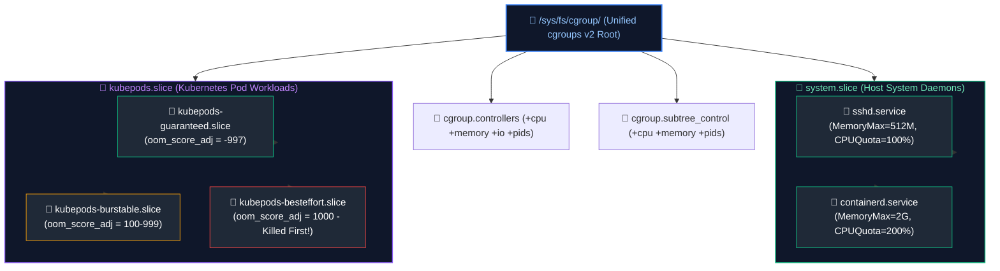

#### Hands-On: Creating and Enforcing Cgroups v2 Limits
```bash

# 20. Create a new cgroup node inside the unified hierarchy

sudo mkdir -p /sys/fs/cgroup/worker_pool

# 21. Restrict CPU consumption: Max 1.5 cores (150ms per 100ms period)

# Format: <quota_microseconds> <period_microseconds>
echo "150000 100000" | sudo tee /sys/fs/cgroup/worker_pool/cpu.max

# 22. Set hard memory limit (512 MB) and soft high-watermark warning (400 MB)

echo "536870912" | sudo tee /sys/fs/cgroup/worker_pool/memory.max
echo "419430400" | sudo tee /sys/fs/cgroup/worker_pool/memory.high

# 23. Protect against fork-bomb attacks by limiting maximum processes

echo "100" | sudo tee /sys/fs/cgroup/worker_pool/pids.max

# 24. Move a running process (PID 48210) into this cgroup

echo 48210 | sudo tee /sys/fs/cgroup/worker_pool/cgroup.procs

# 25. Verify active metrics and memory consumption inside the cgroup

cat /sys/fs/cgroup/worker_pool/memory.current
cat /sys/fs/cgroup/worker_pool/cpu.stat
```

---

# 5. Linux Networking and Low-Level Diagnostic Toolkit

### 5.1 Socket Mechanics, Ring Buffers, and the Ingress Packet Journey

#### The Packet's Journey from Wire to User Space
When an Ethernet packet arrives at the physical server, it traverses a sophisticated multi-stage journey through hardware, interrupts, and kernel subsystems:

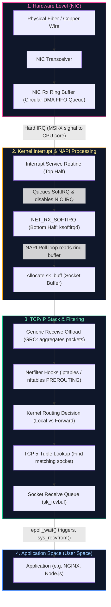

#### Step-by-Step Mechanics:
1. **DMA Transfer:** The NIC writes incoming packet data directly into host RAM using Direct Memory Access (DMA) into memory slots allocated in the **Rx Ring Buffer**.
2. **Hard IRQ:** The NIC raises a hardware interrupt to the CPU. The CPU halts current work and executes the lightweight "Top Half" handler, which schedules a `NET_RX_SOFTIRQ` and temporarily disables NIC hardware interrupts (to prevent interrupt storms).
3. **NAPI Polling:** The kernel’s `ksoftirqd` daemon invokes the NAPI poll loop, draining packets from the ring buffer and packaging each packet into a `struct sk_buff`.
4. **Netfilter / iptables:** The packet passes through firewall PREROUTING hooks. If connection tracking (`conntrack`) table is full, the packet is silently dropped!
5. **Socket Enqueue:** The kernel matches the 5-tuple (`src_ip, src_port, dst_ip, dst_port, proto`) to an open socket and queues the `sk_buff` into the socket’s receive buffer (`SO_RCVBUF`).
6. **Application Read:** The application, waiting on an event loop via `epoll_wait()`, wakes up and executes `read()` or `recv()` to copy bytes from kernel socket buffer to user memory.

---

### 5.2 Production Network Troubleshooting Commands

```bash

# 27. Inspect all listening TCP/UDP sockets with process IDs, omitting DNS lookups

ss -tulpn

# 28. Inspect socket buffer queues (Recv-Q and Send-Q)

# If Recv-Q > 0: The application is failing to read data fast enough!
# If Send-Q > 0: The remote peer is failing to acknowledge sent data (network bottleneck)!
ss -ti '( sport = :443 )'

# 29. Check for dropped packets and overrun errors on the NIC ring buffer

ip -s link show eth0
ethtool -S eth0 | grep -E "drop|error|overrun|miss"

# 30. Live capture HTTP/TLS traffic on eth0, filtering by destination port 443 with ASCII output

sudo tcpdump -nnvv -i eth0 tcp port 443 -c 100 -w /tmp/capture.pcap

# 31. Query kernel routing table for a specific destination IP

ip route get 10.240.0.10

# 32. Check Linux conntrack table utilization (Major cause of dropped connections in Kubernetes)

conntrack -C
cat /proc/sys/net/netfilter/nf_conntrack_max
```

---

# 6. Defensive Shell Scripting & Automation Patterns

### 6.1 Production Bash Engineering Standards

Scripts running in cloud infrastructure must be robust, deterministic, idempotent, and defensively constructed.

#### The Mandatory Strict Header
```bash
#!/usr/bin/env bash
# -e: Exit immediately if any command returns a non-zero exit status
# -u: Treat unset/uninitialized variables as an error and exit immediately
# -o pipefail: Prevent pipeline masking (return status is that of the rightmost failure)
set -euo pipefail

# Set Internal Field Separator to newline and tab (prevents spaces from splitting filenames)
IFS=$'\n\t'
```

#### Production Engineering Rules
1. **Double-Quote Every Variable:** `rm -rf "$TARGET_DIR"` (prevents catastrophe if `TARGET_DIR` expands to empty or contains spaces).
2. **Deterministic Temporary Files:** Always use `mktemp` with automated signal cleanup traps.
3. **Flock Locking:** Prevent concurrent execution of the same cron/cronjob script using file descriptors and `flock`.
4. **Structured JSON Logs:** Never use plain unstructured `echo`. Output structured logs with ISO-8601 timestamps and severity levels.

---

### 6.2 Production Node Health Audit & Automated Backup Engine

The following complete, runnable script demonstrates signal traps, concurrency guards, structured JSON telemetry, and automated cleanup:

```bash
#!/usr/bin/env bash
# ==============================================================================
# Script: node_health_audit.sh
# Purpose: Autonomous node telemetry collector, disk auditor & backup engine
# Usage: ./node_health_audit.sh
# ==============================================================================
set -euo pipefail
IFS=$'\n\t'

# Configuration Constants
readonly SCRIPT_NAME="$(basename "$0")"
readonly LOCK_FILE="/var/run/${SCRIPT_NAME%.*}.lock"
readonly LOG_FILE="/var/log/node_health_audit.log"
readonly BACKUP_SRC="/etc/cloud-api"
readonly BACKUP_DST="/var/backups/cloud-api"
readonly RETENTION_DAYS=7
readonly DISK_ALERT_THRESHOLD=85

# Ensure log directory exists
mkdir -p "$(dirname "${LOG_FILE}")"

# Structured JSON Logger
log_json() {
    local level="$1"
    local message="$2"
    local timestamp
    timestamp=$(date -u +"%Y-%m-%dT%H:%M:%SZ")
    
    # Construct JSON payload safely
    printf '{"timestamp":"%s","script":"%s","level":"%s","message":"%s"}\n' \
        "${timestamp}" "${SCRIPT_NAME}" "${level}" "${message}" | tee -a "${LOG_FILE}" >&2
}

# Trap Cleanup Handler
cleanup() {
    local exit_code=$?
    log_json "INFO" "Executing termination cleanup handler (Exit code: ${exit_code})."
    # Release file lock and clean lockfile
    rm -f "${LOCK_FILE}"
    exit "${exit_code}"
}
trap cleanup EXIT INT TERM

# Concurrency Guard: Ensure only one instance executes at any time
exec 200>"${LOCK_FILE}"
if ! flock -n 200; then
    log_json "ERROR" "Execution blocked: Another instance holds lock on ${LOCK_FILE}."
    exit 1
fi

# Audit Disk Usage
audit_disk_pressure() {
    log_json "INFO" "Auditing filesystem storage pressure..."
    local usage_pct
    usage_pct=$(df / | awk 'NR==2 {print $5}' | tr -d '%')

    if [[ "${usage_pct}" -gt "${DISK_ALERT_THRESHOLD}" ]]; then
        log_json "WARN" "Disk usage on / critical: ${usage_pct}% (Threshold: ${DISK_ALERT_THRESHOLD}%)"
    else
        log_json "INFO" "Disk usage healthy: ${usage_pct}% consumed."
    fi
}

# Execute Automated Compressed Backup
execute_backup() {
    if [[ ! -d "${BACKUP_SRC}" ]]; then
        log_json "ERROR" "Backup source directory does not exist: ${BACKUP_SRC}"
        return 1
    fi

    mkdir -p "${BACKUP_DST}"
    local timestamp
    timestamp=$(date +"%Y%m%d_%H%M%S")
    local archive_file="${BACKUP_DST}/backup_${timestamp}.tar.gz"

    log_json "INFO" "Creating compressed archive of ${BACKUP_SRC} at ${archive_file}"
    tar -czf "${archive_file}" -C "${BACKUP_SRC}" .

    log_json "INFO" "Purging backups older than ${RETENTION_DAYS} days from ${BACKUP_DST}"
    find "${BACKUP_DST}" -type f -name "backup_*.tar.gz" -mtime +"${RETENTION_DAYS}" -delete
}

main() {
    log_json "INFO" "Starting node health and backup cycle."
    audit_disk_pressure
    execute_backup
    log_json "INFO" "Node health check and backup cycle completed successfully."
}

main "$@"
```

---

# 7. Python for Systems & Infrastructure Automation

### 7.1 Concurrency, Subprocesses, and Direct Kernel Telemetry

While shell scripts are ideal for simple linear commands, Python is required for enterprise automation involving:
1. **JSON/REST APIs:** Parsing cloud provider endpoints (AWS IMDS, Azure Instance Metadata).
2. **Direct Kernel Parsing:** Reading low-level metrics directly from `/proc` and `/sys` without forking shell processes.
3. **Structured Concurrency:** Using `concurrent.futures.ThreadPoolExecutor` for high-throughput health auditing.

---

### 7.2 Production System Telemetry & PSI Log Parser

The script below directly reads Linux **Pressure Stall Information (PSI)** from `/proc/pressure`—the modern Linux kernel mechanism (introduced in Linux 4.20) for detecting hardware bottlenecks across CPU, Memory, and I/O before actual failure occurs:

```python
#!/usr/bin/env python3
"""
Linux Node Telemetry and Pressure Stall Information (PSI) Auditor.
Reads kernel pressure metrics directly from /proc/pressure and audits systemd services.
Zero external dependencies (pure standard library).
"""

from concurrent.futures import ThreadPoolExecutor
from dataclasses import asdict, dataclass
import json
import logging
import os
from pathlib import Path
import subprocess
import sys
from typing import Dict, List, Optional

logging.basicConfig(
    level=logging.INFO,
    format='{"time":"%(asctime)s","logger":"%(name)s","level":"%(levelname)s","message":"%(message)s"}',
    handlers=[logging.StreamHandler(sys.stdout)],
)
logger = logging.getLogger("system_auditor")

@dataclass(frozen=True)
class PressureMetrics:
    resource: str
    some_avg10: float
    some_avg60: float
    full_avg10: Optional[float]

class SystemTelemetryCollector:
    def __init__(self, psi_base_path: Path = Path("/proc/pressure")):
        self.psi_base_path = psi_base_path

    def read_pressure_metric(self, resource_name: str) -> Optional[PressureMetrics]:
        """
        Parses /proc/pressure/{cpu,memory,io}.
        Format:
        some avg10=0.00 avg60=0.00 avg300=0.00 total=0
        full avg10=0.00 avg60=0.00 avg300=0.00 total=0
        """
        target_file = self.psi_base_path / resource_name
        if not target_file.exists():
            logger.warning("Pressure stall file missing: %s", target_file)
            return None

        some_10, some_60 = 0.0, 0.0
        full_10: Optional[float] = None

        try:
            with open(target_file, "r", encoding="utf-8") as f:
                for line in f:
                    tokens = line.strip().split()
                    if not tokens:
                        continue
                    if tokens[0] == "some":
                        some_10 = float(tokens[1].split("=")[1])
                        some_60 = float(tokens[2].split("=")[1])
                    elif tokens[0] == "full":
                        full_10 = float(tokens[1].split("=")[1])

            return PressureMetrics(
                resource=resource_name,
                some_avg10=some_10,
                some_avg60=some_60,
                full_avg10=full_10,
            )
        except (IOError, ValueError) as err:
            logger.error("Failed to parse pressure metric %s: %s", resource_name, err)
            return None

    @staticmethod
    def get_failed_systemd_units() -> List[str]:
        """Executes systemctl to identify failed service units."""
        command = ["systemctl", "--failed", "--no-legend", "--plain"]
        try:
            result = subprocess.run(
                command, capture_output=True, text=True, check=True, timeout=5
            )
            failed_units = []
            for line in result.stdout.strip().splitlines():
                if line:
                    failed_units.append(line.split()[0])
            return failed_units
        except (subprocess.SubprocessError, FileNotFoundError) as err:
            logger.error("Error executing systemctl audit: %s", err)
            return []

    def run_health_audit(self) -> Dict:
        """Executes metrics collection concurrently."""
        resources = ["cpu", "memory", "io"]
        with ThreadPoolExecutor(max_workers=3) as executor:
            metrics = list(executor.map(self.read_pressure_metric, resources))

        failed_units = self.get_failed_systemd_units()

        return {
            "pressure_metrics": [asdict(m) for m in metrics if m is not None],
            "failed_systemd_services": failed_units,
            "overall_status": "DEGRADED" if failed_units else "HEALTHY",
        }

if __name__ == "__main__":
    collector = SystemTelemetryCollector()
    telemetry_report = collector.run_health_audit()
    print(json.dumps(telemetry_report, indent=2))
```

---

# 8. Automated Bootstrapping, Cloud-Init, and OS Hardening

### 8.1 Cloud-Init Execution Stages & Boot Mechanics

Cloud-init is the cross-cloud industry standard for early instance bootstrapping on AWS, Azure, and Google Cloud. When an instance launches, cloud-init runs through 4 sequential systemd target stages:

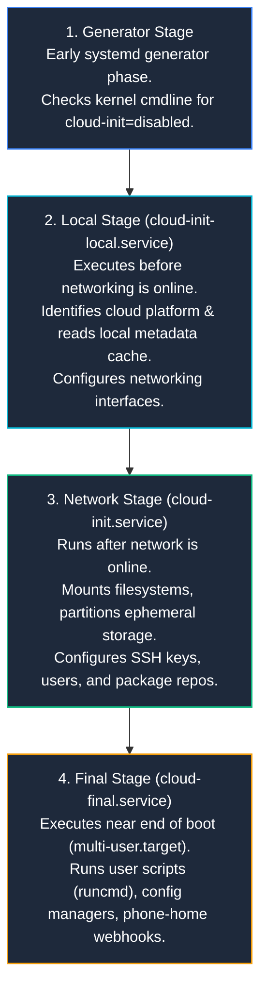

---

### 8.2 CIS Benchmark Baseline & Kernel Parameter Hardening

Below is a production `cloud-init` configuration enforcing CIS Level 1 hardening standards and optimizing the Linux kernel for high-throughput cloud networking and Kubernetes workloads:

```yaml
#cloud-config
# ==============================================================================
# Production Hardened Cloud-Init Baseline Configuration
# ==============================================================================
package_upgrade: true
packages:
  - fail2ban
  - ufw
  - chrony
  - auditd

users:
  - default
  - name: deployer
    gecos: Deployment Automation Service Account
    sudo: ALL=(ALL) NOPASSWD:ALL
    groups: [sudo, adm]
    shell: /bin/bash
    ssh_authorized_keys:
      - ssh-ed25519 AAAAC3NzaC1lZDI1NTE5AAAAIClOUD3NG1nZ3e67B9Xk4w109401948190 deployer@production

write_files:
  - path: /etc/sysctl.d/99-kubernetes-security-hardening.conf
    permissions: "0644"
    owner: root:root
    content: |

# 36. Enable IP forwarding for container bridge networking

net.ipv4.ip_forward = 1
      net.bridge.bridge-nf-call-iptables = 1
      net.bridge.bridge-nf-call-ip6tables = 1

# 37. Defend against TCP SYN Flood attacks

net.ipv4.tcp_syncookies = 1
      net.ipv4.tcp_max_syn_backlog = 8192

# 38. Prevent IP spoofing and ignore bogus ICMP redirects

net.ipv4.conf.all.rp_filter = 1
      net.ipv4.conf.default.rp_filter = 1
      net.ipv4.conf.all.accept_redirects = 0
      net.ipv4.conf.default.accept_redirects = 0
      net.ipv4.conf.all.send_redirects = 0

# 39. Enhance File Descriptor and Virtual Memory limits for high concurrency

fs.file-max = 2097152
      fs.inotify.max_user_watches = 524288
      vm.max_map_count = 262144

# 40. Tune Virtual Memory Swappiness (Aggressively prefer RAM over swap)

vm.swappiness = 10
      vm.dirty_background_ratio = 5
      vm.dirty_ratio = 10

runcmd:
  # Apply hardened sysctl configuration immediately
  - sysctl --system
  # Enforce SSH security: disable password auth and root login
  - sed -i -e '/^#PasswordAuthentication/s/^.*$/PasswordAuthentication no/' /etc/ssh/sshd_config
  - sed -i -e '/^PermitRootLogin/s/^.*$/PermitRootLogin no/' /etc/ssh/sshd_config
  - systemctl restart sshd
  # Configure Host Firewall (UFW)
  - ufw default deny incoming
  - ufw default allow outgoing
  - ufw allow 22/tcp comment 'SSH Management'
  - ufw allow 443/tcp comment 'HTTPS Ingress'
  - ufw --force enable
```

---

# 9. Senior SRE Troubleshooting Playbooks & Diagnostic Runbooks

When an incident hits production, follow these systematic triaging playbooks:

### 9.1 Playbook 1: High CPU / Runaway Process Triage
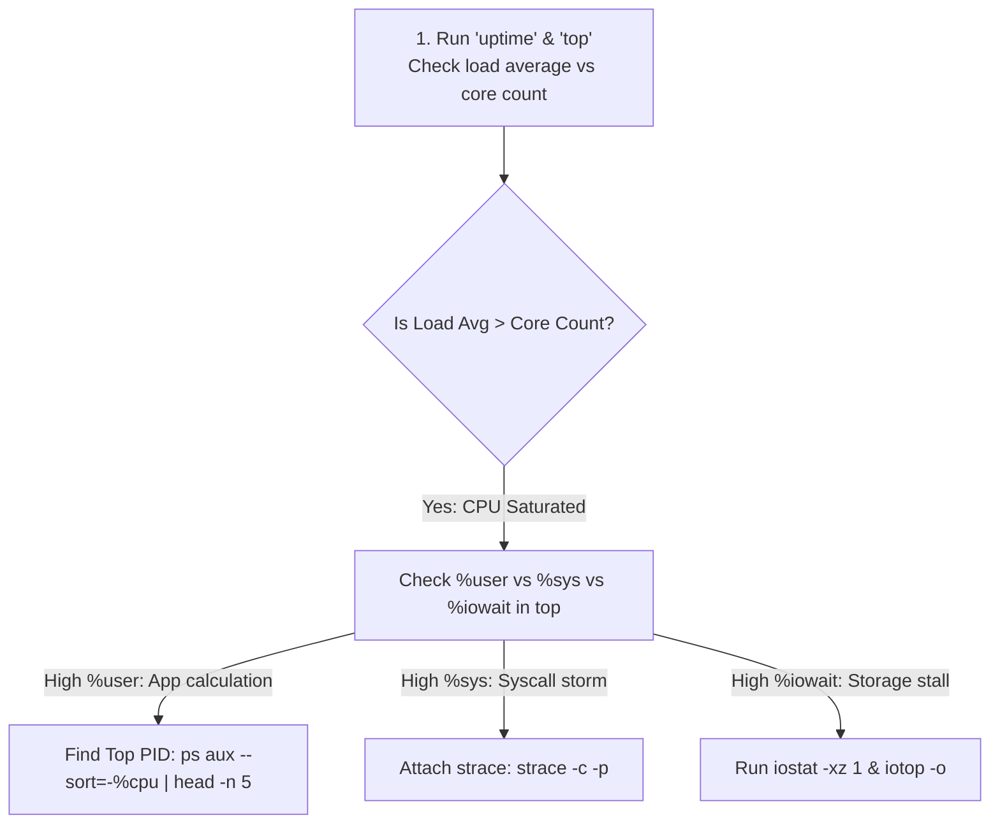
```bash

# 42. Identify top 5 CPU consuming processes with thread count

ps -eo pid,ppid,user,%cpu,%mem,nlwp,comm --sort=-%cpu | head -n 6

# 43. Inspect thread-level CPU usage for a specific process

top -H -p <PID>

# 44. Profile system call frequency of a suspicious PID for 10 seconds

sudo strace -c -p <PID>
```

### 9.2 Playbook 2: Memory Pressure & OOM Investigation
```bash

# 45. Search kernel ring buffer for historical OOM killer executions

sudo dmesg -T | grep -i -E "oom[-_]killer|out of memory"

# 46. Inspect kernel oom_score for active processes

cat /proc/<PID>/oom_score
cat /proc/<PID>/oom_score_adj

# 47. Check for memory fragmentation via buddyinfo

cat /proc/buddyinfo
```

### 9.3 Playbook 3: Network Connection & Port Starvation Triage
```bash

# 48. Count connections by state (identify TIME_WAIT or CLOSE_WAIT leaks)

ss -ant | awk '{print $1}' | sort | uniq -c | sort -nr

# 49. Check for ephemeral port exhaustion

# Check available range:
cat /proc/sys/net/ipv4/ip_local_port_range
# Check number of active outbound connections:
ss -nat '( sport >= 32768 and sport <= 60999 )' | wc -l
```

---

# 10. Summary Comparison & Production Engineering Reference Matrix

### 10.1 Linux Subsystem Operational Mechanics & Triage Matrix

Operating high-density cloud infrastructure demands deep familiarity with the Linux kernel subsystems governing memory, CPU scheduling, storage I/O, networking, and process lifecycle management. When incidents occur in production, senior SREs apply Brendan Gregg's USE Methodology—evaluating **Utilization** (how busy a resource is), **Saturation** (the degree of queued work), and **Errors** (failed transactions or hardware dropped packets).

The operational characteristics, primary failure modes, and canonical resolution strategies across core Linux subsystems:

| Subsystem | Linux Kernel Mechanism | Primary Failure Mode | Detection / Diagnostic Command | Production Resolution Strategy |
| :--- | :--- | :--- | :--- | :--- |
| **Virtual Memory** | 4KB Page Tables, Page Cache, MMU | Memory fragmentation, OOM Termination | `free -m`, `dmesg \| grep -i oom` | Tune `vm.swappiness = 10`, configure `memory.max`, set `oom_score_adj`. |
| **CPU Scheduling** | Completely Fair Scheduler (CFS) | CFS Quota Throttling (P99 latency spikes) | `cat /sys/fs/cgroup/.../cpu.stat` | Remove artificial CPU limits in Kubernetes; size requests accurately. |
| **VFS & Storage** | Inodes, Dentries, Page Cache | Inode exhaustion (`df -i 100%`), unlinked file descriptor leaks | `df -i`, `lsof +L1` | Zero out open unlinked FDs (`> /proc/<PID>/fd/<FD>`), isolate logs. |
| **Networking** | Sockets, Netfilter, Ring Buffers | Conntrack table full, Socket buffer drops | `conntrack -C`, `ss -s`, `ethtool -S` | Increase `nf_conntrack_max`, tune `net.core.somaxconn = 65535`. |
| **Process Control** | `task_struct`, signals, systemd | Zombie accumulation, ungraceful kill | `ps aux \| grep 'Z'`, `journalctl -xeu` | Use PID 1 init wrapper (`tini`), catch `SIGTERM` in application code. |

---

# 11. References & Further Reading

1. **The Linux Kernel Documentation:** Official kernel subsystems, VFS architecture, and CFS scheduling mechanics. [kernel.org/doc/html/latest](https://www.kernel.org/doc/html/latest/).
2. **Linux Cgroups v2 Unified Hierarchy Specification:** Tejun Heo et al., Linux Kernel Organization. [docs.kernel.org/admin-guide/cgroup-v2.html](https://docs.kernel.org/admin-guide/cgroup-v2.html).
3. **systemd System and Service Manager Architecture:** Lennart Poettering et al. [systemd.io](https://systemd.io/).
4. **Systems Performance: Enterprise and the Cloud (2nd Edition):** Brendan Gregg (2020). Addison-Wesley Professional.
5. **Center for Internet Security (CIS) Ubuntu & RHEL Linux Benchmark Guidelines:** [cisecurity.org/benchmark](https://www.cisecurity.org/benchmark/).