# 02. Networking Fundamentals & Cloud Infrastructure Design: Master Guide

A comprehensive, production-grade guide to OSI/TCP-IP networking, packet lifecycle, subnetting (CIDR), routing, DNS, BGP, VPC/VNet architectures, transit hubs, private endpoints, hybrid connectivity (ExpressRoute, Direct Connect), and cloud load balancing.

---

## Architectural Overview: TCP/IP Stack & Packet Flow

Computer networking in the cloud is not an abstract software layer; it is a physical and software-defined pipeline governed by strict protocols. When an application in a Kubernetes pod or virtual machine sends an HTTP request, the data is encapsulated as it descends the client's network stack, traverses software-defined network (SDN) overlays, middleboxes, and cloud routers, and is decapsulated by the destination host.

```mermaid
flowchart TD
    subgraph ClientHost ["Client Host (Application & OS Stack)"]
        AppClient["Application Layer (L7)<br/>HTTP/2, gRPC, TLS 1.3, DNS, REST"]
        TransportClient["Transport Layer (L4)<br/>TCP (Handshake, Sliding Window, Congestion Control) / UDP"]
        NetworkClient["Internet Layer (L3)<br/>IPv4 / IPv6, CIDR Routing Table, TTL, IPSec"]
        LinkClient["Link / Physical Layer (L2/L1)<br/>Ethernet Frames, MAC Addresses, ARP, MTU 1500"]

        AppClient -->|"Encapsulates into payload"| TransportClient
        TransportClient -->|"Prepends TCP header (Port numbers)"| NetworkClient
        NetworkClient -->|"Prepends IP header (Source/Dest IP)"| LinkClient
    end

    subgraph TransitFabric ["Cloud SDN & Transit Fabric"]
        RouterNAT["Cloud Router / NAT Gateway<br/>(Longest Prefix Match, SNAT/DNAT, Conntrack)"]
        L4LB["Layer 4 Load Balancer (NLB / IPVS)<br/>(5-Tuple Consistent Hash, Direct Server Return)"]
        L7Proxy["Layer 7 Reverse Proxy (ALB / Envoy / NGINX)<br/>(TLS Termination, Path Routing, HTTP Keep-Alive)"]

        RouterNAT --> L4LB --> L7Proxy
    end

    subgraph BackendHost ["Target Server Host (Decapsulation)"]
        LinkServer["Link Layer: NIC Ring Buffer & NAPI"]
        NetworkServer["Internet Layer: IP Validation & Netfilter"]
        TransportServer["Transport Layer: Socket Rx Queues"]
        AppServer["Backend Service: epoll Event Loop Listener"]

        LinkServer -->|"Strips Ethernet header"| NetworkServer
        NetworkServer -->|"Strips IP header"| TransportServer
        TransportServer -->|"Strips TCP header"| AppServer
    end

    LinkClient -->|"Physical Transit (Fiber / Overlay VXLAN)"| RouterNAT
    L7Proxy -->|"Private Connection Pool"| LinkServer

    style ClientHost fill:#0f172a,stroke:#3b82f6,stroke-width:1.5px,color:#93c5fd
    style TransitFabric fill:#0f172a,stroke:#f59e0b,stroke-width:1.5px,color:#fde68a
    style BackendHost fill:#0f172a,stroke:#10b981,stroke-width:1.5px,color:#6ee7b7

    style AppClient fill:#1f2937,stroke:#3b82f6,stroke-width:2px,color:#fff
    style TransportClient fill:#1f2937,stroke:#3b82f6,stroke-width:2px,color:#fff
    style NetworkClient fill:#1f2937,stroke:#3b82f6,stroke-width:2px,color:#fff
    style LinkClient fill:#1f2937,stroke:#3b82f6,stroke-width:2px,color:#fff

    style RouterNAT fill:#1f2937,stroke:#f59e0b,stroke-width:2px,color:#fff
    style L4LB fill:#1f2937,stroke:#f59e0b,stroke-width:2px,color:#fff
    style L7Proxy fill:#1f2937,stroke:#f59e0b,stroke-width:2px,color:#fff

    style LinkServer fill:#1f2937,stroke:#10b981,stroke-width:2px,color:#fff
    style NetworkServer fill:#1f2937,stroke:#10b981,stroke-width:2px,color:#fff
    style TransportServer fill:#1f2937,stroke:#10b981,stroke-width:2px,color:#fff
    style AppServer fill:#1f2937,stroke:#10b981,stroke-width:2px,color:#fff
```

---

## Table of Contents
1. [OSI 7-Layer vs. TCP/IP 4-Layer Models & Socket Mechanics](#1-osi-7-layer-vs-tcpip-4-layer-models--socket-mechanics)
   - [1.1 The Postal Analogy & Layer Encapsulation](#11-the-postal-analogy--layer-encapsulation)
   - [1.2 Socket Mechanics and the 5-Tuple Connection Identifier](#12-socket-mechanics-and-the-5-tuple-connection-identifier)
2. [TCP State Machine, Flow Control, and Congestion Control](#2-tcp-state-machine-flow-control-and-congestion-control)
   - [2.1 The TCP 3-Way Handshake & 4-Way Teardown](#21-the-tcp-3-way-handshake--4-way-teardown)
   - [2.2 TCP State Transitions: TIME_WAIT vs. CLOSE_WAIT](#22-tcp-state-transitions-time_wait-vs-close_wait)
   - [2.3 Flow Control (Sliding Window) vs. Congestion Control (CUBIC vs. BBR)](#23-flow-control-sliding-window-vs-congestion-control-cubic-vs-bbr)
   - [2.4 SYN Flood Attacks and Cryptographic TCP SYN Cookies](#24-syn-flood-attacks-and-cryptographic-tcp-syn-cookies)
3. [IP Addressing, CIDR Subnet Math, and IPv6](#3-ip-addressing-cidr-subnet-math-and-ipv6)
   - [3.1 Binary Subnet Math from First Principles](#31-binary-subnet-math-from-first-principles)
   - [3.2 The Cloud Provider 5-IP Deduction Rule](#32-the-cloud-provider-5-ip-deduction-rule)
   - [3.3 IPv6 Architecture & Dual-Stack Cloud Migration](#33-ipv6-architecture--dual-stack-cloud-migration)
4. [DNS Architecture, Resolution Internals, and Records](#4-dns-architecture-resolution-internals-and-records)
   - [4.1 The Distributed DNS Hierarchy: Root, TLD, and Authoritative Servers](#41-the-distributed-dns-hierarchy-root-tld-and-authoritative-servers)
   - [4.2 Comprehensive Record Types (A, AAAA, CNAME, ALIAS, MX, TXT, SOA, SRV)](#42-comprehensive-record-types-a-aaaa-cname-alias-mx-txt-soa-srv)
   - [4.3 Split-Horizon DNS & Cloud Private DNS Zones](#43-split-horizon-dns--cloud-private-dns-zones)
   - [4.4 DNS Caching, TTLs, and the Java DNS Cache Gotcha](#44-dns-caching-ttls-and-the-java-dns-cache-gotcha)
5. [HTTP/1.1 to HTTP/3, TLS 1.3 Cryptography, and PKI](#5-http11-to-http3-tls-13-cryptography-and-pki)
   - [5.1 Protocol Evolution: HTTP/1.1 vs. HTTP/2 Multiplexing vs. HTTP/3 QUIC](#51-protocol-evolution-http11-vs-http2-multiplexing-vs-http3-quic)
   - [5.2 TLS 1.3 1-RTT Handshake & Perfect Forward Secrecy (PFS)](#52-tls-13-1-rtt-handshake--perfect-forward-secrecy-pfs)
   - [5.3 Public Key Infrastructure (PKI) and Mutual TLS (mTLS)](#53-public-key-infrastructure-pki-and-mutual-tls-mtls)
6. [Routing Tables, Gateways, NAT, and BGP](#6-routing-tables-gateways-nat-and-bgp)
   - [6.1 Longest Prefix Match (LPM) Routing Evaluation](#61-longest-prefix-match-lpm-routing-evaluation)
   - [6.2 Source NAT (SNAT), Destination NAT (DNAT), and Port Exhaustion](#62-source-nat-snat-destination-nat-dnat-and-port-exhaustion)
   - [6.3 Anycast Routing & BGP Peering Foundations](#63-anycast-routing--bgp-peering-foundations)
7. [Proxies and Load Balancing: Layer 4 vs. Layer 7](#7-proxies-and-load-balancing-layer-4-vs-layer-7)
   - [7.1 Forward Proxies vs. Reverse Proxies](#71-forward-proxies-vs-reverse-proxies)
   - [7.2 Layer 4 (NLB/IPVS) vs. Layer 7 (ALB/Envoy) Architecture](#72-layer-4-nlbipvs-vs-layer-7-albenvoy-architecture)
   - [7.3 Balancing Algorithms: Round Robin, Least Conn, Consistent Hash](#73-balancing-algorithms-round-robin-least-conn-consistent-hash)
8. [Firewalls, Security Groups, and Network ACLs](#8-firewalls-security-groups-and-network-acls)
   - [8.1 Stateful Firewalls vs. Stateless Network ACLs](#81-stateful-firewalls-vs-stateless-network-acls)
   - [8.2 Linux Netfilter & iptables Packet Processing Architecture](#82-linux-netfilter--iptables-packet-processing-architecture)
9. [MTU, Path MTU Discovery, and Packet Diagnostics](#9-mtu-path-mtu-discovery-and-packet-diagnostics)
   - [9.1 Maximum Transmission Unit (MTU) and the ICMP Black Hole Outage](#91-maximum-transmission-unit-mtu-and-the-icmp-black-hole-outage)
   - [9.2 Production Python Network Health & Latency Auditor](#92-production-python-network-health--latency-auditor)
10. [Senior SRE Network Troubleshooting Runbooks](#10-senior-sre-network-troubleshooting-runbooks)
   - [10.1 Runbook 1: Diagnosing Connection Timeouts vs. Connection Refused](#101-runbook-1-diagnosing-connection-timeouts-vs-connection-refused)
   - [10.2 Runbook 2: Diagnosing Path MTU Black Holes](#102-runbook-2-diagnosing-path-mtu-black-holes)
11. [Enterprise Cloud Network Architecture & CIDR Planning](#11-enterprise-cloud-network-architecture--cidr-planning)
   - [11.1 The Airline Hub Analogy & Why Hub-and-Spoke Dominates](#111-the-airline-hub-analogy--why-hub-and-spoke-dominates)
   - [11.2 Global Non-Overlapping RFC 1918 Address Allocation Strategies](#112-global-non-overlapping-rfc-1918-address-allocation-strategies)
   - [11.3 Multi-Tier Subnet Segmentation (Ingress, App, Data, Management)](#113-multi-tier-subnet-segmentation-ingress-app-data-management)
12. [Software-Defined Networking (SDN) Datapath & Virtualization Mechanics](#12-software-defined-networking-sdn-datapath--virtualization-mechanics)
   - [12.1 Accelerated Networking & SR-IOV Hypervisor Bypass](#121-accelerated-networking--sr-iov-hypervisor-bypass)
   - [12.2 SDN Overlays: VXLAN and NVGRE Packet Encapsulation](#122-sdn-overlays-vxlan-and-nvgre-packet-encapsulation)
13. [Route Tables, Gateways, and Traffic Redirection](#13-route-tables-gateways-and-traffic-redirection)
   - [13.1 Default Cloud System Routes vs. User-Defined Routes (UDRs)](#131-default-cloud-system-routes-vs-user-defined-routes-udrs)
   - [13.2 The Routing Precedence Hierarchy (LPM, UDR, BGP, System)](#132-the-routing-precedence-hierarchy-lpm-udr-bgp-system)
   - [13.3 Managed NAT Gateways & Eliminating SNAT Port Exhaustion](#133-managed-nat-gateways--eliminating-snat-port-exhaustion)
14. [Network Firewalls, Gateway Load Balancers & Perimeter Defense](#14-network-firewalls-gateway-load-balancers--perimeter-defense)
   - [14.1 Next-Generation Firewalls: Azure Firewall Premium vs. AWS Network Firewall](#141-next-generation-firewalls-azure-firewall-premium-vs-aws-network-firewall)
   - [14.2 Gateway Load Balancer (GWLB) & Inline NVA Scaling via GENEVE Encapsulation](#142-gateway-load-balancer-gwlb--inline-nva-scaling-via-geneve-encapsulation)
   - [14.3 Micro-Segmentation: NSG & Security Group Hierarchies](#143-micro-segmentation-nsg--security-group-hierarchies)
15. [Private Link and Private Endpoints](#15-private-link-and-private-endpoints)
   - [15.1 The Death of Public PaaS Endpoints: Private Link Architecture](#151-the-death-of-public-paas-endpoints-private-link-architecture)
   - [15.2 The DNS Resolution Dance: CNAME Flattening & Private DNS Zones](#152-the-dns-resolution-dance-cname-flattening--private-dns-zones)
   - [15.3 Azure Private DNS Resolver & Route 53 Resolver for Hybrid DNS](#153-azure-private-dns-resolver--route-53-resolver-for-hybrid-dns)
16. [Hub-and-Spoke Topology vs. Scaled Transit Fabrics](#16-hub-and-spoke-topology-vs-scaled-transit-fabrics)
   - [16.1 VNet Peering Mechanics & The Non-Transitive Routing Trap](#161-vnet-peering-mechanics--the-non-transitive-routing-trap)
   - [16.2 Scaled Mesh Transit: Azure Virtual WAN vs. AWS Transit Gateway](#162-scaled-mesh-transit-azure-virtual-wan-vs-aws-transit-gateway)
17. [Hybrid Cloud Backbones: ExpressRoute and Direct Connect](#17-hybrid-cloud-backbones-expressroute-and-direct-connect)
   - [17.1 Dedicated Layer 3 Cross-Connects & BGP Dynamic Peering](#171-dedicated-layer-3-cross-connects--bgp-dynamic-peering)
   - [17.2 Automated Active-Passive Failover: ExpressRoute with IPsec VPN Backup](#172-automated-active-passive-failover-expressroute-with-ipsec-vpn-backup)
18. [Global Edge Ingress & Anycast Routing](#18-global-edge-ingress--anycast-routing)
   - [18.1 BGP Anycast Edge Routing (Azure Front Door / CloudFront)](#181-bgp-anycast-edge-routing-azure-front-door--cloudfront)
   - [18.2 Split-TCP Termination & HTTP/3 Performance Acceleration](#182-split-tcp-termination--http3-performance-acceleration)
19. [Automated Network Validation & Routing Audit Script](#19-automated-network-validation--routing-audit-script)
   - [19.1 Complete Production Python CIDR & Route Collision Auditor](#191-complete-production-python-cidr--route-collision-auditor)
20. [Senior Network SRE Troubleshooting Runbooks](#20-senior-network-sre-troubleshooting-runbooks)
   - [20.1 Scenario 1: Asymmetric Routing Black Hole over Hybrid BGP Circuits](#201-scenario-1-asymmetric-routing-black-hole-over-hybrid-bgp-circuits)
   - [20.2 Scenario 2: Private Endpoint DNS Resolution Leak Inside AKS / EKS](#202-scenario-2-private-endpoint-dns-resolution-leak-inside-aks--eks)
   - [20.3 Scenario 3: Ephemeral SNAT Exhaustion on High-Throughput Egress](#203-scenario-3-ephemeral-snat-exhaustion-on-high-throughput-egress)
   - [20.4 Scenario 4: Subnet IP Exhaustion During Sudden Kubernetes Cluster Scaling](#204-scenario-4-subnet-ip-exhaustion-during-sudden-kubernetes-cluster-scaling)
21. [Summary Comparison & Production Engineering Reference Matrix](#21-summary-comparison--production-engineering-reference-matrix)
   - [21.1 Core Networking Fundamentals & Diagnostic Matrix](#211-core-networking-fundamentals--diagnostic-matrix)
   - [21.2 Cloud Network Architecture & Infrastructure Component Reference](#212-cloud-network-architecture--infrastructure-component-reference)
22. [References & Further Reading](#22-references--further-reading)

---

# 1. OSI 7-Layer vs. TCP/IP 4-Layer Models & Socket Mechanics

### 1.1 The Postal Analogy & Layer Encapsulation

#### The Beginner Intuition: Sending a Letter
Imagine writing a confidential letter to a friend living in an apartment complex overseas:
1. **Application (Payload):** The text of the letter ("Hello! How are you?").
2. **Transport (Port numbers):** You specify the apartment number (`Apartment 443`). Without the apartment number, the mailroom wouldn't know which person gets the letter.
3. **Network (IP address):** You place the letter into an envelope with the building's street address (`203.0.113.10`).
4. **Data Link (MAC address / Ethernet frame):** The envelope is placed inside a mail delivery truck carrying mail between local post office distribution centers.

As the letter travels down the stack, each layer wraps the payload inside its own header (**Encapsulation**). When it reaches the destination, each layer strips away its corresponding header (**Decapsulation**).

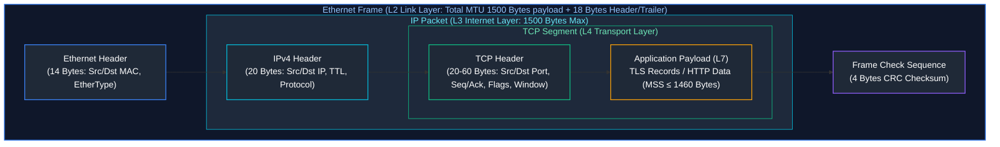

#### Conceptual & Operational Comparison: OSI vs. TCP/IP

While the ISO/OSI model provides an authoritative 7-layer theoretical taxonomy for protocol classification and architectural analysis, production internet infrastructure and cloud networks run strictly on the pragmatic 4-layer TCP/IP protocol suite (RFC 1122). In production software systems, Layers 5 (Session), 6 (Presentation), and 7 (Application) collapse into application process memory, while Layers 1 and 2 are implemented directly by physical NICs, top-of-rack switches, and hypervisor virtual switches.

The structural and architectural mapping across both models:

#### Comparison: Theoretical OSI vs. Pragmatic TCP/IP

| OSI Layer (7-Layer Model) | TCP/IP Layer (4-Layer Model) | Primary Function | Canonical Protocols & Data Units |
| :--- | :--- | :--- | :--- |
| **7. Application** | **Application Layer** | High-level APIs, user-facing protocols | HTTP/1.1, HTTP/2, DNS, gRPC, SSH, SMTP |
| **6. Presentation** | Application Layer | Data serialization, compression, TLS encryption | JSON, Protocol Buffers, TLS 1.3, gzip |
| **5. Session** | Application Layer | Session establishment, RPC tokens | SOCKS, NetBIOS, RPC sessions |
| **4. Transport** | **Transport Layer** | End-to-end reliability, multiplexing, flow control | TCP (Segments), UDP (Datagrams) |
| **3. Network** | **Internet Layer** | Logical addressing, packet routing across networks | IPv4, IPv6, ICMP, IPsec (Packets) |
| **2. Data Link** | **Network Access Layer** | Physical framing, local hop MAC addressing | Ethernet, ARP, VLAN 802.1Q, VXLAN (Frames) |
| **1. Physical** | Network Access Layer | Raw electrical/optical bit transmission | 100G Fiber (Single-mode), Cat6a copper, Bits |

---

### 1.2 Socket Mechanics and the 5-Tuple Connection Identifier

In the Linux kernel, a network connection is represented as a file descriptor pointing to a `struct sock`. Across the entire operating system, every TCP/UDP connection is uniquely identified by a **5-Tuple**:

$$\text{Connection ID} = (\text{Source IP}, \text{Source Port}, \text{Destination IP}, \text{Destination Port}, \text{Protocol})$$

#### Why the 5-Tuple Matters in Cloud Engineering:
- A web server listening on port `443` is **not** limited to 65,535 connections!
- Because the tuple contains the *client's* IP and port, a single server IP and port can concurrently serve **millions of simultaneous TCP connections**, bounded only by kernel memory (RAM consumed by `struct sk_buff` and socket buffers) and open file descriptor limits (`fs.file-max`).
- However, when a client (e.g. an API gateway) connects to a *single* upstream server IP and port, the client is constrained by its ephemeral port range (`32768` to `60999`, ~28,232 outbound connections).

---

# 2. TCP State Machine, Flow Control, and Congestion Control

### 2.1 The TCP 3-Way Handshake & 4-Way Teardown

Transmission Control Protocol (TCP) is a connection-oriented, reliable, byte-stream protocol. Before a single byte of HTTP data can be sent, client and server must synchronize their sequence numbers.

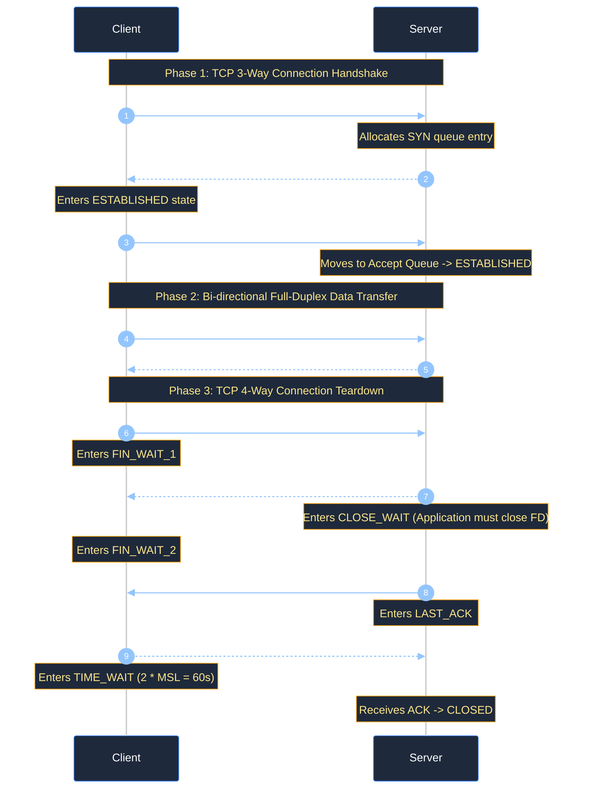

#### Step-by-Step Breakdown:
1. **SYN (Synchronize):** The client selects a cryptographically random Initial Sequence Number (ISN = `1000`) and sends TCP options:
   - **MSS (Maximum Segment Size):** e.g., 1460 bytes (Ethernet MTU 1500 - 20B IP - 20B TCP).
   - **Window Scale (WS):** Allows window sizes up to 1GB instead of the legacy 64KB limit.
   - **SACK Permitted:** Enables Selective Acknowledgments to retransmit only dropped packets.
2. **SYN-ACK:** The server acknowledges the client's ISN (`ack = 1001`) and sends its own ISN (`seq = 5000`).
3. **ACK:** The client acknowledges the server's sequence number (`ack = 5001`). The connection is now `ESTABLISHED`.

---

### 2.2 TCP State Transitions: TIME_WAIT vs. CLOSE_WAIT

Understanding these two states is the single most critical TCP debugging skill for Cloud Engineers and SREs:

```mermaid
flowchart TD
    subgraph TIME_WAIT_Issue ["TIME_WAIT State (Active Closer Side)"]
        TW1["Process calls close() actively"] --> TW2["Connection enters TIME_WAIT"]
        TW2 --> TW3["Kernel holds 5-tuple for 2 * MSL (60s)"]
        TW3 --> TW4["Normal Kernel Behavior:<br/>Prevents old duplicate packets from corrupting new connections"]
    end

    subgraph CLOSE_WAIT_Issue ["CLOSE_WAIT State (Passive Closer Side - BUG!)"]
        CW1["Remote peer sends FIN"] --> CW2["OS Kernel automatically replies with ACK"]
        CW2 --> CW3["Socket enters CLOSE_WAIT"]
        CW3 --> CW4["CRITICAL BUG: Application failed to call close()!<br/>Socket descriptor leaks until app restarts!"]
    end

    style TIME_WAIT_Issue fill:#0f172a,stroke:#3b82f6,stroke-width:1.5px,color:#93c5fd
    style CLOSE_WAIT_Issue fill:#0f172a,stroke:#ef4444,stroke-width:1.5px,color:#fca5a5
    style TW1 fill:#1f2937,stroke:#3b82f6,stroke-width:2px,color:#fff
    style TW2 fill:#1f2937,stroke:#3b82f6,stroke-width:2px,color:#fff
    style TW3 fill:#1f2937,stroke:#3b82f6,stroke-width:2px,color:#fff
    style TW4 fill:#1f2937,stroke:#10b981,stroke-width:2px,color:#fff
    style CW1 fill:#1f2937,stroke:#ef4444,stroke-width:2px,color:#fff
    style CW2 fill:#1f2937,stroke:#ef4444,stroke-width:2px,color:#fff
    style CW3 fill:#1f2937,stroke:#ef4444,stroke-width:2px,color:#fff
    style CW4 fill:#1f2937,stroke:#ef4444,stroke-width:2px,color:#fff
```

- **`TIME_WAIT`:**
  - Occurs on the endpoint that **initiated the close** (usually client or reverse proxy).
  - The socket remains in `TIME_WAIT` for $2 \times \text{MSL}$ (Maximum Segment Lifetime, default 60s in Linux).
  - *Purpose:* Ensures the final `ACK` arrived at the remote end, and allows any lingering delayed packets in transit to expire safely.
  - *Mitigation if exhausting ports:* Enable `net.ipv4.tcp_tw_reuse = 1` in `/etc/sysctl.conf`.
- **`CLOSE_WAIT`:**
  - Occurs on the endpoint that **received the FIN**. The kernel acknowledged the FIN, but the user-space application code forgot to call `socket.close()`!
  - **This is always an application code bug (connection pool leak).** Tuning `sysctl` cannot fix `CLOSE_WAIT`.

---

### 2.3 Flow Control (Sliding Window) vs. Congestion Control (CUBIC vs. BBR)

- **Flow Control (End-to-End):** Prevents a fast sender from overwhelming a slow receiver. The receiver advertises a **Receive Window (`rwnd`)** in every TCP header indicating how many bytes of buffer space remain in its receive queue.
- **Congestion Control (Network-Wide):** Prevents senders from overwhelming the intermediate network routers and switches. Maintained via the **Congestion Window (`cwnd`)**.
  - **TCP CUBIC (Loss-Based):** The legacy standard. Aggressively increases `cwnd` until a packet drop occurs. In modern high-bandwidth cloud networks, packet drops cause "bufferbloat" and severe latency spikes.
  - **TCP BBR (Bottleneck Bandwidth and RTT - Model-Based):** Developed by Google. BBR does not treat packet loss as congestion. Instead, it continuously probes the network to measure **Max Bandwidth** and **Min RTT**, keeping queues empty and achieving 10x-100x lower latency on transatlantic or cross-region cloud links.

```bash
# Enable Google BBR Congestion Control on modern Linux kernels (5.x+)
sudo modprobe tcp_bbr
echo "tcp_bbr" | sudo tee -a /etc/modules-load.d/bbr.conf
echo "net.core.default_qdisc = fq" | sudo tee -a /etc/sysctl.d/99-bbr.conf
echo "net.ipv4.tcp_congestion_control = bbr" | sudo tee -a /etc/sysctl.d/99-bbr.conf
sudo sysctl --system
```

---

### 2.4 SYN Flood Attacks and Cryptographic TCP SYN Cookies

In a standard handshake, when a server receives a `SYN`, it allocates memory in the **SYN Backlog Queue** and waits for the final `ACK`.
- In a **SYN Flood Denial of Service**, an attacker sends millions of spoofed `SYN` packets without ever returning `ACK`.
- The SYN queue overflows, and the server refuses all legitimate incoming connections.

#### The Solution: Cryptographic SYN Cookies (`net.ipv4.tcp_syncookies = 1`)
When the SYN queue fills up, the Linux kernel stops allocating memory for half-open sockets. Instead:
1. It hashes the client's IP, port, server secret, and timestamp into a 32-bit cryptographic hash.
2. It uses this hash as its Initial Sequence Number (`ISN`) in the `SYN-ACK`.
3. When the legitimate client sends the final `ACK`, the acknowledgment number will be $\text{ISN} + 1$.
4. The server subtracts 1, recalculates the cryptographic hash, and if valid, reconstructs the connection on the fly—**allocating zero memory until the handshake is verified!**

---

# 3. IP Addressing, CIDR Subnet Math, and IPv6

### 3.1 Binary Subnet Math from First Principles

An IPv4 address is a 32-bit integer divided into four 8-bit octets separated by dots. In **Classless Inter-Domain Routing (CIDR)** notation, the `/N` suffix indicates how many bits represent the **Network Prefix**, leaving $32 - N$ bits for **Host Addresses**.

#### Step-by-Step Calculation for `10.0.4.0/22`:
1. Total Bits: $32$.
2. Network Bits: $22$.
3. Host Bits: $32 - 22 = 10 \text{ bits}$.
4. Total IP Addresses: $2^{10} = 1024 \text{ addresses}$.
5. Subnet Mask in Binary:
   - Octet 1: `11111111` ($255$)
   - Octet 2: `11111111` ($255$)
   - Octet 3: `11111100` ($252$)
   - Octet 4: `00000000` ($0$)
   - Mask = `255.255.252.0`.
6. IP Range: `10.0.4.0` through `10.0.7.255`.

---

### 3.2 The Cloud Provider 5-IP Deduction Rule

In traditional on-premises networking, **2 IP addresses** are reserved per subnet:
- Network Address (all host bits 0, e.g. `.0`)
- Broadcast Address (all host bits 1, e.g. `.255`)

> [!IMPORTANT]
> **In AWS VPC and Azure VNet, cloud providers reserve 5 IP addresses in every subnet:**
> 1. `x.x.x.0`: Network Address.
> 2. `x.x.x.1`: Subnet Default Gateway Router (VNet / VPC router).
> 3. `x.x.x.2`: Cloud DNS Resolver (e.g., Azure DNS / AWS Route 53 Resolver at VPC base + 2).
> 4. `x.x.x.3`: Reserved by cloud provider for future internal infrastructure routing.
> 5. `x.x.x.255`: Subnet Broadcast Address.

Because every virtual cloud subnet permanently forfeits 5 control-plane IP addresses regardless of subnet size, selecting CIDR masks requires calculating the actual usable capacity for compute nodes, pods, and private endpoints:

#### Cloud Subnet Capacity Reference Table:

| CIDR Prefix | Total IPs ($2^{32-N}$) | On-Prem Usable ($2^H - 2$) | Cloud Usable (AWS/Azure: $2^H - 5$) | Typical Cloud Use Case |
| :---: | :---: | :---: | :---: | :--- |
| **/28** | 16 | 14 | **11** | Minimal Private Endpoint / Application Gateway |
| **/27** | 32 | 30 | **27** | Azure Bastion / Firewall Management Subnet |
| **/26** | 64 | 62 | **59** | Dedicated Database / Redis Subnet |
| **/24** | 256 | 254 | **251** | Standard Microservice / Web Tier Subnet |
| **/22** | 1,024 | 1,022 | **1,019** | Large Kubernetes Cluster (EKS / AKS Node pool) |
| **/16** | 65,536 | 65,534 | **65,531** | Entire Enterprise Virtual Network (VNet / VPC) |

---

### 3.3 IPv6 Architecture & Dual-Stack Cloud Migration

IPv6 expands address space from 32 bits ($4.3 \times 10^9$) to **128 bits** ($3.4 \times 10^{38}$ addresses).

#### Anatomy of an IPv6 Address:
- Canonical form: `2001:0db8:85a3:0000:0000:8a2e:0370:7334`
- **Zero Compression (`::`):** Consecutive blocks of zeros can be compressed once per address: `2001:db8:85a3::8a2e:370:7334`.
- **Subnet Standard:** In IPv6, the universal subscriber subnet prefix is **/64** ($2^{64}$ addresses per subnet). This renders NAT obsolete; every device has a globally routable public address protected by stateful firewall rules.

---

# 4. DNS Architecture, Resolution Internals, and Records

### 4.1 The Distributed DNS Hierarchy: Root, TLD, and Authoritative Servers

DNS is a globally distributed, hierarchical namespace database translating human-readable hostnames (`api.example.com`) into routable IP addresses.

#### Global DNS Namespace Treeview Chart

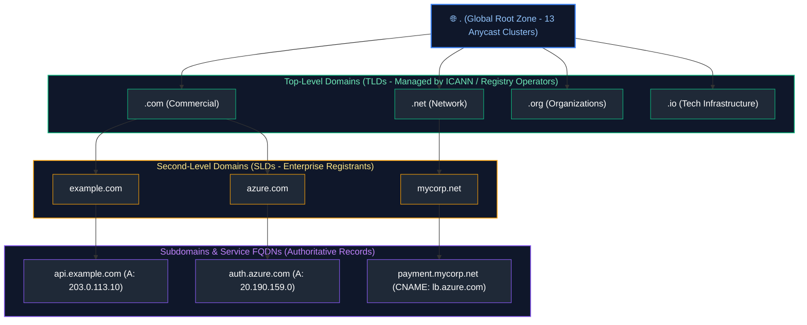

#### The Iterative DNS Resolution Walkthrough

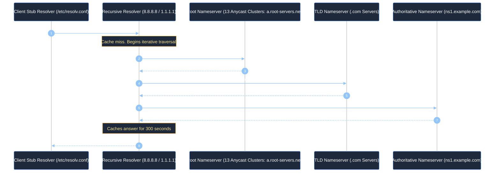

1. **Stub Resolver:** The local client library reading `/etc/resolv.conf` (e.g. pointing to `127.0.0.53` for `systemd-resolved` or cloud DNS `168.63.129.16`).
2. **Recursive Resolver:** Traverses the internet hierarchy on behalf of the client and caches responses according to Time-To-Live (TTL).
3. **Root Nameservers:** 13 logical root server authorities operating thousands of physical nodes worldwide via BGP Anycast routing.
4. **Authoritative Nameserver:** Holds the official DNS records configured by domain administrators.

---

### 4.2 Comprehensive Record Types (A, AAAA, CNAME, ALIAS, MX, TXT, SOA, SRV)

DNS zone databases store discrete resource records (RRs) that dictate how resolvers route network traffic, authenticate domain ownership, and locate internal services. Each record type serves a specialized architectural purpose across internet edge routing and internal VPC name resolution:

| Record Type | Target Value | Description & Cloud Engineering Role |
| :--- | :--- | :--- |
| **`A`** | `203.0.113.10` | Maps hostname to 32-bit IPv4 address. |
| **`AAAA`** | `2001:db8::1` | Maps hostname to 128-bit IPv6 address. |
| **`CNAME`** | `lb.azure.com` | Canonical name alias. **Cannot exist at the zone apex (`example.com`)** per RFC 1034! |
| **`ALIAS / ANAME`** | `lb.azure.com` | Cloud-provider virtual record that resolves CNAME flattening at the zone apex. |
| **`MX`** | `10 mail.corp.com` | Mail exchange server with integer priority (lower number = higher priority). |
| **`TXT`** | `"v=spf1 ..."` | Arbitrary text metadata. Essential for email verification (SPF, DKIM, DMARC) and TLS ACME domain validation challenges. |
| **`SOA`** | Master NS, Email, Serial | Start of Authority: zone administrative metadata and negative caching TTL. |
| **`SRV`** | Priority, Weight, Port, Host | Service locator record; heavily used in Kubernetes headless services and Consul. |

---

### 4.3 Split-Horizon DNS & Cloud Private DNS Zones

In enterprise cloud security, internal servers should never communicate over public IPs. **Split-Horizon DNS** serves different IP addresses based on the requester's network location:

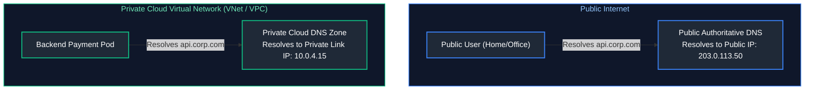

---

### 4.4 DNS Caching, TTLs, and the Java DNS Cache Gotcha

- **Time-To-Live (TTL):** Dictates how many seconds recursive resolvers can cache an answer. During migrations, lower TTL to 60s at least 48 hours prior to cutover.
- **The Java JVM DNS Cache Trap:** By default, if a Java application runs with a security manager or older JDK, the JVM caches DNS lookups **FOREVER (`networkaddress.cache.ttl = -1`)**. If an AWS RDS or Azure SQL database fails over to a replica with a new IP, the Java service continues sending traffic to the dead IP indefinitely!
- **Fix:** Set `-Dsun.net.inetaddr.ttl=30` in JVM startup flags.

---

# 5. HTTP/1.1 to HTTP/3, TLS 1.3 Cryptography, and PKI

### 5.1 Protocol Evolution: HTTP/1.1 vs. HTTP/2 Multiplexing vs. HTTP/3 QUIC

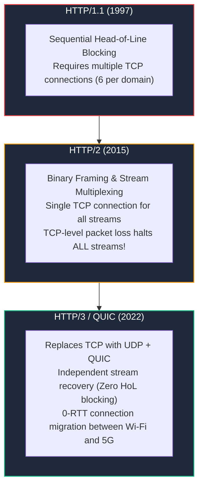

---

### 5.2 TLS 1.3 1-RTT Handshake & Perfect Forward Secrecy (PFS)

TLS 1.3 improves security and connection establishment time over TLS 1.2 by cutting the handshake latency from 2 round-trip times (2-RTT) down to **1-RTT**:

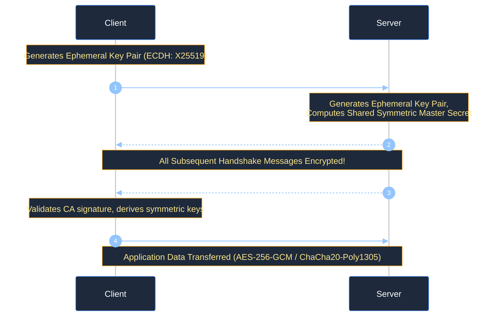

- **Server Name Indication (SNI):** TLS extension sent in `ClientHello` stating which hostname the client wants. This allows a single load balancer IP to host certificates for hundreds of distinct customer domains.
- **Perfect Forward Secrecy (PFS):** Mandated in TLS 1.3. Because ephemeral keys (`ECDHE`) are negotiated for each session and discarded from RAM immediately after, an attacker who steals the server's private key in the future **cannot decrypt recorded historical network traffic**.

---

### 5.3 Public Key Infrastructure (PKI) and Mutual TLS (mTLS)

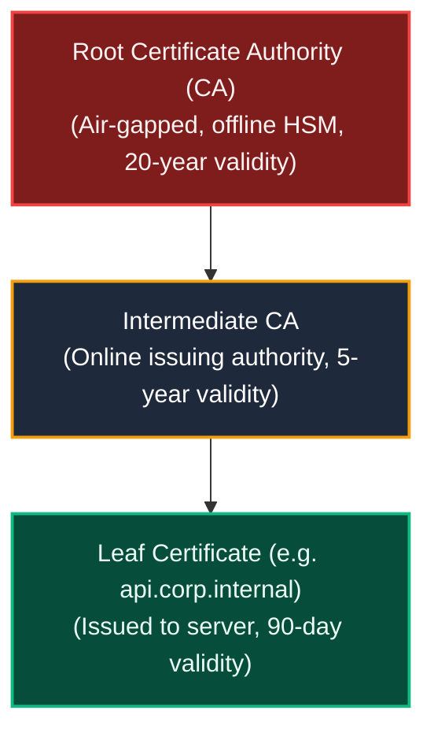

- **Standard TLS:** Server presents certificate to client; client verifies server authenticity.
- **Mutual TLS (mTLS):** Both client and server present X.509 certificates to each other. The server validates that the client is an authorized microservice in the cluster. This is the cryptographic engine powering **Zero Trust Service Meshes** (Istio, Linkerd, Envoy).

---

# 6. Routing Tables, Gateways, NAT, and BGP

### 6.1 Longest Prefix Match (LPM) Routing Evaluation

When a router evaluates where to forward a packet, it compares the packet's destination IP against all entries in its routing table and selects the rule with the **longest prefix match (most specific subnet mask)**:

> **Incoming Packet Destination IP:** `10.0.2.45`

| Evaluation Preference | Route Target CIDR | Next Hop Gateway | Interface | Prefix Length | Decision |
| :---: | :--- | :--- | :---: | :---: | :--- |
| 1 | `0.0.0.0/0` | `192.168.1.1` (Internet GW) | `eth0` | `/0` | Catch-all default route; least specific. |
| 2 | `10.0.0.0/16` | `10.0.0.1` (VNet Peering) | `eth1` | `/16` | Matches subnet, but less specific. |
| 3 | `10.0.2.0/24` | `10.0.2.1` (Local Subnet) | `eth2` | `/24` | **SELECTED (Longest Prefix Match)** |
| 4 | `10.0.2.45/32` | `10.0.2.45` (Direct Host) | `lo` | `/32` | *If present, would beat /24.* |

---

### 6.2 Source NAT (SNAT), Destination NAT (DNAT), and Port Exhaustion

- **Source NAT (SNAT):** Rewrites private RFC 1918 source IP to a public IP on outbound traffic.
- **Destination NAT (DNAT):** Rewrites public destination IP to a private backend server IP on inbound traffic.

#### The Outage: SNAT Port Exhaustion
When hundreds of pods in a private subnet call external APIs (e.g. Stripe, GitHub, Datadog) through a cloud NAT Gateway:
- Every outbound connection to a specific destination IP and port consumes **one ephemeral source port** (out of 65,535).
- If applications open and close connections rapidly without HTTP connection pooling (Keep-Alive), ports enter `TIME_WAIT` for 60 seconds.
- Once all ephemeral ports are allocated, new outbound requests fail with: `Connection timed out` or `Cannot assign requested address`.
- **Architectural Solution:** Implement HTTP Keep-Alive connection pools in application code, use Cloud Private Endpoints / PrivateLink for cloud APIs, or allocate multiple public IPs to the NAT Gateway.

---

### 6.3 Anycast Routing & BGP Peering Foundations

- **Unicast:** One IP address maps to one physical server.
- **Anycast:** **The same IP address is advertised simultaneously by hundreds of data centers worldwide** via Border Gateway Protocol (BGP).
- When a user queries `1.1.1.1` (Cloudflare) or `8.8.8.8` (Google), global ISP BGP routers route packets to the geographically closest data center. If one data center goes dark, BGP automatically routes traffic to the next closest facility.

---

# 7. Proxies and Load Balancing: Layer 4 vs. Layer 7

### 7.1 Forward Proxies vs. Reverse Proxies

- **Forward Proxy (Client-Side Guardian):** Protects and regulates outbound client traffic. Enforces enterprise egress compliance, URL filtering, and data loss prevention (DLP).
- **Reverse Proxy (Server-Side Guardian):** Protects origin application servers. Sits at the edge to terminate TLS, balance traffic, enforce WAF security rules, and cache static assets.

---

### 7.2 Layer 4 (NLB/IPVS) vs. Layer 7 (ALB/Envoy) Architecture

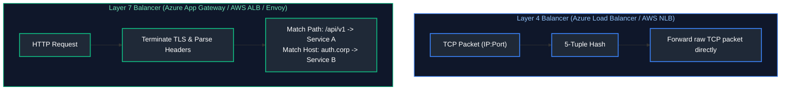

| Dimension | Layer 4 Load Balancer (NLB) | Layer 7 Load Balancer (ALB / Envoy) |
| :--- | :--- | :--- |
| **Inspection Scope** | IP and Port only | Full HTTP payload, headers, cookies, query parameters |
| **Throughput & Latency**| Millions of requests/sec; sub-millisecond latency | Tens of thousands of requests/sec; 2-15ms latency overhead |
| **TLS Termination** | Pass-through or TLS termination | Terminates TLS; injects `X-Forwarded-For` and `X-Forwarded-Proto` |
| **Routing Capability** | IP/Port hashing only | Path routing (`/users`), header routing, cookie stickiness |

---

### 7.3 Balancing Algorithms: Round Robin, Least Conn, Consistent Hash

1. **Round Robin:** Distributes requests sequentially across backends. Poor fit if requests have drastically differing processing times.
2. **Least Connections:** Forwards request to the backend with the fewest active TCP connections. Ideal for long-lived database sessions or WebSockets.
3. **Consistent Hashing (Ketama Ring):** Hashes a key (e.g., Client IP or User ID) onto a circular hash ring. Essential for caching tiers (e.g. Memcached, Redis) because adding or removing a node only redistributes $1/N$ of keys instead of invalidating the entire cache.

---

# 8. Firewalls, Security Groups, and Network ACLs

### 8.1 Stateful Firewalls vs. Stateless Network ACLs

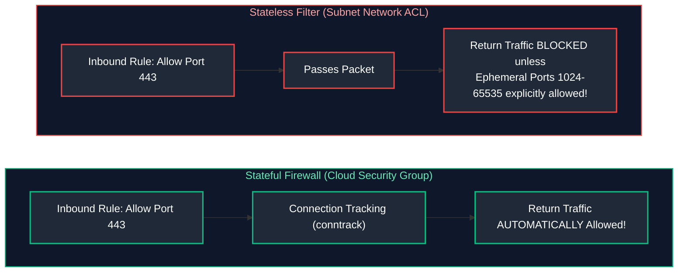

- **Security Groups (Stateful):** If you permit inbound traffic on port 443, the return traffic from the server to the client is automatically permitted regardless of outbound rules.
- **Network ACLs (Stateless):** Evaluates every packet independently. If you open inbound port 443, you **must explicitly configure an outbound rule allowing ephemeral return ports (`1024-65535`)**, or the connection will hang!

---

### 8.2 Linux Netfilter & iptables Packet Processing Architecture

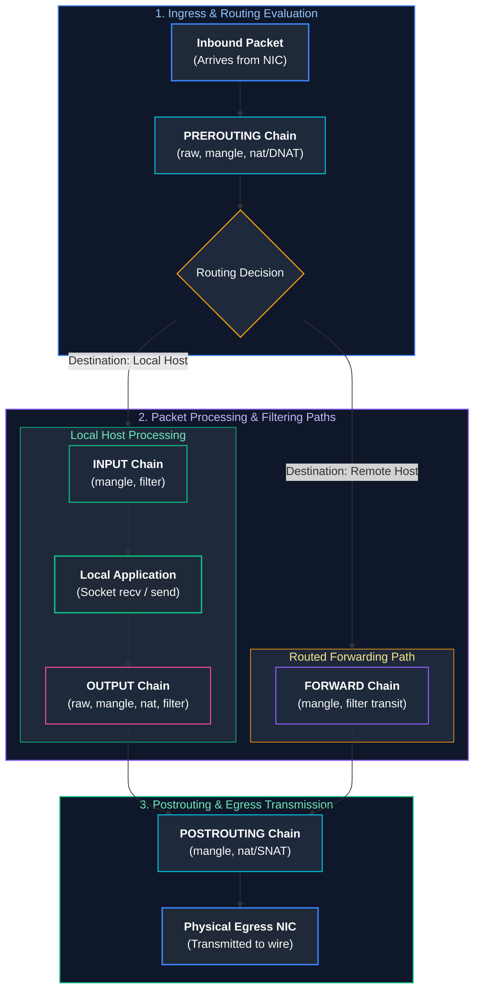

---

# 9. MTU, Path MTU Discovery, and Packet Diagnostics

### 9.1 Maximum Transmission Unit (MTU) and the ICMP Black Hole Outage

- Standard Ethernet MTU is **1500 bytes**.
- Cloud VPCs often support **Jumbo Frames (9001 bytes)** for intra-VPC communication.
- When a packet traverses an intermediate router whose MTU is smaller than the packet size, the router checks the **Don't Fragment (DF)** bit in the IP header.
  - If DF is 0: The router breaks the packet into fragments (introducing reassembly overhead).
  - If DF is 1: The router drops the packet and returns an **ICMP Type 3, Code 4 ("Fragmentation Needed and DF set")** message telling the client to reduce its MTU (**Path MTU Discovery / PMTUD**).

#### The "MTU Black Hole" Nightmare:
If a firewall blocks all ICMP traffic, the ICMP Type 3 Code 4 notice is discarded.
- Small TCP handshakes (SYN, ACK) succeed effortlessly.
- Large HTTP POST requests or TLS certificate exchanges freeze and time out!
- **Fix:** Clamp TCP MSS on the gateway router:
  `iptables -t mangle -A FORWARD -p tcp --tcp-flags SYN,RST SYN -j TCPMSS --clamp-mss-to-pmtu`

---

### 9.2 Production Python Network Health & Latency Auditor

Below is a complete, runnable Python diagnostic utility measuring DNS resolution time, TCP handshake latency, and TLS certificate expiration with sub-millisecond precision:

```python
#!/usr/bin/env python3
"""
Enterprise Network & Endpoint Latency Diagnostic Tool.
Audits DNS resolution speed, TCP handshake duration, and SSL certificate health.
Zero external dependencies.
"""

from dataclasses import asdict, dataclass
from datetime import datetime, timezone
import json
import logging
import socket
import ssl
import sys
import time
from typing import List, Optional

logging.basicConfig(
    level=logging.INFO,
    format='{"time":"%(asctime)s","logger":"%(name)s","level":"%(levelname)s","message":"%(message)s"}',
    handlers=[logging.StreamHandler(sys.stdout)],
)
logger = logging.getLogger("net_auditor")

@dataclass(frozen=True)
class EndpointMetrics:
    host: str
    port: int
    resolved_ip: str
    dns_time_ms: float
    tcp_handshake_ms: float
    tls_handshake_ms: Optional[float]
    cert_expiry_days: Optional[int]
    status: str
    error: str = ""

class NetworkProbe:
    def __init__(self, timeout_sec: float = 3.0):
        self.timeout = timeout_sec

    def audit_endpoint(self, host: str, port: int = 443) -> EndpointMetrics:
        dns_start = time.perf_counter()
        resolved_ip = ""
        try:
            addr_info = socket.getaddrinfo(host, port, family=socket.AF_INET, type=socket.SOCK_STREAM)
            resolved_ip = addr_info[0][4][0]
            dns_time_ms = (time.perf_counter() - dns_start) * 1000.0
        except socket.gaierror as err:
            return EndpointMetrics(
                host=host, port=port, resolved_ip="", dns_time_ms=0.0,
                tcp_handshake_ms=0.0, tls_handshake_ms=None, cert_expiry_days=None,
                status="DNS_FAILURE", error=str(err)
            )

        sock = socket.socket(socket.AF_INET, socket.SOCK_STREAM)
        sock.settimeout(self.timeout)
        tcp_start = time.perf_counter()

        try:
            sock.connect((resolved_ip, port))
            tcp_time_ms = (time.perf_counter() - tcp_start) * 1000.0
        except (socket.timeout, socket.error) as err:
            sock.close()
            return EndpointMetrics(
                host=host, port=port, resolved_ip=resolved_ip, dns_time_ms=round(dns_time_ms, 2),
                tcp_handshake_ms=0.0, tls_handshake_ms=None, cert_expiry_days=None,
                status="TCP_FAILURE", error=str(err)
            )

        tls_time_ms = None
        cert_days = None

        if port == 443:
            tls_start = time.perf_counter()
            ssl_ctx = ssl.create_default_context()
            try:
                with ssl_ctx.wrap_socket(sock, server_hostname=host) as ssock:
                    tls_time_ms = (time.perf_counter() - tls_start) * 1000.0
                    cert = ssock.getpeercert()
                    if cert and "notAfter" in cert:
                        expire_date = datetime.strptime(cert["notAfter"], "%b %d %H:%M:%S %Y %Z").replace(tzinfo=timezone.utc)
                        cert_days = (expire_date - datetime.now(timezone.utc)).days
            except Exception as err:
                return EndpointMetrics(
                    host=host, port=port, resolved_ip=resolved_ip, dns_time_ms=round(dns_time_ms, 2),
                    tcp_handshake_ms=round(tcp_time_ms, 2), tls_handshake_ms=None, cert_expiry_days=None,
                    status="TLS_FAILURE", error=str(err)
                )
        else:
            sock.close()

        return EndpointMetrics(
            host=host, port=port, resolved_ip=resolved_ip,
            dns_time_ms=round(dns_time_ms, 2),
            tcp_handshake_ms=round(tcp_time_ms, 2),
            tls_handshake_ms=round(tls_time_ms, 2) if tls_time_ms else None,
            cert_expiry_days=cert_days,
            status="HEALTHY",
        )

if __name__ == "__main__":
    endpoints = [
        ("google.com", 443),
        ("cloudflare.com", 443),
        ("api.github.com", 443),
    ]
    probe = NetworkProbe(timeout_sec=2.5)
    results = [asdict(probe.audit_endpoint(h, p)) for h, p in endpoints]
    print(json.dumps(results, indent=2))
```

---

# 10. Senior SRE Network Troubleshooting Runbooks

### 10.1 Runbook 1: Diagnosing Connection Timeouts vs. Connection Refused
- **`Connection Refused`:** The packet reached the destination host, but **no process is listening on that port**, or a local firewall sent an explicit `TCP RST`.
  - *Action:* Verify process is running (`systemctl status`), verify listening ports (`ss -tulpn | grep <port>`).
- **`Connection Timed Out`:** Packets are being **silently dropped** by a middlebox, firewall, or security group.
  - *Action:* Check cloud Security Groups, Subnet NACLs, route table default gateway, and test with `nc -zv -w 3 <IP> <PORT>`.

### 10.2 Runbook 2: Diagnosing Path MTU Black Holes
```bash
# Test MTU with Don't Fragment (DF) flag set from Linux
# Syntax: ping -M do -s <packet_size> <target_ip>
# Note: 1472 bytes payload + 28 bytes IP/ICMP header = 1500 bytes MTU
ping -M do -s 1472 8.8.8.8
```
- If it responds: Standard 1500 byte MTU is healthy.
- If it returns `Frag needed and DF set`: Lower packet size iteratively to find the bottleneck path MTU.

---

# 11. Enterprise Cloud Network Architecture & CIDR Planning

### 11.1 The Airline Hub Analogy & Why Hub-and-Spoke Dominates

To understand why enterprise cloud networking enforces a **Hub-and-Spoke topology**, consider how commercial airlines organize flights:

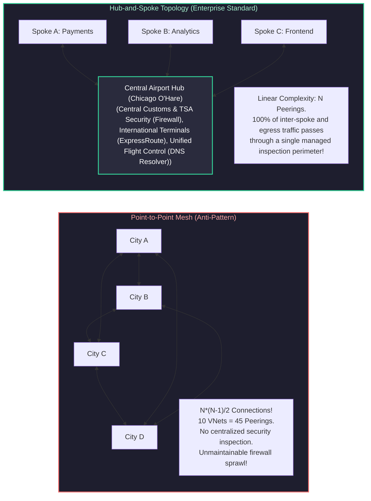

- **Point-to-Point Mesh:** If 50 application VNets establish direct peerings with each other, you must manage $N(N-1)/2 = 1,225$ peerings. Security teams have zero visibility into inter-application traffic, and compliance audits become impossible.
- **Hub-and-Spoke:** Each spoke establishes a single peering to the central Hub. The Hub enforces centralized security inspection, outbound NAT, hybrid on-premises connectivity, and DNS resolution. Managing 50 spokes requires exactly **50 peerings**, with 100% of packets subject to central auditing.

---

### 11.2 Global Non-Overlapping RFC 1918 Address Allocation Strategies

Private IPv4 space (RFC 1918) is strictly limited:
- `10.0.0.0/8` (16,777,216 addresses)
- `172.16.0.0/12` (1,048,576 addresses)
- `192.168.0.0/16` (65,536 addresses)

In large enterprises with on-premises data centers, branch offices, and multi-region cloud deployments, **overlapping CIDRs cause immediate routing collisions**. Overlapping subnets cannot be peered without complex, high-latency 1:1 Source/Destination NAT translation gateways.

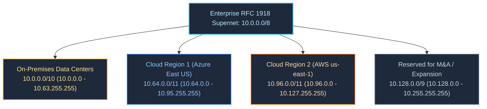

---

### 11.3 Multi-Tier Subnet Segmentation (Ingress, App, Data, Management)

Enterprise spoke VNets follow the standardized **3-Tier Subnet Architecture**:

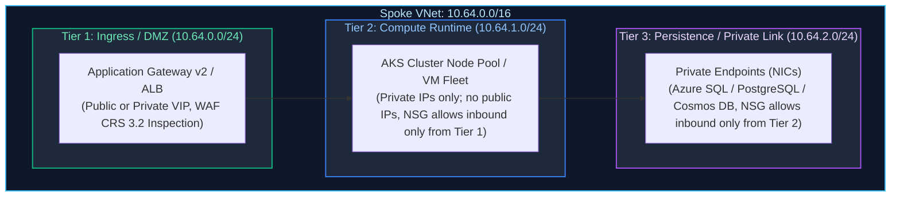

> [!IMPORTANT]
> **Cloud Provider Reserved IP Addresses:** Both Azure and AWS reserve specific IP addresses in every subnet:
> - **Azure reserves 5 IPs per subnet:** `.0` (Network ID), `.1` (Default Gateway), `.2` & `.3` (Azure DNS mapping), `.255` (Network Broadcast).
> - **AWS reserves 5 IPs per subnet:** `.0` (Network ID), `.1` (VPC Router), `.2` (DNS resolver), `.3` (Future use), `.255` (Network Broadcast).
> Therefore, a `/28` subnet (16 total IP addresses) yields only **11 usable host addresses**.

---

# 12. Software-Defined Networking (SDN) Datapath & Virtualization Mechanics

### 12.1 Accelerated Networking & SR-IOV Hypervisor Bypass

Traditional cloud virtualization routes every network packet through the host operating system's software hypervisor bridge, introducing significant jitter, CPU overhead, and microsecond latency penalties:

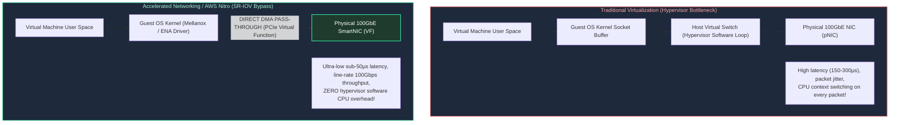

- **SR-IOV (Single Root I/O Virtualization):** Exposes physical PCIe network hardware as hundreds of virtual functions (VFs). The guest OS interacts directly with the SmartNIC hardware via Direct Memory Access (DMA), bypassing the virtualization hypervisor completely.
- **Production Standard:** In Azure, always enable `accelerated_networking_enabled = true`. In AWS, utilize instance types backed by the **AWS Nitro System** with Elastic Network Adapter (ENA).

---

### 12.2 SDN Overlays: VXLAN and NVGRE Packet Encapsulation

Under the hood of Azure Virtual Networks and AWS VPCs lies a physical spine-and-leaf physical IP network. Cloud providers implement **SDN Overlays** using **VXLAN (Virtual Extensible LAN)** or **NVGRE (Network Virtualization using Generic Routing Encapsulation)**:
1. When VM A (`10.1.1.4`) sends a packet to VM B (`10.1.2.8`), the guest kernel constructs a standard Ethernet frame.
2. The physical SmartNIC intercepts the frame, inspects the SDN directory service mapping, and wraps the customer payload inside an outer **UDP packet (port 4789 for VXLAN)** addressed between the physical hypervisor host IPs.
3. The outer packet is routed across the physical data center fabric via standard Layer 3 Equal-Cost Multi-Path (ECMP).
4. The receiving host SmartNIC decapsulates the outer UDP header and deposits the original payload directly into VM B’s memory.

---

# 13. Route Tables, Gateways, and Traffic Redirection

### 13.1 Default Cloud System Routes vs. User-Defined Routes (UDRs)

By default, cloud platforms configure invisible **System Routes** in every subnet:
- Traffic between subnets in the same VNet: Routed directly via `Virtual network`.
- Traffic across peered VNets: Routed directly via `VNet peering`.
- Traffic to `0.0.0.0/0`: Routed directly to `Internet` via transparent cloud SNAT.

To build an enterprise DMZ where all traffic is inspected by a central firewall, network engineers override system routes using **User-Defined Routes (UDRs) / Custom Route Tables**:

```yaml
# Conceptual UDR Routing Rule
AddressPrefix: 0.0.0.0/0
NextHopType: VirtualAppliance
NextHopIPAddress: 10.0.1.4  # Central Azure Firewall Private IP
```

---

### 13.2 The Routing Precedence Hierarchy (LPM, UDR, BGP, System)

When multiple routes exist in a cloud route table, the SDN packet forwarding engine evaluates routes in strict order of precedence:

$$\text{Longest Prefix Match (LPM)} \longrightarrow \text{User-Defined Route (UDR)} \longrightarrow \text{BGP ExpressRoute / DirectConnect} \longrightarrow \text{System Default Route}$$

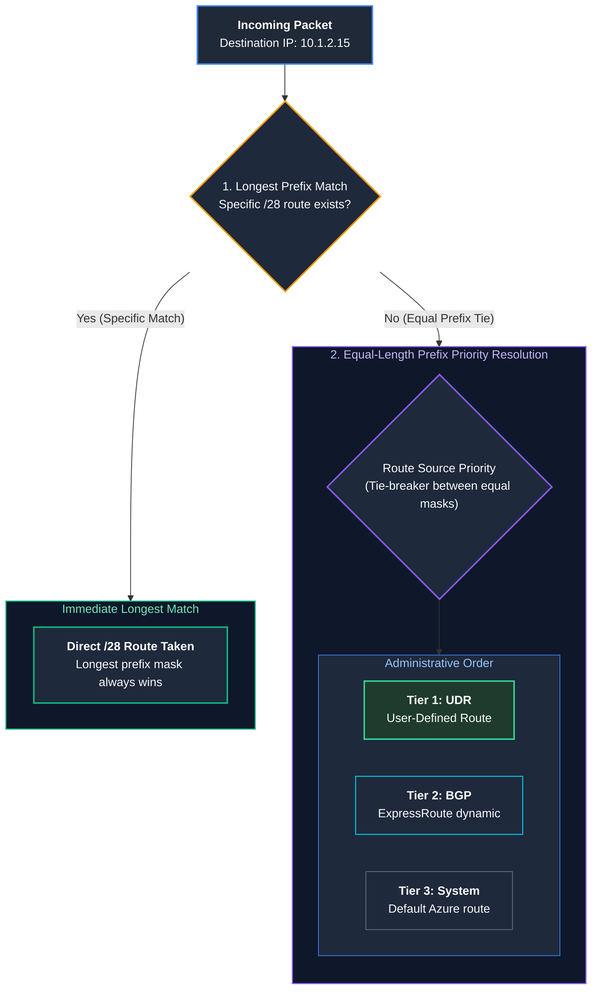

> [!CRITICAL]
> **The Longest Prefix Match (LPM) Rule:** LPM **always trumps route source priority**. If a UDR defines `0.0.0.0/0 -> 10.0.1.4`, but an active BGP route advertises `10.0.0.0/8 -> ExpressRouteGateway`, traffic targeting `10.1.2.15` will follow the BGP route because `/8` is more specific than `/0`! To force inter-VNet traffic through the firewall, you must define explicit, more specific UDRs (e.g. `10.0.0.0/8 -> 10.0.1.4`).

---

### 13.3 Managed NAT Gateways & Eliminating SNAT Port Exhaustion

When private instances initiate outbound connections to public endpoints (e.g., third-party APIs, GitHub, package registries), the cloud performs **Source Network Address Translation (SNAT)**.
- **Default Azure/AWS SNAT (Anti-Pattern):** Allocates a fixed pool of 1,024 ephemeral ports per instance. Under high concurrency, the instance rapidly consumes all ephemeral ports, resulting in silent connection dropouts and 30-second TCP SYN retransmission timeouts.
- **Managed NAT Gateway (Best Practice):** Allocates a dedicated pool of static public IPs. Each public IP provides **64,512 concurrent SNAT ports**. With 16 public IPs attached, a single NAT Gateway provides over **1,000,000 concurrent outbound connections**.

---

# 14. Network Firewalls, Gateway Load Balancers & Perimeter Defense

### 14.1 Next-Generation Firewalls: Azure Firewall Premium vs. AWS Network Firewall

| Capability | Azure Firewall Premium | AWS Network Firewall |
| :--- | :--- | :--- |
| **Inspection Engine** | Microsoft Threat Intelligence & Suricata-based IDPS | Open-source **Suricata** rules engine |
| **TLS Forward-Proxy Inspection** | Built-in TLS termination & re-encryption via Key Vault intermediate CA | Supported via TLS inspection configurations and AWS ACM CA |
| **FQDN Filtering** | Layer 7 application rules with wildcard FQDNs (e.g., `*.github.com`) | Stateful Layer 7 domain list rule groups (HTTP Host & SNI) |
| **High Availability Architecture** | Fully managed active-active autoscaling cluster behind internal VIP | Endpoint deployed per Availability Zone inside a dedicated firewall subnet |
| **Throughput & Scaling** | Autoscales dynamically up to 100 Gbps | Scales elastically up to 100 Gbps per AZ |

---

### 14.2 Gateway Load Balancer (GWLB) & Inline NVA Scaling via GENEVE Encapsulation

When enterprises deploy third-party **Network Virtual Appliances (NVAs)** (e.g., Palo Alto Networks VM-Series, Fortinet FortiGate, Check Point CloudGuard), scaling them horizontally without breaking TCP session symmetry requires **Gateway Load Balancer (GWLB)**:

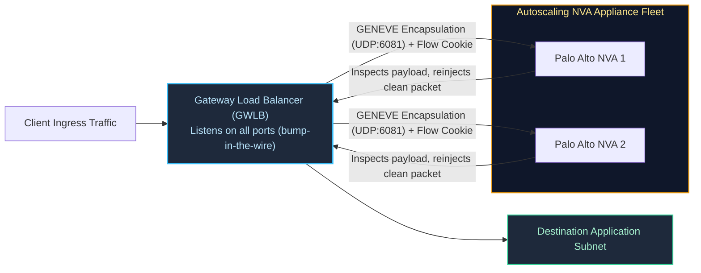

- **GENEVE Protocol (Port 6081):** GWLB wraps customer packets inside a GENEVE header containing a **Flow Cookie**. The NVA inspects the original packet headers, applies Layer 7 threat rules, and returns the packet to GWLB via GENEVE.
- **Session Stickiness:** GWLB guarantees that bidirectional TCP flows are routed to the **exact same physical firewall appliance**, preserving stateful TCP tracking without complex dual-arm SNAT configurations.

---

### 14.3 Micro-Segmentation: NSG & Security Group Hierarchies

Network Security Groups (NSGs) and AWS Security Groups enforce stateful Layer 4 micro-segmentation at the network interface (NIC) boundary:
- **Subnet-Level NSG:** Protects the perimeter of the entire subnet.
- **NIC-Level NSG:** Provides defense-in-depth directly on the individual virtual machine or container network interface.
- **Stateful Rule Processing:** If an outbound rule permits traffic to a remote IP, return inbound traffic is **automatically allowed** regardless of inbound deny rules.

---

# 15. Private Link and Private Endpoints

### 15.1 The Death of Public PaaS Endpoints: Private Link Architecture

Historically, cloud databases and storage accounts exposed public IP addresses accessible via the internet. Even when protected by IP firewall whitelists, traffic was exposed to credential brute-forcing, distributed denial-of-service (DDoS) attacks, and data exfiltration.

**Private Link** completely eliminates public endpoints by projecting a **virtual network interface (NIC) with a private RFC 1918 IP address** directly into your private subnet:

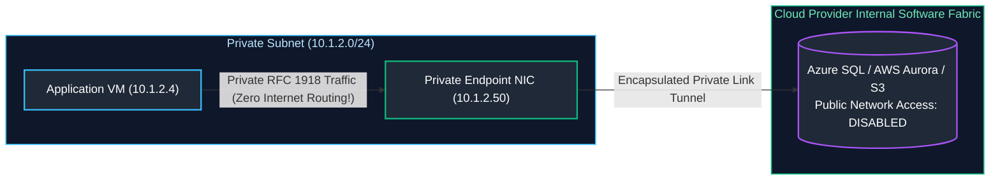

---

### 15.2 The DNS Resolution Dance: CNAME Flattening & Private DNS Zones

When you attach a Private Endpoint to `mydb.database.windows.net`, the cloud DNS updates public DNS to return a canonical name (CNAME) pointing to a private link domain:

```mermaid
%%{init: {'theme': 'dark', 'themeVariables': { 'actorBkg': '#1e293b', 'actorBorder': '#3b82f6', 'actorTextColor': '#ffffff', 'signalColor': '#93c5fd', 'signalTextColor': '#ffffff', 'noteBkgColor': '#1e293b', 'noteBorderColor': '#f59e0b', 'noteTextColor': '#fde68a', 'activationBkgColor': '#3b82f6', 'sequenceNumberColor': '#ffffff' }}}%%
sequenceDiagram
    autonumber
    participant App as Application Pod
    participant DNS as Azure Private DNS / Route 53 Resolver
    participant PublicDNS as Internet Public DNS (1.1.1.1)

    App->>DNS: Query: mydb.database.windows.net
    Note over DNS: DNS detects CNAME record: mydb.privatelink.database.windows.net
    DNS->>DNS: Evaluates linked Private DNS Zone: privatelink.database.windows.net
    DNS-->>App: Returns PRIVATE IP: 10.1.2.50
    App->>App: Connects to 10.1.2.50 (Encrypted TLS session established)

    Note over App,PublicDNS: IF PRIVATE DNS ZONE IS MISSING OR MISCONFIGURED:
    App->>PublicDNS: Query: mydb.database.windows.net
    PublicDNS-->>App: Resolves CNAME to PUBLIC IP: 40.112.54.12
    App->>PublicDNS: Connects to 40.112.54.12 -> FIREWALL BLOCKS CONNECTION (Connection Timed Out!)
```

---

### 15.3 Azure Private DNS Resolver & Route 53 Resolver for Hybrid DNS

In hybrid enterprise architectures, on-premises corporate servers must resolve cloud Private Endpoints, and cloud workloads must resolve on-premises Active Directory domains:

```mermaid
flowchart LR
    subgraph OnPrem ["On-Premises Data Center"]
        OnPremDNS["On-Premises Windows DNS Server (192.168.1.10)"]
    end

    subgraph HubVNet ["Cloud Connectivity Hub VNet"]
        InboundEndpoint["Inbound DNS Endpoint (10.0.2.4)<br/>Receives forwarded queries from on-premises"]
        OutboundEndpoint["Outbound DNS Endpoint (10.0.2.5)<br/>Forwards queries to on-premises DNS"]
        CloudDNS["Azure Private DNS Zone / AWS Route 53<br/>(privatelink.database.windows.net)"]
    end

    OnPremDNS -->|"Conditional Forwarder: *.privatelink -> 10.0.2.4"| InboundEndpoint
    InboundEndpoint --> CloudDNS
    OutboundEndpoint -->|"Conditional Forwarder: corp.internal -> 192.168.1.10"| OnPremDNS

    style OnPrem fill:#1e293b,stroke:#ec4899,stroke-width:1.5px,color:#f472b6
    style HubVNet fill:#0f172a,stroke:#38bdf8,stroke-width:1.5px,color:#bae6fd
```

---

# 16. Hub-and-Spoke Topology vs. Scaled Transit Fabrics

### 16.1 VNet Peering Mechanics & The Non-Transitive Routing Trap

Virtual Network Peering connects two VNets over the cloud provider's low-latency fiber backbone. Traffic between peered VNets exhibits **zero gateway latency and line-rate throughput**.

> [!CAUTION]
> **The Non-Transitive Routing Trap:** Cloud VNet peering is **strictly non-transitive**. 
> - If Spoke A is peered to Hub, and Spoke B is peered to Hub, **Spoke A cannot communicate with Spoke B directly through the peering**.
> - To route traffic between Spoke A and Spoke B, traffic must be forwarded through a router or firewall inside the Hub using User-Defined Routes (UDRs) specifying `NextHop: VirtualAppliance`.

---

### 16.2 Scaled Mesh Transit: Azure Virtual WAN vs. AWS Transit Gateway

When enterprise network topologies scale beyond 30 Spokes across multiple geographic regions, managing hundreds of UDRs and peering meshes becomes unmaintainable. Enterprises deploy **Managed Transit Fabrics**:

```mermaid
flowchart TD
    subgraph EnterpriseTransitFabric ["Centralized Transit Engine (Azure vWAN / AWS Transit Gateway)"]
        TransitCore["Transit Hub Core Router<br/>(BGP Dynamic Route Propagation, Automated Transitive Any-to-Any Routing, Up to 50 Gbps per VPC/VNet Attachment)"]
        FirewallService["Integrated Centralized Firewall Inspection"]
        TransitCore <--> FirewallService
    end

    Spoke1["Spoke 1: Core Banking"] <--> TransitCore
    Spoke2["Spoke 2: Fraud Detection"] <--> TransitCore
    Spoke3["Spoke 3: Digital Channels"] <--> TransitCore
    ExpressRouteGW["Dedicated ExpressRoute / Direct Connect"] <--> TransitCore

    style EnterpriseTransitFabric fill:#0f172a,stroke:#38bdf8,stroke-width:1.5px,color:#bae6fd
    style TransitCore fill:#1e293b,stroke:#38bdf8,stroke-width:2px,color:#fff
    style FirewallService fill:#1e293b,stroke:#ef4444,stroke-width:2px,color:#fff
```

- **Azure Virtual WAN (vWAN):** A Microsoft-managed networking service connecting branch offices, VPNs, ExpressRoute circuits, and VNets into an automated hub-and-spoke mesh. Route propagation is fully automated without manual UDR authoring.
- **AWS Transit Gateway (TGW):** A regional network transit hub connecting thousands of VPCs and on-premises networks over an elastic AWS-managed router supporting BGP dynamic route evaluation.

---

# 17. Hybrid Cloud Backbones: ExpressRoute and Direct Connect

### 17.1 Dedicated Layer 3 Cross-Connects & BGP Dynamic Peering

Enterprise hybrid connectivity requires private, dedicated bandwidth bypassing the public internet:
- **Azure ExpressRoute & AWS Direct Connect:** Dedicated physical cross-connects (1 Gbps, 10 Gbps, or 100 Gbps) established at carrier colocation facilities (Equinix, Megaport, Digital Realty).
- **BGP Dynamic Peering (RFC 4271):** ExpressRoute and Direct Connect exchange routes dynamically using Border Gateway Protocol (BGP):
  - On-premises edge routers advertise local subnets using a private Autonomous System Number (ASN), e.g. `65001`.
  - Cloud gateways advertise virtual network CIDRs using cloud ASNs (Azure: `12076` or custom private ASN; AWS: `64512`).

---

### 17.2 Automated Active-Passive Failover: ExpressRoute with IPsec VPN Backup

To protect against catastrophic fiber cuts or carrier cross-connect failures, enterprises deploy **Site-to-Site IPsec VPN as an automated secondary backup**:

```mermaid
flowchart TD
    OnPremBGP["On-Premises Edge BGP Router"]

    subgraph PrimaryPath ["Primary Path: Dedicated ExpressRoute / Direct Connect"]
        ER["ExpressRoute Circuit (Active)<br/>Advertises route with SHORTER AS-Path & HIGHER BGP Local Preference"]
    end

    subgraph BackupPath ["Backup Path: Encrypted IPsec VPN over Public Internet"]
        VPN["Site-to-Site IPsec VPN (Standby)<br/>Advertises route with AS-Path Prepending (AS 65001 65001 65001)"]
    end

    OnPremBGP --> ER --> CloudVGW["Cloud Gateway"]
    OnPremBGP --> VPN --> CloudVGW

    style PrimaryPath fill:#0f172a,stroke:#34d399,stroke-width:1.5px,color:#a7f3d0
    style BackupPath fill:#0f172a,stroke:#f59e0b,stroke-width:1.5px,color:#fde68a
    style ER fill:#1e3b2e,stroke:#34d399,stroke-width:2px,color:#fff
    style VPN fill:#3b2a1e,stroke:#f59e0b,stroke-width:2px,color:#fff
```

#### How BGP Automatically Governs Failover:
1. **Outbound Traffic (Cloud to On-Prem):** On-premises routers advertise subnets over ExpressRoute with a standard AS-Path, and advertise the same subnets over the VPN circuit with **AS-Path Prepending** (repeating the ASN 3 times). Cloud routers automatically select ExpressRoute because shorter AS-Paths win.
2. **Inbound Traffic (On-Prem to Cloud):** The on-premises edge router assigns a **higher BGP Local Preference (e.g. 200)** to ExpressRoute routes, and a **lower Local Preference (e.g. 100)** to VPN routes.
3. **Sub-Second Failure Detection:** By configuring **Bidirectional Forwarding Detection (BFD)** on the BGP session, link failures are detected in **$< 300\text{ms}$**, triggering instantaneous failover to the backup VPN without user disruption.

---

# 18. Global Edge Ingress & Anycast Routing

### 18.1 BGP Anycast Edge Routing (Azure Front Door / CloudFront)

Traditional DNS-based routing returns the IP address of an application server in a specific data center. If a user is in Singapore and the application is hosted in Virginia, the user's initial TCP handshake must cross the Pacific Ocean over the public internet, suffering massive latency and packet loss.

**BGP Anycast** broadcasts the **exact same public IP address** simultaneously from hundreds of cloud Points of Presence (PoPs) globally:

```mermaid
flowchart TD
    UserEurope["User in Frankfurt"] --> PoPFra["Frankfurt Edge PoP (Anycast IP: 13.107.246.10)"]
    UserAsia["User in Tokyo"] --> PoPTok["Tokyo Edge PoP (Anycast IP: 13.107.246.10)"]

    subgraph GlobalCloudBackbone ["Private Terabit Dark-Fiber Global Backbone"]
        PoPFra --> Back1["Global Fiber Ring"]
        PoPTok --> Back1
        Back1 --> Origin["Origin Application (US-East Region)"]
    end

    style PoPFra fill:#1e293b,stroke:#38bdf8,stroke-width:2px,color:#bae6fd
    style PoPTok fill:#1e293b,stroke:#38bdf8,stroke-width:2px,color:#bae6fd
    style GlobalCloudBackbone fill:#0f172a,stroke:#10b981,stroke-width:1.5px,color:#6ee7b7
```

---

### 18.2 Split-TCP Termination & HTTP/3 Performance Acceleration

1. **Split-TCP Termination:** When a user initiates a connection, the TCP 3-way handshake and TLS 1.3 cryptographic negotiation complete with the **local Edge PoP** in $< 10\text{ms}$.
2. **Connection Pooling to Origin:** The Edge PoP maintains warm, pre-established persistent connection pools across the provider's dedicated dark-fiber backbone to the origin application, eliminating cold handshake latency across the globe.

---

# 19. Automated Network Validation & Routing Audit Script

### 19.1 Complete Production Python CIDR & Route Collision Auditor

Below is a production-grade Python utility that audits enterprise cloud network configurations, detects overlapping CIDR blocks, verifies subnet allocation math, and flags routing loops or missing firewall next-hops:

```python
#!/usr/bin/env python3
"""
Enterprise Cloud Network & Routing Architecture Auditor.
Validates RFC 1918 CIDR subnet boundaries, detects overlapping IP ranges,
and audits route table UDR configurations for routing black holes.
"""

from dataclasses import asdict, dataclass
import ipaddress
import json
import logging
import sys
from typing import Any, Dict, List, Optional

logging.basicConfig(
    level=logging.INFO,
    format='{"time":"%(asctime)s","level":"%(levelname)s","message":"%(message)s"}',
    handlers=[logging.StreamHandler(sys.stdout)],
)
logger = logging.getLogger("network_auditor")

@dataclass(frozen=True)
class SubnetAuditFinding:
    severity: str
    finding_type: str
    message: str
    affected_subnets: List[str]

class EnterpriseNetworkAuditor:
    def __init__(self, network_topology: Dict[str, Any]):
        self.topology = network_topology

    def audit_all(self) -> Dict[str, Any]:
        """Runs complete suite of network architecture validation audits."""
        findings: List[SubnetAuditFinding] = []
        findings.extend(self._audit_cidr_overlaps())
        findings.extend(self._audit_route_tables())
        findings.extend(self._audit_subnet_capacity())

        return {
            "network_topology_name": self.topology.get("environment_name", "enterprise-cloud"),
            "audit_status": "FAILED" if any(f.severity == "CRITICAL" for f in findings) else "PASSED",
            "findings_count": len(findings),
            "findings": [asdict(f) for f in findings],
        }

    def _audit_cidr_overlaps(self) -> List[SubnetAuditFinding]:
        findings = []
        networks = []
        for vnet in self.topology.get("vnets", []):
            name = vnet.get("name")
            for prefix in vnet.get("address_prefixes", []):
                try:
                    net_obj = ipaddress.ip_network(prefix)
                    networks.append((name, net_obj))
                except ValueError as err:
                    findings.append(
                        SubnetAuditFinding(
                            severity="CRITICAL",
                            finding_type="INVALID_CIDR_FORMAT",
                            message=f"VNet {name} contains malformed CIDR: {prefix} ({err})",
                            affected_subnets=[prefix],
                        )
                    )

        # Check all pairs for overlap
        for i in range(len(networks)):
            for j in range(i + 1, len(networks)):
                vnet_a, net_a = networks[i]
                vnet_b, net_b = networks[j]
                if net_a.overlaps(net_b):
                    findings.append(
                        SubnetAuditFinding(
                            severity="CRITICAL",
                            finding_type="CIDR_COLLISION_DETECTED",
                            message=f"Routing Collision: VNet '{vnet_a}' ({net_a}) overlaps with VNet '{vnet_b}' ({net_b})! Peering will fail.",
                            affected_subnets=[str(net_a), str(net_b)],
                        )
                    )
        return findings

    def _audit_route_tables(self) -> List[SubnetAuditFinding]:
        findings = []
        for vnet in self.topology.get("vnets", []):
            for subnet in vnet.get("subnets", []):
                routes = subnet.get("routes", [])
                has_default_egress = False
                for r in routes:
                    if r.get("prefix") == "0.0.0.0/0":
                        has_default_egress = True
                        if r.get("next_hop_type") == "VirtualAppliance" and not r.get("next_hop_ip"):
                            findings.append(
                                SubnetAuditFinding(
                                    severity="CRITICAL",
                                    finding_type="INVALID_NEXT_HOP",
                                    message=f"Subnet '{subnet.get('name')}' defines VirtualAppliance next-hop but is missing NextHopIPAddress!",
                                    affected_subnets=[subnet.get("name")],
                                )
                            )
                if subnet.get("requires_inspection", False) and not has_default_egress:
                    findings.append(
                        SubnetAuditFinding(
                            severity="WARNING",
                            finding_type="MISSING_EGRESS_FIREWALL_ROUTE",
                            message=f"Subnet '{subnet.get('name')}' requires security inspection but lacks 0.0.0.0/0 route to central firewall.",
                            affected_subnets=[subnet.get("name")],
                        )
                    )
        return findings

    def _audit_subnet_capacity(self) -> List[SubnetAuditFinding]:
        findings = []
        for vnet in self.topology.get("vnets", []):
            for subnet in vnet.get("subnets", []):
                prefix = subnet.get("prefix", "")
                try:
                    net = ipaddress.ip_network(prefix)
                    # Cloud providers consume 5 reserved addresses
                    usable_ips = max(0, net.num_addresses - 5)
                    if usable_ips < 11:
                        findings.append(
                            SubnetAuditFinding(
                                severity="WARNING",
                                finding_type="SUBNET_CAPACITY_LOW",
                                message=f"Subnet '{subnet.get('name')}' ({prefix}) has only {usable_ips} usable IPs. Risk of IP exhaustion under horizontal autoscaling.",
                                affected_subnets=[prefix],
                            )
                        )
                except ValueError:
                    pass
        return findings

# ============================================================================
# Verification Run
# ============================================================================
if __name__ == "__main__":
    sample_enterprise_topology = {
        "environment_name": "prod-multi-region",
        "vnets": [
            {
                "name": "hub-vnet-eastus",
                "address_prefixes": ["10.0.0.0/20"],
                "subnets": [
                    {
                        "name": "AzureFirewallSubnet",
                        "prefix": "10.0.1.0/26",
                        "routes": [{"prefix": "0.0.0.0/0", "next_hop_type": "Internet"}],
                    }
                ],
            },
            {
                "name": "spoke-payments-eastus",
                "address_prefixes": ["10.1.0.0/16"],
                "subnets": [
                    {
                        "name": "aks-runtime-subnet",
                        "prefix": "10.1.1.0/24",
                        "requires_inspection": True,
                        "routes": [{"prefix": "0.0.0.0/0", "next_hop_type": "VirtualAppliance", "next_hop_ip": "10.0.1.4"}],
                    },
                    {
                        "name": "legacy-micro-subnet",
                        "prefix": "10.1.2.0/28",  # Only 11 usable IPs!
                        "requires_inspection": False,
                        "routes": [],
                    },
                ],
            },
            {
                # OVERLAPPING VNET INTRODUCED FOR AUDIT VERIFICATION
                "name": "rogue-analytics-vnet",
                "address_prefixes": ["10.1.128.0/17"],  # Overlaps with 10.1.0.0/16!
                "subnets": [],
            },
        ],
    }

    auditor = EnterpriseNetworkAuditor(sample_enterprise_topology)
    report = auditor.audit_all()
    print(json.dumps(report, indent=2))
```

---

# 20. Senior Network SRE Troubleshooting Runbooks

### 20.1 Scenario 1: Asymmetric Routing Black Hole over Hybrid BGP Circuits
- **Symptom:** On-premises applications can initiate HTTP connections to cloud microservices, but packets hang indefinitely and connection resets occur. Cloud firewalls record zero matching ingress packets or drop return packets.
- **Root Cause Isolation:**
  1. Inspect BGP routing tables on both the on-premises edge router and the cloud Virtual Network Gateway.
  2. Notice that outbound packets from on-premises travel across the **ExpressRoute circuit**, while return packets from cloud VMs follow an internet-based **IPsec VPN tunnel** because the cloud UDR lacked BGP route propagation flags.
  3. The stateful firewall on the VPN path drops the return SYN-ACK packet because it never witnessed the initial SYN packet (**Stateful Asymmetric Routing Drop**).
- **Remediation Runbook:**
  1. Ensure **BGP AS-Path Prepending** is configured identically across both paths, or assign higher Local Preference on the ExpressRoute circuit.
  2. In Azure Route Tables, enable `DisableBgpRoutePropagation = false` to allow gateway learned routes to populate subnet forwarding tables.
  3. If asymmetric paths are architecturally mandatory, configure firewall rule state-bypass or deploy a central Gateway Load Balancer.

---

### 20.2 Scenario 2: Private Endpoint DNS Resolution Leak Inside AKS / EKS
- **Symptom:** Microservices running in Kubernetes fail to connect to Azure Cosmos DB or AWS RDS with `AccessDeniedException: Public Network Access is disabled`.
- **Root Cause Isolation:**
  1. Execute `nslookup mydb.privatelink.documents.azure.com` inside an application container pod.
  2. The DNS query resolves to a **public IP address (e.g. `20.190.128.5`)** rather than the private endpoint IP (`10.1.2.50`).
  3. The Kubernetes `CoreDNS` configuration is forwarding queries to the upstream public DNS (`168.63.129.16`) without linking the `privatelink.documents.azure.com` Private DNS Zone to the AKS Virtual Network.
- **Resolution:**
  1. Link the Azure Private DNS Zone to the Spoke VNet in Terraform:
     ```hcl
     resource "azure_private_dns_zone_virtual_network_link" "link" {
       name                  = "aks-spoke-link"
       resource_group_name   = "rg-dns"
       private_dns_zone_name = "privatelink.documents.azure.com"
       virtual_network_id    = azure_virtual_network.spoke.id
     }
     ```
  2. Flush CoreDNS cache in the cluster: `kubectl rollout restart deployment/coredns -n kube-system`.

---

### 20.3 Scenario 3: Ephemeral SNAT Exhaustion on High-Throughput Egress
- **Symptom:** E-commerce checkout pods encounter sudden bursts of `ConnectionResetError: [Errno 104]` when making outbound calls to payment gateways. Latency spikes from 50ms to 30,000ms.
- **Diagnostic Commands & Metrics:**
  - In Azure Monitor: Inspect `SNAT Connection Count` and `Failed SNAT Connections` on the Virtual Network.
  - Notice that `Failed SNAT Connections > 0`, confirming port pool starvation.
- **Resolution:**
  1. Deploy an **Azure Managed NAT Gateway** or **AWS NAT Gateway** to the compute subnet.
  2. Attach multiple static public IP addresses to expand the ephemeral port capacity to $64,512 \times N$.
  3. Configure connection keep-alive in application HTTP client connection pools (e.g. `requests.Session()` with HTTP connection reuse) to avoid continuously opening and closing TCP sockets.

---

### 20.4 Scenario 4: Subnet IP Exhaustion During Sudden Kubernetes Cluster Scaling
- **Symptom:** During a Black Friday traffic surge, the Kubernetes Cluster Autoscaler attempts to spin up 50 new worker nodes. Nodes remain stuck in `NotReady` status; pod scheduling fails with `FailedCreatePodSandBox: NetworkPlugin cni failed to set up pod network: no IP addresses available in network`.
- **Root Cause:** The subnet was provisioned with a `/24` prefix (251 usable IPs). With Azure CNI or AWS VPC CNI allocating 30 IPs per node, 8 nodes consumed all available IP addresses in the subnet.
- **Remediation Runbook:**
  1. Transition the Kubernetes cluster to **Azure CNI Overlay** or **AWS Prefix Delegation**, where pods receive IP addresses from a private non-routable overlay CIDR (`10.244.0.0/16`) rather than consuming physical VNet subnet IPs.
  2. Add an auxiliary non-contiguous CIDR block (e.g. `10.200.0.0/16`) to the VNet and provision a dedicated node pool subnet.

---

# 21. Summary Comparison & Production Engineering Reference Matrix

### 21.1 Core Networking Fundamentals & Diagnostic Matrix

Production networking requires rapid triage across protocol boundaries. When latency spikes or connection timeouts occur, engineers isolate the root cause across the 5-tuple connection path—verifying TCP state transitions, socket buffer limits, DNS propagation, and SNAT allocations.

The operational characteristics, failure modes, and first-line resolution commands across core networking protocols:

| Networking Concept | Architectural Role | Core Failure Mode | First-Line Diagnostic Command | Production Resolution |
| :--- | :--- | :--- | :--- | :--- |
| **TCP 3-Way Handshake** | Establish connection & sequence sync | SYN Queue exhaustion / Drops | `netstat -s \| grep -i listen` | Enable `tcp_syncookies = 1`, increase `somaxconn`. |
| **TIME_WAIT State** | Graceful connection termination | Ephemeral port exhaustion | `ss -ant \| grep TIME-WAIT \| wc -l`| Enable `tcp_tw_reuse = 1`, implement HTTP Keep-Alive. |
| **CIDR Subnetting** | IP address partitioning | IP exhaustion in private subnet | Cloud portal / subnet IP counters | Size subnets with `/22` for Kubernetes nodes. |
| **DNS Resolution** | Name-to-IP resolution | NXDOMAIN, Stale DNS records | `dig +trace +cd api.corp.com` | Audit TTLs, check `/etc/resolv.conf`, configure CoreDNS. |
| **TLS 1.3** | Transport layer encryption | SNI mismatch, Certificate expiry | `openssl s_client -connect host:443` | Automated certificate rotation (cert-manager, ACME). |
| **Source NAT (SNAT)** | Private-to-public egress | SNAT port starvation | NAT Gateway cloud metric alarms | Allocate additional public IPs to NAT GW, pool conns. |
| **Layer 4 vs L7 LB** | Traffic distribution | L7 CPU saturation, Host unreach | `curl -Iv https://endpoint/healthz` | Offload static traffic to CDN, scale proxy replicas. |

---

### 21.2 Cloud Network Architecture & Infrastructure Component Reference

Modern enterprise cloud fabrics decouple edge ingress, cross-spoke routing, egress inspection, and private PaaS connectivity into distinct managed services. Designing resilient multi-region environments requires balancing bandwidth ceilings, failover SLAs, and protocol encapsulation overhead.

Architectural comparison of enterprise cloud networking primitives:

| Cloud Network Component | Primary Purpose | OSI Layer | Scalability Ceiling | High Availability Standard |
| :--- | :--- | :--- | :--- | :--- |
| **Azure Firewall Premium** | Centralized Layer 3-7 threat inspection & FQDN egress | Layer 3 – 7 | Scales to 100 Gbps | Multi-AZ active-active managed cluster |
| **Azure Virtual WAN / AWS TGW** | Global transit hub routing across hundreds of Spokes | Layer 3 | 50 Gbps per attachment | Fully distributed regional transit fabric |
| **Private Link / Private Endpoint**| Eliminates public IP exposure of cloud PaaS | Layer 4 | Dependent on underlying PaaS | Zone-redundant virtual NIC in private subnet |
| **Managed NAT Gateway** | High-throughput outbound SNAT translation | Layer 4 | 64,512 ports per public IP | Zone-redundant managed egress gateway |
| **Azure Front Door / CloudFront**| BGP Anycast edge CDN, WAF, & split-TCP acceleration | Layer 7 | Global Multi-Terabit Edge | Hundreds of global Points of Presence (PoPs) |
| **Gateway Load Balancer (GWLB)** | Inline bump-in-the-wire NVA scaling via GENEVE | Layer 3 / 4 | Line-rate multi-appliance scaling | Preserves stateful TCP session stickiness |

---

# 22. References & Further Reading

1. **RFC 793: Transmission Control Protocol:** Information Sciences Institute, University of Southern California. [datatracker.ietf.org/doc/html/rfc793](https://datatracker.ietf.org/doc/html/rfc793).
2. **RFC 8446: The Transport Layer Security (TLS) Protocol Version 1.3:** Rescorla, E. (2018). IETF. [datatracker.ietf.org/doc/html/rfc8446](https://datatracker.ietf.org/doc/html/rfc8446).
3. **RFC 1918: Address Allocation for Private Internets:** Rekhter, Y., et al. (1996). [datatracker.ietf.org/doc/html/rfc1918](https://datatracker.ietf.org/doc/html/rfc1918).
4. **TCP/IP Illustrated, Volume 1: The Protocols (2nd Edition):** Fall, K. R., & Stevens, W. R. (2011). Addison-Wesley Professional.
5. **RFC 4271: A Border Gateway Protocol 4 (BGP-4):** Rekhter, Y., & Li, T. (2006). [datatracker.ietf.org/doc/html/rfc4271](https://datatracker.ietf.org/doc/html/rfc4271).
6. **RFC 8926: Geneve: Generic Network Virtualization Encapsulation:** Gross, J., et al. (2020). [datatracker.ietf.org/doc/html/rfc8926](https://datatracker.ietf.org/doc/html/rfc8926).
7. **Microsoft Azure Virtual Network Architecture Center:** Hub-and-Spoke and Virtual WAN reference topologies. [learn.microsoft.com/azure/architecture](https://learn.microsoft.com/azure/architecture/).
8. **AWS Scalable and Secure Multi-VPC Network Infrastructure:** Amazon Web Services (2024). [docs.aws.amazon.com/whitepapers](https://docs.aws.amazon.com/whitepapers/).
9. **Cloudflare Learning Center: Architecture of DNS, Anycast, and DDoS Defense:** [cloudflare.com/learning](https://www.cloudflare.com/learning/).