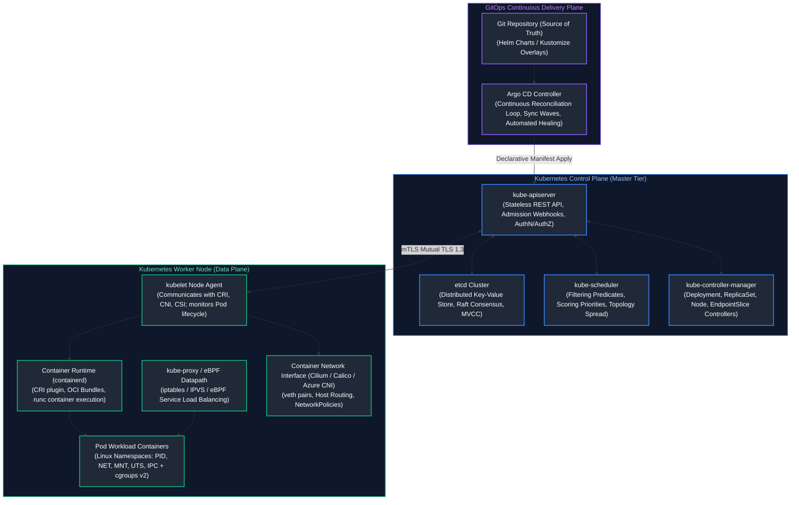
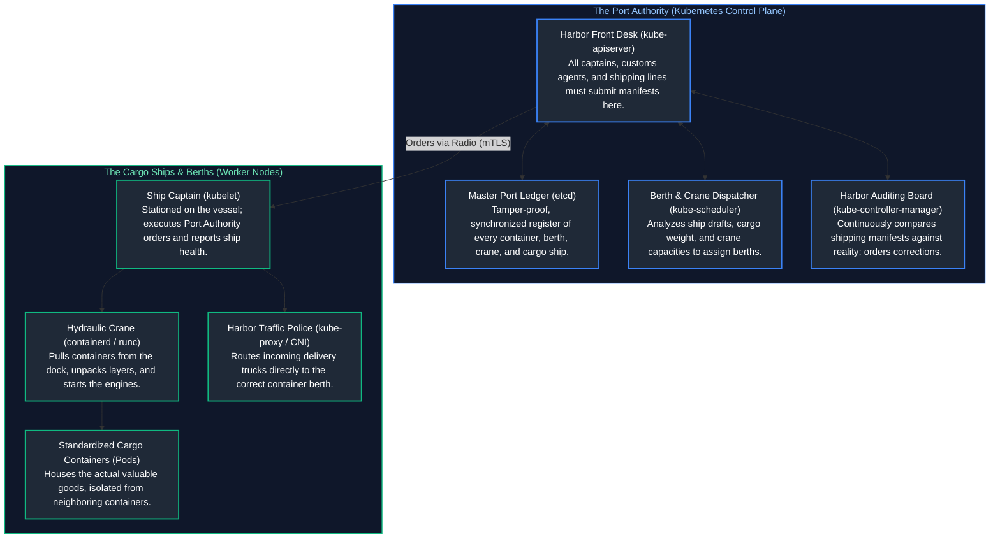
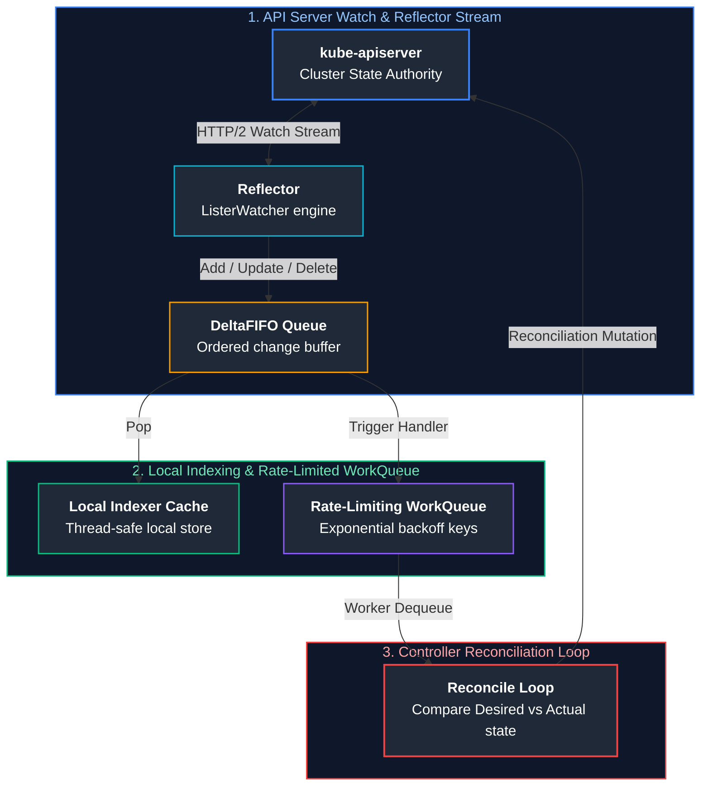
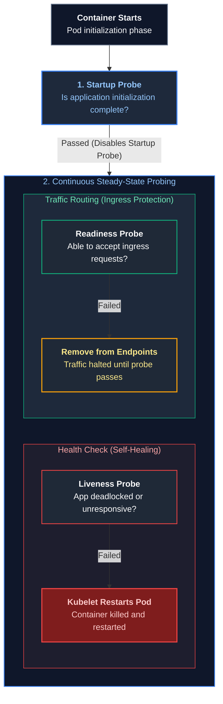
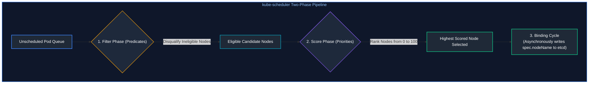
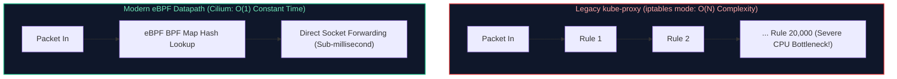
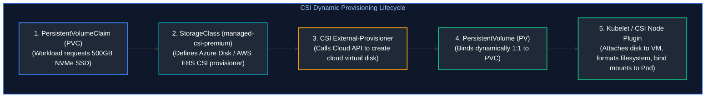
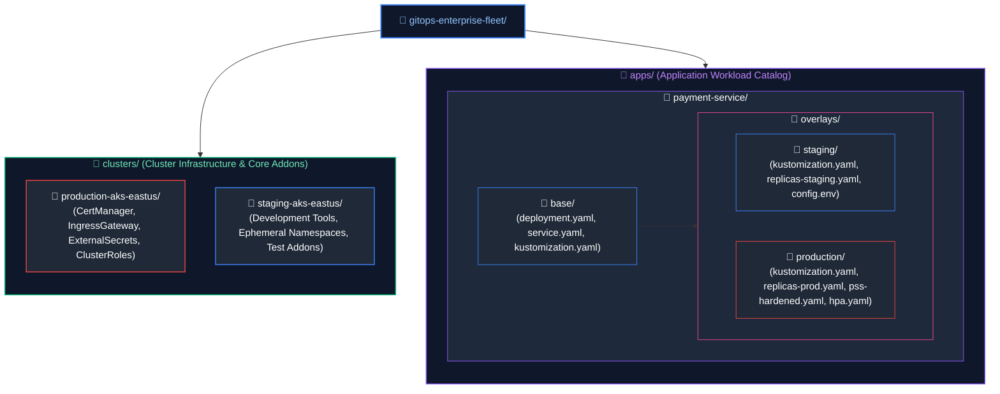
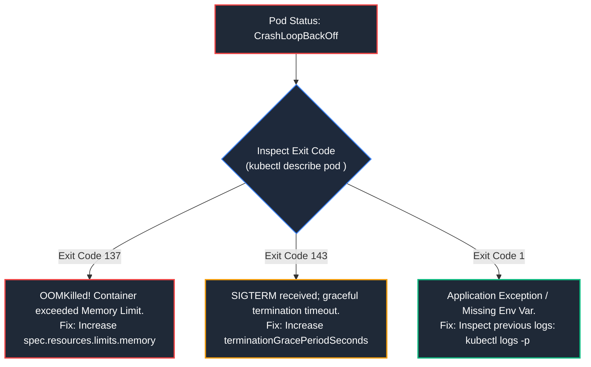

# 06. Containers, Kubernetes & GitOps: Advanced Cloud Architecture

A comprehensive, production-grade guide to Kubernetes architecture, control plane mechanics, etcd Raft consensus, scheduling algorithms, CNI/CSI/CRI subsystems, auto-scaling with HPA and KEDA, GitOps delivery with Argo CD, StatefulSets, Gateway API, and production cluster troubleshooting playbooks tailored for Senior Kubernetes Engineers, Platform Architects, and Site Reliability Engineers.

---

## Architectural Overview: Kubernetes Control Plane & Node Runtime

Kubernetes is a declarative, distributed container orchestration engine. It abstracts fleets of bare-metal or cloud virtual machines into a single unified computing cluster. In Kubernetes, operators never manage individual containers directly; they submit declarative desired-state specifications to the API server, and autonomous controller reconciliation loops continuously work to converge actual cluster reality with the desired specification:



---

## Table of Contents
1. [The Kubernetes Paradigm & The Port Authority Analogy](#1-the-kubernetes-paradigm--the-port-authority-analogy)
   - [1.1 Why Kubernetes Won: From Imperative VMs to Declarative Desired State](#11-why-kubernetes-won-from-imperative-vms-to-declarative-desired-state)
   - [1.2 The Port Master Analogy: Control Plane vs. Worker Fleet](#12-the-port-master-analogy-control-plane-vs-worker-fleet)
   - [1.3 Anatomy of an OCI Container: Namespaces, cgroups v2, and Rootfs](#13-anatomy-of-an-oci-container-namespaces-cgroups-v2-and-rootfs)
2. [Kubernetes Control Plane Internals & etcd Mechanics](#2-kubernetes-control-plane-internals--etcd-mechanics)
   - [2.1 The 6-Stage API Server Request Processing Pipeline](#21-the-6-stage-api-server-request-processing-pipeline)
   - [2.2 etcd Consensus Architecture: Raft, BoltDB B+ Trees, and Compaction](#22-etcd-consensus-architecture-raft-boltdb-b-trees-and-compaction)
   - [2.3 Controller Manager Reconciliation Loops, Informers, and Leader Election](#23-controller-manager-reconciliation-loops-informers-and-leader-election)
3. [Pod Lifecycle, Two-Phase Scheduling & Advanced Placement](#3-pod-lifecycle-two-phase-scheduling--advanced-placement)
   - [3.1 Pod Phase States, Container Lifecycle Hooks, and Health Probes](#31-pod-phase-states-container-lifecycle-hooks-and-health-probes)
   - [3.2 Two-Phase Scheduling: Filtering (Predicates) and Scoring (Priorities)](#32-two-phase-scheduling-filtering-predicates-and-scoring-priorities)
   - [3.3 Taints, Tolerations, Node Affinity, and Topology Spread Constraints](#33-taints-tolerations-node-affinity-and-topology-spread-constraints)
4. [Resource Management, QoS Classes, and Autoscaling](#4-resource-management-qos-classes-and-autoscaling)
   - [4.1 Requests vs. Limits: CFS Quotas and The OOM Killer](#41-requests-vs-limits-cfs-quotas-and-the-oom-killer)
   - [4.2 Quality of Service (QoS) Classes: Guaranteed, Burstable, BestEffort](#42-quality-of-service-qos-classes-guaranteed-burstable-besteffort)
   - [4.3 Autoscaling Fleets: HPA, VPA, and Event-Driven KEDA](#43-autoscaling-fleets-hpa-vpa-and-event-driven-keda)
   - [4.4 Cluster Autoscaler vs. Karpenter Just-In-Time Node Provisioning](#44-cluster-autoscaler-vs-karpenter-just-in-time-node-provisioning)
5. [Kubernetes Networking, CNI Plugins, and Gateway API](#5-kubernetes-networking-cni-plugins-and-gateway-api)
   - [5.1 The Three Fundamental Pod-to-Pod Networking Laws](#51-the-three-fundamental-pod-to-pod-networking-laws)
   - [5.2 CNI Architecture Comparison: Flannel vs. Calico vs. Azure CNI vs. Cilium](#52-cni-architecture-comparison-flannel-vs-calico-vs-azure-cni-vs-cilium)
   - [5.3 Service Datapaths: kube-proxy (iptables / IPVS) vs. eBPF (Cilium)](#53-service-datapaths-kube-proxy-iptables--ipvs-vs-ebpf-cilium)
   - [5.4 Modern Ingress & The Kubernetes Gateway API](#54-modern-ingress--the-kubernetes-gateway-api)
6. [Storage Subsystem: CSI, Persistent Volumes, and StatefulSets](#6-storage-subsystem-csi-persistent-volumes-and-statefulsets)
   - [6.1 Container Storage Interface (CSI) Dynamic Volume Provisioning](#61-container-storage-interface-csi-dynamic-volume-provisioning)
   - [6.2 StatefulSet Invariants: Deterministic Ordinal Identity and Headless DNS](#62-statefulset-invariants-deterministic-ordinal-identity-and-headless-dns)
7. [Security, RBAC, and Workload Identity](#7-security-rbac-and-workload-identity)
   - [7.1 Role-Based Access Control (RBAC): Roles, ClusterRoles, and Bindings](#71-role-based-access-control-rbac-roles-clusterroles-and-bindings)
   - [7.2 Pod Security Standards (PSS) & Admission Webhook Enforcement](#72-pod-security-standards-pss--admission-webhook-enforcement)
   - [7.3 Cloud Workload Identity Federation in Kubernetes](#73-cloud-workload-identity-federation-in-kubernetes)
8. [GitOps Continuous Delivery with Argo CD](#8-gitops-continuous-delivery-with-argo-cd)
   - [8.1 Continuous Reconciliation, Drift Healing, and State Convergence](#81-continuous-reconciliation-drift-healing-and-state-convergence)
   - [8.2 Production Argo CD ApplicationSet & Sync Wave Orchestration](#82-production-argo-cd-applicationset--sync-wave-orchestration)
9. [Senior SRE Kubernetes Troubleshooting Runbooks](#9-senior-sre-kubernetes-troubleshooting-runbooks)
   - [9.1 CrashLoopBackOff Triage (Exit Codes 1, 137, 143)](#91-crashloopbackoff-triage-exit-codes-1-137-143)
   - [9.2 Pod Pending Triage (Scheduling Starvation & PVC Mount Deadlocks)](#92-pod-pending-triage-scheduling-starvation--pvc-mount-deadlocks)
   - [9.3 Pod Stuck in Terminating & Finalizer Deadlock Resolution](#93-pod-stuck-in-terminating--finalizer-deadlock-resolution)
   - [9.4 ImagePullBackOff & Upstream Registry Rate-Limiting Runbook](#94-imagepullbackoff--upstream-registry-rate-limiting-runbook)
   - [9.5 NodeNotReady Triage (Kubelet PIDs Exhaustion & Disk Pressure)](#95-nodenotready-triage-kubelet-pids-exhaustion--disk-pressure)
   - [9.6 Production Python Kubernetes Cluster Diagnostics Script](#96-production-python-kubernetes-cluster-diagnostics-script)
10. [Summary Comparison & Production Engineering Reference Matrix](#10-summary-comparison--production-engineering-reference-matrix)
    - [10.1 Kubernetes Subsystem Architecture & Failure Mode Reference Matrix](#101-kubernetes-subsystem-architecture--failure-mode-reference-matrix)
11. [References & Further Reading](#11-references--further-reading)
---

# 1. The Kubernetes Paradigm & The Port Authority Analogy

### 1.1 Why Kubernetes Won: From Imperative VMs to Declarative Desired State

In traditional infrastructure management, deploying a multi-tier microservice application required an **imperative workflow**:
1. An engineer wrote shell or Ansible scripts instructing the cloud provider to create 10 VMs.
2. The scripts executed SSH commands into each VM to install runtime runtimes (JVM, Node.js, Python), compile dependencies, write environment files, and start systemd services.
3. If an underlying physical hypervisor suffered hardware degradation at 3:00 AM, the VM died. An on-call engineer was paged to wake up, diagnose the dead VM, manually spin up a replacement node, update load balancer target groups, update DNS records, and re-mount block storage.

This imperative approach suffered from two fatal flaws:
- **Configuration Drift:** Over weeks and months, manual hotfixes and package patches caused individual VMs to diverge, resulting in the infamous *"It worked in staging, why did it crash in production?"* crisis.
- **High Recovery Latency (MTTR):** Remediation required human diagnostic intervention and lengthy VM boot sequences (often 3 to 10 minutes per VM).

Kubernetes revolutionized distributed systems by shifting from **imperative scripting** to **declarative reconciliation**:
- The operator declares the target end-state via YAML/JSON: *"There must exist 5 healthy replicas of the payment microservice running container image `payment:v2.4.1`, each guaranteed 500m CPU and 1Gi RAM, balanced across at least 2 distinct Availability Zones."*
- Kubernetes takes ownership of the control loop. If a physical node experiences hardware failure, the control plane detects missed heartbeats within 40 seconds, automatically evicts the pods, and reschedules them onto surviving healthy nodes without human intervention.

---

### 1.2 The Port Master Analogy: Control Plane vs. Worker Fleet

To intuitively understand Kubernetes without getting lost in acronyms, visualize the **Port of Rotterdam**, one of the busiest maritime shipping hubs in the world:



- **`kube-apiserver` (The Front Desk):** No crane worker, captain, or customer can touch the master ledger directly. All requests must be stamped, authenticated, and authorized at the central desk.
- **`etcd` (The Master Ledger):** If the ledger burns down, the port descends into chaos. It uses consensus protocols (Raft) so that even if one backup clerk faints, the remaining clerks agree on the exact location of every container.
- **`kube-scheduler` (The Logistics Dispatcher):** Evaluates incoming containers. If a container weighs 40 tons (requires 16 CPU cores and 64GB RAM) and needs refrigerated power (GPU affinity), the dispatcher filters out docks without power and assigns the container to the optimal berth.
- **`kube-controller-manager` (The Auditing Board):** Checks the ledger every 5 seconds. If a shipping contract mandates 3 refrigerated containers of insulin, but a fire destroyed one, the board immediately commands the dispatcher to provision a replacement container.
- **`kubelet` (The Ship Captain):** An agent running directly on the ship (worker node). It talks to the crane (`containerd`) to load/unload containers, monitors engine temperature (CPU/RAM pressure), and radios health heartbeats back to the Port Authority.
- **Container Runtime (The Crane & Standard ISO Box):** Standardizes packaging so that whether you are shipping bananas (Node.js) or car engines (Java), the crane lifts and mounts them using the exact same standard interface.

---

### 1.3 Anatomy of an OCI Container: Namespaces, cgroups v2, and Rootfs

A container is **not** a lightweight virtual machine. A container does not run its own guest kernel, hypervisor, or virtual BIOS. A container is simply a **standard Linux process** constrained by three core Linux kernel subsystems:

1. **Linux Namespaces (Isolation Boundary):**
   - **`pid` (Process IDs):** The container process believes it is PID 1 (system init), completely blind to host processes.
   - **`net` (Network Devices):** Provides an isolated loopback device, private IP address, routing table, and iptables chains.
   - **`mnt` (Mount Points):** Isolates filesystem mount points using `chroot` or `pivot_root`.
   - **`ipc` (Inter-Process Communication):** Prevents containers from reading shared memory segments or message queues of other containers.
   - **`uts` (Hostnames):** Allows the container to have its own unique hostname (e.g. the Pod name).
   - **`user` (User Mapping):** Maps container `root` (UID 0) to an unprivileged high-number UID on the host (UID 100000), preventing container breakout attacks.

2. **Control Groups v2 (`cgroups v2` Resource Boundaries):**
   - Enforces hard ceilings on CPU, Memory, I/O bandwidth, and maximum process IDs (PIDs).
   - `memory.max`: Hard limit that triggers an Out-Of-Memory (OOM) killer if exceeded.
   - `cpu.max`: Enforces CFS (Completely Fair Scheduler) period and quota limits to throttle CPU execution.

3. **Layered Filesystem (`overlay2` Rootfs):**
   - An OCI container image consists of immutable read-only layers stacked via the Linux `overlayfs` driver.
   - When a container boots, Docker or containerd creates a thin, ephemeral **read-write layer** on top. All file modifications are stored in this top layer using copy-on-write (CoW) semantics.

---

# 2. Kubernetes Control Plane Internals & etcd Mechanics

### 2.1 The 6-Stage API Server Request Processing Pipeline

The `kube-apiserver` is the stateless communication hub of the entire cluster. It exposes an OpenAPI-compliant JSON/Protobuf REST API over TLS port 6443. Every inbound API request—whether from `kubectl`, a CI/CD service account, or the `kubelet`—executes through a strict sequential 6-stage pipeline:

```mermaid
flowchart TD
    subgraph Pipeline ["kube-apiserver Request Lifecycle Pipeline"]
        Req["Incoming HTTP REST Request<br/>(POST /api/v1/namespaces/prod/pods)"]
        --> AuthN["1. Authentication (AuthN)<br/>(Extracts Client Identity: X.509, Bearer Token, OIDC JWT)"]
        --> AuthZ["2. Authorization (AuthZ)<br/>(RBAC, ABAC, Webhook; evaluates Subject, Verb, Resource)"]
        --> Mutating["3. Mutating Admission Webhooks<br/>(Modifies spec: Injects sidecars, sets default timeouts)"]
        --> SchemaVal["4. Object Schema Validation<br/>(Validates OpenAPI v3 schema, types, immutable fields)"]
        --> Validating["5. Validating Admission Webhooks<br/>(Enforces security policies: Kyverno, OPA Gatekeeper)"]
        --> etcdCommit["6. Commit to etcd Storage<br/>(Serializes to Protocol Buffers, writes to Raft WAL log)"]
    end

    style Pipeline fill:#0f172a,stroke:#3b82f6,stroke-width:1.5px,color:#93c5fd
    style Req fill:#1f2937,stroke:#3b82f6,stroke-width:2px,color:#fff
    style AuthN fill:#1f2937,stroke:#06b6d4,stroke-width:2px,color:#fff
    style AuthZ fill:#1f2937,stroke:#06b6d4,stroke-width:2px,color:#fff
    style Mutating fill:#1f2937,stroke:#f59e0b,stroke-width:2px,color:#fff
    style SchemaVal fill:#1f2937,stroke:#3b82f6,stroke-width:2px,color:#fff
    style Validating fill:#1f2937,stroke:#ef4444,stroke-width:2px,color:#fff
    style etcdCommit fill:#1f2937,stroke:#10b981,stroke-width:2px,color:#fff
```



#### Detailed Phase Breakdown:
1. **Authentication (AuthN):**
   - The API server iterates through configured authenticators in order:
     - **X.509 Client Certificates:** Verified against the cluster CA (`/etc/kubernetes/pki/ca.crt`). The Common Name (`CN`) becomes the username; Organization (`O`) attributes become groups.
     - **OpenID Connect (OIDC) Tokens:** Validates OAuth2 JWT tokens issued by Microsoft Entra ID, Okta, or Google Cloud IAM using JSON Web Key Sets (JWKS).
     - **Webhook Token Authentication:** Delegates token verification to an external HTTP endpoint.
   - If no authenticator accepts the request, the server returns `HTTP 401 Unauthorized`.
2. **Authorization (AuthZ):**
   - Evaluates the authenticated subject against active authorizers (typically Node and RBAC).
   - Validates if the Subject possesses permission to execute the requested `verb` (`get`, `list`, `create`, `update`, `delete`) on the target `apiGroup` and `resource` inside the requested `namespace`.
   - If unauthorized, returns `HTTP 403 Forbidden`.
3. **Mutating Admission Webhooks:**
   - Invokes external webhooks registered via `MutatingWebhookConfiguration`.
   - Webhooks can modify the request payload before persistence. Examples:
     - Istio / Linkerd injecting an Envoy sidecar proxy into `spec.containers`.
     - Vault agent injecting dynamic secrets volumes and init containers.
4. **Object Schema Validation:**
   - Compares the object structure against the OpenAPI v3 specification.
   - Rejects invalid data types, missing required fields, or modifications to immutable fields (e.g. changing `spec.clusterIP` on a Service).
5. **Validating Admission Webhooks:**
   - Evaluates final business logic and security guardrails via tools like **Kyverno** or **OPA Gatekeeper**.
   - Validates that:
     - All container images originate from approved internal registries (e.g. `mycorp.azurecr.io`).
     - No container runs with `privileged: true` or root UID 0.
     - Required production labels (`app.kubernetes.io/owner`, `cost-center`) are present.
   - If validation fails, the entire request is rejected with `HTTP 400 Bad Request`.
6. **etcd Persistence:**
   - The verified object is converted from JSON to Protocol Buffers and written to `etcd` under `/registry/<resource_plural>/<namespace>/<name>`.

---

### 2.2 etcd Consensus Architecture: Raft, BoltDB B+ Trees, and Compaction

`etcd` is a strongly consistent, distributed key-value store implementing the **Raft consensus algorithm**. It maintains the complete state of the Kubernetes cluster.

#### Raft Consensus Quorum Rules:
To tolerate $F$ node failures without suffering split-brain or data corruption, an etcd cluster must maintain a strict majority quorum $Q$:
$$Q = \left\lfloor \frac{N}{2} \right\rfloor + 1$$

| Cluster Size ($N$) | Quorum Needed ($Q$) | Maximum Tolerable Failures ($F$) |
| :---: | :---: | :---: |
| 1 | 1 | 0 (Single point of failure) |
| 3 | 2 | 1 failure tolerated |
| 5 | 3 | 2 failures tolerated |
| 7 | 4 | 3 failures tolerated |

> [!WARNING]
> **Why Even-Numbered Clusters Are Anti-Patterns:**
> A 4-node cluster requires a quorum of $\lfloor 4/2 \rfloor + 1 = 3$ nodes. If 2 nodes fail, the cluster drops to 2 nodes, losing quorum and freezing all writes! A 4-node cluster provides the exact same fault tolerance ($F=1$) as a 3-node cluster, while doubling the network consensus communication overhead. Always maintain odd-sized clusters (3 or 5 nodes).

#### Internal Storage Engine:
- **Write-Ahead Log (WAL):** Every write is appended to an append-only disk log and flushed to physical disk via `fsync` before acknowledgment.
- **BoltDB (B+ Tree):** etcd stores keys and revision metadata on disk using BoltDB, an embedded, ACID-compliant key-value database utilizing copy-on-write B+ trees.
- **MVCC (Multi-Version Concurrency Control):** Keys are never overwritten in-place. Every mutation increments a 64-bit global revision counter. Modifying key `/foo` creates a new version while retaining prior versions for point-in-time reads and event watches.

#### Compaction & Defragmentation Runbook:
Over time, historical MVCC revisions cause the etcd database file (`member/snap/db`) to grow toward the default quota limit (2GB, configurable up to 8GB). When the quota is reached, etcd enters read-only mode and fires the `NOSPACE` alarm!

```bash

# Check etcd database endpoint status and DB size

ETCDCTL_API=3 etcdctl --endpoints=https://127.0.0.1:2379 \
  --cacert=/etc/kubernetes/pki/etcd/ca.crt \
  --cert=/etc/kubernetes/pki/etcd/server.crt \
  --key=/etc/kubernetes/pki/etcd/server.key \
  endpoint status --write-out=table

# Get current global revision number

CURRENT_REV=$(ETCDCTL_API=3 etcdctl --endpoints=https://127.0.0.1:2379 \
  --cacert=/etc/kubernetes/pki/etcd/ca.crt \
  --cert=/etc/kubernetes/pki/etcd/server.crt \
  --key=/etc/kubernetes/pki/etcd/server.key \
  endpoint status --write-out=json | grep -o '"revision":[0-9]*' | head -1 | cut -d: -f2)

# Compact all revisions older than current revision

ETCDCTL_API=3 etcdctl --endpoints=https://127.0.0.1:2379 \
  --cacert=/etc/kubernetes/pki/etcd/ca.crt \
  --cert=/etc/kubernetes/pki/etcd/server.crt \
  --key=/etc/kubernetes/pki/etcd/server.key \
  compact $CURRENT_REV

# Defragment physical disk storage to reclaim free space

ETCDCTL_API=3 etcdctl --endpoints=https://127.0.0.1:2379 \
  --cacert=/etc/kubernetes/pki/etcd/ca.crt \
  --cert=/etc/kubernetes/pki/etcd/server.crt \
  --key=/etc/kubernetes/pki/etcd/server.key \
  defrag

# Clear any active NOSPACE alarms

ETCDCTL_API=3 etcdctl --endpoints=https://127.0.0.1:2379 \
  --cacert=/etc/kubernetes/pki/etcd/ca.crt \
  --cert=/etc/kubernetes/pki/etcd/server.crt \
  --key=/etc/kubernetes/pki/etcd/server.key \
  alarm disarm
```

> [!CAUTION]
> **etcd Disk Fsync Latency Rules:**
> Raft consensus requires deterministic write acknowledgment. If disk synchronous write latency (`wal_fsync_duration_seconds`) exceeds **10 milliseconds**, etcd heartbeat RPCs time out, causing frequent leader re-elections, API server request drops, and control plane instability. Always back etcd storage with dedicated high-IOPS NVMe SSDs!

---

### 2.3 Controller Manager Reconciliation Loops, Informers, and Leader Election

The `kube-controller-manager` is a daemon process executing multiple autonomous reconciliation loops (DeploymentController, ReplicaSetController, NodeLifecycleController, EndpointSliceController).



#### SharedInformer Architecture:
To prevent thousands of controller threads from overwhelming `kube-apiserver` with duplicate polling requests, Kubernetes utilizes the **SharedInformer** framework:
1. **Reflector:** Establishes a persistent HTTP/2 `watch` stream against the API server. It receives real-time delta events (`Added`, `Modified`, `Deleted`).
2. **DeltaFIFO:** Buffers incoming events in an ordered FIFO queue.
3. **Indexer (Local Memory Cache):** Stores a local, thread-safe cache of cluster objects in memory. Controllers read from this local memory cache rather than querying the remote API server.
4. **Rate-Limiting WorkQueue:** Distributes workload keys (e.g. `namespace/name`) to worker pools with exponential backoff on retries.

#### Leader Election via Coordination Leases:
Multiple replicas of `kube-controller-manager` or `kube-scheduler` run concurrently for high availability, but **only one active leader** may execute reconciliation loops:
- Controllers compete to acquire a `Lease` object in the `kube-system` namespace via the `coordination.k8s.io` API.
- The leader regularly renews the lease (renew deadline = 10s; duration = 15s).
- If the leader crashes or network partitions, standby instances detect the expired lease and execute an atomic compare-and-swap update to claim leadership.

---

# 3. Pod Lifecycle, Two-Phase Scheduling & Advanced Placement

### 3.1 Pod Phase States, Container Lifecycle Hooks, and Health Probes

A Pod is the smallest deployable compute unit in Kubernetes. It encapsulates one or more tightly coupled containers sharing network namespaces (`IP`, ports) and storage volumes.

#### The 5 Pod Phases:
1. **`Pending`:** Accepted by the API server, but one or more containers are not yet running (e.g. scheduling predicates failing, downloading images, waiting for EBS/Azure Disk volume attachment).
2. **`Running`:** Bound to a node, all containers created, and at least one container is currently executing or restarting.
3. **`Succeeded`:** All containers in the Pod completed execution with exit code `0` (standard for CronJobs and Batch Jobs).
4. **`Failed`:** All containers terminated, with at least one container returning a non-zero exit code.
5. **`Unknown`:** Control plane lost communication with the node's `kubelet`.

#### Container Lifecycle Hooks (`postStart` & `preStop`):
- **`postStart`:** Executes immediately after container creation asynchronously with the entrypoint. Note: If `postStart` fails, the container is killed.
- **`preStop`:** A blocking call executed immediately before a container is terminated (due to rolling update, pod deletion, or preemption).

> [!TIP]
> **Zero-Downtime Rolling Update Pattern (The `preStop` Sleep Trick):**
> When a Pod is marked for termination:
> 1. The Pod status changes to `Terminating`.
> 2. Simultaneously, `kube-apiserver` instructs the worker `kubelet` to kill the pod AND instructs `kube-proxy` to remove the pod IP from the Service `EndpointSlice`.
> 3. Because endpoint propagation across thousands of nodes takes **2 to 5 seconds**, clients may continue sending traffic to the dying container, triggering `HTTP 502 Bad Gateway` errors!
> 
> **Solution:** Add a `preStop` hook with a 10-15 second sleep. The container continues processing incoming requests while `kube-proxy` cleans up routing rules:
> ```yaml
> lifecycle:
>   preStop:
>     exec:
>       command: ["/bin/sh", "-c", "sleep 15"]
> ```

#### The Three Health Probes:


- **Startup Probe:** Protects slow-starting legacy applications (e.g. heavy Java Spring Boot apps taking 90 seconds to warm up). Disables liveness and readiness checks until startup succeeds.
- **Liveness Probe:** Detects unrecoverable deadlocks (e.g. infinite loop, thread starvation). If it fails consecutively past `failureThreshold`, `kubelet` sends `SIGTERM`, waits `terminationGracePeriodSeconds`, sends `SIGKILL`, and restarts the container.
- **Readiness Probe:** Detects transient overload (e.g. backend database reconnection, cache warm-up). If it fails, Kubernetes stops routing ingress traffic by stripping the pod's IP from the Service's `EndpointSlice`. **It does not restart the container.**

---

### 3.2 Two-Phase Scheduling: Filtering (Predicates) and Scoring (Priorities)

The `kube-scheduler` monitors unscheduled pods (`spec.nodeName == ""`) and selects the optimal node across two distinct pipeline phases:



#### Phase 1: Filtering (Predicates)
Disqualifies nodes that cannot satisfy the pod's physical or architectural requirements:
- `NodeResourcesFit`: Verifies the node has sufficient unallocated CPU and RAM requests.
- `NodePorts`: Checks if the requested `hostPort` is already bound by another pod on that node.
- `PodTopologySpread`: Ensures placement does not violate cross-zone skew limits.
- `NodeAffinity`: Verifies required node label constraints (`requiredDuringSchedulingIgnoredDuringExecution`).
- `Tolerations`: Verifies the pod can tolerate all active taints on the node.

#### Phase 2: Scoring (Priorities)
Ranks remaining candidate nodes on a scale from 0 to 100 using weighted plugins:
- `NodeResourcesBalancedAllocation`: Favors nodes where the resulting CPU and RAM usage ratios match closely, preventing fragmented stranded resources (e.g. 90% RAM used but only 10% CPU used).
- `ImageLocality`: Favors nodes that already have the container image layers cached locally on disk, reducing cold-start network pull latency.
- `NodeAffinityPriority`: Scores nodes matching soft affinity expressions (`preferredDuringSchedulingIgnoredDuringExecution`).

The node with the highest cumulative score is selected. The scheduler commits a `Binding` object to `kube-apiserver`, binding `spec.nodeName`.

---

### 3.3 Taints, Tolerations, Node Affinity, and Topology Spread Constraints

#### Taints & Tolerations:
Taints allow a node to **repel** a set of pods. Pods will only schedule onto a tainted node if they possess an explicit matching toleration.
- **`NoSchedule`:** New pods without toleration will not schedule; existing running pods are unaffected.
- **`PreferNoSchedule`:** Soft constraint; scheduler tries to avoid the node, but will place pods there if no alternatives exist.
- **`NoExecute`:** Any existing pod on the node lacking a matching toleration is **immediately evicted**.

```yaml
# Node Taint Command
# kubectl taint nodes aks-gpu-pool-01 dedicated=ml-training:NoSchedule

# Pod Spec Matching Toleration
tolerations:
  - key: "dedicated"
    operator: "Equal"
    value: "ml-training"
    effect: "NoSchedule"
```

#### Pod Topology Spread Constraints:
Ensures high availability by evenly spreading pod replicas across physical failure domains (Availability Zones or host racks), preventing entire service outages if a single zone fails:

```yaml
apiVersion: apps/v1
kind: Deployment
metadata:
  name: payment-engine
  namespace: production
spec:
  replicas: 9
  selector:
    matchLabels:
      app: payment-engine
  template:
    metadata:
      labels:
        app: payment-engine
    spec:
      topologySpreadConstraints:
        - maxSkew: 1
          topologyKey: "topology.kubernetes.io/zone"
          whenUnsatisfiable: DoNotSchedule
          labelSelector:
            matchLabels:
              app: payment-engine
      containers:
        - name: engine
          image: mycorp.azurecr.io/payment:v2.4.1
```

- `maxSkew: 1`: The maximum difference in replica count between any two zones cannot exceed 1. (e.g., Zone A: 3, Zone B: 3, Zone C: 3).
- `whenUnsatisfiable: DoNotSchedule`: If placing a new pod would cause skew to exceed 1, the scheduler refuses to schedule the pod until nodes in the under-represented zone become available.

---

# 4. Resource Management, QoS Classes, and Autoscaling

### 4.1 Requests vs. Limits: CFS Quotas and The OOM Killer

Every container definition should declare resource **requests** and **limits** for both CPU and Memory:

```yaml
resources:
  requests:
    cpu: "500m"      # 0.5 vCPU core
    memory: "512Mi"  # 512 Mebibytes
  limits:
    cpu: "2000m"     # 2 vCPU cores
    memory: "2Gi"    # 2 Gibibytes
```

#### Fundamental Behavioral Differences:
1. **CPU is a Compressible Resource:**
   - Handled by the Linux kernel **Completely Fair Scheduler (CFS)**.
   - If a container exceeds its CPU limit (`2000m`), the kernel does **not** kill the container. Instead, it enforces **CPU Throttling**: the kernel revokes execution cycles until the next CFS scheduling period (default: 100ms).
   - Throttling causes severe P99 latency spikes in microservices.
2. **Memory is an Incompressible Resource:**
   - Handled by Linux `cgroups` memory controllers (`memory.max`).
   - If a container process attempts to allocate memory beyond its limit (`2Gi`), the kernel cannot throttle physical bytes.
   - The Linux kernel **OOM Killer** immediately sends `SIGKILL` (Exit Code `137`) to the container's highest memory-consuming process!

---

### 4.2 Quality of Service (QoS) Classes: Guaranteed, Burstable, BestEffort

Kubernetes automatically calculates the QoS class for a Pod based on its requests and limits configuration. The QoS class determines the pod's `oom_score_adj` in the Linux kernel:

| QoS Class | Qualification Criteria | `oom_score_adj` | Termination Priority Under Node RAM Pressure |
| :--- | :--- | :---: | :--- |
| **Guaranteed** | Every container in the Pod must specify CPU and Memory **Requests == Limits** (Requests must be $>0$). | `-997` | **Last to be killed.** Preserved for mission-critical core microservices and stateful databases. |
| **Burstable** | At least one container specifies requests, and Requests < Limits (or limits not set). | $\min(\max(2, 1000 - \frac{1000 \times \text{Req}}{\text{Alloc}}), 999)$ | Evicted after BestEffort pods are exhausted. Killed based on percentage of requested memory consumed. |
| **BestEffort** | **Zero requests and zero limits** configured on any container. | `1000` | **Killed immediately** as soon as the node experiences memory or disk pressure! |

---

### 4.3 Autoscaling Fleets: HPA, VPA, and Event-Driven KEDA

#### Horizontal Pod Autoscaler (HPA):
The HPA controller queries the Kubernetes Metrics Server every 15 seconds, calculating target replicas using the mathematical formula:
$$\text{Desired Replicas} = \left\lceil \text{Current Replicas} \times \left( \frac{\text{Current Metric Value}}{\text{Target Metric Value}} \right) \right\rceil$$

```yaml
apiVersion: autoscaling/v2
kind: HorizontalPodAutoscaler
metadata:
  name: payment-hpa
  namespace: production
spec:
  scaleTargetRef:
    apiVersion: apps/v1
    kind: Deployment
    name: payment-engine
  minReplicas: 3
  maxReplicas: 30
  metrics:
    - type: Resource
      resource:
        name: cpu
        target:
          type: Utilization
          averageUtilization: 75
    - type: Resource
      resource:
        name: memory
        target:
          type: Utilization
          averageUtilization: 80
```

#### Event-Driven Autoscaling with KEDA:
Standard HPA can only scale on in-cluster metrics (CPU/RAM). In event-driven architectures, CPU utilization lags behind incoming traffic: by the time CPU spikes, queues are already backlogged!
**KEDA (Kubernetes Event-driven Autoscaling)** connects directly to external message brokers (Azure Service Bus, AWS SQS, Apache Kafka) and scales workloads from **0 to N replicas** based on backlog depth:

```yaml
apiVersion: keda.sh/v1alpha1
kind: ScaledObject
metadata:
  name: queue-consumer-scaler
  namespace: production
spec:
  scaleTargetRef:
    name: order-processor
  minReplicaCount: 0      # Scales down to zero when queue is empty!
  maxReplicaCount: 50
  cooldownPeriod: 300     # Wait 5 minutes of silence before scaling to zero
  triggers:
    - type: azure-servicebus
      metadata:
        queueName: orders-inbound
        messageCount: "25" # Add 1 pod replica for every 25 pending messages
      authenticationRef:
        name: keda-azure-credentials
```

---

### 4.4 Cluster Autoscaler vs. Karpenter Just-In-Time Node Provisioning

Scaling Kubernetes worker nodes to meet dynamic application demand has evolved from coarse node-group expansion to flexible, just-in-time machine provisioning. Legacy Cluster Autoscaler operates by resizing pre-defined cloud Auto Scaling Groups (AWS ASGs or Azure VMSS), which introduces significant spin-up latency and instance rigidities. In contrast, modern open-source Karpenter and AKS Fleet Autoscalers directly evaluate unschedulable pod resource requirements against cloud pricing APIs, provisioning right-sized instances on the fly.

The architectural, operational, and cost trade-offs between node-group and just-in-time autoscaling:

| Feature | Legacy Cluster Autoscaler | Modern Karpenter / AKS Fleet Autoscaler |
| :--- | :--- | :--- |
| **Provisioning Mechanism** | Adjusts node count in pre-configured cloud Auto Scaling Groups (AWS ASG / Azure VMSS). | Directly calls cloud compute APIs (`ec2:RunInstances`, Azure compute fleet). Bypasses node groups. |
| **Provisioning Speed** | **2 to 5 minutes** per node (must wait for ASG signaling, VM boot, kubelet registration). | **$<45$ seconds** from pending pod to running container. |
| **Instance Type Selection** | Rigid: Restricted to the single VM instance type defined in the node pool (e.g. `Standard_D4s_v5`). | Dynamic: Analyzes exact CPU/RAM/GPU/topology requirements of pending pods and selects the cheapest suitable instance. |
| **De-provisioning & Consolidation** | Scans for nodes with $<50\%$ utilization; evicts pods and terminates node after 10-minute cooldown. | Continuous proactive bin-packing. Terminates expensive nodes and consolidates workloads onto cheaper/fewer instances. |

---

# 5. Kubernetes Networking, CNI Plugins, and Gateway API

### 5.1 The Three Fundamental Pod-to-Pod Networking Laws

Kubernetes imposes a strict IP-per-Pod networking model governed by three non-negotiable architectural axioms:
1. **Every Pod receives its own unique IP address** within the cluster, shared by all containers in that Pod.
2. **All Pods can communicate with all other Pods on any node** directly via L3 routing, without requiring Network Address Translation (NAT) or port mapping.
3. **Host node agents (`kubelet`) can communicate directly with all Pods** running on that same host.

---

### 5.2 CNI Architecture Comparison: Flannel vs. Calico vs. Azure CNI vs. Cilium

The Container Network Interface (CNI) plugin is responsible for attaching network interfaces (`veth` pairs) to Pod network namespaces and establishing inter-node routing:

| CNI Plugin | Architecture Type | Encapsulation Overhead | NetworkPolicy Engine | Best Production Use Case |
| :--- | :--- | :--- | :--- | :--- |
| **Flannel** | L3 Overlay (VXLAN) or Host-GW | Minor VXLAN UDP overhead (50 bytes/pkt) | **None** (No security filtering) | Simple on-premise test clusters; legacy labs. |
| **Calico** | Pure L3 (BGP) or IP-in-IP / VXLAN | Zero overhead in BGP mode; low in VXLAN | High-performance iptables/eBPF policies | Large enterprise on-premise & hybrid cloud clusters. |
| **Azure CNI (VNet)** | Native Cloud L3 (Direct IP Allocation) | **Zero overhead** (First-class VNet IPs) | Azure Network Policies or Calico engine | High-throughput enterprise Azure environments requiring VNet integration. |
| **Cilium** | Kernel eBPF Socket / XDP Datapath | **Zero overhead** (Bypasses iptables entirely) | Rich L3/L4/L7 eBPF policies + FQDN filtering | Ultra-high scale, low latency, micro-segmentation, and Envoy-less service mesh. |

---

### 5.3 Service Datapaths: kube-proxy (iptables / IPVS) vs. eBPF (Cilium)

Kubernetes `Services` provide stable virtual IP addresses (`ClusterIP`) that load balance across dynamic ephemeral Pod IPs. The data path is implemented via three architectures:



- **`kube-proxy` (iptables mode):** Every Service and Pod endpoint is written as sequential packet filter chains in the Linux kernel. Evaluating $N$ rules has $O(N)$ computational complexity. In clusters with $>5,000$ services, syncing iptables locks the kernel networking subsystem and causes severe packet processing latency spikes.
- **`kube-proxy` (IPVS mode):** Uses Linux IP Virtual Server. Translates rules into in-kernel hash tables with $O(1)$ lookup complexity, scaling significantly better than iptables.
- **Cilium eBPF (Host Routing):** Bypasses `kube-proxy` and the Linux kernel netfilter stack entirely. Attaches eBPF programs directly to the network interface socket buffers (`sk_buff`), performing direct socket-to-socket memory copying with zero intermediate context switches.

---

### 5.4 Modern Ingress & The Kubernetes Gateway API

The legacy `Ingress` API suffered from severe architectural limitations: it forced vendors to use unstandardized, proprietary annotations (e.g. `nginx.ingress.kubernetes.io/canary-weight`) and combined infrastructure management with application routing.

The **Gateway API** (GA in Kubernetes 1.29+) decouples responsibilities cleanly:
1. **`GatewayClass`:** Defined by Cluster Infrastructure Engineers (e.g. Istio, Envoy Gateway, Azure Application Gateway).
2. **`Gateway`:** Deployed by Platform Operators; defines listening ports, TLS certificates, and entry VIPs.
3. **`HTTPRoute` / `TLSRoute`:** Authored by Application Developers; defines path-based routing, header rewrites, and canary traffic splitting:

```yaml
apiVersion: gateway.networking.k8s.io/v1
kind: HTTPRoute
metadata:
  name: payment-route
  namespace: production
spec:
  parentRefs:
    - name: enterprise-edge-gateway
  rules:
    - matches:
        - path:
            type: PathPrefix
            value: /api/v2/payments
      backendRefs:
        - name: payment-service-v2
          port: 8080
          weight: 90
        - name: payment-service-canary
          port: 8080
          weight: 10
```

---

# 6. Storage Subsystem: CSI, Persistent Volumes, and StatefulSets

### 6.1 Container Storage Interface (CSI) Dynamic Volume Provisioning

The Container Storage Interface (CSI) standardizes how Kubernetes interfaces with cloud block, file, and object storage:



- **`StorageClass`:** Specifies the CSI storage plugin and parameters (e.g. IOPS tiers, replication type). Use `volumeBindingMode: WaitForFirstConsumer` to ensure disks are provisioned in the exact Availability Zone where the pod is scheduled!
- **`PersistentVolumeClaim` (PVC):** The developer's declarative request for storage capacity and access mode (`ReadWriteOnce`, `ReadWriteMany`).
- **`PersistentVolume` (PV):** The actual underlying physical/cloud storage resource.

---

### 6.2 StatefulSet Invariants: Deterministic Ordinal Identity and Headless DNS

Unlike Deployments where pods are fungible and randomly named (`web-7f89d-abc`), **StatefulSets** are engineered for stateful distributed databases (Kafka, Cassandra, PostgreSQL):

1. **Deterministic Ordinal Naming:** Pods are numbered sequentially: `kafka-0`, `kafka-1`, `kafka-2`.
2. **Ordered Rolling Updates:** Updates deploy strictly in reverse ordinal order (`kafka-2` updates and becomes healthy before `kafka-1` is touched).
3. **Dedicated Volume Binding (`volumeClaimTemplates`):** Each ordinal index receives its own unique PV. If `kafka-1` crashes and reschedules onto another host, the CSI driver automatically detaches its specific disk from the old host and re-attaches it to the new host.
4. **Headless Service DNS Resolution:** Each pod receives a deterministic cluster DNS record:
   $$\text{pod-name}.\text{headless-service-name}.\text{namespace}.\text{svc}.\text{cluster}.\text{local}$$
   *(e.g. `kafka-0.kafka-headless.production.svc.cluster.local`)*

---

# 7. Security, RBAC, and Workload Identity

### 7.1 Role-Based Access Control (RBAC): Roles, ClusterRoles, and Bindings

Kubernetes RBAC enforces the principle of least privilege:

```yaml
apiVersion: rbac.authorization.k8s.io/v1
kind: Role
metadata:
  namespace: production
  name: release-engineer-role
rules:
  - apiGroups: ["apps"]
    resources: ["deployments", "statefulsets"]
    verbs: ["get", "list", "watch", "update", "patch", "restart"]
  - apiGroups: [""]
    resources: ["pods", "pods/log"]
    verbs: ["get", "list", "watch"]
---
apiVersion: rbac.authorization.k8s.io/v1
kind: RoleBinding
metadata:
  name: bind-release-engineers
  namespace: production
subjects:
  - kind: Group
    name: "engineering-release-leads"
    apiGroup: rbac.authorization.k8s.io
roleRef:
  kind: Role
  name: release-engineer-role
  apiGroup: rbac.authorization.k8s.io
```

- **`Role` / `RoleBinding`:** Scoped strictly to a single target namespace.
- **`ClusterRole` / `ClusterRoleBinding`:** Scoped cluster-wide across all namespaces (used for node metrics agents, ingress controllers, cluster auditors).

---

### 7.2 Pod Security Standards (PSS) & Admission Webhook Enforcement

Kubernetes native Pod Security Admission classifies workloads into 3 PSS profiles:
1. **`Privileged`:** Completely unrestricted; allows full root host access, host networking, and raw devices.
2. **`Baseline`:** Prevents known privilege escalations; forbids host ports, host namespaces, and dangerous capabilities.
3. **`Restricted`:** Hardened production profile. Mandates:
   - `runAsNonRoot: true` (forbids running as UID 0).
   - `readOnlyRootFilesystem: true`.
   - `drop: ["ALL"]` on Linux capabilities.
   - Forbids `allowPrivilegeEscalation: false`.

Enforced via namespace labels:
```yaml
apiVersion: v1
kind: Namespace
metadata:
  name: payment-prod
  labels:
    pod-security.kubernetes.io/enforce: restricted
    pod-security.kubernetes.io/enforce-version: latest
```

---

### 7.3 Cloud Workload Identity Federation in Kubernetes

Storing long-lived cloud API access keys inside Kubernetes Secrets is a severe security vulnerability. Modern cloud platforms utilize **Workload Identity Federation**:
1. Kubernetes provides a cryptographically signed OIDC Service Account token.
2. The Pod exchanges this short-lived JWT token directly with the Cloud STS (AWS STS / Azure Entra ID / GCP STS).
3. The Cloud IAM provider validates the token against the Kubernetes cluster's public JWKS endpoint and returns a temporary (1-hour) cloud IAM session credential.
4. **Result:** Zero long-lived static secrets stored in the cluster!

---

# 8. GitOps Continuous Delivery with Argo CD

### 8.1 Continuous Reconciliation, Drift Healing, and State Convergence

In a GitOps delivery model, **Git is the single declarative source of truth** for infrastructure and application state:
- Developers commit changes (e.g. updating image tag `v2.4.0` $\to$ `v2.4.1`) to a Git repository via pull requests.
- The **Argo CD Application Controller** runs an in-cluster reconciliation loop:
  - Compares desired manifests stored in Git against live state in `etcd`.
  - If drift occurs (e.g. an operator runs `kubectl edit deployment` during an incident), Argo CD flags the status as `OutOfSync`.
  - If `automated.selfHeal: true` is configured, Argo CD immediately overwrites live cluster state, reverting unauthorized changes within seconds.

---

### 8.2 Production Argo CD ApplicationSet & Sync Wave Orchestration

#### Enterprise GitOps Fleet Repository Folder Treeview

In enterprise GitOps, application definitions and cluster fleet manifests are decoupled using structured Kustomize bases and environment overlays:



#### Sync Waves (`argocd.argoproj.io/sync-wave`):
Sync waves order the execution of declarative resources during deployment:
- **Wave -1:** Run database schema migrations (`Job`).
- **Wave 0:** Deploy backend microservices (`Deployment`, `Service`).
- **Wave 1:** Deploy frontend reverse proxies and `HTTPRoute` ingress resources.

#### Production ApplicationSet:
An `ApplicationSet` generates dozens of Argo CD `Applications` across multiple clusters and environments dynamically from a single template:

```yaml
apiVersion: argoproj.io/v1alpha1
kind: ApplicationSet
metadata:
  name: multi-cluster-payment
  namespace: argocd
spec:
  generators:
    - matrix:
        generators:
          - clusters:
              selector:
                matchLabels:
                  tier: production
          - git:
              repoURL: https://github.com/mycorp/gitops-manifests.git
              revision: HEAD
              directories:
                - path: apps/payment-service/overlays/*
  template:
    metadata:
      name: '{{path.basename}}-{{name}}'
    spec:
      project: default
      source:
        repoURL: https://github.com/mycorp/gitops-manifests.git
        targetRevision: HEAD
        path: '{{path}}'
      destination:
        server: '{{server}}'
        namespace: production
      syncPolicy:
        automated:
          prune: true
          selfHeal: true
        syncOptions:
          - CreateNamespace=true
```

---

# 9. Senior SRE Kubernetes Troubleshooting Runbooks

### 9.1 CrashLoopBackOff Triage (Exit Codes 1, 137, 143)



#### Diagnostic Commands:
```bash

# Inspect exact termination reason and exit code

kubectl get pod <pod_name> -n <namespace> -o jsonpath='{.status.containerStatuses[*].lastState.terminated}'

# View previous container instance logs before it crashed

kubectl logs <pod_name> -n <namespace> --previous --tail=100

# Check node kernel dmesg for OOM-killer invocations

kubectl get node <node_name> -o jsonpath='{.status.conditions[?(@.type=="MemoryPressure")].status}'
```

---

### 9.2 Pod Pending Triage (Scheduling Starvation & PVC Mount Deadlocks)

A Pod in `Pending` state has not been scheduled or cannot attach required storage:

```bash

# Inspect scheduler failure events

kubectl describe pod <pod_name> -n <namespace> | grep -A 10 Events:

# Common Scheduling Failures:
# - "0/24 nodes are available: 24 Insufficient cpu." -> Node pool request capacity exhausted.
#   Remediation: Scale node pool or lower container CPU requests.
# - "0/24 nodes are available: node(s) had untolerated taint." -> Missing toleration.
# - "VolumeZoneConflict" -> Pod scheduled in Zone A, but PV disk is pinned to Zone B.
#   Remediation: Set StorageClass volumeBindingMode: WaitForFirstConsumer.
```

---

### 9.3 Pod Stuck in Terminating & Finalizer Deadlock Resolution

When a Pod or Namespace remains stuck in `Terminating` for hours:

#### Root Cause:
A **Finalizer** (`metadata.finalizers`) is blocking deletion. A controller is waiting for an external cleanup task to finish (e.g. `kubernetes.io/pvc-protection` waiting for storage detachment), but the controller has crashed or the cloud volume is deadlocked.

#### Remediation Protocol:
```bash

# Inspect active finalizers

kubectl get pod <pod_name> -n <namespace> -o jsonpath='{.metadata.finalizers}'

# If storage detachment is deadlocked and node is gone, patch finalizer to empty:

kubectl patch pod <pod_name> -n <namespace> \
  -p '{"metadata":{"finalizers":null}}' --type=merge

# For namespaces stuck terminating due to orphan CRDs:

kubectl get namespace <ns_name> -o json \
  | tr -d "\n" | sed "s/\"finalizers\": \[[^]]\+\]/\"finalizers\": []/" \
  | kubectl replace --raw /api/v1/namespaces/<ns_name>/finalize -f -
```

---

### 9.4 ImagePullBackOff & Upstream Registry Rate-Limiting Runbook

#### Diagnostic Workflow:
```bash

# Describe pod to check image pull error string

kubectl describe pod <pod_name> -n <namespace> | grep -E "(Failed|BackOff|Warning)"

# Common Root Causes:
# a) "HTTP 429 Too Many Requests": Upstream registry rate limit reached (e.g. Docker Hub anonymous limit).
#    Fix: Mirror image to internal enterprise registry (ACR/ECR) and inject imagePullSecrets.
# b) "x509: certificate signed by unknown authority": Custom corporate private CA missing on node.
#    Fix: Mount internal CA certs into containerd /etc/containerd/certs.d.
# c) "manifest unknown": Image tag does not exist in registry.
```

---

### 9.5 NodeNotReady Triage (Kubelet PIDs Exhaustion & Disk Pressure)

If a node transitions to `NotReady`:

```bash

# Inspect node condition details

kubectl describe node <node_name> | grep -A 5 Conditions:

# SSH into host node and inspect kubelet journal logs

journalctl -u kubelet -n 200 --no-pager

# Check if node hit PID exhaustion (fork bomb or zombie processes):

# Verify current process count vs kernel maximum:
cat /sys/fs/cgroup/pids/pids.current
sysctl kernel.pid_max

# Check disk inodes and usage:

df -h
df -i

# Clean unreferenced container images to relieve DiskPressure:
crictl rmi --prune
```

---

### 9.6 Production Python Kubernetes Cluster Diagnostics Script

The production Python engine below audits all pods across all namespaces, detects OOM-killed workloads, calculates crash frequencies, identifies pending scheduling bottlenecks, and outputs structured JSON triage reports:

```python
#!/usr/bin/env python3
"""
Kubernetes Cluster Health & Crash Diagnostic Engine.
Audits all pods across namespaces, discovers OOMKilled containers,
pending storage bindings, and calculates restarting workloads.
Zero external dependencies.
"""

from dataclasses import asdict, dataclass
import json
import logging
import sys
from typing import Any, Dict, List, Optional

logging.basicConfig(
    level=logging.INFO,
    format='{"time":"%(asctime)s","logger":"%(name)s","level":"%(levelname)s","message":"%(message)s"}',
    handlers=[logging.StreamHandler(sys.stdout)],
)
logger = logging.getLogger("k8s_auditor")

@dataclass(frozen=True)
class ContainerIssue:
    container_name: str
    restart_count: int
    last_exit_code: Optional[int]
    termination_reason: Optional[str]
    is_oom_killed: bool

@dataclass(frozen=True)
class PodTriageReport:
    namespace: str
    pod_name: str
    phase: str
    node_name: Optional[str]
    total_restarts: int
    has_oom_killed: bool
    issues: List[ContainerIssue]
    triage_action: str

class KubernetesClusterAuditor:
    @staticmethod
    def audit_pod_spec(pod_raw: Dict[str, Any]) -> PodTriageReport:
        """Evaluates raw pod manifest status JSON for operational anomalies."""
        metadata = pod_raw.get("metadata", {})
        ns = metadata.get("namespace", "default")
        name = metadata.get("name", "unknown")
        spec = pod_raw.get("spec", {})
        node = spec.get("nodeName")

        status = pod_raw.get("status", {})
        phase = status.get("phase", "Unknown")

        total_restarts = 0
        has_oom = False
        issues: List[ContainerIssue] = []

        container_statuses = status.get("containerStatuses", [])
        for c in container_statuses:
            c_name = c.get("name", "unknown")
            restarts = c.get("restartCount", 0)
            total_restarts += restarts

            last_state = c.get("lastState", {})
            terminated = last_state.get("terminated")

            exit_code = None
            reason = None
            c_oom = False

            if terminated:
                exit_code = terminated.get("exitCode")
                reason = terminated.get("reason")
                if reason == "OOMKilled" or exit_code == 137:
                    c_oom = True
                    has_oom = True

            if restarts > 0 or c_oom or (terminated and exit_code != 0):
                issues.append(
                    ContainerIssue(
                        container_name=c_name,
                        restart_count=restarts,
                        last_exit_code=exit_code,
                        termination_reason=reason,
                        is_oom_killed=c_oom,
                    )
                )

        # Determine automated triage action
        if phase == "Pending":
            triage_action = "CHECK_SCHEDULER_EVENTS_AND_STORAGE_ATTACHMENT"
        elif has_oom:
            triage_action = "CRITICAL_OOM: INCREASE_SPEC_RESOURCES_LIMITS_MEMORY"
        elif total_restarts > 5:
            triage_action = "HIGH_CRASH_RATE: CHECK_PREVIOUS_LOGS_AND_HEALTH_PROBES"
        else:
            triage_action = "NORMAL_HEALTHY"

        return PodTriageReport(
            namespace=ns,
            pod_name=name,
            phase=phase,
            node_name=node,
            total_restarts=total_restarts,
            has_oom_killed=has_oom,
            issues=issues,
            triage_action=triage_action,
        )

if __name__ == "__main__":
    sample_pod_manifest = {
        "metadata": {
            "namespace": "production",
            "name": "payment-api-7b89-z4r8q",
        },
        "spec": {
            "nodeName": "aks-nodepool1-18274-vmss000003",
        },
        "status": {
            "phase": "Running",
            "containerStatuses": [
                {
                    "name": "payment-worker",
                    "restartCount": 8,
                    "lastState": {
                        "terminated": {
                            "exitCode": 137,
                            "reason": "OOMKilled",
                        }
                    },
                }
            ],
        },
    }

    auditor = KubernetesClusterAuditor()
    report = auditor.audit_pod_spec(sample_pod_manifest)
    print(json.dumps(asdict(report), indent=2))
```

---

# 10. Summary Comparison & Production Engineering Reference Matrix

### 10.1 Kubernetes Subsystem Architecture & Failure Mode Reference Matrix

Operating enterprise Kubernetes clusters requires balancing distributed consensus storage, kernel-level networking datapaths, event-driven compute scaling, and declarative GitOps reconciliation. When control plane or worker node anomalies occur, senior SREs rapidly isolate whether the failure stems from storage I/O bottlenecks in etcd, iptables chain saturation in kube-proxy, cold start scheduling deadlocks, or mutating admission webhook timeouts.

The architectural dependencies, performance bottlenecks, and diagnostic commands across core Kubernetes subsystems:

| Kubernetes Subsystem | Primary Technology | Performance Bottleneck | Primary Failure Mode | Diagnostic Tooling |
| :--- | :--- | :--- | :--- | :--- |
| **Control Plane Store**| etcd (Raft) | Disk write fsync latency ($>10$ms) | Leader election flapping, read-only freeze | `etcdctl endpoint health`, `etcdctl check perf` |
| **Networking Datapath**| Cilium (eBPF) / Calico | Large iptables chain evaluations | NetworkPolicy blocking probes, MTU drops | `cilium status`, `cilium monitor`, `ip -s link` |
| **Autoscaling** | KEDA + HPA + Karpenter | Slow node spinup (2-4 min) | Cold start lag, pending pod spikes | `kubectl get scaledobject`, `kubectl get hpa` |
| **GitOps Engine** | Argo CD | High API server query rate | Sync drift storms, out-of-sync loops | `argocd app list`, `kubectl get apps -A` |
| **Stateful Workloads** | StatefulSet + CSI | Cross-AZ disk detachment delay | `Multi-Attach error for volume` | `kubectl describe pvc`, `kubectl get pv` |
| **Security Admission**| Kyverno / OPA Gatekeeper | Webhook timeout on API server | Cluster-wide API latency spike | `kubectl get validatingwebhookconfigurations` |

---

# 11. References & Further Reading

1. **Kubernetes Documentation: Concepts & Architecture:** Official controller reference and cluster state reconciliation. [kubernetes.io/docs](https://kubernetes.io/docs/concepts/architecture/).
2. **etcd Documentation & Operating Guide:** Distributed consensus, Raft log compaction, and BoltDB storage engine. [etcd.io/docs](https://etcd.io/docs/).
3. **Argo CD Official Guide & Best Practices:** Declarative continuous delivery, drift healing, and sync wave orchestration. [argo-cd.readthedocs.io](https://argo-cd.readthedocs.io/en/stable/).
4. **KEDA: Kubernetes Event-driven Autoscaling:** Architecture, custom metrics triggers, and scale-to-zero mechanics. [keda.sh](https://keda.sh/).
5. **Cilium eBPF Architecture Guide:** eBPF-based container networking, observability, and service mesh. [docs.cilium.io](https://docs.cilium.io/en/stable/overview/intro/).
6. **Designing Distributed Systems:** Burns, B. (2018). O'Reilly Media. Foundational containerized design patterns.