# 10. Platform Engineering, FinOps & Enterprise Cloud Operations

A comprehensive, production-grade guide to Internal Developer Platforms (IDP, Backstage), developer experience (DevEx), golden paths, FinOps cost optimization, landing zone governance, policy-as-code, and enterprise cloud operations.

---

## Architectural Overview: Internal Developer Platform (IDP) Control Plane

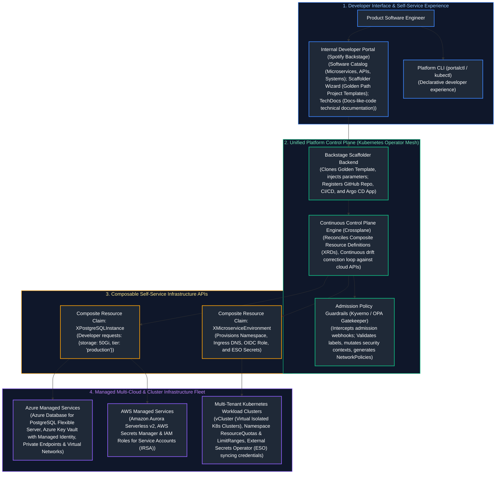

---

## Table of Contents
1. [The Platform Engineering Paradigm: Municipal Highway Analogy](#1-the-platform-engineering-paradigm-municipal-highway-analogy)
   - [1.1 Real-World Analogy: Paved Highways vs. Clearing Jungle Dirt Roads](#11-real-world-analogy-paved-highways-vs-clearing-jungle-dirt-roads)
   - [1.2 Cognitive Load Theory & Team Topologies](#12-cognitive-load-theory--team-topologies)
   - [1.3 Treating the Platform as a Product: Customer Focus & Internal Adoption](#13-treating-the-platform-as-a-product-customer-focus--internal-adoption)
2. [Internal Developer Portals: Spotify Backstage Architecture](#2-internal-developer-portals-spotify-backstage-architecture)
   - [2.1 Core Subsystems: Software Catalog, TechDocs, and Software Templates (Scaffolder)](#21-core-subsystems-software-catalog-techdocs-and-software-templates-scaffolder)
   - [2.2 The Golden Path (Paved Road) Philosophy: Magnetic vs. Coercive Adoption](#22-the-golden-path-paved-road-philosophy-magnetic-vs-coercive-adoption)
   - [2.3 Production Backstage Scaffolder Template Definition](#23-production-backstage-scaffolder-template-definition)
3. [Infrastructure Control Planes with Crossplane](#3-infrastructure-control-planes-with-crossplane)
   - [3.1 Moving Beyond Static IaC: Continuous Reconciliation Loops vs. Pipeline Runs](#31-moving-beyond-static-iac-continuous-reconciliation-loops-vs-pipeline-runs)
   - [3.2 Crossplane Building Blocks: Providers, Managed Resources (MRs), and Composite Resource Definitions (XRDs)](#32-crossplane-building-blocks-providers-managed-resources-mrs-and-composite-resource-definitions-xrds)
   - [3.3 Production Composition: Abstracting Cloud Relational Databases](#33-production-composition-abstracting-cloud-relational-databases)
4. [Kubernetes Multi-Tenancy & Platform Abstractions](#4-kubernetes-multi-tenancy--platform-abstractions)
   - [4.1 Soft Multi-Tenancy: Namespaces, ResourceQuotas, and LimitRanges](#41-soft-multi-tenancy-namespaces-resourcequotas-and-limitranges)
   - [4.2 Hard Multi-Tenancy: Virtual Clusters (vCluster) vs. Physical Isolation](#42-hard-multi-tenancy-virtual-clusters-vcluster-vs-physical-isolation)
5. [Automated Policy Guardrails with Kyverno](#5-automated-policy-guardrails-with-kyverno)
   - [5.1 Kyverno vs. OPA Gatekeeper: Declarative YAML vs. Imperative Rego](#51-kyverno-vs-opa-gatekeeper-declarative-yaml-vs-imperative-rego)
   - [5.2 Admission Webhooks: Validate, Mutate, and Generate Rules](#52-admission-webhooks-validate-mutate-and-generate-rules)
6. [Platform Secret Management: External Secrets Operator (ESO)](#6-platform-secret-management-external-secrets-operator-eso)
   - [6.1 The Security Hazard of Storing Secrets in Git and etcd](#61-the-security-hazard-of-storing-secrets-in-git-and-etcd)
   - [6.2 ESO Architecture: ClusterSecretStore, ExternalSecret, and Workload Identity](#62-eso-architecture-clustersecretstore-externalsecret-and-workload-identity)
7. [Ephemeral Development Environments & Preview Stacks](#7-ephemeral-development-environments--preview-stacks)
   - [7.1 Pull-Request-Driven Preview Lifecycle Orchestration](#71-pull-request-driven-preview-lifecycle-orchestration)
   - [7.2 Automated Garbage Collection, Resource TTLs, and Cloud Cost Containment](#72-automated-garbage-collection-resource-ttls-and-cloud-cost-containment)
8. [Developer Experience (DevEx) & Engineering Effectiveness Metrics](#8-developer-experience-devex--engineering-effectiveness-metrics)
   - [8.1 DORA Metrics: Deployment Frequency, Lead Time, CFR, and MTTR](#81-dora-metrics-deployment-frequency-lead-time-cfr-and-mttr)
   - [8.2 The SPACE Framework for Developer Productivity](#82-the-space-framework-for-developer-productivity)
9. [Production Code Implementation: Automated Golden Path Repository Auditor](#9-production-code-implementation-automated-golden-path-repository-auditor)
   - [9.1 Production Python Platform Catalog & Golden Path Compliance Auditor](#91-production-python-platform-catalog--golden-path-compliance-auditor)
10. [Senior Platform Architect Troubleshooting Runbooks: Platform Failures](#10-senior-platform-architect-troubleshooting-runbooks-platform-failures)
    - [10.1 Scenario 1: Crossplane Cloud API Rate-Limit Throttling Storm](#101-scenario-1-crossplane-cloud-api-rate-limit-throttling-storm)
    - [10.2 Scenario 2: External Secrets Operator Token Desynchronization](#102-scenario-2-external-secrets-operator-token-desynchronization)
    - [10.3 Scenario 3: Zombie Ephemeral Pull-Request Environments Leaking Cloud Spend](#103-scenario-3-zombie-ephemeral-pull-request-environments-leaking-cloud-spend)
11. [The FinOps Framework: The Smart Metered Electric Grid Analogy](#11-the-finops-framework-the-smart-metered-electric-grid-analogy)
    - [11.1 Real-World Analogy: Buying a Power Plant (CapEx) vs. The Metered Electric Grid (OpEx)](#111-real-world-analogy-buying-a-power-plant-capex-vs-the-metered-electric-grid-opex)
    - [11.2 The Three FinOps Phases: Inform, Optimize, Operate](#112-the-three-finops-phases-inform-optimize-operate)
    - [11.3 Unit Economics: Shifting from Raw Spend to Business Efficiency Metrics](#113-unit-economics-shifting-from-raw-spend-to-business-efficiency-metrics)
12. [Enterprise Resource Hierarchy & Landing Zone Governance](#12-enterprise-resource-hierarchy--landing-zone-governance)
    - [12.1 Enterprise Cloud Landing Zones: Azure CAF vs. AWS Control Tower](#121-enterprise-cloud-landing-zones-azure-caf-vs-aws-control-tower)
    - [12.2 Mandatory Cost-Allocation Tagging Governance via Policy-as-Code](#122-mandatory-cost-allocation-tagging-governance-via-policy-as-code)
    - [12.3 Preventive Guardrails: Service Control Policies (SCPs) and Azure Policy](#123-preventive-guardrails-service-control-policies-scps-and-azure-policy)
13. [Cost Visibility, Showback vs. Chargeback, and ML Anomaly Detection](#13-cost-visibility-showback-vs-chargeback-and-ml-anomaly-detection)
    - [13.1 Showback vs. Chargeback Accounting Models](#131-showback-vs-chargeback-accounting-models)
    - [13.2 Statistical Anomaly Detection: Holt-Winters and Z-Scores](#132-statistical-anomaly-detection-holt-winters-and-z-scores)
14. [Compute and Storage Cost Optimization: Rate vs. Usage Levers](#14-compute-and-storage-cost-optimization-rate-vs-usage-levers)
    - [14.1 Compute Rightsizing Analytics and Elastic Scaling](#141-compute-rightsizing-analytics-and-elastic-scaling)
    - [14.2 Commitment Discounts: Reserved Instances vs. Savings Plans](#142-commitment-discounts-reserved-instances-vs-savings-plans)
    - [14.3 Spot Instances / Spot VMs: Auction Physics & Graceful IMDS Drain Handling](#143-spot-instances--spot-vms-auction-physics--graceful-imds-drain-handling)
    - [14.4 Storage Lifecycle Policies: Hot, Cool, Cold, Archive and the Retrieval Fee Trap](#144-storage-lifecycle-policies-hot-cool-cold-archive-and-the-retrieval-fee-trap)
15. [Network Egress and Data Transfer Economics](#15-network-egress-and-data-transfer-economics)
    - [15.1 The Hidden Tax of Cloud Networking: Inter-AZ, Inter-Region, and Egress](#151-the-hidden-tax-of-cloud-networking-inter-az-inter-region-and-egress)
    - [15.2 Mitigating NAT Gateway Data Processing Surcharges](#152-mitigating-nat-gateway-data-processing-surcharges)
16. [Kubernetes Workload Cost Attribution (Kubecost & OpenCost)](#16-kubernetes-workload-cost-attribution-kubecost--opencost)
    - [16.1 The Shared Multi-Tenant Cluster Allocation Problem](#161-the-shared-multi-tenant-cluster-allocation-problem)
    - [16.2 Kubecost Allocation Mathematics: Requests vs. Usage vs. Idle Overhead](#162-kubecost-allocation-mathematics-requests-vs-usage-vs-idle-overhead)
17. [Enterprise Architecture Governance and ADRs](#17-enterprise-architecture-governance-and-adrs)
    - [17.1 Architecture Decision Records (ADRs) Framework](#171-architecture-decision-records-adrs-framework)
    - [17.2 Cloud Center of Excellence (CCoE) Operating Model](#172-cloud-center-of-excellence-ccoe-operating-model)
18. [Production Code Implementation: Automated Cloud Waste & Zombie Asset Auditor](#18-production-code-implementation-automated-cloud-waste--zombie-asset-auditor)
    - [18.1 Production Python Cloud FinOps Waste Auditor](#181-production-python-cloud-finops-waste-auditor)
19. [Senior FinOps Troubleshooting Runbooks: Outage & Bill Shock Scenarios](#19-senior-finops-troubleshooting-runbooks-outage--bill-shock-scenarios)
    - [19.1 Scenario 1: Overnight Cloud Cost Explosion from an Unthrottled Distributed Loop](#191-scenario-1-overnight-cloud-cost-explosion-from-an-unthrottled-distributed-loop)
    - [19.2 Scenario 2: Massive Unexpected NAT Gateway Data Processing Surcharge](#192-scenario-2-massive-unexpected-nat-gateway-data-processing-surcharge)
    - [19.3 Scenario 3: Glacier Deep Archive Emergency Retrieval Fee Shock](#193-scenario-3-glacier-deep-archive-emergency-retrieval-fee-shock)
20. [Summary Comparison & Production Engineering Reference Matrix](#20-summary-comparison--production-engineering-reference-matrix)
    - [20.1 Platform Engineering Evolution & Operating Model Reference Matrix](#201-platform-engineering-evolution--operating-model-reference-matrix)
    - [20.2 Enterprise FinOps Maturity & Cost Optimization Framework](#202-enterprise-finops-maturity--cost-optimization-framework)
21. [References & Further Reading](#21-references--further-reading)
---

# 1. The Platform Engineering Paradigm: Municipal Highway Analogy

### 1.1 Real-World Analogy: Paved Highways vs. Clearing Jungle Dirt Roads

To understand why the software industry has transitioned from early DevOps into Platform Engineering, consider the difference between a **civil highway department** and asking commuters to build their own roads:

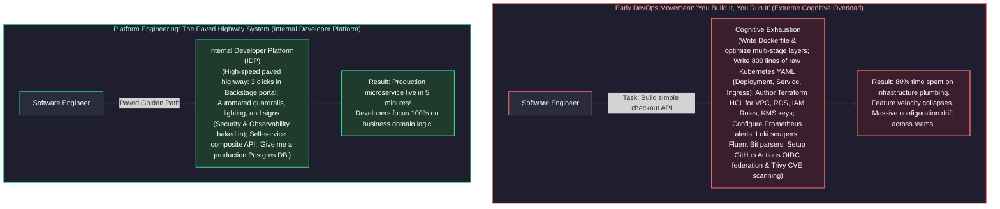

- **Early DevOps (Clearing the Jungle):** The noble slogan *"You build it, you run it"* was misinterpreted as *"You write code, you also design the VPC, write the Terraform, configure the CNI network plugin, rotate the TLS certificates, tune the Prometheus scrapers, and manage the ingress controller."* Product developers were overwhelmed with infrastructure trivia, leading to massive context switching, configuration errors, and slow feature delivery.
- **Platform Engineering (The Municipal Highway Department):** A dedicated Platform Team acts as civil engineers. They build the **Internal Developer Platform (IDP)**: well-lit highways with safety guardrails, clear speed limits, and emergency services. Developers don't need a civil engineering license to drive to work. If an engineer has specialized needs (an off-road vehicle requiring custom kernel parameters), they can take the dirt road—with the understanding that they are responsible for their own towing if they get stuck.

---

### 1.2 Cognitive Load Theory & Team Topologies

Platform engineering is grounded in educational psychologist John Sweller's **Cognitive Load Theory**, adapted for software organizations by Matthew Skelton and Manuel Pais in *Team Topologies*:

$$\text{Total Cognitive Load} = \text{Intrinsic Load} + \text{Germane Load} + \text{Extraneous Load}$$

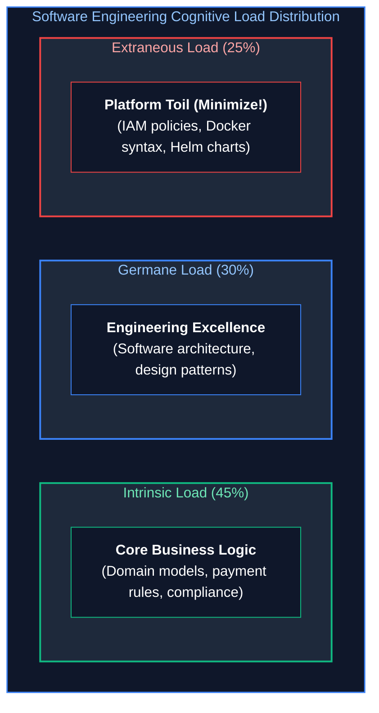

- **Intrinsic Cognitive Load:** The fundamental complexity of the problem space (e.g., how the business calculates European VAT taxes). This cannot be eliminated.
- **Germane Cognitive Load:** The mental processing devoted to creating mental schemas and long-term learning (e.g., designing clean domain models). This should be maximized.
- **Extraneous Cognitive Load:** Mental energy wasted on operational friction (e.g., *"What was the exact syntax for an AWS IAM Trust Policy JSON?"* or *"Why is my Kubernetes ingress throwing 404 because of an annotation typo?"*). **The sole objective of platform engineering is to ruthlessly eradicate extraneous cognitive load.**

#### Team Topologies Interaction Framework:
1. **Stream-Aligned Teams:** Product-focused engineering teams delivering customer value directly.
2. **Platform Teams:** Internal product teams providing an underlying platform that enables stream-aligned teams to deliver work autonomously without direct operational handoffs.
3. **Enabling Teams:** Specialists (e.g., security, testing) who temporarily embed with stream-aligned teams to transfer skills.
4. **Complicated-Subsystem Teams:** Specialized teams owning deeply technical domains (e.g., real-time cryptography engines).

---

### 1.3 Treating the Platform as a Product: Customer Focus & Internal Adoption

A fatal failure mode for platform engineering teams is operating like a legacy central IT department, issuing bureaucratic mandates (*"All teams MUST use this platform by Q3"*).

> [!CRITICAL]
> **The Golden Law of Platform Adoption:** **Treat the platform as a product, and treat internal developers as customers.** If developers circumvent your platform using shadow cloud accounts, **the platform is flawed, not the developers**. Platforms must win adoption through superior developer ergonomics, faster velocity, and self-evident value, not organizational coercion.

---

# 2. Internal Developer Portals: Spotify Backstage Architecture

**Spotify Backstage** (donated to the CNCF) has emerged as the industry-standard framework for building Internal Developer Portals.

### 2.1 Core Subsystems: Software Catalog, TechDocs, and Software Templates (Scaffolder)

Spotify Backstage unifies fragmented developer toolchains by serving as an extensible internal developer portal. Rather than forcing product engineers to navigate dozens of disparate cloud consoles, build pipelines, documentation wikis, and monitoring dashboards, Backstage organizes enterprise software around four tightly integrated foundational subsystems: a centralized Software Catalog, Docs-like-Code documentation, automated Scaffolder project generation, and a pluggable micro-frontend ecosystem.

The architectural responsibilities, file manifests, and developer experience outcomes across Backstage subsystems:

#### Spotify Backstage Core Subsystems Reference Matrix

| Subsystem | Architectural Role | Source Artifact / Manifest | Processing Engine & Protocols | Developer Experience Outcome |
| :--- | :--- | :--- | :--- | :--- |
| **1. Software Catalog** | Centralized entity graph tracking software ownership, metadata, and dependencies. | `catalog-info.yaml` stored in every service repository. | Ingestion engine continuously polls Git providers; builds in-memory relational entity graph. | Instant discovery of microservice ownership, maintainers, deployed environments, and API contracts. |
| **2. TechDocs** | Docs-like-code technical documentation reader and search engine. | Markdown files stored in `/docs` directory in source repo (`mkdocs.yml`). | CI pipeline or Backstage worker runs `mkdocs build`, pushing static HTML to AWS S3 or Azure Blob Storage. | Eliminates outdated Confluence wikis; documentation is versioned, reviewed, and published alongside code. |
| **3. Software Templates (Scaffolder)** | Self-service golden path provisioning wizard for bootstraping new projects. | `template.yaml` defining parameters and execution steps. | Scaffolder execution engine parameterizes Cookiecutter/Jinja templates, creates Git repo, and triggers CI. | Reduces service bootstrapping time from 2–3 weeks of ticket requests to $< 5$ minutes of automated provisioning. |
| **4. Dynamic Plugin Architecture** | Extensible micro-frontend integrating enterprise cloud toolchains. | React frontend components & Node.js backend proxy plugins. | Pluggable REST / GraphQL aggregators querying third-party APIs (Kubernetes, PagerDuty, SonarQube). | Unified single-pane-of-glass dashboard displaying real-time pod health, code quality, and on-call schedules. |

#### Backstage Entity Data Model:
Backstage organizes software assets into a structured, bidirectional entity graph defined via `catalog-info.yaml` files committed inside each repository:
- **Component:** An individual unit of software (service, website, library).
- **API:** The explicit contract exposed by a component (OpenAPI, gRPC Protobuf, AsyncAPI).
- **Resource:** Infrastructure dependencies needed by components (PostgreSQL databases, Redis caches, S3 buckets).
- **System:** A collection of components and resources cooperating to provide user-facing capabilities (e.g., `checkout-system`).
- **Domain:** High-level business boundary grouping multiple systems (e.g., `e-commerce-domain`).

#### Spotify Backstage Software Template Repository Folder Treeview

A standardized Backstage Scaffolder template repository couples parameterized user input forms (`template.yaml`) with a Jinja-templated application skeleton:

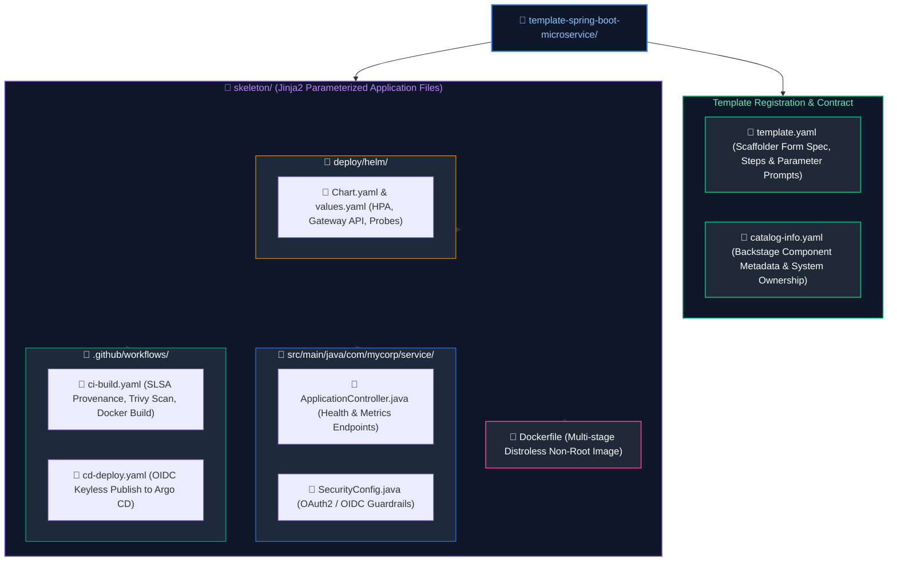

---

### 2.2 The Golden Path (Paved Road) Philosophy: Magnetic vs. Coercive Adoption

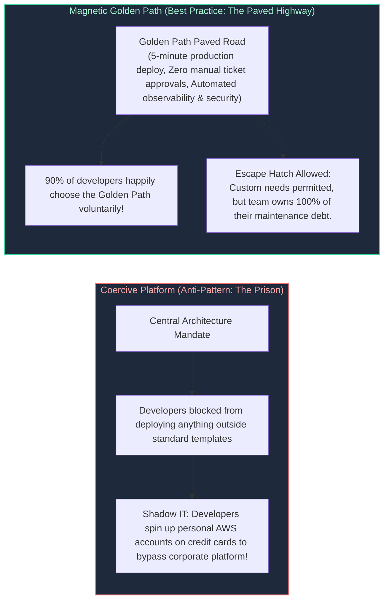

---

### 2.3 Production Backstage Scaffolder Template Definition

Below is a production `template.yaml` defining a self-service Scaffolder template that provisions a new Spring Boot / Python microservice, creates the GitHub repository, publishes the initial commit, and registers it in the catalog:

```yaml
# /templates/spring-microservice/template.yaml
apiVersion: scaffolder.backstage.io/v1beta3
kind: Template
metadata:
  name: standard-microservice-template
  title: Production-Grade Microservice Golden Path
  description: Scaffolds a production-ready microservice with Docker, GitHub Actions CI/CD, Argo CD GitOps, and Datadog tracing baked in.
  tags:
    - recommended
    - python
    - fastapi
    - kubernetes
spec:
  owner: platform-team
  type: service

  parameters:
    - title: Service Metadata
      required:
        - service_name
        - owner_team
        - description
      properties:
        service_name:
          title: Service Identifier
          type: string
          description: Unique kebab-case name (e.g., payment-processor)
          pattern: "^[a-z0-9-]+$"
        owner_team:
          title: Owning Team
          type: string
          description: Team responsible for service maintenance
          ui:field: OwnerPicker
          ui:options:
            allowedKinds: [Group]
        description:
          title: Description
          type: string
          description: Brief summary of business purpose

    - title: Deployment & Infrastructure Settings
      required:
        - environment_tier
        - needs_database
      properties:
        environment_tier:
          title: Initial Target Tier
          type: string
          default: non-production
          enum:
            - non-production
            - production
        needs_database:
          title: Provision Dedicated PostgreSQL DB?
          type: boolean
          default: false

  steps:

    # Fetch cookiecutter skeleton template from Git

- id: fetch-template
      name: Rendering Golden Skeleton
      action: fetch:template
      input:
        url: ./skeleton
        values:
          service_name: ${{ parameters.service_name }}
          owner_team: ${{ parameters.owner_team }}
          description: ${{ parameters.description }}
          needs_database: ${{ parameters.needs_database }}

    # Publish repository to corporate GitHub organization

- id: publish-github
      name: Creating Remote GitHub Repository
      action: publish:github
      input:
        allowedHosts: ["github.com"]
        description: ${{ parameters.description }}
        repoUrl: github.com?owner=enterprise-org&repo=${{ parameters.service_name }}
        defaultBranch: main
        protectDefaultBranch: true
        repoVisibility: internal

    # Register service in Backstage Software Catalog

- id: register-catalog
      name: Registering Component in Backstage Catalog
      action: catalog:register
      input:
        repoContentsUrl: ${{ steps['publish-github'].output.repoContentsUrl }}
        catalogInfoPath: "/catalog-info.yaml"

  output:
    links:
      - title: View Source Repository
        url: ${{ steps['publish-github'].output.remoteUrl }}
      - title: Open in Backstage Catalog
        icon: catalog
        entityRef: ${{ steps['register-catalog'].output.entityRef }}
```

---

# 3. Infrastructure Control Planes with Crossplane

### 3.1 Moving Beyond Static IaC: Continuous Reconciliation Loops vs. Pipeline Runs

```mermaid
flowchart TD
    subgraph StaticIaC ["Static Infrastructure as Code (Terraform / OpenTofu)"]
        T_Git["Git Commit"] --> T_Pipe["CI/CD Pipeline Executes 'terraform apply'"]
        T_Pipe --> T_Cloud["Cloud API Mutated"]
        T_Cloud -.->|"Out-of-band drift occurs (Engineer changes Security Group in Web Console)"| T_Blind["Terraform is BLIND to drift until the next pipeline runs days later!"]
    end

    subgraph ControlPlane ["Continuous Kubernetes Control Plane (Crossplane)"]
        C_CRD["Custom Resource in etcd"] <-->|"Continuous Active Reconciliation Loop (Every 60s)"| Controller["Crossplane Provider Controller"]
        Controller <-->|"Interrogates Live Cloud API via gRPC"| C_Cloud["Live Cloud Infrastructure"]
        C_Cloud -.->|"Out-of-band mutation"| Detected["Drift instantly detected! Controller automatically self-heals & resets cloud state back to declared manifest!"]
    end

    style StaticIaC fill:#1e293b,stroke:#f87171,stroke-width:1.5px,color:#fca5a5
    style ControlPlane fill:#1e293b,stroke:#34d399,stroke-width:1.5px,color:#a7f3d0
    style Detected fill:#1e3b2e,stroke:#34d399,stroke-width:1.5px,color:#fff
```

---

### 3.2 Crossplane Building Blocks: Providers, Managed Resources (MRs), and Composite Resource Definitions (XRDs)

Crossplane extends the Kubernetes API with four core primitives:
1. **Providers (e.g. `provider-azure`, `provider-aws`):** Kubernetes operators that package CRDs mapping 1:1 with cloud primitives.
2. **Managed Resources (MRs):** Low-level granular resources (e.g., `VirtualNetwork`, `FlexibleServer`, `KeyVaultKey`). Owned exclusively by platform teams.
3. **Composite Resource Definitions (XRDs):** Defines the **custom API contract** exposed to application developers (e.g., `DatabaseInstance.platform.corp/v1`).
4. **Compositions:** The operational engine that translates an abstract XRD claim into dozens of fully configured, hardened, interconnected Managed Resources across cloud providers.

---

### 3.3 Production Composition: Abstracting Cloud Relational Databases

Below is a production Crossplane Composition provisioning an enterprise Azure Database for PostgreSQL Flexible Server, generating an Azure Key Vault secret, and binding network security rules:

```yaml
# /crossplane/compositions/azure-postgres-composition.yaml
apiVersion: apiextensions.crossplane.io/v1
kind: Composition
metadata:
  name: postgres-flexible.azure.platform.corp
  labels:
    provider: azure
    service: postgres
spec:
  compositeTypeRef:
    apiVersion: database.corp.platform/v1alpha1
    kind: XDatabaseInstance

  resources:
    # Resource 1: Azure PostgreSQL Flexible Server
    - name: postgresServer
      base:
        apiVersion: dbforpostgresql.azure.upbound.io/v1beta1
        kind: FlexibleServer
        spec:
          forProvider:
            location: eastus
            administratorLogin: cloudadmin
            autoGrowEnabled: true
            backupRetentionDays: 30
            geoRedundantBackupEnabled: true
            version: "15"
            skuName: GP_Standard_D2ds_v4
            storageMb: 32768
            delegatedSubnetIdSelector:
              matchLabels:
                tier: database-subnet
      patches:
        # Patch storage size from developer claim
        - type: FromCompositeFieldPath
          fromFieldPath: spec.parameters.storageGB
          toFieldPath: spec.forProvider.storageMb
          transforms:
            - type: math
              math:
                multiply: 1024

    # Resource 2: Firewall Rule permitting Kubernetes VNet Ingress
    - name: firewallRule
      base:
        apiVersion: dbforpostgresql.azure.upbound.io/v1beta1
        kind: FlexibleServerFirewallRule
        spec:
          forProvider:
            serverNameSelector:
              matchControllerRef: true
            startIpAddress: "10.240.0.0"
            endIpAddress: "10.240.255.255"

    # Resource 3: Connection Secret Written directly to Developer Namespace
    - name: connectionSecret
      base:
        apiVersion: kubernetes.crossplane.io/v1alpha1
        kind: Object
        spec:
          forProvider:
            manifest:
              apiVersion: v1
              kind: Secret
              metadata:
                name: db-connection-credentials
```

---

# 4. Kubernetes Multi-Tenancy & Platform Abstractions

Platform engineers must balance multi-tenant resource density against security isolation.

### 4.1 Soft Multi-Tenancy: Namespaces, ResourceQuotas, and LimitRanges

In soft multi-tenancy, multiple teams share a single large Kubernetes cluster. Tenants are partitioned via Namespaces with hard compute boundaries:

```yaml
# /manifests/tenants/checkout-tenant-policy.yaml
apiVersion: v1
kind: ResourceQuota
metadata:
  name: team-checkout-quota
  namespace: team-checkout
spec:
  hard:
    requests.cpu: "16"
    requests.memory: 32Gi
    limits.cpu: "32"
    limits.memory: 64Gi
    persistentvolumeclaims: "10"
    services.loadbalancers: "0"  # Prevent accidental public IP exposure!
---
apiVersion: v1
kind: LimitRange
metadata:
  name: team-checkout-limitrange
  namespace: team-checkout
spec:
  limits:
    - type: Container
      default:
        cpu: "500m"
        memory: "512Mi"
      defaultRequest:
        cpu: "100m"
        memory: "128Mi"
      max:
        cpu: "4"
        memory: "8Gi"
```

---

### 4.2 Hard Multi-Tenancy: Virtual Clusters (vCluster) vs. Physical Isolation

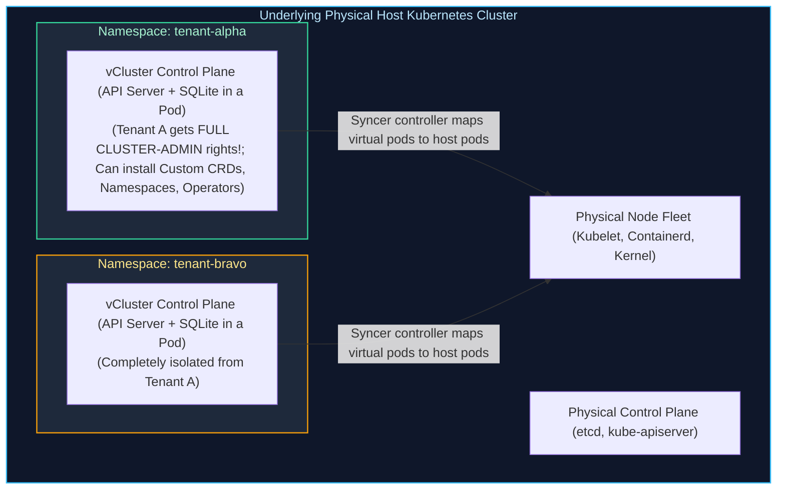

| Dimension | Soft Multi-Tenancy (Namespaces) | Virtual Clusters (vCluster) | Separate Physical Clusters |
| :--- | :--- | :--- | :--- |
| **Cluster-Scoped Resources (CRDs)**| Shared; collision risk between teams | Completely isolated per virtual cluster | 100% physically isolated |
| **Kubernetes Versioning** | Locked to host cluster version | Tenants can run different minor K8s versions | Fully independent |
| **Cluster Admin Access** | Strictly forbidden for developers | Safe: Tenants have `cluster-admin` inside vCluster | Tenants have root cluster access |
| **Infrastructure Cost** | Lowest (maximum bin-packing efficiency) | Near-zero overhead (~1 lightweight pod per tenant) | Highest (massive baseline control plane fees) |

---

# 5. Automated Policy Guardrails with Kyverno

### 5.1 Kyverno vs. OPA Gatekeeper: Declarative YAML vs. Imperative Rego

Enforcing security, governance, and organizational standards across multi-tenant Kubernetes clusters requires automated admission control. While static linters catch violations in CI pipelines, admission webhooks act as the final defensive gate in the API server before manifests are committed to etcd. The cloud-native ecosystem features two dominant policy engines—Kyverno and Open Policy Agent (OPA) Gatekeeper—each embodying a distinct architectural philosophy for rule definition, mutation, and resource generation.

The architectural, language, and operational differences between Kyverno and OPA Gatekeeper:

| Policy Engine Dimension | Kyverno (Kubernetes Native) | OPA Gatekeeper (General Purpose) |
| :--- | :--- | :--- |
| **Policy Language Syntax** | **100% Native Kubernetes YAML:** Policies look and behave like standard Kubernetes resources. | **Rego Domain-Specific Language (DSL):** Requires developers to learn query-based Datalog syntax. |
| **Dynamic Resource Generation** | **Natively Supported:** Automatically generates default `NetworkPolicy`, `ResourceQuota`, or `RoleBinding` on namespace creation. | **Not Supported Natively:** Requires auxiliary custom controllers or complex external operators. |
| **Mutation Capabilities** | **Native JSON Patch / Overlay:** Modifies incoming manifests easily using familiar YAML structure. | Supported via specialized `Assign` and `AssignMetadata` Custom Resource Definitions. |
| **Developer Learning Curve** | **Zero new languages:** Any engineer who knows Kubernetes YAML can author and debug policies in minutes. | **Steep:** Writing, unit testing, and debugging Rego rule evaluation requires specialized training. |
| **Non-Kubernetes Scope** | Limited strictly to Kubernetes admission and background cluster scanning. | **Universal Scope:** OPA evaluates policies for Terraform IaC, Envoy proxies, Linux PAM, and HTTP APIs. |
| **Recommended Platform Role** | The preferred standard for pure Kubernetes platform governance and golden path automation. | Best suited for multi-system enterprise compliance spanning cloud IaC, service mesh, and Kubernetes. |

#### Admission Controller Webhook Processing Flowchart

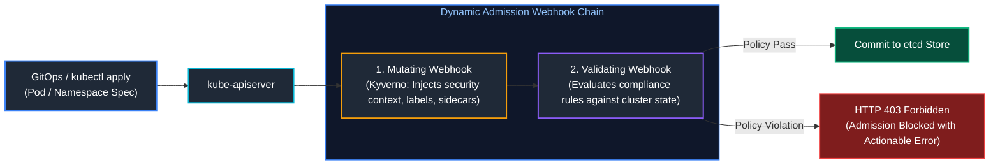

---

### 5.2 Admission Webhooks: Validate, Mutate, and Generate Rules

#### Production Kyverno Policy: Auto-Generating Default-Deny NetworkPolicies
Whenever a developer creates a new namespace, Kyverno **automatically generates** a zero-trust default-deny NetworkPolicy:

```yaml
# /kyverno/policies/generate-default-network-policy.yaml
apiVersion: kyverno.io/v1
kind: ClusterPolicy
metadata:
  name: generate-default-network-policy
  annotations:
    policies.kyverno.io/title: Auto-Generate Default Deny Ingress
    policies.kyverno.io/category: Multi-Tenancy & Zero Trust
spec:
  rules:
    - name: generate-deny-all-ingress
      match:
        any:
          - resources:
              kinds: ["Namespace"]
      exclude:
        any:
          - resources:
              namespaces: ["kube-system", "kube-public", "kyverno", "monitoring"]
      generate:
        apiVersion: networking.k8s.io/v1
        kind: NetworkPolicy
        name: default-deny-all-ingress
        namespace: "{{request.object.metadata.name}}"
        synchronize: true
        data:
          spec:
            podSelector: {}
            policyTypes:
              - Ingress
```

---

# 6. Platform Secret Management: External Secrets Operator (ESO)

### 6.1 The Security Hazard of Storing Secrets in Git and etcd

1. **Base64 is NOT Encryption:** Kubernetes `Secret` objects store data in unencrypted base64 strings in etcd. Anyone with read access to the namespace or etcd backups can trivially decode credentials.
2. **GitOps Anti-Pattern:** Committing raw secrets to Git repositories exposes credentials to all repository viewers and Git history clones.

---

### 6.2 ESO Architecture: ClusterSecretStore, ExternalSecret, and Workload Identity

**External Secrets Operator (ESO)** continuously reads credentials from external enterprise vaults (Azure Key Vault, AWS Secrets Manager, HashiCorp Vault) and materializes them as ephemeral native Kubernetes Secrets:

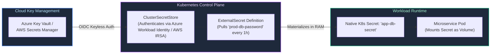

---

# 7. Ephemeral Development Environments & Preview Stacks

### 7.1 Pull-Request-Driven Preview Lifecycle Orchestration

Preview environments allow developers and QA engineers to test pull requests against real cloud infrastructure before merging to main:

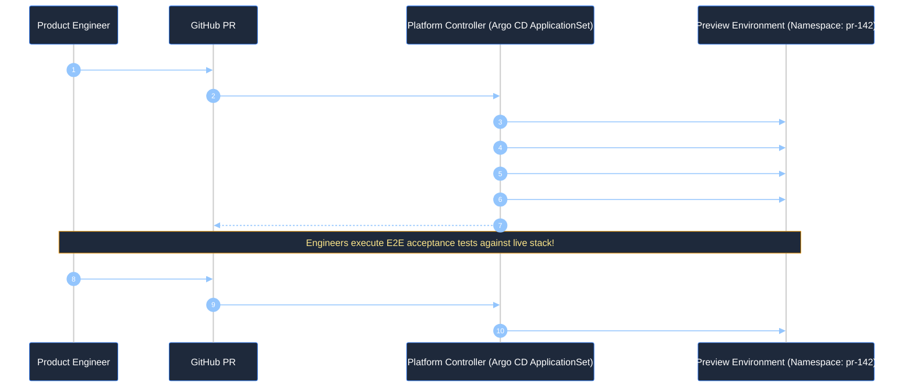

---

### 7.2 Automated Garbage Collection, Resource TTLs, and Cloud Cost Containment

Without automated garbage collection, developers abandon PRs, leaving hundreds of orphan databases and load balancers running, accumulating massive cloud waste:
- **Namespace TTL Annotations:** Annotate preview namespaces with `platform.corp/ttl: "72h"`.
- **Kube-Janitor / Custom Cleanup Cron:** A platform daemon scans namespaces hourly. If `now() > creation_timestamp + TTL`, the janitor executes an automated cascade deletion.

---

# 8. Developer Experience (DevEx) & Engineering Effectiveness Metrics

### 8.1 DORA Metrics: Deployment Frequency, Lead Time, CFR, and MTTR

The DevOps Research and Assessment (DORA) metrics measure engineering velocity and platform stability:

| DORA Metric | Elite Performer Standard | How Platform Engineering Drives the Metric |
| :--- | :---: | :--- |
| **Deployment Frequency** | Multiple deploys per day | Self-service Backstage templates & automated GitOps pipelines |
| **Lead Time for Changes** | $< 1$ Hour (Commit to Prod) | Standardized CI/CD templates with pre-baked security scanning |
| **Change Failure Rate (CFR)**| $< 5\%$ | Automated canary rollouts (Argo Rollouts) & Kyverno policy gates |
| **Time to Restore (MTTR)**| $< 1$ Hour | One-click GitOps rollback via Argo CD or Helm history rollback |

---

### 8.2 The SPACE Framework for Developer Productivity

DORA measures delivery pipeline throughput; GitHub and Microsoft's **SPACE Framework** measures the holistic human experience:
- **S - Satisfaction and Well-Being:** How healthy and happy are developers? (Measured via quarterly DevEx surveys).
- **P - Performance:** Quality and impact of software outcomes (Bug escape rate, customer adoption).
- **A - Activity:** Count of actions completed (PRs merged, commits, incidents handled).
- **C - Communication & Collaboration:** Discoverability of internal documentation and APIs (Search queries in Backstage).
- **E - Efficiency and Flow:** Minimizing context switching and interruptions (Time spent waiting for CI pipelines or waiting for infrastructure tickets).

---

# 9. Production Code Implementation: Automated Golden Path Repository Auditor

### 9.1 Production Python Platform Catalog & Golden Path Compliance Auditor

Below is a production-grade Python tool that audits git repositories for **Golden Path compliance**, verifies `catalog-info.yaml` syntax, checks for security scanning workflows, and outputs structured JSON reports for Backstage:

```python
#!/usr/bin/env python3
"""
Platform Engineering Golden Path & Catalog Compliance Auditor.
Interrogates Git repositories for compliance with internal developer platform standards:
Backstage catalog-info.yaml, Dockerfile optimization, CI/CD pipelines, and security guardrails.
"""

from dataclasses import asdict, dataclass
import json
import logging
from pathlib import Path
import sys
from typing import Any, Dict, List
import yaml

logging.basicConfig(
    level=logging.INFO,
    format='{"time":"%(asctime)s","level":"%(levelname)s","logger":"%(name)s","message":"%(message)s"}',
    handlers=[logging.StreamHandler(sys.stdout)],
)
logger = logging.getLogger("platform_auditor")

@dataclass(frozen=True)
class ComplianceCheck:
    check_id: str
    category: str
    status: str  # PASSED, FAILED, WARNING
    remediation: str

class GoldenPathComplianceEngine:
    def __init__(self, target_repo_path: Path):
        self.repo = target_repo_path

    def audit_all(self) -> Dict[str, Any]:
        """Runs the complete suite of Golden Path compliance checks."""
        logger.info("Initiating Golden Path compliance audit against: %s", self.repo)
        results: List[ComplianceCheck] = []

        results.extend(self._check_backstage_catalog())
        results.extend(self._check_containerization())
        results.extend(self._check_cicd_pipelines())
        results.extend(self._check_security_policies())

        total = len(results)
        passed = sum(1 for c in results if c.status == "PASSED")
        score = (passed / total) * 100 if total > 0 else 0

        return {
            "repository": str(self.repo.resolve()),
            "compliance_score_percent": round(score, 1),
            "overall_status": "COMPLIANT" if score >= 80 else "NON_COMPLIANT",
            "findings": [asdict(c) for c in results],
        }

    def _check_backstage_catalog(self) -> List[ComplianceCheck]:
        catalog_path = self.repo / "catalog-info.yaml"
        if not catalog_path.exists():
            return [
                ComplianceCheck(
                    check_id="CATALOG_INFO_EXISTS",
                    category="Cataloging",
                    status="FAILED",
                    remediation="Add catalog-info.yaml to repository root to register service in Backstage.",
                )
            ]

        try:
            with open(catalog_path, "r", encoding="utf-8") as f:
                data = yaml.safe_load(f)

            if not data or data.get("apiVersion") != "backstage.io/v1alpha1":
                return [
                    ComplianceCheck(
                        check_id="CATALOG_API_VERSION",
                        category="Cataloging",
                        status="FAILED",
                        remediation="catalog-info.yaml must use apiVersion: backstage.io/v1alpha1.",
                    )
                ]

            metadata = data.get("metadata", {})
            spec = data.get("spec", {})

            if not metadata.get("name") or not spec.get("owner"):
                return [
                    ComplianceCheck(
                        check_id="CATALOG_METADATA_FIELDS",
                        category="Cataloging",
                        status="FAILED",
                        remediation="Ensure metadata.name and spec.owner are populated in catalog-info.yaml.",
                    )
                ]

            return [
                ComplianceCheck(
                    check_id="CATALOG_METADATA_FIELDS",
                    category="Cataloging",
                    status="PASSED",
                    remediation="Catalog definition valid.",
                )
            ]
        except Exception as err:
            return [
                ComplianceCheck(
                    check_id="CATALOG_SYNTAX_VALID",
                    category="Cataloging",
                    status="FAILED",
                    remediation=f"Invalid YAML syntax in catalog-info.yaml: {err}",
                )
            ]

    def _check_containerization(self) -> List[ComplianceCheck]:
        dockerfile = self.repo / "Dockerfile"
        if not dockerfile.exists():
            return [
                ComplianceCheck(
                    check_id="DOCKERFILE_PRESENT",
                    category="Build & Packaging",
                    status="FAILED",
                    remediation="Create standard multi-stage Dockerfile adhering to Golden Path templates.",
                )
            ]

        content = dockerfile.read_text(encoding="utf-8")
        findings = [
            ComplianceCheck(
                check_id="DOCKERFILE_PRESENT",
                category="Build & Packaging",
                status="PASSED",
                remediation="Dockerfile exists.",
            )
        ]

        if "latest" in content:
            findings.append(
                ComplianceCheck(
                    check_id="DOCKER_NO_LATEST_TAG",
                    category="Build & Packaging",
                    status="WARNING",
                    remediation="Avoid using ':latest' base image tags; pin explicit SHA256 digests or semver versions.",
                )
            )

        if "USER root" in content or "USER 0" in content:
            findings.append(
                ComplianceCheck(
                    check_id="DOCKER_NON_ROOT",
                    category="Security",
                    status="FAILED",
                    remediation="Configure a non-root USER in the Dockerfile to adhere to least-privilege security.",
                )
            )

        return findings

    def _check_cicd_pipelines(self) -> List[ComplianceCheck]:
        workflow_dir = self.repo / ".github" / "workflows"
        if not workflow_dir.exists() or not list(workflow_dir.glob("*.yml")):
            return [
                ComplianceCheck(
                    check_id="CI_WORKFLOW_PRESENT",
                    category="CI/CD",
                    status="FAILED",
                    remediation="Add GitHub Actions workflow under .github/workflows/ using the Golden Path action.",
                )
            ]

        return [
            ComplianceCheck(
                check_id="CI_WORKFLOW_PRESENT",
                category="CI/CD",
                status="PASSED",
                remediation="GitHub Actions workflows present.",
            )
        ]

    def _check_security_policies(self) -> List[ComplianceCheck]:
        dependabot = self.repo / ".github" / "dependabot.yml"
        if not dependabot.exists():
            return [
                ComplianceCheck(
                    check_id="DEPENDABOT_ENABLED",
                    category="Security",
                    status="WARNING",
                    remediation="Enable Dependabot or Renovate for automated vulnerability dependency updates.",
                )
            ]

        return [
            ComplianceCheck(
                check_id="DEPENDABOT_ENABLED",
                category="Security",
                status="PASSED",
                remediation="Automated dependency security updates configured.",
            )
        ]

# ============================================================================
# Verification Run
# ============================================================================
if __name__ == "__main__":
    # Create temporary mock microservice directory for demonstration
    mock_dir = Path("/tmp/mock_golden_path_service")
    mock_dir.mkdir(parents=True, exist_ok=True)
    (mock_dir / ".github" / "workflows").mkdir(parents=True, exist_ok=True)

    # Write compliant files
    (mock_dir / "catalog-info.yaml").write_text(
        "apiVersion: backstage.io/v1alpha1\nkind: Component\nmetadata:\n  name: payments-service\nspec:\n  type: service\n  owner: team-billing\n"
    )
    (mock_dir / "Dockerfile").write_text(
        "FROM python:3.11-slim\nUSER 10001\nCMD ['python', 'main.py']\n"
    )
    (mock_dir / ".github" / "workflows" / "build.yml").write_text("name: Build\non: [push]\n")
    (mock_dir / ".github" / "dependabot.yml").write_text("version: 2\n")

    auditor = GoldenPathComplianceEngine(mock_dir)
    report = auditor.audit_all()
    print(json.dumps(report, indent=2))
```

---

# 10. Senior Platform Architect Troubleshooting Runbooks: Platform Failures

### 10.1 Scenario 1: Crossplane Cloud API Rate-Limit Throttling Storm
- **Symptom:** Crossplane logs are inundated with `HTTP 429 Too Many Requests` from Azure Resource Manager (ARM) or AWS Cloud Control API. Cloud resource creation stalls; developer claims remain stuck in `Syncing` status indefinitely.
- **Root Cause:** 2,000 Managed Resources (MRs) in Crossplane are operating on default **1-minute poll intervals**. The cumulative reconciliation queries exhaust the cloud provider's regional subscription API rate limits.
- **Immediate Mitigation Runbook:**
  1. Increase poll interval across all Crossplane Providers:
     ```yaml
     # Update Provider deployment flags
     args:
       - --poll-interval=15m
       - --max-reconcile-rate=10
     ```
  2. Implement caching proxies or enable native cloud resource event subscriptions (e.g. Azure Event Grid notification hooks) to trigger reconciliations reactively instead of polling continuously.

---

### 10.2 Scenario 2: External Secrets Operator Token Desynchronization
- **Symptom:** Kubernetes pods fail to start with `CreateContainerConfigError`. The target Kubernetes Secret is missing or contains stale credentials.
- **Root Cause Isolation:**
  1. Inspect the `ExternalSecret` custom resource:
     ```bash
     kubectl describe externalsecret/db-credentials -n team-checkout
     ```
  2. Notice the error: `SecretStoreProviderError: Azure Key Vault returned 403 Forbidden: Client address not authorized by firewall`.
  3. The workload cluster's egress IP was altered or a Private Endpoint DNS resolution failed.
- **Resolution:**
  1. Verify the cluster's Managed Identity has `Key Vault Secrets User` role assignment.
  2. Ensure the Virtual Network hosting the cluster has proper Private Endpoint peering to Azure Key Vault.

---

### 10.3 Scenario 3: Zombie Ephemeral Pull-Request Environments Leaking Cloud Spend
- **Symptom:** Monthly AWS / Azure bill spikes unexpectedly by \$18,000. Finance alerts the platform team that 350 preview databases and load balancers are active in non-production accounts.
- **Root Cause:** Developers regularly close pull requests using GitHub UI without triggering the GitHub Actions webhook (or the cleanup job failed silently due to an expired PAT token).
- **Remediation Runbook:**
  1. Run an emergency cleanup script filtering namespaces with `env: preview` older than 7 days:
     ```bash
     kubectl get ns -l environment=preview -o json | jq -r '.items[] | select(.metadata.creationTimestamp < (now - 604800 | todate)) | .metadata.name' | xargs -I {} kubectl delete ns {}
     ```
  2. Enforce **Kube-Janitor** or **Kyverno TTL Controller** with automated cloud resource reaping.

---

# 11. The FinOps Framework: The Smart Metered Electric Grid Analogy

### 11.1 Real-World Analogy: Buying a Power Plant (CapEx) vs. The Metered Electric Grid (OpEx)

To understand why enterprise organizations experience catastrophic cloud billing shocks without a mature FinOps practice, consider the structural difference between **building your own power plant** and **plugging into a smart municipal electric grid**:

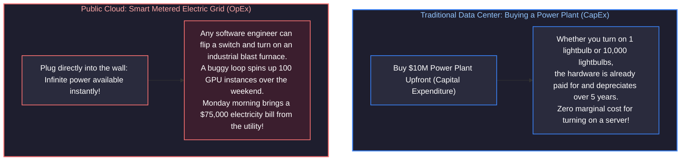

- **In the traditional data center (CapEx):** Procurement was slow, bureaucratic, and gated by physical purchase orders. A server took 3 months to be delivered, racked, and cabled. However, once installed, running an extra batch job cost virtually nothing extra. Engineers never had to worry about hourly financial burn.
- **In the public cloud (OpEx):** Cloud resources are variable operating expenditures billed by the second. Any developer with `Contributor` IAM permissions can execute `terraform apply` or click a button in the web console, committing the enterprise to thousands of dollars per hour. **FinOps is not about "saving money"—FinOps is about maximizing business value per dollar spent.**

---

### 11.2 The Three FinOps Phases: Inform, Optimize, Operate

The FinOps Foundation defines an iterative, continuous three-phase lifecycle:

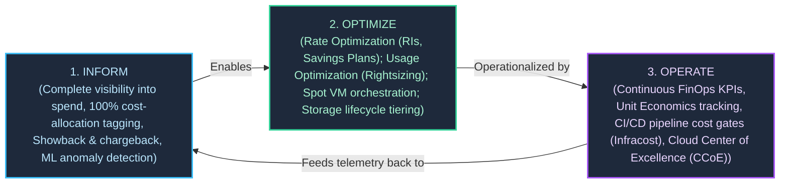

---

### 11.3 Unit Economics: Shifting from Raw Spend to Business Efficiency Metrics

A common anti-pattern in cloud governance is celebrating raw cost cuts when the business is booming, or panicking when the cloud bill increases because revenue doubled. Mature FinOps measures **Unit Economics**:

$$\text{Cloud Unit Metric} = \frac{\text{Total Attributed Cloud Infrastructure Cost}}{\text{Core Business Value Metric}}$$

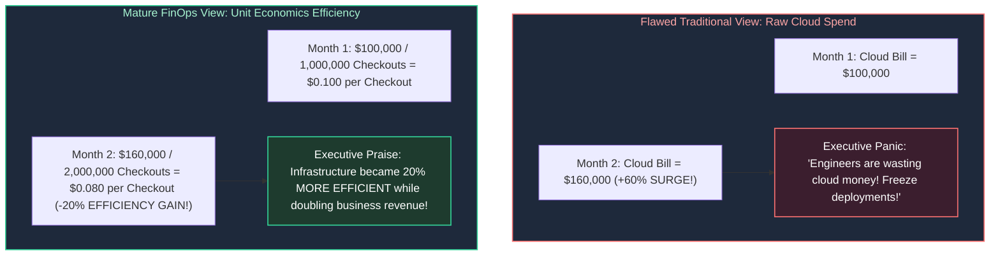

#### Canonical Enterprise Unit Metric Formulations:
- **E-Commerce:** $\text{Cloud Cost per Completed Order}$ (Target: $< \$0.05$).
- **SaaS B2B:** $\text{Cloud Cost per Monthly Active User (MAU)}$ (Target: $< \$0.12$).
- **Fintech / Payment Processing:** $\text{Cloud Cost per \$1,000 Payment Volume Processed}$.
- **Streaming / Media:** $\text{Cloud Cost per Gigabyte Streamed to Subscribers}$.

---

# 12. Enterprise Resource Hierarchy & Landing Zone Governance

Enterprise landing zones establish organizational hierarchies, security boundaries, and billing ownership before application workloads deploy.

### 12.1 Enterprise Cloud Landing Zones: Azure CAF vs. AWS Control Tower

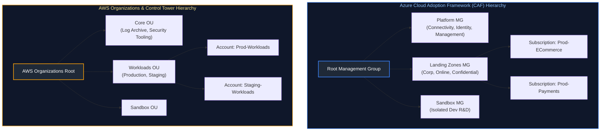

---

### 12.2 Mandatory Cost-Allocation Tagging Governance via Policy-as-Code

Untagged cloud resources represent financial black holes that cannot be attributed to specific departments or products. Enterprises enforce **Policy-as-Code** gates at the management root, causing cloud APIs to **reject non-compliant provisioning requests**:

```json
// Azure Policy: Deny Resource Deployment if CostCenter Tag is Missing
{
  "properties": {
    "displayName": "Enforce Mandatory CostCenter Tag on Resource Groups",
    "description": "Denies creation of any resource group that does not include the CostCenter financial ledger tag.",
    "mode": "All",
    "policyRule": {
      "if": {
        "allOf": [
          {
            "field": "type",
            "equals": "Microsoft.Resources/subscriptions/resourceGroups"
          },
          {
            "field": "tags['CostCenter']",
            "exists": "false"
          }
        ]
      },
      "then": {
        "effect": "deny"
      }
    }
  }
}
```

---

### 12.3 Preventive Guardrails: Service Control Policies (SCPs) and Azure Policy

Preventive policies establish non-negotiable financial and regional guardrails:
1. **Restricting Deployment Regions:** Prevent developers from launching resources in expensive or non-compliant regions:
   ```json
   // AWS Service Control Policy (SCP): Restrict Deployment to approved regions
   {
     "Version": "2012-10-17",
     "Statement": [
       {
         "Sid": "DenyUnapprovedRegions",
         "Effect": "Deny",
         "NotAction": [
           "iam:*", "route53:*", "cloudfront:*", "waf:*"
         ],
         "Resource": "*",
         "Condition": {
           "StringNotEquals": {
             "aws:RequestedRegion": ["us-east-1", "eu-west-1"]
           }
         }
       }
     ]
   }
   ```
2. **Denying Monster Compute SKUs:** Deny developer creation of massive GPU instances (`p4d.24xlarge` at \$32/hr) or mega-RAM virtual machines without executive architecture review.

---

# 13. Cost Visibility, Showback vs. Chargeback, and ML Anomaly Detection

### 13.1 Showback vs. Chargeback Accounting Models

Driving accountability for decentralized cloud spending requires selecting an organizational financial attribution mechanism. While centralized IT budgets historically absorbed all technology infrastructure costs, modern FinOps shifts financial responsibility to individual engineering squads through two primary governance models: Showback (informational transparency) and Chargeback (direct ledger transfers).

The financial, structural, and cultural trade-offs between Showback and Chargeback models:

| Governance Dimension | Showback Model (Inform / Crawl Phase) | Chargeback Model (Operate / Run Phase) |
| :--- | :--- | :--- |
| **Financial Mechanism** | Informational reports issued monthly showing attributed cloud expenditure. | Actual inter-departmental balance transfers debited from team budgets. |
| **P&L General Ledger Impact** | Centralized IT/Cloud budget absorbs all invoices; zero direct P&L impact on squads. | Product teams carry direct P&L accountability; cloud spend reduces squad operating margins. |
| **Engineering Incentive** | Voluntary optimization; depends on good citizenship and moral persuasion. | Direct structural incentive: every dollar saved on cloud can fund headcounts or bonuses. |
| **Implementation Complexity** | Low: Requires cost allocation tagging and dashboards (Grafana / CloudHealth). | High: Requires corporate ERP integration, cross-charging codes, and dispute mediation. |
| **Cultural Friction** | Low initial resistance; introduces cost awareness without budget anxiety. | High initial friction; leads to disputes over shared platform overhead (e.g. who pays for network transit?). |
| **Organizational Maturity** | Recommended starting point for organizations in FinOps "Crawl" and "Walk" stages. | Standard operational state for mature "Run" phase enterprises with dedicated FinOps teams. |

---

### 13.2 Statistical Anomaly Detection: Holt-Winters and Z-Scores

Static dollar thresholds fail to catch cloud waste because spend naturally grows as the business expands. Modern FinOps platforms use statistical time-series algorithms:
- **Z-Score Detection:** Calculates standard deviations from a rolling 14-day moving mean:
  $$Z = \frac{X_t - \mu_{14}}{\sigma_{14}}$$
  If $Z > 2.5$, a statistical anomaly is declared, immediately paging on-call engineers via PagerDuty.
- **Holt-Winters Triple Exponential Smoothing:** Accounts for cyclical business patterns (e.g., lower traffic on Sundays vs. peak spikes on Cyber Monday).

---

# 14. Compute and Storage Cost Optimization: Rate vs. Usage Levers

FinOps divides optimization into two distinct levers:
1. **Usage Optimization (Engineering):** Using fewer resources (downsizing VMs, terminating idle disks, cleaning preview stacks).
2. **Rate Optimization (Finance/Architecture):** Paying less per resource unit for the exact same infrastructure (Savings Plans, Spot instances).

### 14.1 Compute Rightsizing Analytics and Elastic Scaling

Over $40\%$ of cloud virtual machines operate at **$< 10\%$ average CPU and memory utilization**:
- **The Rightsizing Rule:** If an instance exhibits **P95 CPU $\le 20\%$** and **P95 RAM $\le 30\%$** over a rolling 14-day observation window, immediately downsize the instance by one size tier (e.g. `Standard_D8s_v5` $\rightarrow$ `Standard_D4s_v5`), slashing compute spend by **$50\%$**.

---

### 14.2 Commitment Discounts: Reserved Instances vs. Savings Plans

| Commitment Discount Model | Geographic & Regional Scope | Instance Family & OS Flexibility | Maximum Discount | Cross-Service Coverage | Marketplace Resale | Best Production Use Case |
| :--- | :--- | :--- | :---: | :--- | :---: | :--- |
| **Standard Reserved Instances (RI)** | Locked to a specific Region, Availability Zone, and exact instance type. | **None:** Locked to specific instance type, size, operating system, and tenancy. | **Up to ~72%** | Virtual Machines only (EC2 / Azure Reserved VM). | **Yes** (Can sell unused capacity on AWS Marketplace). | Mission-critical monolithic databases running 24/7 on fixed hardware specifications. |
| **EC2 / VM Instance Savings Plans** | Locked to a specific Region and a specific instance family (e.g. `m6i` or `Dsv5`). | **Moderate:** Automatically applies regardless of instance size, OS, or tenancy within the family. | **Up to ~66%** | Virtual Machines within the committed family only. | **No** | Stable workload fleets where the VM family is fixed, but individual sizes scale up/down. |
| **Compute Savings Plans** | **Global:** Applies across any Region automatically. | **Complete:** Automatically applies regardless of family, size, AZ, OS, or tenancy. | **Up to ~60%** | Comprehensive: Applies to EC2, AWS Fargate, and AWS Lambda seamlessly. | **No** | Dynamic containerized microservice fleets, serverless workloads, and rapid architecture evolutions. |

> [!CRITICAL]
> **The 70% Commitment Portfolio Law:** **Never commit to 100% of your current cloud fleet.** Workloads naturally fluctuate, and architectural refactorings (e.g. moving a monolithic VM to serverless containers) can strand unused commitments. The industry standard is committing to **$70\% - 80\%$ of steady-state baseline capacity**, absorbing elastic peaks with On-Demand and Spot instances.

---

### 14.3 Spot Instances / Spot VMs: Auction Physics & Graceful IMDS Drain Handling

Cloud providers sell surplus, unallocated hypervisor capacity at a **$60\% - 90\%$ discount** as **Spot Instances (AWS) / Spot VMs (Azure)**:
- **The Catch:** The cloud provider can evict the instance at any time with minimal warning (**2-minute notice in AWS** via EventBridge/IMDS; **30-second notice in Azure** via Scheduled Events API).
- **Graceful Drain Controller:** Workload clusters run an automated daemon that polls the Instance Metadata Service (IMDS) every 5 seconds. The moment an eviction token is detected, it automatically drains pods to surviving nodes:

```bash
# SRE Drain Automation: Poll AWS IMDS for Spot Eviction Action
TOKEN=$(curl -s -X PUT "http://169.254.169.254/latest/api/token" -H "X-aws-ec2-metadata-token-ttl-seconds: 60")
ACTION=$(curl -s -H "X-aws-ec2-metadata-token: $TOKEN" "http://169.254.169.254/latest/meta-data/spot/instance-action")

if [ "$ACTION" != "" ]; then
  echo "SPOT INTERRUPTION NOTICE RECEIVED: Draining Kubernetes Node..."
  kubectl cordon $(hostname)
  kubectl drain $(hostname) --ignore-daemonsets --delete-emptydir-data --force --grace-period=90
fi
```

---

### 14.4 Storage Lifecycle Policies: Hot, Cool, Cold, Archive and the Retrieval Fee Trap

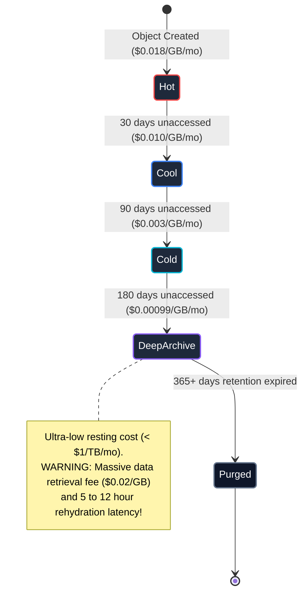

> [!CAUTION]
> **The Archive Retrieval Fee Trap:** Deep Archive / Glacier Deep Archive costs less than \$1 per terabyte per month to store. However, **retrieving that data incurs massive per-gigabyte retrieval surcharges and takes up to 12 hours**. Never transition files to Archive tiers if analytical queries (Athena, BigQuery, Databricks) regularly scan those directories!

---

# 15. Network Egress and Data Transfer Economics

### 15.1 The Hidden Tax of Cloud Networking: Inter-AZ, Inter-Region, and Egress

Inbound data transfer into public clouds is almost universally **free** (the "Hotel California" model). Cloud providers charge aggressively for outbound movement:

| Network Traffic Scope | Physical Path | Billing Rate | FinOps Architectural Mitigation |
| :--- | :--- | :--- | :--- |
| **Intra-AZ Traffic** | Same Subnet / Availability Zone | **Free (\$0.00 / GB)** | Co-locate high-chatter microservices (App to Redis) in the same AZ. |
| **Inter-AZ Traffic** | Cross-AZ within same Region | **\$0.01 / GB each way** (\$0.02 / GB roundtrip) | Enable Kubernetes Topology Aware Hints; configure local in-memory caches. |
| **Inter-Region Traffic** | Across cloud regions (e.g. East to West) | **\$0.02 / GB** | Replicate only deduplicated, compressed delta streams (Kafka / CDC). |
| **Public Internet Egress** | Cloud out to Public Internet | **\$0.08 – \$0.12 / GB** | Place Cloudflare / CloudFront CDN at perimeter to cache static & API payloads. |

---

### 15.2 Mitigating NAT Gateway Data Processing Surcharges

Managed NAT Gateways (AWS NAT Gateway / Azure NAT Gateway) are silent cost exploders:
- **Fixed Fee:** ~\$0.045 per hour per gateway (~$32/mo).
- **Data Processing Surcharge:** **\$0.045 per Gigabyte processed**!
- If a data pipeline downloads 50 Terabytes of training data from an S3 bucket or Azure Blob through a NAT Gateway, the company incurs **\$2,250 in unnecessary data processing fees**!

#### The Architectural Solution: VPC Gateway Endpoints
Route cloud service traffic directly through **free Gateway Endpoints**:
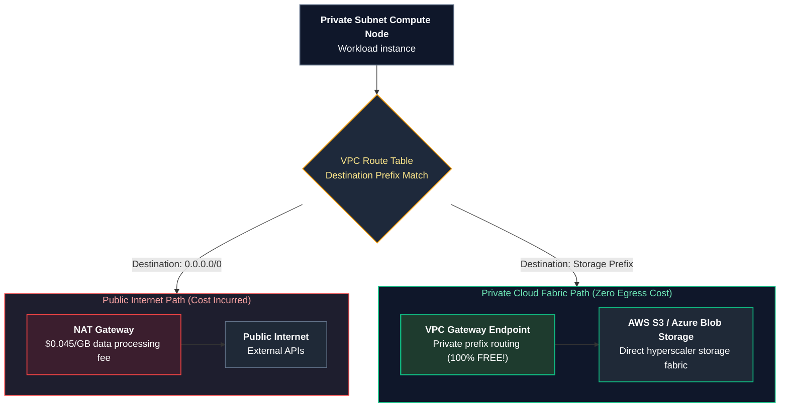

---

# 16. Kubernetes Workload Cost Attribution (Kubecost & OpenCost)

### 16.1 The Shared Multi-Tenant Cluster Allocation Problem

When 40 teams deploy microservices to a single 200-node shared Kubernetes cluster, the cloud bill arrives as a monolithic itemized charge for "200 Virtual Machines". Infrastructure leaders cannot determine which team is responsible for which portion of the bill.

---

### 16.2 Kubecost Allocation Mathematics: Requests vs. Usage vs. Idle Overhead

**OpenCost (CNCF)** and **Kubecost** resolve this by calculating cost allocation per container pod:

$$\text{Pod Cost} = \max(\text{CPU}_{\text{Requests}}, \text{CPU}_{\text{Usage}}) \times \text{Rate}_{\text{CPU}} + \max(\text{RAM}_{\text{Requests}}, \text{RAM}_{\text{Usage}}) \times \text{Rate}_{\text{RAM}}$$

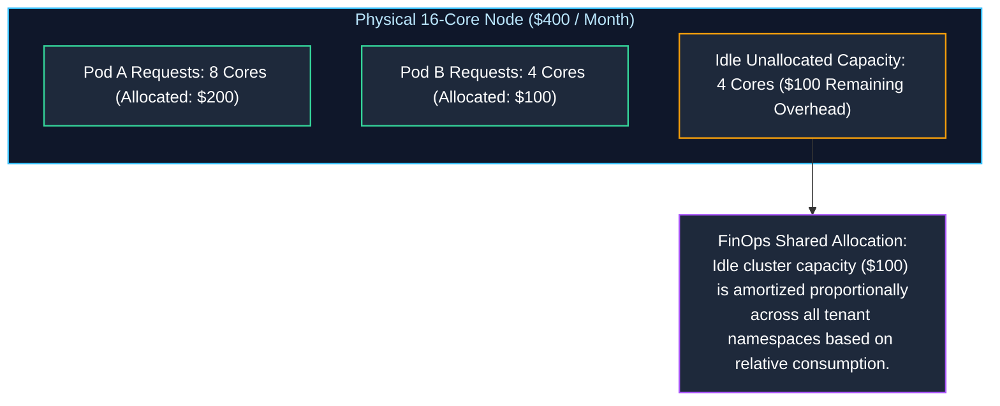

---

# 17. Enterprise Architecture Governance and ADRs

### 17.1 Architecture Decision Records (ADRs) Framework

An **Architecture Decision Record (ADR)** documents significant technical decisions, architectural trade-offs, and financial implications in an immutable, version-controlled markdown file:

```markdown
# ADR-014: Standardizing Multi-Region Relational Tier on Azure Cosmos DB vs. Aurora

**Date:** 2026-10-14  
**Status:** Approved  
**Deciders:** Principal Architect, Staff SRE, FinOps Lead  

## 1. Context & Business Problem

Our checkout platform is expanding to Europe. We require active-active write capability across `eastus` and `westeurope` with sub-10ms write latency and automated regional failover. Operating cross-region PostgreSQL clusters requires complex replication proxies and manual split-brain reconciliation.

## 2. Decision

We will adopt **Azure Cosmos DB** with the NoSQL (Core) API, Session Consistency, and Multi-Region Writes enabled.

## 3. Financial & Operational Consequences

### Positive Consequences:
- Multi-Region Writes guarantee a 99.999% availability SLA.
- Zero server maintenance, OS patching, or cross-region replication toil.
### Negative Consequences & Financial Risks:
- Request Unit (RU/s) consumption-based pricing can surge rapidly under unindexed cross-partition queries.
- Mandatory Mitigation: We will enforce Cosmos DB Autoscale capped at 20,000 RU/s and alert on partition hot-spotting via Datadog.
```

---

### 17.2 Cloud Center of Excellence (CCoE) Operating Model

The **Cloud Center of Excellence (CCoE)** is a cross-functional governing council:
- **Composition:** Lead Enterprise Architect, Head of Information Security, Lead SRE, FinOps Director, and Product Engineering VP.
- **Cadence:** Bi-weekly operational review inspecting cloud budget variances, reviewing new ADR proposals, and auditing compliance tag scores.

---

# 18. Production Code Implementation: Automated Cloud Waste & Zombie Asset Auditor

### 18.1 Production Python Cloud FinOps Waste Auditor

Below is a production-grade Python utility that interrogates cloud inventory data, detects orphaned block storage disks, unassociated public IPs, idle load balancers, and calculates exact monthly financial waste:

```python
#!/usr/bin/env python3
"""
Production Cloud FinOps Waste & Zombie Asset Auditor.
Scans cloud infrastructure inventories for detached storage volumes,
unassociated public IPs, and abandoned database snapshots to quantify financial leakage.
"""

from dataclasses import asdict, dataclass
import json
import logging
import sys
from typing import Any, Dict, List, Optional

logging.basicConfig(
    level=logging.INFO,
    format='{"time":"%(asctime)s","level":"%(levelname)s","logger":"%(name)s","message":"%(message)s"}',
    handlers=[logging.StreamHandler(sys.stdout)],
)
logger = logging.getLogger("finops_waste_scanner")

@dataclass(frozen=True)
class WasteFinding:
    resource_id: str
    resource_type: str
    region: str
    age_days: int
    monthly_waste_usd: float
    remediation_action: str

class EnterpriseFinOpsAuditor:
    # Monthly cost benchmarks (US-East Average)
    PRICE_PER_GB_SSD = 0.10        # $0.10/GB/month for GP3 / Premium SSD
    PRICE_PER_IDLE_IP = 3.65       # $0.005/hour idle public IP reservation fee
    PRICE_PER_IDLE_ALB = 18.25     # $0.025/hour idle application load balancer base charge

    def __init__(self, inventory_data: Dict[str, Any]):
        self.data = inventory_data

    def audit_all(self) -> Dict[str, Any]:
        """Executes full suite of cloud waste audits."""
        logger.info("Executing comprehensive enterprise FinOps audit...")
        findings: List[WasteFinding] = []

        findings.extend(self._audit_unattached_disks())
        findings.extend(self._audit_unassociated_ips())
        findings.extend(self._audit_idle_load_balancers())

        total_monthly_waste = sum(f.monthly_waste_usd for f in findings)

        return {
            "audit_summary": {
                "total_waste_items_flagged": len(findings),
                "projected_monthly_waste_usd": round(total_monthly_waste, 2),
                "projected_annual_waste_usd": round(total_monthly_waste * 12, 2),
                "financial_status": "ACTION_REQUIRED" if total_monthly_waste > 500 else "OPTIMIZED",
            },
            "itemized_findings": [asdict(f) for f in findings],
        }

    def _audit_unattached_disks(self) -> List[WasteFinding]:
        disks = self.data.get("disks", [])
        findings = []
        for d in disks:
            if not d.get("attached_vm_id"):
                size_gb = d.get("size_gb", 0)
                cost = round(size_gb * self.PRICE_PER_GB_SSD, 2)
                findings.append(
                    WasteFinding(
                        resource_id=d.get("disk_id", "unknown"),
                        resource_type="Unattached_Block_Disk",
                        region=d.get("region", "global"),
                        age_days=d.get("age_days", 0),
                        monthly_waste_usd=cost,
                        remediation_action="Take final cold snapshot and execute disk deletion.",
                    )
                )
        return findings

    def _audit_unassociated_ips(self) -> List[WasteFinding]:
        ips = self.data.get("public_ips", [])
        findings = []
        for ip in ips:
            if not ip.get("associated_nic_id"):
                findings.append(
                    WasteFinding(
                        resource_id=ip.get("ip_address", "unknown"),
                        resource_type="Unassociated_Public_IP",
                        region=ip.get("region", "global"),
                        age_days=ip.get("age_days", 0),
                        monthly_waste_usd=self.PRICE_PER_IDLE_IP,
                        remediation_action="Release unassociated public IP to stop idle reservation charges.",
                    )
                )
        return findings

    def _audit_idle_load_balancers(self) -> List[WasteFinding]:
        albs = self.data.get("load_balancers", [])
        findings = []
        for lb in albs:
            # An ALB with 0 registered targets is idle waste
            if lb.get("registered_targets_count", 0) == 0:
                findings.append(
                    WasteFinding(
                        resource_id=lb.get("lb_name", "unknown"),
                        resource_type="Zero_Target_Load_Balancer",
                        region=lb.get("region", "global"),
                        age_days=lb.get("age_days", 0),
                        monthly_waste_usd=self.PRICE_PER_IDLE_ALB,
                        remediation_action="Deregister idle load balancer lacking backend targets.",
                    )
                )
        return findings

# ============================================================================
# Verification Run
# ============================================================================
if __name__ == "__main__":
    sample_cloud_inventory = {
        "disks": [
            {"disk_id": "vol-084a91b2c", "size_gb": 500, "attached_vm_id": None, "age_days": 42, "region": "us-east-1"},
            {"disk_id": "vol-991bc220f", "size_gb": 1000, "attached_vm_id": None, "age_days": 18, "region": "us-east-1"},
            {"disk_id": "vol-11002233a", "size_gb": 100, "attached_vm_id": "i-0a811c", "age_days": 120, "region": "us-east-1"},
        ],
        "public_ips": [
            {"ip_address": "52.14.88.102", "associated_nic_id": None, "age_days": 60, "region": "us-east-2"},
            {"ip_address": "54.210.12.5", "associated_nic_id": "nic-8812", "age_days": 90, "region": "us-east-1"},
        ],
        "load_balancers": [
            {"lb_name": "app/abandoned-preview-alb/5501", "registered_targets_count": 0, "age_days": 35, "region": "us-east-1"},
            {"lb_name": "app/prod-checkout-alb/9901", "registered_targets_count": 8, "age_days": 365, "region": "us-east-1"},
        ],
    }

    auditor = EnterpriseFinOpsAuditor(sample_cloud_inventory)
    report = auditor.audit_all()
    print(json.dumps(report, indent=2))
```

---

# 19. Senior FinOps Troubleshooting Runbooks: Outage & Bill Shock Scenarios

### 19.1 Scenario 1: Overnight Cloud Cost Explosion from an Unthrottled Distributed Loop
- **Symptom:** Engineering VP receives an urgent Monday morning call from Finance. The cloud bill spiked by **\$48,000 over the weekend**.
- **Root Cause Isolation:**
  1. Open Cost Management $\rightarrow$ Group by Service & Resource.
  2. Notice `AWS Lambda` / `Azure Functions` executed **450,000,000 invocations** between Saturday 02:00 UTC and Sunday 22:00 UTC.
  3. A developer committed a recursive event loop: Function A wrote a message to an S3 bucket; S3 bucket creation triggered Function A; repeat infinitely.
- **Immediate Mitigation:**
  1. Set function reserved concurrency to **0** via cloud CLI to halt all executions instantly:
     ```bash
     aws lambda put-function-concurrency --function-name recursive-processor --reserved-concurrent-executions 0
     ```
  2. Sever the event source trigger at the S3 bucket configuration.
  3. Deploy preventive **CloudWatch / Azure Cost Anomaly Alerts** with automated circuit-breaker webhooks.

---

### 19.2 Scenario 2: Massive Unexpected NAT Gateway Data Processing Surcharge
- **Symptom:** Monthly AWS invoice shows a line item for `EC2: NATGateway-Bytes` totaling **\$14,500** ($320\text{TB}$ processed).
- **Root Cause:** A newly deployed machine learning training pipeline in a private subnet was downloading terabytes of training images from S3 through the NAT Gateway rather than through a free VPC Gateway Endpoint.
- **Remediation Runbook:**
  1. Deploy an **S3 VPC Gateway Endpoint** (100% free of charge) and associate it with all private subnet route tables via Terraform:
     ```hcl
     resource "aws_vpc_endpoint" "s3_gateway" {
       vpc_id          = aws_vpc.main.id
       service_name    = "com.amazonaws.us-east-1.s3"
       route_table_ids = [aws_route_table.private.id]
     }
     ```
  2. S3 traffic immediately diverts from the NAT Gateway directly to the AWS internal network fabric, dropping the monthly NAT processing bill from \$14,500 to **\$0**.

---

### 19.3 Scenario 3: Glacier Deep Archive Emergency Retrieval Fee Shock
- **Symptom:** A security audit required analyzing 80TB of historical raw security logs stored in Glacier Deep Archive. An engineer submitted an bulk retrieval request. The following month's bill included a surprise **\$18,000 data retrieval fee**.
- **Root Cause:** The engineer selected **Expedited / Standard Retrieval** on 80TB of deep cold data instead of evaluating whether the data could be filtered before retrieval or querying metadata logs.
- **Remediation Policy:**
  1. Enforce IAM boundary permissions restricting `glacier:RestoreObject` permissions.
  2. Require FinOps approval for any storage restore job exceeding 5TB.

---

# 20. Summary Comparison & Production Engineering Reference Matrix

### 20.1 Platform Engineering Evolution & Operating Model Reference Matrix

Platform engineering shifts internal infrastructure delivery from ticket-based central operations to self-service Internal Developer Platforms (IDPs). By providing paved paths, automated Golden Path templates, and declarative infrastructure control planes, platform teams dramatically reduce developer cognitive load while enforcing non-negotiable security and architectural guardrails across all deployed microservices.

The evolution of delivery interfaces, cognitive burdens, and operational models across IT eras:

| Platform Dimension | Legacy Central IT Model | Early DevOps Movement | Modern Platform Engineering Standard |
| :--- | :--- | :--- | :--- |
| **Provisioning Interface** | Jira tickets & email requests | Raw Terraform HCL & AWS Console | Backstage Self-Service Portal & Crossplane XRDs |
| **Developer Cognitive Load**| Zero (Wait weeks for ops to build) | **Extreme Overload** (Must master full cloud stack) | **Minimal** (Paved Roads eliminate extraneous trivia) |
| **Drift Management** | Manual ad-hoc audits | Periodic CI/CD `terraform plan` | Continuous Kubernetes reconciliation loops |
| **Multi-Tenancy Model** | Dedicated physical VMs | Shared unconstrained namespaces | vCluster & Namespace ResourceQuotas |
| **Secret Management** | Shared passwords in Wiki / Slack | Base64 Secrets checked into Git | External Secrets Operator (Keyless Workload Identity) |
| **Success Metrics** | Server uptime (Four 9s) | Velocity of code commits | DORA 4 Metrics & SPACE Developer Satisfaction |

---

### 20.2 Enterprise FinOps Maturity & Cost Optimization Framework

Enterprise Cloud Financial Management (FinOps) operationalizes continuous cost governance across the Inform, Optimize, and Operate lifecycle. Rather than relying on retroactive invoice accounting, mature organizations employ automated rate optimization levers (Commitment Discounts, Spot fleets), usage optimization levers (storage lifecycles, rightsizing, egress minimization), and real-time policy guardrails to enforce predictable unit economics.

Comparative capabilities and financial dividends across FinOps maturity tiers:

| FinOps Dimension | Reactive Tactical Approach | Mature Proactive Enterprise Standard | Primary Financial Benefit |
| :--- | :--- | :--- | :--- |
| **Billing Visibility** | Reviewing monthly PDF invoice | Real-time Datadog / Kubecost dashboards | Eliminates surprise bill shock; detects anomalies in hours |
| **Cost Allocation** | Shared corporate IT cost center | Granular showback/chargeback to product teams | Direct accountability motivates engineering teams to clean waste |
| **Compute Purchasing**| 100% On-Demand pricing | 70% Savings Plans + 20% Spot + 10% On-Demand | 30% to 60% overall compute rate reduction |
| **Storage Lifecycle** | Infinite retention in Hot Tier | Automated Hot $\rightarrow$ Cool $\rightarrow$ Archive $\rightarrow$ Purge rules | 70% to 90% storage bill reduction |
| **Network Egress** | Routing all traffic through NAT Gateways | Gateway Endpoints, Topology Hints, CloudFront CDN | Eliminates thousands in data processing & cross-AZ fees |
| **Governance Model**| Manual spreadsheets & approvals | Policy-as-Code (Azure Policy / AWS SCPs) | Rejects non-compliant and oversized resources at admission |

---

# 21. References & Further Reading

1. **Team Topologies: Organizing Business and Technology Teams for Fast Flow:** Skelton, M., & Pais, M. (2019). IT Revolution Press. [teamtopologies.com](https://teamtopologies.com/).
2. **Platform Engineering Community Guide & Core Tenets:** [platformengineering.org](https://platformengineering.org/).
3. **Spotify Backstage Architecture Documentation:** CNCF Incubating Project. [backstage.io/docs](https://backstage.io/docs/overview/what-is-backstage).
4. **Crossplane Composable Infrastructure Control Planes:** CNCF Project. [docs.crossplane.io](https://docs.crossplane.io/).
5. **Kyverno: Kubernetes Native Policy Management:** CNCF Incubating Project. [kyverno.io/docs](https://kyverno.io/docs/).
6. **Accelerate: The Science of Lean Software and DevOps:** Forsgren, N., Humble, J., & Kim, G. (2018). IT Revolution Press.
7. **FinOps Foundation Framework & Operating Principles:** [finops.org/framework](https://www.finops.org/framework/).
8. **Cloud FinOps: Collaborative, Real-Time Cloud Value Decision Making (2nd Edition):** Storment, J. R., & Fuller, M. (2023). O'Reilly Media.
9. **Microsoft Cloud Adoption Framework (CAF) for Azure:** Landing zone architectures and governance. [learn.microsoft.com/azure/cloud-adoption-framework](https://learn.microsoft.com/en-us/azure/cloud-adoption-framework/).
10. **OpenCost Specification & Architecture:** CNCF Project for Kubernetes cost allocation. [opencost.io](https://www.opencost.io/).
11. **Documenting Architecture Decisions (ADR Framework):** Nygard, M. (2011). Cognitect Blog. [cognitect.com/blog](https://cognitect.com/blog/2011/11/15/documenting-architecture-decisions).