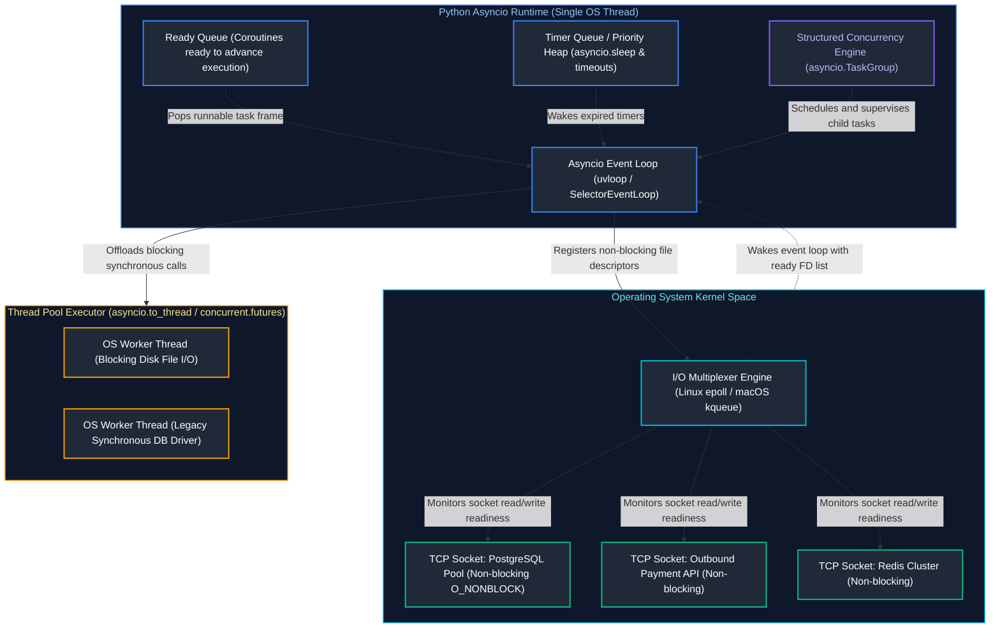
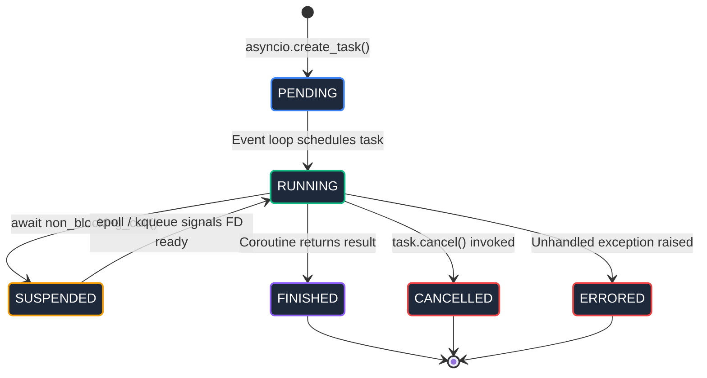

# 03. Python Concurrency & Asynchronous Programming: Master Guide

A comprehensive, production-grade guide to Python concurrency paradigms, preemptive OS threading vs. multiprocessing, cooperative multitasking with `asyncio`, event loop mechanics (`epoll`/`kqueue`/`uvloop`), Python 3.11+ structured concurrency (`TaskGroup`), non-blocking I/O, `contextvars`, and bridging synchronous/asynchronous boundaries for Senior Backend Engineers and Architects.

---

## Architectural Overview: Asynchronous Event Loop & OS I/O Multiplexing



---

## Table of Contents
1. [Concurrency Models: Preemptive Threads vs. Multiprocessing vs. AsyncIO](#1-concurrency-models-preemptive-threads-vs-multiprocessing-vs-asyncio)
   - [1.1 Conceptual Foundations: Preemption vs. Cooperative Scheduling](#11-conceptual-foundations-preemption-vs-cooperative-scheduling)
   - [1.2 The Concurrency Trilemma: Memory Footprint, Context Switching, and GIL Impact](#12-the-concurrency-trilemma-memory-footprint-context-switching-and-gil-impact)
   - [1.3 Thread Synchronization Primitives: Locks, RLock, Semaphores, Conditions, and Events](#13-thread-synchronization-primitives-locks-rlock-semaphores-conditions-and-events)
   - [1.4 The Non-Atomic Operation Trap: Race Conditions under the GIL](#14-the-non-atomic-operation-trap-race-conditions-under-the-gil)
2. [Multiprocessing & IPC Architectures](#2-multiprocessing--ipc-architectures)
   - [2.1 Process Start Methods: `fork`, `spawn`, and `forkserver`](#21-process-start-methods-fork-spawn-and-forkserver)
   - [2.2 Shared Memory (`multiprocessing.shared_memory`) and Zero-Copy Data Pipelines](#22-shared-memory-multiprocessingshared_memory-and-zero-copy-data-pipelines)
   - [6.3 Inter-Process Communication: Queues, Pipes, and Managers](#63-inter-process-communication-queues-pipes-and-managers)
   - [6.4 Process Pool Lifecycle, Worker Crashes, and Signal Handling](#64-process-pool-lifecycle-worker-crashes-and-signal-handling)
3. [AsyncIO Event Loop Mechanics & Coroutine Lifecycles](#7-asyncio-event-loop-mechanics--coroutine-lifecycles)
   - [7.1 Coroutines, Tasks, and Futures: State Machines and Execution Mechanics](#71-coroutines-tasks-and-futures-state-machines-and-execution-mechanics)
   - [7.2 The Selector Event Loop (`epoll`, `kqueue`) and Native `uvloop`](#72-the-selector-event-loop-epoll-kqueue-and-native-uvloop)
   - [7.3 What Actually Happens When You `await`? Generator Frame Suspension](#73-what-actually-happens-when-you-await-generator-frame-suspension)
4. [Structured Concurrency & Task Management](#8-structured-concurrency--task-management)
   - [8.1 The Flaws of `asyncio.gather` & Fire-and-Forget Coroutines](#81-the-flaws-of-asynciogather--fire-and-forget-coroutines)
   - [8.2 Python 3.11+ `asyncio.TaskGroup`: The Nursery Model & Error Fan-Out](#82-python-311-asynciotaskgroup-the-nursery-model--error-fan-out)
   - [8.3 Handling Composite Failures with `ExceptionGroup` and `except*`](#83-handling-composite-failures-with-exceptiongroup-and-except)
   - [8.4 Cancellation Protocols, Shielding (`asyncio.shield`), and Resource Guarantees](#84-cancellation-protocols-shielding-asyncioshield-and-resource-guarantees)
   - [8.5 Deadline Management with `asyncio.timeout`](#85-deadline-management-with-asynciotimeout)
5. [Async Synchronization Primitives & Backpressure Pipelines](#9-async-synchronization-primitives--backpressure-pipelines)
   - [9.1 `asyncio.Semaphore` for Rate Limiting & Resource Protection](#91-asynciosemaphore-for-rate-limiting--resource-protection)
   - [9.2 Producer-Consumer Workflows with `asyncio.Queue` & Flow Control](#92-producer-consumer-workflows-with-asyncioqueue--flow-control)
   - [9.3 Coordinating Event Signals with `asyncio.Event` and `asyncio.Condition`](#93-coordinating-event-signals-with-asyncioevent-and-asynciocondition)
6. [Bridging Synchronous and Asynchronous Boundaries](#10-bridging-synchronous-and-asynchronous-boundaries)
   - [10.1 Offloading Blocking I/O via `asyncio.to_thread` vs. `loop.run_in_executor`](#101-offloading-blocking-io-via-asyncioto_thread-vs-looprun_in_executor)
   - [10.2 Invoking Coroutines from Synchronous Code: Thread-Safe Dispatch](#102-invoking-coroutines-from-synchronous-code-thread-safe-dispatch)
   - [10.3 Diagnosing and Alerting on Event Loop Starvation & Blocking Calls](#103-diagnosing-and-alerting-on-event-loop-starvation--blocking-calls)
7. [Task-Local Storage with `contextvars`](#11-task-local-storage-with-contextvars)
   - [11.1 Why `threading.local` Fails in Asynchronous Runtimes](#111-why-threadinglocal-fails-in-asynchronous-runtimes)
   - [11.2 Propagating Distributed Tracing IDs & Security Claims with `ContextVar`](#112-propagating-distributed-tracing-ids--security-claims-with-contextvar)
   - [11.3 Context Inheritance in Child Tasks and Thread Offloading](#113-context-inheritance-in-child-tasks-and-thread-offloading)
8. [Summary Comparison & Production Engineering Reference Matrix](#12-summary-comparison--production-engineering-reference-matrix)
9. [References & Further Reading](#13-references--further-reading)

---

# 1. Concurrency Models: Preemptive Threads vs. Multiprocessing vs. AsyncIO

### 1.1 Conceptual Foundations: Preemption vs. Cooperative Scheduling

#### Intuitive Analogy: The Restaurant Kitchen
To understand the three concurrency models in Python, consider three different restaurant kitchen setups:

1. **Multiprocessing (Multiple Separate Kitchens)**:
   - You rent 4 independent kitchens, each with its own chef, stove, refrigerator, and ingredients.
   - **Advantage**: If Chef 1 is slicing 500 onions (heavy CPU work), Chef 2, 3, and 4 are completely undisturbed in their own kitchens.
   - **Tradeoff**: Massive physical overhead (high RAM usage per kitchen). Passing dishes between kitchens requires packaging them in delivery vans (IPC serialization overhead).
2. **Preemptive Threading (One Kitchen with 4 Chefs Bumping Into Each Other)**:
   - You have 1 kitchen with 4 chefs sharing the same cutting board, knives, and refrigerator. A manager with a whistle (the OS kernel scheduler) blows the whistle every 5 seconds, forcing Chef 1 to freeze immediately mid-slice so Chef 2 can step in.
   - **Advantage**: Chefs share the same refrigerator instantly without packaging food (shared memory space).
   - **Tradeoff**: The kitchen only has ONE active stove (the CPython GIL). If two chefs try to write on the same order ticket simultaneously, they smudge the ink (race conditions).
3. **AsyncIO / Cooperative Multitasking (One Master Chef with a Bank of Timers)**:
   - You have 1 master chef who never stands around waiting. When pasta is placed in boiling water (a network database query), the chef sets a timer and immediately pivots to chop tomatoes for the salad. When the timer dings, the chef pivots back to drain the pasta.
   - **Advantage**: Ultra-lightweight. Zero collisions. One chef can manage 10,000 boiling pots simultaneously with virtually zero RAM overhead.
   - **Tradeoff**: If the chef freezes to perform a 10-minute complex calculation (blocking CPU work), *all 10,000 pots burn* because no other chef exists to take over!

---

### 1.2 The Concurrency Trilemma: Memory Footprint, Context Switching, and GIL Impact

#### Trade-Off Analysis: Memory Overhead vs. Scheduling Cost
Designing resilient high-concurrency microservices in Python requires navigating three conflicting mechanical trade-offs governed by the underlying operating system kernel:

1. **Process-Level Isolation (`multiprocessing`):**
   - **Kernel Abstraction:** Each worker is a distinct operating system process created via `fork()` or `spawn()`.
   - **Cost Profile:** Highest memory overhead ($\approx 25 - 60\text{ MB}$ per process due to duplicate Python runtime memory structures) and highest context-switching overhead (flushing the CPU's Translation Lookaside Buffer). However, each process owns an independent CPython interpreter and heap, delivering true 100% linear multicore CPU scaling.

2. **Kernel Threading (`threading`):**
   - **Kernel Abstraction:** Native OS kernel threads (`pthread` on Linux/macOS) scheduled preemptively by the OS kernel scheduler.
   - **Cost Profile:** Moderate memory cost ($\approx 8\text{ MB}$ default virtual stack allocation per thread, though typically $\approx 64 - 128\text{ KB}$ physical resident memory). Threads share process heap space. While preemptive scheduling avoids starvation, execution of Python bytecode is strictly serialized by the Global Interpreter Lock, yielding zero speedup for CPU-bound loops.

3. **User-Space Cooperative Coroutines (`asyncio`):**
   - **Kernel Abstraction:** Single-threaded user-space cooperative multitasking running over an OS event notification loop (`epoll` on Linux, `kqueue` on macOS).
   - **Cost Profile:** Microscopic memory footprint ($\approx 2 - 4\text{ KB}$ per coroutine frame stored in heap RAM). Context switches occur entirely within Python user space without kernel mode transitions or CPU register swaps, allowing a single server process to manage $50,000+$ concurrent network sockets with minimal CPU utilization.

| Concurrency Architecture | Operating System Entity | Memory per Unit | Context Switching Cost | Multicore CPU Speedup? | Typical Production Use Case |
| :--- | :--- | :--- | :--- | :---: | :--- |
| **`multiprocessing`** | Isolated OS Processes | $\approx 25\text{--}60\text{ MB}$ | Heavy OS context switch + TLB flush | **Yes (100% per core)** | CPU-bound math, ML batch inference, image encoding |
| **`threading`** | Native OS Kernel Threads | $\approx 8\text{ MB}$ virtual stack | Moderate OS thread context switch | **No (Stalled by GIL)** | Legacy blocking I/O, C-extensions releasing GIL |
| **`asyncio`** | Heap-allocated Coroutines | $\approx 2\text{--}4\text{ KB}$ | Ultra-fast user-space frame swap | **No (Single-threaded)** | High-throughput web APIs, microservices, chat/WebSockets |

---

### 1.3 Thread Synchronization Primitives: Locks, RLock, Semaphores, Conditions, and Events

When multiple threads interact with shared mutable state, synchronization primitives prevent race conditions and data corruption.

#### 1. `threading.Lock` vs. `threading.RLock` (Reentrant Lock)
A standard `Lock` deadlocks if the same thread attempts to acquire it twice. An `RLock` allows the *holding thread* to acquire it multiple times recursively, maintaining an internal recursion counter:

```python
import threading

class AccountManager:
    def __init__(self, initial_balance: float) -> None:
        self._balance = initial_balance
        # RLock allows recursive acquisition within the same thread
        self._lock = threading.RLock()

    def withdraw(self, amount: float) -> None:
        with self._lock:
            if self._balance < amount:
                raise ValueError("Insufficient funds")
            self._balance -= amount

    def transfer(self, target: "AccountManager", amount: float) -> None:
        with self._lock:
            # Reentrantly enters withdraw without self-deadlocking!
            self.withdraw(amount)
            target.deposit(amount)

    def deposit(self, amount: float) -> None:
        with self._lock:
            self._balance += amount

    @property
    def balance(self) -> float:
        with self._lock:
            return self._balance
```

#### 2. `threading.Condition`: Signaling Between Threads
`Condition` coordinates worker threads that must wait for a specific state transition (e.g., waiting for items to appear in a buffer):

```python
import threading
import time

class WorkBuffer:
    def __init__(self, capacity: int) -> None:
        self.capacity = capacity
        self.items: list[str] = []
        self._lock = threading.Lock()
        self._not_empty = threading.Condition(self._lock)
        self._not_full = threading.Condition(self._lock)

    def produce(self, item: str) -> None:
        with self._not_full:
            while len(self.items) >= self.capacity:
                self._not_full.wait()  # Releases lock and sleeps until notified
            self.items.append(item)
            self._not_empty.notify()   # Wakes waiting consumer

    def consume(self) -> str:
        with self._not_empty:
            while not self.items:
                self._not_empty.wait()  # Releases lock and sleeps until notified
            item = self.items.pop(0)
            self._not_full.notify()    # Wakes waiting producer
            return item
```

---

### 1.4 The Non-Atomic Operation Trap: Race Conditions under the GIL

> [!CAUTION]
> ### The Dangerous Myth: "The GIL Makes Threads Safe"
> A catastrophic misconception among junior engineers is that because the CPython GIL only allows one thread to run at a time, Python code is immune to race conditions. **This is completely false!**
> 
> The GIL switches threads between bytecode instructions. In Python, an innocent statement like `counter += 1` is compiled into **three distinct bytecode instructions**:
> 1. `LOAD_FAST` (reads current value onto stack)
> 2. `BINARY_OP` (adds 1)
> 3. `STORE_FAST` (writes new value back to variable)
> 
> If the GIL switches threads between step 1 and step 3, an update is permanently lost!

#### Demonstrating the Race Condition:
```python
import threading

shared_counter = 0

def increment_unprotected(iterations: int) -> None:
    global shared_counter
    for _ in range(iterations):
        # NON-ATOMIC: 3 bytecode steps. Prone to mid-flight thread preemption!
        shared_counter += 1

threads = [threading.Thread(target=increment_unprotected, args=(100_000,)) for _ in range(5)]

for t in threads:
    t.start()
for t in threads:
    t.join()

print(f"Expected: 500,000 | Actual: {shared_counter}")
# Outputs e.g. Actual: 284,103! Massive data corruption occurred under the GIL.
```

---

# 2. Multiprocessing & IPC Architectures

### 2.1 Process Start Methods: `fork`, `spawn`, and `forkserver`

Python supports three distinct operating system techniques for spawning child processes:

| Start Method | Supported OS | Memory Mechanics & Startup | Thread Safety & Lock Inheritance Hazard | Production Recommendation |
| :--- | :--- | :--- | :--- | :--- |
| **`fork`** | Linux / POSIX default | Clones parent process memory instantly via OS Copy-on-Write (CoW). Sub-millisecond startup. | ⚠️ **Severe Hazard**: Clones memory locks in whatever state they held at the instant of forking. If a background thread held a mutex or DB pool lock, the child hangs in an unrecoverable deadlock! | **Banned in multithreaded applications** (Gunicorn workers, gRPC, Celery). |
| **`spawn`** | macOS & Windows default (Linux optional) | Starts a fresh Python interpreter executable from scratch. Re-imports the entry point module. Startup takes 10–50ms. | ✅ **100% Thread-Safe**: Starts with a completely pristine heap and empty lock table. Zero lock inheritance. | **Recommended standard** for all cloud and containerized Python workloads. |
| **`forkserver`** | Linux / POSIX | Starts a single-threaded, clean daemon process on server boot. Subsequent child workers are forked strictly from the unthreaded daemon. | ✅ **Thread-Safe**: Because the forkserver never spawns background threads, it can safely use `fork()` without lock corruption hazards. | **Optimal for high-throughput Linux workers** requiring sub-millisecond spawn latencies. |

#### Configuring the Start Method Safely:
```python
import multiprocessing as mp

if __name__ == "__main__":
    # In production microservices, explicitly force 'spawn' or 'forkserver'
    mp.set_start_method("spawn", force=True)
```

---

### 2.2 Shared Memory (`multiprocessing.shared_memory`) and Zero-Copy Data Pipelines

Standard `multiprocessing.Queue` incurs massive CPU and memory serialization costs because every Python object is pickled into bytes, copied over a UNIX socket pipe, and unpickled in the child process.

For high-throughput telemetry, tabular data, or image processing, **POSIX Shared Memory** (`multiprocessing.shared_memory`) allows multiple processes to map the exact same physical RAM pages into their virtual address spaces without copying:

```python
import numpy as np
from multiprocessing import shared_memory, Process

def process_batch(shm_name: str, shape: tuple[int, ...], dtype: np.dtype) -> None:

# 3. Attach to existing shared memory segment

existing_shm = shared_memory.SharedMemory(name=shm_name)

# 4. Reconstruct NumPy array wrapping the raw memory buffer (Zero-Copy!)

batch_array = np.ndarray(shape, dtype=dtype, buffer=existing_shm.buf)

# 5. Perform compute operations in-place

batch_array *= 2.5

# 6. Detach process from shared memory

existing_shm.close()

if __name__ == "__main__":
    shape = (5000, 5000)
    dtype = np.float32
    nbytes = int(np.prod(shape)) * np.dtype(dtype).itemsize

    # Allocate shared memory block in parent
    shm = shared_memory.SharedMemory(create=True, size=nbytes)
    parent_array = np.ndarray(shape, dtype=dtype, buffer=shm.buf)
    parent_array[:] = 10.0

    print(f"Parent array before child processing: {parent_array[0, 0]}")

    # Launch worker process passing only the string name of the memory block
    worker = Process(target=process_batch, args=(shm.name, shape, dtype))
    worker.start()
    worker.join()

    print(f"Parent array after zero-copy child mutation: {parent_array[0, 0]}")

    # Explicit teardown
    shm.close()
    shm.unlink() # Releases POSIX shared memory block back to the OS
```

---

### 6.3 Inter-Process Communication: Queues, Pipes, and Managers

When processes must exchange discrete messages or work orders:

```python
from multiprocessing import Process, Queue
import queue

def data_ingestion_worker(task_queue: Queue, result_queue: Queue) -> None:
    while True:
        try:
            task = task_queue.get(timeout=1.0)
        except queue.Empty:
            break
            
        if task is None:  # Sentinel value signaling shutdown
            break
            
        processed_result = {"task_id": task["id"], "score": task["value"] * 1.5}
        result_queue.put(processed_result)

if __name__ == "__main__":
    task_q: Queue = Queue(maxsize=1000)
    result_q: Queue = Queue(maxsize=1000)

    workers = [
        Process(target=data_ingestion_worker, args=(task_q, result_q))
        for _ in range(4)
    ]

    for w in workers:
        w.start()

    # Enqueue tasks
    for i in range(10):
        task_q.put({"id": i, "value": i * 10})

    # Send poison pill sentinels to terminate workers
    for _ in range(4):
        task_q.put(None)

    for w in workers:
        w.join()

    while not result_q.empty():
        print(f"Collected result: {result_q.get()}")
```

---

### 6.4 Process Pool Lifecycle, Worker Crashes, and Signal Handling

When utilizing `concurrent.futures.ProcessPoolExecutor`, sudden child process deaths (e.g., killed by the Linux Out-Of-Memory Killer `SIGKILL`) will raise `BrokenProcessPool` on subsequent task submissions:

```python
from concurrent.futures import ProcessPoolExecutor
from concurrent.futures.process import BrokenProcessPool
import os
import signal

def suicidal_task(x: int) -> int:
    if x == 42:
        # Simulate catastrophic worker segfault or OOM termination
        os.kill(os.getpid(), signal.SIGKILL)
    return x * 2

def execute_resilient_pool():
    with ProcessPoolExecutor(max_workers=2) as executor:
        try:
            futures = [executor.submit(suicidal_task, i) for i in [1, 42, 3]]
            for f in futures:
                print(f.result())
        except BrokenProcessPool as exc:
            print(f"[RECOVERY] Worker process was violently terminated: {exc}")
            # Production triage: Re-instantiate a fresh pool or alert on container memory
```

---

# 7. AsyncIO Event Loop Mechanics & Coroutine Lifecycles

### 7.1 Coroutines, Tasks, and Futures: State Machines and Execution Mechanics

To master `asyncio`, you must distinguish between the three core primitives:

| Primitive | Type & Class Hierarchy | Execution Nature | State Machine | Role in Event Loop Execution |
| :--- | :--- | :--- | :--- | :--- |
| **Coroutine Object** | `types.CoroutineType` created via `async def` | **Passive**: Calling `async def foo()` allocates a heap frame but executes *zero* instructions | Unscheduled $\to$ Suspended $\to$ Completed | Must be explicitly awaited (`await foo()`) or scheduled into a Task (`create_task`) |
| **`asyncio.Future`** | Low-level event notification primitive | **Passive**: A placeholder bridge between callback protocols and coroutines | `PENDING` $\to$ `FINISHED` or `CANCELLED` | Resolves when an external thread/callback calls `future.set_result()` or `set_exception()` |
| **`asyncio.Task`** | Concrete subclass of `asyncio.Future` | **Active**: Wraps a coroutine and registers it directly on the event loop ready queue | Drives state transitions (`RUNNING`, `SUSPENDED`) | Drives coroutine forward by invoking `coroutine.send(None)` on each iteration of the event loop |



---

### 7.2 The Selector Event Loop (`epoll`, `kqueue`) and Native `uvloop`

The default Python event loop uses `selectors.DefaultSelector`:
* **Linux**: Uses `epoll` system calls.
* **macOS / BSD**: Uses `kqueue`.
* **Windows**: Uses I/O Completion Ports (`ProactorEventLoop`).

#### How `epoll` Operates:
1. When a coroutine connects to a remote database, it creates a non-blocking TCP socket (`O_NONBLOCK`).
2. When `socket.connect()` or `socket.recv()` returns `EWOULDBLOCK` (data not yet ready), the event loop registers the socket’s integer file descriptor (`fd`) with the OS kernel via `epoll_ctl()`.
3. The event loop calls `epoll_wait()`. The operating system kernel puts the Python process to sleep until network packets arrive on the network card.
4. When packets arrive, the OS wakes the event loop and delivers a list of ready file descriptors. The event loop looks up the corresponding `Future`, marks it completed, and places the coroutine back on the ready queue.

#### Elevating Performance with `uvloop`:
`uvloop` is a drop-in replacement for Python's built-in event loop written in C and Cython on top of **libuv** (the high-performance C library powering Node.js):

```python
import asyncio
import uvloop

# Configure uvloop as the default event loop policy
asyncio.set_event_loop_policy(uvloop.EventLoopPolicy())

async def main():
    print("Running on ultra-fast libuv C event loop!")

asyncio.run(main())
```
*Production Benchmark*: `uvloop` handles $2\times$ to $4\times$ more requests per second than the default `asyncio` selector loop, matching Go and Node.js network throughput.

---

### 7.3 What Actually Happens When You `await`? Generator Frame Suspension

At the CPython runtime level, coroutines are built directly upon Python's generator architecture:

```python
import types

# Simulating how CPython executes coroutines internally
async def fetch_user_data(user_id: int) -> dict:
    return {"user_id": user_id, "status": "active"}

coro = fetch_user_data(101)

# Notice: coro is a coroutine object
print(f"Object type: {type(coro)}")

# Driving the coroutine manually without an event loop
try:
    # send(None) steps the coroutine forward until return
    coro.send(None)
except StopIteration as exit_signal:
    # In Python, returning a value from an async def raises StopIteration with the result!
    print(f"Coroutine execution completed with result: {exit_signal.value}")
```

---

# 8. Structured Concurrency & Task Management

### 8.1 The Flaws of `asyncio.gather` & Fire-and-Forget Coroutines

Prior to Python 3.11, concurrent operations were typically orchestrated using `asyncio.gather()`:

```python
# ANTI-PATTERN: The hazard of asyncio.gather
import asyncio

async def critical_step():
    await asyncio.sleep(1)
    raise RuntimeError("Payment gateway rejected authorization!")

async def background_logging():
    try:
        await asyncio.sleep(10)
        print("Logged to audit log")
    except asyncio.CancelledError:
        print("Logging cleanly cancelled")

async def orchestrate_order():
    # If critical_step fails, background_logging continues running in the background as an orphaned zombie!
    await asyncio.gather(critical_step(), background_logging())
```

#### Why `asyncio.gather()` Fails in Production:
1. **Orphaned Zombie Tasks**: When one coroutine in `gather()` raises an exception, the other coroutines are **not** automatically cancelled by default! They continue consuming memory and network resources silently.
2. **Fire-and-Forget Hazards**: Unawaited tasks spawned via `asyncio.create_task()` can fail silently without ever logging their tracebacks if their references are garbage-collected.

---

### 8.2 Python 3.11+ `asyncio.TaskGroup`: The Nursery Model & Error Fan-Out

Python 3.11 introduced **`asyncio.TaskGroup`** (inspired by Martin Sustrik's structured concurrency and Nathaniel J. Smith's Trio framework).

#### Core Structured Concurrency Guarantees:
1. **Bounded Lifetime**: No child task can outlive the lexical scope of the `async with TaskGroup()` block.
2. **Automatic Error Fan-Out & Cancellation**: If *any* child task fails, the `TaskGroup` automatically issues cancellation requests (`task.cancel()`) to **all other child tasks** within the group!
3. **Composite Error Reporting**: The `TaskGroup` waits for all children to finalize, bundles all unhandled exceptions into a single `ExceptionGroup`, and raises it.

```python
import asyncio

async def fetch_pricing(symbol: str) -> float:
    await asyncio.sleep(0.1)
    return 150.25

async def fetch_inventory(symbol: str) -> int:
    await asyncio.sleep(0.15)
    return 42

async def execute_trade_pipeline(symbol: str):
    async with asyncio.TaskGroup() as tg:
        # Spawn supervised child tasks
        task_price = tg.create_task(fetch_pricing(symbol))
        task_inventory = tg.create_task(fetch_inventory(symbol))

    # Execution reaches here ONLY when all child tasks have completed cleanly
    print(f"Symbol: {symbol} | Price: {task_price.result()} | Stock: {task_inventory.result()}")

asyncio.run(execute_trade_pipeline("AAPL"))
```

---

### 8.3 Handling Composite Failures with `ExceptionGroup` and `except*`

When multiple concurrent tasks in a `TaskGroup` fail simultaneously, Python 3.11 uses `except*` syntax to dissect and handle multiple error types cleanly:

```python
import asyncio

async def failing_network_call():
    await asyncio.sleep(0.1)
    raise ConnectionResetError("Remote server closed TCP connection")

async def failing_validation_call():
    await asyncio.sleep(0.05)
    raise ValueError("Invalid currency payload provided")

async def resilient_supervisor():
    try:
        async with asyncio.TaskGroup() as tg:
            tg.create_task(failing_network_call())
            tg.create_task(failing_validation_call())
    except* ConnectionResetError as exc_group:
        for exc in exc_group.exceptions:
            print(f"[RETRYABLE NETWORK FAILURE]: {exc}")
    except* ValueError as exc_group:
        for exc in exc_group.exceptions:
            print(f"[PERMANENT CLIENT ERROR]: {exc}")

asyncio.run(resilient_supervisor())
```

---

### 8.4 Cancellation Protocols, Shielding (`asyncio.shield`), and Resource Guarantees

When a task is cancelled, the event loop injects an `asyncio.CancelledError` into the coroutine at its current `await` suspension point:

```python
import asyncio

async def critical_database_transaction():
    try:
        print("Starting 2-phase commit...")
        await asyncio.sleep(2.0)
        print("Transaction successfully committed.")
    except asyncio.CancelledError:
        print("[ROLLBACK] Cancellation signal received! Rolling back database locks...")
        # RE-RAISE CancelledError to fulfill the cancellation contract!
        raise
    finally:
        print("[CLEANUP] Releasing connection back to pool.")
```

#### Protecting Critical Operations with `asyncio.shield()`:
If an operation *must* complete even if the client disconnects (such as charging a credit card or writing a transaction log), wrap it in `asyncio.shield()`:

```python
import asyncio

async def charge_credit_card(charge_id: str):
    print(f"Charging {charge_id}...")
    await asyncio.sleep(1.0)
    print(f"Charged {charge_id} successfully.")

async def handle_user_request():
    charge_task = asyncio.create_task(charge_credit_card("ch_9921"))
    try:
        # Shield protects the underlying task from being cancelled if caller is cancelled!
        await asyncio.shield(charge_task)
    except asyncio.CancelledError:
        print("User cancelled HTTP connection, but card charge will complete in background!")
        await charge_task  # Await underlying charge to avoid unhandled errors
```

---

### 8.5 Deadline Management with `asyncio.timeout`

Python 3.11 introduced `asyncio.timeout` (replacing the error-prone `asyncio.wait_for`):

```python
import asyncio

async def query_external_partner():
    await asyncio.sleep(5.0)
    return {"status": "ok"}

async def fetch_with_deadline():
    try:
        # Strict deadline: cancels operation if it exceeds 1.5 seconds
        async with asyncio.timeout(1.5):
            result = await query_external_partner()
            return result
    except TimeoutError:
        print("[SLA EXCEEDED] Upstream partner failed to reply within 1.5s deadline.")
        return {"status": "degraded_fallback"}

asyncio.run(fetch_with_deadline())
```

---

# 9. Async Synchronization Primitives & Backpressure Pipelines

### 9.1 `asyncio.Semaphore` for Rate Limiting & Resource Protection

Without concurrency bounds, launching 10,000 coroutines against an external API or database will exhaust socket descriptors, trigger HTTP 429 rate limits, and crash downstream servers.

Use `asyncio.Semaphore` to establish strict concurrency ceilings:

```python
import asyncio
import httpx

class RateLimitedScraper:
    def __init__(self, max_concurrent_requests: int) -> None:
        # Allow at most N concurrent operations
        self.semaphore = asyncio.Semaphore(max_concurrent_requests)

    async def fetch_url(self, client: httpx.AsyncClient, url: str) -> int:
        async with self.semaphore:
            # Only N coroutines can enter this block simultaneously
            response = await client.get(url)
            return response.status_code

async def main():
    scraper = RateLimitedScraper(max_concurrent_requests=5)
    urls = [f"https://httpbin.org/delay/1" for _ in range(20)]

    async with httpx.AsyncClient() as client:
        async with asyncio.TaskGroup() as tg:
            tasks = [tg.create_task(scraper.fetch_url(client, u)) for u in urls]

    print(f"Successfully processed {len(tasks)} requests with concurrency bound of 5.")

# asyncio.run(main())
```

---

### 9.2 Producer-Consumer Workflows with `asyncio.Queue` & Flow Control

To implement asynchronous worker pools with backpressure, use an `asyncio.Queue` with a bounded `maxsize`:

```python
import asyncio
import random

async def producer(queue: asyncio.Queue[str], producer_id: int):
    for i in range(5):
        item = f"event-{producer_id}-{i}"
        # If queue is full, put() suspends, applying backpressure to the producer!
        await queue.put(item)
        print(f"[Producer {producer_id}] Emitted: {item}")
        await asyncio.sleep(random.uniform(0.05, 0.1))

async def consumer(queue: asyncio.Queue[str], consumer_id: int):
    while True:
        # Wait for available items
        item = await queue.get()
        try:
            print(f"  -> [Consumer {consumer_id}] Processing {item}...")
            await asyncio.sleep(random.uniform(0.1, 0.2))
        finally:
            # Mark task done to satisfy queue.join()
            queue.task_done()

async def main():
    # Bounded queue: holds at most 10 items before blocking producers
    event_queue: asyncio.Queue[str] = asyncio.Queue(maxsize=10)

    # Launch consumers as background workers
    consumer_tasks = [
        asyncio.create_task(consumer(event_queue, cid))
        for cid in range(3)
    ]

    # Launch producers concurrently
    async with asyncio.TaskGroup() as tg:
        for pid in range(2):
            tg.create_task(producer(event_queue, pid))

    # Wait until all items in the queue have been fully processed
    await event_queue.join()

    # Cancel persistent consumers
    for c in consumer_tasks:
        c.cancel()

asyncio.run(main())
```

---

### 9.3 Coordinating Event Signals with `asyncio.Event` and `asyncio.Condition`

`asyncio.Event` coordinates state changes across disparate coroutines (e.g., waiting for configuration reload or database connection readiness):

```python
import asyncio

class AppHealthCoordinator:
    def __init__(self) -> None:
        self._db_ready_event = asyncio.Event()

    async def initialize_databases(self) -> None:
        print("[Init] Connecting to read/write replicas...")
        await asyncio.sleep(1.0)
        print("[Init] Database connection pool established!")
        self._db_ready_event.set() # Unblocks all waiting coroutines simultaneously

    async def handle_api_request(self, request_id: int) -> str:
        # Coroutine sleeps until the database event is set
        await self._db_ready_event.wait()
        return f"Request {request_id} processed against ready database."

async def main():
    coordinator = AppHealthCoordinator()
    
    # Launch API requests before the DB is ready
    async with asyncio.TaskGroup() as tg:
        t1 = tg.create_task(coordinator.handle_api_request(1))
        t2 = tg.create_task(coordinator.handle_api_request(2))
        init_task = tg.create_task(coordinator.initialize_databases())

    print(t1.result())
    print(t2.result())

asyncio.run(main())
```

---

# 10. Bridging Synchronous and Asynchronous Boundaries

### 10.1 Offloading Blocking I/O via `asyncio.to_thread` vs. `loop.run_in_executor`

> [!IMPORTANT]
> **The Cardinal Rule of AsyncIO**:
> **Never execute blocking synchronous operations inside an async function**.
> Invoking a blocking call (like `time.sleep()`, synchronous `requests.get()`, or standard file `open().read()`) halts the entire OS thread, starving all other concurrent coroutines on the event loop!

#### Modern Approach: `asyncio.to_thread` (Python 3.9+)
`asyncio.to_thread` offloads the blocking synchronous function to a background worker thread managed by CPython’s internal thread pool, returning a coroutine that can be awaited cleanly:

```python
import asyncio
import time
import requests

def blocking_legacy_sync_call(url: str) -> int:
    """Simulates a blocking synchronous legacy library call."""
    time.sleep(0.5)  # Blocking sleep
    resp = requests.get(url, timeout=5)
    return resp.status_code

async def main_async_pipeline():
    url = "https://httpbin.org/get"
    
    # Safe offloading: The event loop continues processing other coroutines!
    status_code = await asyncio.to_thread(blocking_legacy_sync_call, url)
    print(f"Legacy call finished with HTTP status: {status_code}")

# asyncio.run(main_async_pipeline())
```

---

### 10.2 Invoking Coroutines from Synchronous Code: Thread-Safe Dispatch

When integrating asynchronous libraries into legacy synchronous frameworks (e.g., calling an async client from inside a Celery sync worker or Flask view):

```python
import asyncio
import threading
from concurrent.futures import Future

class DedicatedAsyncLoopThread:
    """Maintains a persistent background thread running an isolated AsyncIO event loop."""
    def __init__(self) -> None:
        self.loop = asyncio.new_event_loop()
        self.thread = threading.Thread(target=self._run_loop, daemon=True)
        self.thread.start()

    def _run_loop(self) -> None:
        asyncio.set_event_loop(self.loop)
        self.loop.run_forever()

    def submit_coroutine(self, coro) -> Future:
        # Thread-safe submission from synchronous code into the background event loop
        return asyncio.run_coroutine_threadsafe(coro, self.loop)

# Usage in synchronous code:
loop_runner = DedicatedAsyncLoopThread()

async def async_fetch_metrics(metric_id: str) -> dict:
    await asyncio.sleep(0.2)
    return {"metric_id": metric_id, "value": 98.6}

# Synchronous caller blocks for the result cleanly without breaking the event loop
future = loop_runner.submit_coroutine(async_fetch_metrics("cpu_usage"))
result = future.result(timeout=2.0)
print(f"Synchronous caller received: {result}")
```

---

### 10.3 Diagnosing and Alerting on Event Loop Starvation & Blocking Calls

To detect accidental blocking calls stalling the event loop in development and staging environments:

#### 1. Enable AsyncIO Debug Mode
Set the environment variable `PYTHONASYNCIODEBUG=1` or configure it in code:

```python
import asyncio

loop = asyncio.get_event_loop()
loop.set_debug(True)
# Warn if any callback or execution frame blocks the loop for > 100 milliseconds
loop.slow_callback_duration = 0.100
```

#### 2. Visualizing Event Loop Lag with a Heartbeat Canary:
```python
import asyncio
import time

async def event_loop_lag_monitor(threshold_ms: float = 50.0):
    """
    Heartbeat canary: Wakes up every 100ms. If actual sleep time significantly
    exceeds scheduled interval, another task is blocking the event loop thread!
    """
    interval = 0.1
    while True:
        start = time.perf_counter()
        await asyncio.sleep(interval)
        elapsed = time.perf_counter() - start
        lag_ms = (elapsed - interval) * 1000
        
        if lag_ms > threshold_ms:
            print(f"[ALERT: EVENT LOOP STARVATION] Loop lagged by {lag_ms:.2f} ms! A blocking call occurred.")
```

---

# 11. Task-Local Storage with `contextvars`

### 11.1 Why `threading.local` Fails in Asynchronous Runtimes

In traditional synchronous multi-threaded backends, `threading.local()` is used to store request-scoped data (such as user identity, correlation IDs, or database sessions).

> [!CAUTION]
> **Catastrophic Failure in AsyncIO**:
> In an asynchronous server (like FastAPI or Sanic), **thousands of concurrent requests share the exact same operating system thread!**
> If you store `request_id` in `threading.local()`, Request $B$ will overwrite the data of Request $A$, leaking customer identities and mixing audit logs across requests!

---

### 11.2 Propagating Distributed Tracing IDs & Security Claims with `ContextVar`

Python 3.7+ introduced `contextvars` (PEP 567), providing native **task-local storage** designed specifically for asynchronous coroutines and concurrent execution trees:

```python
import asyncio
import contextvars
import uuid

# Define context variables at module level
correlation_id_ctx: contextvars.ContextVar[str] = contextvars.ContextVar(
    "correlation_id", default="SYSTEM"
)
current_user_ctx: contextvars.ContextVar[str] = contextvars.ContextVar(
    "current_user", default="ANONYMOUS"
)

async def internal_database_call():
    # Reads the context variable set in the parent task!
    req_id = correlation_id_ctx.get()
    user = current_user_ctx.get()
    print(f"  [DB Query] Executing query for User: '{user}' | Trace ID: '{req_id}'")

async def process_user_request(user_name: str):
    # Set unique values for the current coroutine context
    token_req = correlation_id_ctx.set(f"req-{uuid.uuid4().hex[:8]}")
    token_user = current_user_ctx.set(user_name)
    try:
        print(f"[Request Start] Processing for {user_name}...")
        await asyncio.sleep(0.05)
        await internal_database_call()
    finally:
        # Reset context variable to avoid leaking modified state
        correlation_id_ctx.reset(token_req)
        current_user_ctx.reset(token_user)

async def main():
    # Run two requests concurrently: contextvars remain 100% isolated!
    async with asyncio.TaskGroup() as tg:
        tg.create_task(process_user_request("Alice"))
        tg.create_task(process_user_request("Bob"))

asyncio.run(main())
```

---

### 11.3 Context Inheritance in Child Tasks and Thread Offloading

* **`asyncio.create_task()`**: Automatically copies the caller's current `Context` snapshot into the child task. Mutations in the child task do **not** affect the parent context.
* **`asyncio.to_thread()`**: Automatically copies the calling coroutine’s `contextvars` into the worker thread, ensuring distributed trace headers and logging contexts persist seamlessly across synchronous boundaries!

---

# 12. Summary Comparison & Production Engineering Reference Matrix

| Feature / Primitive | `multiprocessing` | `threading` | `asyncio` (`TaskGroup`) |
| :--- | :--- | :--- | :--- |
| **Execution Model** | Separate OS Processes | Preemptive Kernel Threads | Cooperative Single-Thread Event Loop |
| **Memory Overhead** | High ($25\text{--}60\text{ MB}$ per process) | Moderate ($\approx 8\text{ MB}$ virtual stack) | Minimal ($\approx 2\text{--}4\text{ KB}$ per coroutine) |
| **Multicore Scaling** | Complete ($N$ CPU cores) | Zero (Constrained by CPython GIL) | Zero (Single core; use multiple workers) |
| **Context Switching Overhead** | High (OS kernel page table swaps) | Moderate (OS thread context switch) | Sub-microsecond (User-space frame swap) |
| **Data Sharing Model** | IPC: Queues, Pipes, Shared Memory | Shared heap memory (Needs locks!) | Shared heap memory (Zero race conditions if cooperative) |
| **Error Handling Model** | Process termination / `BrokenProcessPool` | Unhandled exceptions kill thread silently | Structured `ExceptionGroup` via `except*` |
| **Context Storage** | Environment / IPC parameters | `threading.local` | `contextvars.ContextVar` |
| **Primary Failure Trap** | Deadlocks on `fork` with active threads | Race conditions on non-atomic operations | Event loop starvation from blocking calls |

---

# 13. References & Further Reading

1. **PEP 654 – Exception Groups and `except*`**: [https://peps.python.org/pep-0654/](https://peps.python.org/pep-0654/)
2. **PEP 567 – Context Variables (`contextvars`)**: [https://peps.python.org/pep-0567/](https://peps.python.org/pep-0567/)
3. **Python 3.11+ Structured Concurrency (`asyncio.TaskGroup`)**: [https://docs.python.org/3/library/asyncio-task.html#task-groups](https://docs.python.org/3/library/asyncio-task.html#task-groups)
4. **`uvloop`: Ultra-fast Drop-in Replacement for AsyncIO Event Loop**: [https://github.com/MagicStack/uvloop](https://github.com/MagicStack/uvloop)
5. **Nathaniel J. Smith: *Notes on Structured Concurrency, or: Go statement considered harmful***: [https://vorpus.org/blog/notes-on-structured-concurrency-or-go-statement-considered-harmful/](https://vorpus.org/blog/notes-on-structured-concurrency-or-go-statement-considered-harmful/)
6. **Related Guides**:
   - See [03. CPython Runtime, Memory, and Performance](02_cpython_runtime_and_memory.md) for GIL mechanics and PyMalloc.
   - See [07. Web Frameworks: FastAPI and Flask](05_web_frameworks_and_api_protocols.md) for ASGI vs WSGI concurrency architectures.
   - See [12. Caching, Redis, and Event-Driven Messaging](08_caching_redis_and_kafka.md) for Celery and ARQ async job queues.