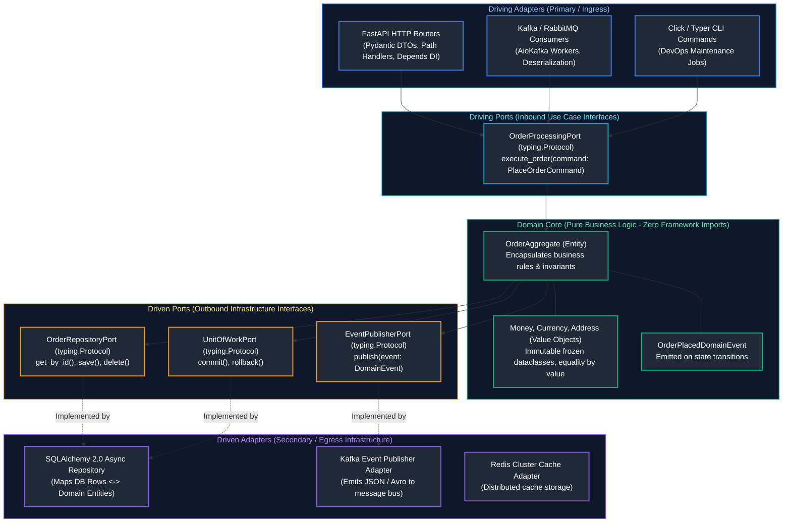
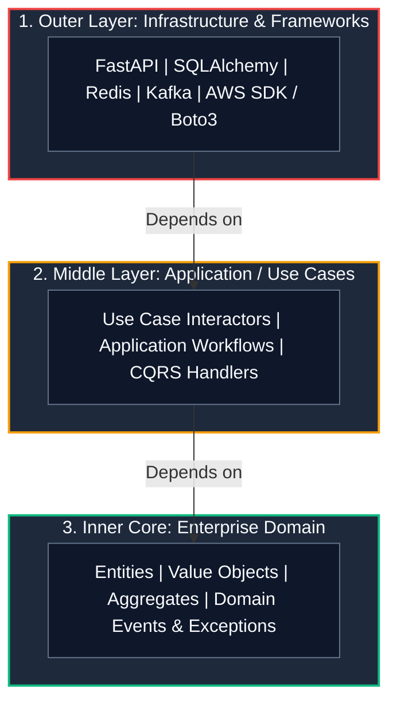
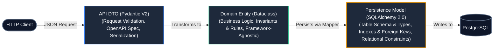

# 04. Design Patterns, SOLID Principles & Software Architecture: Master Guide

A comprehensive, production-grade guide to software design patterns in Python, the SOLID architectural principles, Gang of Four (GoF) design patterns, Clean / Hexagonal (Ports & Adapters) architecture, Domain-Driven Design (DDD) aggregates, Repository and Unit of Work abstractions, the Tri-Model Separation Principle, and RFC 7807 Problem Details error translation for Senior Backend Engineers and Enterprise Architects.

---

## Architectural Overview: Hexagonal (Ports & Adapters) Architecture in Python



---

## Table of Contents
1. [The SOLID Principles Adapted to Python](#1-the-solid-principles-adapted-to-python)
   - [1.1 Single Responsibility Principle (SRP)](#11-single-responsibility-principle-srp)
   - [4.2 Open/Closed Principle (OCP) with Plugin Registries](#42-openclosed-principle-ocp-with-plugin-registries)
   - [4.3 Liskov Substitution Principle (LSP) in Dynamic Runtimes](#43-liskov-substitution-principle-lsp-in-dynamic-runtimes)
   - [4.4 Interface Segregation Principle (ISP) with Narrow Protocols](#44-interface-segregation-principle-isp-with-narrow-protocols)
   - [4.5 Dependency Inversion Principle (DIP) with `typing.Protocol`](#45-dependency-inversion-principle-dip-with-typingprotocol)
2. [Gang of Four (GoF) Patterns in Python](#5-gang-of-four-gof-patterns-in-python)
   - [5.1 Creational Patterns: Factory Method, Builder, and Dependency-Injected Singletons](#51-creational-patterns-factory-method-builder-and-dependency-injected-singletons)
   - [5.2 Structural Patterns: Adapter, Decorator, and Virtual Proxy](#52-structural-patterns-adapter-decorator-and-virtual-proxy)
   - [5.3 Behavioral Patterns: Strategy, Observer (Event Bus), and Command](#53-behavioral-patterns-strategy-observer-event-bus-and-command)
3. [Hexagonal (Ports and Adapters) & Clean Architecture](#6-hexagonal-ports-and-adapters--clean-architecture)
   - [6.1 The Dependency Rule: Inward Independence](#61-the-dependency-rule-inward-independence)
   - [6.2 Enterprise Production Folder Structure](#62-enterprise-production-folder-structure)
4. [Domain-Driven Design (DDD) Core Constructs](#7-domain-driven-design-ddd-core-constructs)
   - [7.1 Entities vs. Immutable Value Objects](#71-entities-vs-immutable-value-objects)
   - [7.2 Aggregate Roots & Invariant Boundary Enforcement](#72-aggregate-roots--invariant-boundary-enforcement)
   - [7.3 Domain Events & In-Memory Event Dispatcher](#73-domain-events--in-memory-event-dispatcher)
5. [The Repository & Unit of Work (UoW) Patterns](#8-the-repository--unit-of-work-uow-patterns)
   - [8.1 Repository Protocol Definition & In-Memory Test Doubles](#81-repository-protocol-definition--in-memory-test-doubles)
   - [8.2 Atomic Multi-Repository Unit of Work with Async Context Managers](#82-atomic-multi-repository-unit-of-work-with-async-context-managers)
6. [The Tri-Model Separation Principle](#9-the-tri-model-separation-principle)
   - [9.1 The Anti-Pattern: Exposing ORM Models Directly to APIs](#91-the-anti-pattern-exposing-orm-models-directly-to-apis)
   - [9.2 The Three Models: API DTOs vs. Domain Entities vs. ORM Tables](#92-the-three-models-api-dtos-vs-domain-entities-vs-orm-tables)
   - [9.3 Bidirectional Model Mappers](#93-bidirectional-model-mappers)
7. [Model Mapper](#93-bidirectional-model-mappers)
8. [RFC 7807 Problem Details Error Standardization](#13-rfc-7807-problem-details-error-standardization)
   - [13.1 Architecture of an Enterprise Problem Details Envelope](#131-architecture-of-an-enterprise-problem-details-envelope)
   - [13.2 Domain Exception Translation in FastAPI/Starlette](#132-domain-exception-translation-in-fastapistarlette)
9. [Summary Comparison & Production Engineering Reference Matrix](#14-summary-comparison--production-engineering-reference-matrix)
10. [References & Further Reading](#15-references--further-reading)
---

# 1. The SOLID Principles Adapted to Python

### 1.1 Single Responsibility Principle (SRP)

> **Definition**: A module, class, or function should have one, and only one, reason to change.

#### Anti-Pattern: The "God Class"
In unarchitected Python backends, developers frequently create massive classes that perform business logic, database queries, external API calls, and email formatting all in one place:

```python
# ANTI-PATTERN: Violates Single Responsibility Principle
class UserService:
    def register_user(self, user_dict: dict) -> None:

# 2. Validation logic

if "@" not in user_dict["email"]:
            raise ValueError("Invalid email")

# 3. Database persistence logic

import psycopg2
        conn = psycopg2.connect("...")
        cursor = conn.cursor()
        cursor.execute("INSERT INTO users VALUES (%s, %s)", (user_dict["name"], user_dict["email"]))
        conn.commit()

# 4. Notification formatting and SMTP transport

import smtplib
        server = smtplib.SMTP("smtp.mail.com")
        server.sendmail("noreply@app.com", user_dict["email"], "Welcome to our platform!")
```
*Why this fails*: `UserService` changes if the database engine switches to PostgreSQL asyncpg, if the email vendor switches from SMTP to SendGrid, or if email validation rules change.

#### Refactoring into Single Responsibilities:
```python
from dataclasses import dataclass
from typing import Protocol

@dataclass(frozen=True)
class UserRegistrationCommand:
    name: str
    email: str

    def __post_init__(self) -> None:
        if "@" not in self.email:
            raise ValueError("Malformed email address")

class UserRepositoryPort(Protocol):
    async def save_user(self, name: str, email: str) -> None: ...

class NotificationPort(Protocol):
    async def send_welcome_email(self, email: str, name: str) -> None: ...

class UserRegistrationUseCase:
    """Coordinates registration workflow with zero direct infrastructure coupling."""
    def __init__(self, user_repo: UserRepositoryPort, notifier: NotificationPort) -> None:
        self._user_repo = user_repo
        self._notifier = notifier

    async def execute(self, command: UserRegistrationCommand) -> None:
        await self._user_repo.save_user(command.name, command.email)
        await self._notifier.send_welcome_email(command.email, command.name)
```

---

### 4.2 Open/Closed Principle (OCP) with Plugin Registries

> **Definition**: Software entities (classes, modules, functions) should be open for extension, but closed for modification.

#### Anti-Pattern: Cascading `if/elif` Trees
Adding a new payment provider (e.g., Stripe, PayPal, Klarna, ApplePay) should **never** require modifying existing, battle-tested payment processing code:

```python
# ANTI-PATTERN: Violates OCP (Every new provider modifies this function!)
def process_payment(provider: str, amount: float) -> bool:
    if provider == "stripe":
        # Stripe API call
        return True
    elif provider == "paypal":
        # PayPal API call
        return True
    elif provider == "klarna":
        # Klarna API call
        return True
    raise ValueError(f"Unknown provider: {provider}")
```

#### Production Solution: The Plugin Registry Pattern
```python
from typing import Protocol, Type

class PaymentStrategy(Protocol):
    async def charge(self, amount_in_cents: int, currency: str) -> str:
        """Processes transaction and returns external transaction ID."""
        ...

class PaymentProcessorRegistry:
    """Open for extension via registration; closed for modification."""
    def __init__(self) -> None:
        self._providers: dict[str, Type[PaymentStrategy]] = {}

    def register(self, provider_code: str):
        def decorator(cls: Type[PaymentStrategy]):
            self._providers[provider_code.lower()] = cls
            return cls
        return decorator

    def get_provider(self, provider_code: str) -> PaymentStrategy:
        provider_cls = self._providers.get(provider_code.lower())
        if not provider_cls:
            raise ValueError(f"Unsupported payment provider: {provider_code}")
        return provider_cls()

# Global registry instance
payment_registry = PaymentProcessorRegistry()

# Adding new providers without modifying core registry logic
@payment_registry.register("stripe")
class StripeAdapter:
    async def charge(self, amount_in_cents: int, currency: str) -> str:
        return f"stripe_ch_{amount_in_cents}"

@payment_registry.register("paypal")
class PayPalAdapter:
    async def charge(self, amount_in_cents: int, currency: str) -> str:
        return f"paypal_capture_{amount_in_cents}"
```

---

### 4.3 Liskov Substitution Principle (LSP) in Dynamic Runtimes

> **Definition**: If $S$ is a subtype of $T$, then objects of type $T$ may be replaced with objects of type $S$ without altering any of the desirable properties of the program (correctness, task performed, etc.).

#### The Rules of LSP in Python:
1. **Preconditions cannot be strengthened in a subtype**: A subclass method cannot require more restrictive arguments than its base class.
2. **Postconditions cannot be weakened in a subtype**: A subclass method must return at least what the base class promised (no returning `None` if base class promises a non-optional object).
3. **Invariants must be preserved**: Any condition that is always true for the base class must remain true for the subclass.

#### Classic LSP Violation: Read-Only Storage Subclass
```python
class StorageRepository:
    def write(self, key: str, value: bytes) -> None: ...

class ReadOnlyStorageRepository(StorageRepository):
    def write(self, key: str, value: bytes) -> None:
        # VIOLATION: Raises exception where caller expected successful write!
        raise PermissionError("Cannot write to read-only storage")
```
*Correction*: Segregate into two distinct interfaces: `ReadableStorage` and `WritableStorage`.

---

### 4.4 Interface Segregation Principle (ISP) with Narrow Protocols

> **Definition**: Clients should not be forced to depend upon interfaces that they do not use.

In Python, prefer **small, highly focused `typing.Protocol` interfaces** (1 to 3 methods) rather than monolithic base classes:

```python
from typing import Protocol, runtime_checkable

@runtime_checkable
class DocumentReader(Protocol):
    def read_bytes(self) -> bytes: ...

@runtime_checkable
class DocumentWriter(Protocol):
    def write_bytes(self, data: bytes) -> None: ...

@runtime_checkable
class DocumentCompressor(Protocol):
    def compress(self, level: int = 9) -> bytes: ...

# A client that only needs to read does NOT depend on write or compress!
def render_preview(reader: DocumentReader) -> str:
    raw_data = reader.read_bytes()
    return f"Preview: {raw_data[:20].decode('utf-8', errors='ignore')}"
```

---

### 4.5 Dependency Inversion Principle (DIP) with `typing.Protocol`

> **Definition**:
> 1. High-level modules should not depend on low-level modules. Both should depend on abstractions.
> 2. Abstractions should not depend on details. Details should depend on abstractions.

In Python 3.8+, **`typing.Protocol` enables Structural Subtyping (Duck Typing with Static Type Safety)**:
* You do not need to inherit from an Abstract Base Class (`abc.ABC`).
* Any class that implements the required methods automatically satisfies the protocol!

```python
from typing import Protocol
import asyncio

# High-Level Domain Port (Abstraction)
class CustomerNotifier(Protocol):
    async def send_sms(self, phone_number: str, message: str) -> bool: ...

# High-Level Business Service: Depends ONLY on the protocol abstraction!
class OrderFulfillmentService:
    def __init__(self, notifier: CustomerNotifier) -> None:
        self._notifier = notifier

    async def complete_order(self, order_id: str, phone: str) -> None:
        # Business logic...
        await self._notifier.send_sms(phone, f"Your order #{order_id} has shipped!")

# Low-Level Infrastructure Adapter (Detail): Implements protocol implicitly!
class TwilioSmsAdapter:
    async def send_sms(self, phone_number: str, message: str) -> bool:
        # Real Twilio REST API integration
        print(f"[Twilio API] Sending '{message}' to {phone_number}")
        return True

# Low-Level Test Double: Implements protocol implicitly!
class MockSmsAdapter:
    def __init__(self) -> None:
        self.sent_messages: list[tuple[str, str]] = []

    async def send_sms(self, phone_number: str, message: str) -> bool:
        self.sent_messages.append((phone_number, message))
        return True
```

---

# 5. Gang of Four (GoF) Patterns in Python

### 5.1 Creational Patterns: Factory Method, Builder, and Dependency-Injected Singletons

#### 1. Builder Pattern for Complex Domain Aggregates
When creating complex domain entities with dozens of optional configurations and strict validation rules, use a fluent Builder:

```python
from dataclasses import dataclass, field
from decimal import Decimal
from typing import Self

@dataclass(frozen=True)
class Invoice:
    invoice_id: str
    customer_id: str
    subtotal: Decimal
    tax_rate: Decimal
    discount: Decimal
    line_items: list[str]

    @property
    def total(self) -> Decimal:
        taxed = self.subtotal * (Decimal("1.0") + self.tax_rate)
        return max(Decimal("0.0"), taxed - self.discount)

class InvoiceBuilder:
    def __init__(self, invoice_id: str, customer_id: str) -> None:
        self._invoice_id = invoice_id
        self._customer_id = customer_id
        self._subtotal = Decimal("0.00")
        self._tax_rate = Decimal("0.08")  # Default 8%
        self._discount = Decimal("0.00")
        self._items: list[str] = []

    def with_subtotal(self, amount: Decimal) -> Self:
        self._subtotal = amount
        return self

    def with_tax_rate(self, rate: Decimal) -> Self:
        if rate < Decimal("0.0"):
            raise ValueError("Tax rate cannot be negative")
        self._tax_rate = rate
        return self

    def with_discount(self, discount: Decimal) -> Self:
        self._discount = discount
        return self

    def add_item(self, item_description: str) -> Self:
        self._items.append(item_description)
        return self

    def build(self) -> Invoice:
        if not self._items:
            raise ValueError("Cannot build an invoice without line items")
        return Invoice(
            invoice_id=self._invoice_id,
            customer_id=self._customer_id,
            subtotal=self._subtotal,
            tax_rate=self._tax_rate,
            discount=self._discount,
            line_items=list(self._items),
        )

# Fluent instantiation
invoice = (
    InvoiceBuilder("inv_1001", "cust_8842")
    .with_subtotal(Decimal("250.00"))
    .with_discount(Decimal("20.00"))
    .add_item("Enterprise Cloud Hosting - Monthly")
    .build()
)
```

#### 2. The Singleton Anti-Pattern vs. Dependency-Injected Singletons
Overriding `__new__` to enforce a global singleton creates tightly coupled, untestable code.
In modern Python, **module-level singletons or FastAPI dependency injection** provide true singletons with effortless mockability:

```python
# In database.py: Python modules are cached in sys.modules, creating natural singletons!
class DatabaseEngine:
    def __init__(self, uri: str) -> None:
        self.uri = uri

# Module-level singleton
engine = DatabaseEngine("postgresql+asyncpg://...")
```

---

### 5.2 Structural Patterns: Adapter, Decorator, and Virtual Proxy

#### 1. Adapter Pattern
Translates an incompatible third-party interface into the interface expected by the domain:

```python
# Legacy 3rd party SDK with non-standard method names
class LegacySendGridSDK:
    def deliver_mail(self, to_addr: str, body_text: str, subject_line: str) -> int:
        print(f"Delivered via SendGrid: {subject_line}")
        return 202

# Target Domain Port
class EmailPort(Protocol):
    async def send(self, recipient: str, subject: str, body: str) -> bool: ...

# Adapter bridging the two
class SendGridAdapter:
    def __init__(self, client: LegacySendGridSDK) -> None:
        self._client = client

    async def send(self, recipient: str, subject: str, body: str) -> bool:
        # Adapts argument ordering and return codes
        status = self._client.deliver_mail(to_addr=recipient, body_text=body, subject_line=subject)
        return status in (200, 202)
```

#### 2. Virtual Proxy (Lazy Loading)
Delays the expensive instantiation of an object until it is actively accessed:

```python
class HeavyMlModel:
    def __init__(self, weights_path: str) -> None:
        print(f"Loading 5GB model weights from {weights_path} into VRAM...")
        self.weights_path = weights_path

    def predict(self, feature_vector: list[float]) -> float:
        return sum(feature_vector) * 0.42

class LazyModelProxy:
    def __init__(self, weights_path: str) -> None:
        self.weights_path = weights_path
        self._model: HeavyMlModel | None = None

    def predict(self, feature_vector: list[float]) -> float:
        # Defer expensive loading until the exact moment of execution
        if self._model is None:
            self._model = HeavyMlModel(self.weights_path)
        return self._model.predict(feature_vector)
```

---

### 5.3 Behavioral Patterns: Strategy, Observer (Event Bus), and Command

#### The Observer Pattern (In-Memory Domain Event Bus):
```python
from collections import defaultdict
from typing import Callable, Coroutine, Any, Type

class DomainEvent:
    """Marker base class for domain events."""

# Type alias for async event listeners
EventListener = Callable[[Any], Coroutine[Any, Any, None]]

class EventBus:
    def __init__(self) -> None:
        self._subscribers: dict[Type[DomainEvent], list[EventListener]] = defaultdict(list)

    def subscribe(self, event_type: Type[DomainEvent], listener: EventListener) -> None:
        self._subscribers[event_type].append(listener)

    async def publish(self, event: DomainEvent) -> None:
        listeners = self._subscribers.get(type(event), [])
        for listener in listeners:
            await listener(event)

# Concrete Domain Event
@dataclass(frozen=True)
class UserSignedUp(DomainEvent):
    user_id: str
    email: str

# Listeners
async def send_analytics_ping(event: UserSignedUp) -> None:
    print(f"[Analytics] User signed up: {event.user_id}")

async def send_welcome_email(event: UserSignedUp) -> None:
    print(f"[Email Service] Sent welcome email to: {event.email}")

# Wiring
bus = EventBus()
bus.subscribe(UserSignedUp, send_analytics_ping)
bus.subscribe(UserSignedUp, send_welcome_email)
# await bus.publish(UserSignedUp(user_id="u_99", email="test@corp.com"))
```

---

# 6. Hexagonal (Ports and Adapters) & Clean Architecture

### 6.1 The Dependency Rule: Inward Independence

The fundamental rule of Clean and Hexagonal Architecture is:
**Dependencies can only point INWARD**.



* The **Domain Core** must be pure Python: zero imports of `fastapi`, `sqlalchemy`, `pydantic`, or `boto3`.
* If your database changes from PostgreSQL to DynamoDB, **not a single line of code in the Domain or Use Case layers should change**!

---

### 6.2 Enterprise Production Folder Structure

```mermaid
flowchart TD
    subgraph RootDir ["📁 src/enterprise_payment_service/ (Application Root)"]
        direction TB
        subgraph DomainLayer ["📁 domain/ (Inner Core - Zero External Dependencies)"]
            direction TB
            D1["📄 model.py<br/>(Aggregates, Entities & Value Objects)"]
            D2["📄 events.py<br/>(Domain Event Definitions)"]
            D3["📄 exceptions.py<br/>(Domain Invariant Exceptions)"]
        end

        subgraph ApplicationLayer ["📁 application/ (Use Cases & Abstract Ports)"]
            direction TB
            subgraph Ports ["📁 ports/ (Interface Protocols)"]
                AP1["📄 repository.py (OrderRepositoryPort)"]
                AP2["📄 unit_of_work.py (UnitOfWorkPort)"]
                AP3["📄 notification.py (EventPublisherPort)"]
            end
            subgraph UseCases ["📁 use_cases/ (Application Workflows)"]
                AU1["📄 process_payment.py"]
                AU2["📄 refund_payment.py"]
            end
        end

        subgraph InfrastructureLayer ["📁 infrastructure/ (Driven Adapters)"]
            direction TB
            ID["📁 db/<br/>(SQLAlchemy 2.0 Async Repositories)"]
            IM["📁 messaging/<br/>(Kafka Event Publisher)"]
            IG["📁 payment_gateways/<br/>(Stripe & PayPal Adapters)"]
        end

        subgraph PresentationLayer ["📁 presentation/ (Driving Ingress)"]
            direction TB
            PA["📁 api/v1/<br/>(FastAPI Handlers & Pydantic Schemas)"]
            PE["📄 error_handlers.py<br/>(RFC 7807 Problem Details)"]
            PC["📁 cli/<br/>(Maintenance Commands)"]
        end
    end

    RootDir --> DomainLayer
    RootDir --> ApplicationLayer
    RootDir --> InfrastructureLayer
    RootDir --> PresentationLayer

    style RootDir fill:#0f172a,stroke:#3b82f6,stroke-width:2px,color:#93c5fd
    style DomainLayer fill:#0f172a,stroke:#10b981,stroke-width:1.5px,color:#6ee7b7
    style ApplicationLayer fill:#0f172a,stroke:#f59e0b,stroke-width:1.5px,color:#fde68a
    style InfrastructureLayer fill:#0f172a,stroke:#ef4444,stroke-width:1.5px,color:#fca5a5
    style PresentationLayer fill:#0f172a,stroke:#8b5cf6,stroke-width:1.5px,color:#c4b5fd
    style D1 fill:#1e293b,stroke:#10b981,stroke-width:1px,color:#fff
    style D2 fill:#1e293b,stroke:#10b981,stroke-width:1px,color:#fff
    style D3 fill:#1e293b,stroke:#10b981,stroke-width:1px,color:#fff
    style Ports fill:#1e293b,stroke:#f59e0b,stroke-width:1px,color:#fff
    style UseCases fill:#1e293b,stroke:#f59e0b,stroke-width:1px,color:#fff
    style AP1 fill:#1f2937,stroke:#f59e0b,stroke-width:1px,color:#fff
    style AP2 fill:#1f2937,stroke:#f59e0b,stroke-width:1px,color:#fff
    style AP3 fill:#1f2937,stroke:#f59e0b,stroke-width:1px,color:#fff
    style AU1 fill:#1f2937,stroke:#f59e0b,stroke-width:1px,color:#fff
    style AU2 fill:#1f2937,stroke:#f59e0b,stroke-width:1px,color:#fff
    style ID fill:#1e293b,stroke:#ef4444,stroke-width:1px,color:#fff
    style IM fill:#1e293b,stroke:#ef4444,stroke-width:1px,color:#fff
    style IG fill:#1e293b,stroke:#ef4444,stroke-width:1px,color:#fff
    style PA fill:#1e293b,stroke:#8b5cf6,stroke-width:1px,color:#fff
    style PE fill:#1e293b,stroke:#8b5cf6,stroke-width:1px,color:#fff
    style PC fill:#1e293b,stroke:#8b5cf6,stroke-width:1px,color:#fff
```



| Layer Directory | Architectural Role | Allowed Dependencies | Forbidden Dependencies |
| :--- | :--- | :--- | :--- |
| `domain/` | Enterprise business logic, entities, value objects, domain events | Standard Library only | External frameworks (`fastapi`, `sqlalchemy`, `pydantic`, `boto3`) |
| `application/` | Orchestrates use-case workflows, defines repository and service ports | `domain/`, Standard Library (`typing.Protocol`, `abc`) | Concrete infrastructure or driving ingress |
| `infrastructure/` | Implements ports for databases, caches, message brokers, external APIs | `application/ports`, `domain/`, database drivers, client SDKs | Direct couplings to presentation HTTP request lifecycle |
| `presentation/` | Driving adapters (FastAPI routes, CLI commands, background consumers) | `application/`, `domain/`, web frameworks (`fastapi`, `click`) | Direct access to raw database tables bypassing application ports |

---

# 7. Domain-Driven Design (DDD) Core Constructs

### 7.1 Entities vs. Immutable Value Objects

#### Tactical Domain-Driven Design Modeling
In Domain-Driven Design (DDD), business logic is encapsulated within domain models that reflect real-world problem spaces. Domain elements are categorized into two fundamental building blocks based on whether their lifecycle is governed by an ongoing identity thread or defined purely by their structural attributes:

1. **Entities (Thread of Continuity & Identity):**
   - **Identity Rule:** An Entity possesses an intrinsic, persistent identity (e.g., a UUID or database primary key) that remains unchanged throughout its entire lifecycle. Two entities with identical attributes but different IDs represent completely distinct business objects (e.g., two customers who happen to share the same first and last name).
   - **State Mutability:** Entities represent mutable state machines (e.g., an `Order` transitioning through `DRAFT`, `PAID`, `SHIPPED`). Equality (`__eq__`) is determined strictly by comparing unique identity identifiers, completely ignoring mutable state fields.

2. **Value Objects (Descriptive & Immutable Attributes):**
   - **Attribute Equivalence:** A Value Object has **zero conceptual identity**. It is defined entirely and exhaustively by the sum of its attributes. If two `Money` objects both represent `$10.00 USD`, they are interchangeable and equivalent.
   - **Strict Immutability:** Value Objects must be **immutable** (`frozen=True`). Modifying an attribute is forbidden; state transitions produce a new Value Object instance. This prevents side-effect aliasing bugs where mutating a value object unexpectedly corrupts shared references across multiple entities.

| Construct | Identity Definition | Mutability | Equality Comparison | Example |
| :--- | :--- | :--- | :--- | :--- |
| **Value Object** | No identity; defined entirely by its attributes | **Immutable** (`frozen=True`) | Equal if all attributes match | `Money(amount=10, currency="USD")` |
| **Entity** | Defined by a persistent unique identity (`id`) | **Mutable** lifecycle state | Equal if unique ID matches | `User(id=UUID, balance=...)` |

#### Value Object Implementation:
```python
from dataclasses import dataclass
from decimal import Decimal

@dataclass(frozen=True)
class Money:
    amount: Decimal
    currency: str

    def __post_init__(self) -> None:
        if self.amount < Decimal("0.00"):
            raise ValueError("Money amount cannot be negative")
        if len(self.currency) != 3:
            raise ValueError("Currency must be a 3-letter ISO code")

    def add(self, other: "Money") -> "Money":
        if self.currency != other.currency:
            raise ValueError(f"Cannot add mismatched currencies: {self.currency} and {other.currency}")
        return Money(self.amount + other.amount, self.currency)
```

---

### 7.2 Aggregate Roots & Invariant Boundary Enforcement

An **Aggregate Root** is a domain entity that guards a cluster of associated objects (entities and value objects), acting as the sole gateway for mutations:

```python
from dataclasses import dataclass, field
from decimal import Decimal
import uuid

class OrderStatus(str):
    DRAFT = "DRAFT"
    CONFIRMED = "CONFIRMED"
    PAID = "PAID"
    CANCELLED = "CANCELLED"

@dataclass
class OrderLineItem:
    item_id: str
    unit_price: Money
    quantity: int

    @property
    def total(self) -> Money:
        return Money(self.unit_price.amount * self.quantity, self.unit_price.currency)

class OrderAggregate:
    """Aggregate Root: Enforces business invariants and encapsulates line items."""
    def __init__(self, order_id: uuid.UUID, customer_id: str, currency: str) -> None:
        self.id = order_id
        self.customer_id = customer_id
        self.currency = currency
        self.status = OrderStatus.DRAFT
        self._items: list[OrderLineItem] = []
        self._domain_events: list[DomainEvent] = []

    def add_item(self, item_id: str, unit_price: Money, quantity: int) -> None:
        # Invariant: Cannot modify confirmed orders
        if self.status != OrderStatus.DRAFT:
            raise ValueError("Cannot add items to an already confirmed order")
        if unit_price.currency != self.currency:
            raise ValueError("Item currency does not match order currency")
        
        self._items.append(OrderLineItem(item_id, unit_price, quantity))

    def confirm(self) -> None:
        # Invariant: Cannot confirm empty orders
        if not self._items:
            raise ValueError("Cannot confirm an order with zero items")
        self.status = OrderStatus.CONFIRMED
        
        # Record Domain Event
        self._domain_events.append(UserSignedUp(user_id=self.customer_id, email="..."))

    def pop_events(self) -> list[DomainEvent]:
        events = list(self._domain_events)
        self._domain_events.clear()
        return events
```

---

### 7.3 Domain Events & In-Memory Event Dispatcher

In pure Domain-Driven Design, modifying one Aggregate Root must **never** synchronously mutate another Aggregate Root inside the same database transaction.
Instead, side effects (such as sending notifications, updating analytics, or reserving inventory) are dispatched as **Domain Events**:

```python
import asyncio
from dataclasses import dataclass, field
from datetime import datetime, timezone
from typing import Callable, Coroutine, Any
import uuid

@dataclass(frozen=True)
class DomainEvent:
    event_id: uuid.UUID = field(default_factory=uuid.uuid4)
    occurred_at: datetime = field(default_factory=lambda: datetime.now(timezone.utc))

@dataclass(frozen=True)
class OrderPlacedEvent(DomainEvent):
    order_id: uuid.UUID = field(default_factory=uuid.uuid4)
    customer_id: str = ""
    total_amount: Decimal = Decimal("0.00")

class InMemoryEventBus:
    """Decoupled in-memory asynchronous event dispatcher."""
    def __init__(self) -> None:
        self._subscribers: dict[type[DomainEvent], list[Callable[[Any], Coroutine[Any, Any, None]]]] = {}

    def subscribe(
        self, 
        event_type: type[DomainEvent], 
        handler: Callable[[Any], Coroutine[Any, Any, None]]
    ) -> None:
        if event_type not in self._subscribers:
            self._subscribers[event_type] = []
        self._subscribers[event_type].append(handler)

    async def publish(self, events: list[DomainEvent]) -> None:
        for event in events:
            handlers = self._subscribers.get(type(event), [])
            # Execute handlers concurrently
            await asyncio.gather(*(handler(event) for handler in handlers), return_exceptions=True)

# Domain Event Handlers
async def send_order_confirmation_email_handler(event: OrderPlacedEvent) -> None:
    print(f"[Email Notification] Order {event.order_id} placed. Sent email to {event.customer_id}")

async def reserve_warehouse_inventory_handler(event: OrderPlacedEvent) -> None:
    print(f"[Inventory Service] Reserving stock for Order {event.order_id}")

# Wire up event bus:
# bus = InMemoryEventBus()
# bus.subscribe(OrderPlacedEvent, send_order_confirmation_email_handler)
# bus.subscribe(OrderPlacedEvent, reserve_warehouse_inventory_handler)
```

---

# 8. The Repository & Unit of Work (UoW) Patterns

### 8.1 Repository Protocol Definition & In-Memory Test Doubles

The Repository pattern isolates domain code from database queries, providing a collection-like abstraction:

```python
from typing import Protocol
import uuid

class OrderRepositoryPort(Protocol):
    async def get_by_id(self, order_id: uuid.UUID) -> OrderAggregate | None: ...
    async def save(self, order: OrderAggregate) -> None: ...

# In-Memory Implementation for Lightning-Fast Unit Testing
class InMemoryOrderRepository:
    def __init__(self) -> None:
        self._storage: dict[uuid.UUID, OrderAggregate] = {}

    async def get_by_id(self, order_id: uuid.UUID) -> OrderAggregate | None:
        return self._storage.get(order_id)

    async def save(self, order: OrderAggregate) -> None:
        self._storage[order.id] = order
```

---

### 8.2 Atomic Multi-Repository Unit of Work with Async Context Managers

The **Unit of Work (UoW)** pattern manages atomic database transactions spanning multiple repositories. It guarantees that either all database modifications commit together, or everything rolls back cleanly:

```python
from typing import Protocol
import abc

class UnitOfWorkPort(Protocol):
    orders: OrderRepositoryPort

    async def __aenter__(self) -> "UnitOfWorkPort": ...
    async def __aexit__(self, exc_type, exc_val, exc_tb) -> None: ...
    async def commit(self) -> None: ...
    async def rollback(self) -> None: ...

class SqlAlchemyUnitOfWork:
    def __init__(self, session_factory) -> None:
        self.session_factory = session_factory

    async def __aenter__(self) -> "SqlAlchemyUnitOfWork":
        self.session = self.session_factory()
        # Instantiate repositories passing active async session
        self.orders = PostgresOrderRepository(self.session)
        return self

    async def __aexit__(self, exc_type, exc_val, exc_tb) -> None:
        if exc_type is not None:
            await self.rollback()
        await self.session.close()

    async def commit(self) -> None:
        await self.session.commit()

    async def rollback(self) -> None:
        await self.session.rollback()
```

#### Executing Use Case with Unit of Work:
```python
async def place_order_use_case(uow: UnitOfWorkPort, customer_id: str) -> uuid.UUID:
    async with uow:
        order = OrderAggregate(order_id=uuid.uuid4(), customer_id=customer_id, currency="USD")
        order.add_item("item_101", Money(Decimal("50.00"), "USD"), 2)
        order.confirm()
        
        await uow.orders.save(order)
        # Commit transaction atomically
        await uow.commit()
        return order.id
```

---

# 9. The Tri-Model Separation Principle

### 9.1 The Anti-Pattern: Exposing ORM Models Directly to APIs

> [!CAUTION]
> ### The Direct ORM Exposure Trap
> Directly returning SQLAlchemy ORM models from FastAPI endpoints causes three major failure modes:
> 1. **Lazy-Loading Detachment Crash**: Serializing relationship fields outside an active async database session raises `DetachedInstanceError`.
> 2. **Mass-Assignment Security Vulnerabilities**: A malicious user sends `{ "is_admin": true }` in the JSON payload, automatically overwriting database columns.
> 3. **API Breakage on Schema Refactoring**: Renaming a database column immediately breaks public REST API clients!

---

### 9.2 The Three Models: API DTOs vs. Domain Entities vs. ORM Tables



| Layer Model | Technology | Responsibility | Scope & Boundaries |
| :--- | :--- | :--- | :--- |
| **API Data Transfer Objects (DTOs)** | Pydantic V2 (`BaseModel`) | HTTP request/response validation, type coercion, OpenAPI serialization | Boundary layer only; never leaks into domain logic |
| **Domain Entities** | Pure Python (`dataclass` / classes) | Business logic enforcement, invariants, state transitions, lifecycle events | Completely decoupled from HTTP frameworks and database engines |
| **Persistence Models** | SQLAlchemy 2.0 (`DeclarativeBase`) | DB schema mapping, foreign key constraints, indexes, identity map tracking | Infrastructure layer; mapped to/from domain entities via Repository |

---

### 9.3 Bidirectional Model Mappers

```python

# 10. API Schema (DTO)

from pydantic import BaseModel, Field
from decimal import Decimal

class CreateOrderRequest(BaseModel):
    customer_id: str = Field(..., min_length=3)
    item_id: str
    unit_price: Decimal = Field(..., gt=0)
    quantity: int = Field(..., ge=1)

# 11. Database ORM Model

from sqlalchemy.orm import DeclarativeBase, Mapped, mapped_column
import uuid

class Base(DeclarativeBase): pass

class OrderORM(Base):
    __tablename__ = "orders"
    id: Mapped[uuid.UUID] = mapped_column(primary_key=True)
    customer_id: Mapped[str] = mapped_column()
    status: Mapped[str] = mapped_column()
    currency: Mapped[str] = mapped_column()

# 12. Model Mapper

class OrderMapper:
    @staticmethod
    def to_domain(orm: OrderORM) -> OrderAggregate:
        entity = OrderAggregate(order_id=orm.id, customer_id=orm.customer_id, currency=orm.currency)
        entity.status = orm.status
        return entity

    @staticmethod
    def to_orm(entity: OrderAggregate) -> OrderORM:
        return OrderORM(
            id=entity.id,
            customer_id=entity.customer_id,
            status=entity.status,
            currency=entity.currency,
        )
```

---

# 13. RFC 7807 Problem Details Error Standardization

### 13.1 Architecture of an Enterprise Problem Details Envelope

[RFC 7807](https://datatracker.ietf.org/doc/html/rfc7807) standardizes machine-readable error responses for HTTP APIs. Every error response returned by your backend should conform to this schema:

```json
{
  "type": "https://api.enterprise.com/errors/insufficient-funds",
  "title": "Insufficient Account Balance",
  "status": 422,
  "detail": "Account 'acc_4412' has a balance of $12.50, which is insufficient for $50.00 withdrawal.",
  "instance": "/v1/accounts/acc_4412/withdrawals",
  "code": "ACC_INSUFFICIENT_FUNDS",
  "invalid_params": [
    {
      "name": "amount",
      "reason": "Requested amount exceeds available balance"
    }
  ]
}
```

---

### 13.2 Domain Exception Translation in FastAPI/Starlette

Translate domain exceptions into standardized RFC 7807 envelopes without polluting route handlers:

```python
from fastapi import FastAPI, Request, status
from fastapi.responses import JSONResponse
import uuid

app = FastAPI()

# Domain Exception
class DomainError(Exception):
    """Base domain exception."""

class InsufficientFundsError(DomainError):
    def __init__(self, account_id: str, balance: float, requested: float) -> None:
        super().__init__(f"Account {account_id} balance {balance} insufficient for {requested}")
        self.account_id = account_id
        self.balance = balance
        self.requested = requested

# Centralized RFC 7807 Exception Handler
@app.exception_handler(InsufficientFundsError)
async def insufficient_funds_handler(request: Request, exc: InsufficientFundsError) -> JSONResponse:
    problem_details = {
        "type": "https://api.enterprise.com/errors/insufficient-funds",
        "title": "Insufficient Funds",
        "status": status.HTTP_422_UNPROCESSABLE_ENTITY,
        "detail": str(exc),
        "instance": request.url.path,
        "code": "FIN_INSUFFICIENT_FUNDS",
        "trace_id": str(uuid.uuid4()),
    }
    return JSONResponse(
        status_code=status.HTTP_422_UNPROCESSABLE_ENTITY,
        content=problem_details,
        headers={"Content-Type": "application/problem+json"},
    )
```

---

# 14. Summary Comparison & Production Engineering Reference Matrix

| Architectural Pattern | Primary Purpose | Layer Placement | Key Python Primitives | Failure Mode if Omitted |
| :--- | :--- | :--- | :--- | :--- |
| **Dependency Inversion** | Decouple business logic from database/APIs | Domain $\leftrightarrow$ Application | `typing.Protocol` | Direct coupling; unit tests require live databases |
| **Plugin Registry (OCP)** | Add features without modifying core code | Application | Decorators, dict registry | Giant `if/elif` ladders that break on every release |
| **Aggregate Root** | Protect transactional business invariants | Domain Core | Pure Python classes | Inconsistent, corrupted data states in database |
| **Repository Pattern** | Abstract data persistence collection | Application $\leftrightarrow$ Infra | `typing.Protocol`, asyncpg | SQL queries scattered across HTTP route handlers |
| **Unit of Work (UoW)** | Guarantee atomic multi-repo transactions | Infrastructure | Async context managers | Partial commits; dangling records on failure |
| **Tri-Model Separation** | Isolate API schemas, entities, and tables | Entire System | Pydantic V2, Dataclasses, ORM | Mass-assignment vulnerabilities, API breakage |
| **RFC 7807 Errors** | Uniform machine-readable error contracts | Presentation | FastAPI Exception Handlers | Inconsistent, unparseable errors across endpoints |

---

# 15. References & Further Reading

1. **RFC 7807 – Problem Details for HTTP APIs**: [https://datatracker.ietf.org/doc/html/rfc7807](https://datatracker.ietf.org/doc/html/rfc7807)
2. **Cosmic Python: *Architecture Patterns with Python*** (Harry Percival & Bob Gregory): [https://www.cosmicpython.com/book/chapter_01_domain_model.html](https://www.cosmicpython.com/book/chapter_01_domain_model.html)
3. **PEP 544 – Protocols: Structural Subtyping (Static Duck Typing)**: [https://peps.python.org/pep-0544/](https://peps.python.org/pep-0544/)
4. **Martin Fowler: *Repository Pattern***: [https://martinfowler.com/eaaCatalog/repository.html](https://martinfowler.com/eaaCatalog/repository.html)
5. **Martin Fowler: *Unit of Work Pattern***: [https://martinfowler.com/eaaCatalog/unitOfWork.html](https://martinfowler.com/eaaCatalog/unitOfWork.html)
6. **Related Guides**:
   - See [07. Web Frameworks: FastAPI and Flask](05_web_frameworks_and_api_protocols.md) for dependency injection and ASGI routing.
   - See [10. SQLAlchemy ORM, Persistence, and Migrations](06_databases_and_sqlalchemy_orm.md) for async repository and UoW implementations.