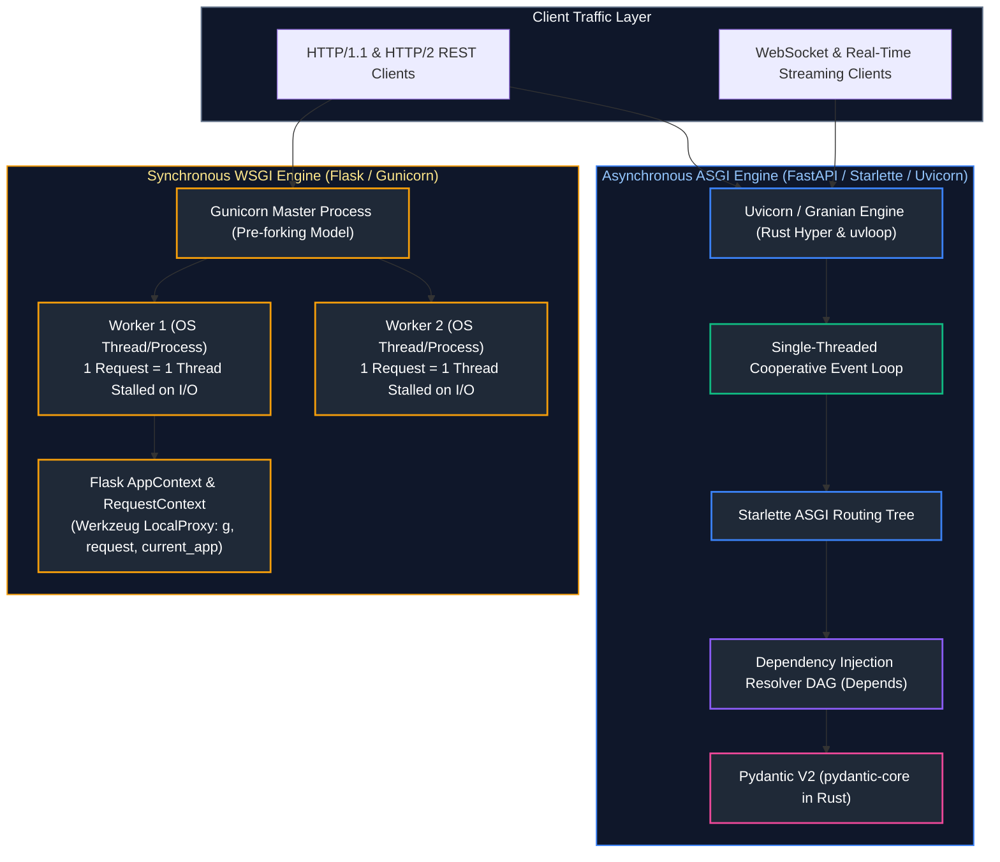
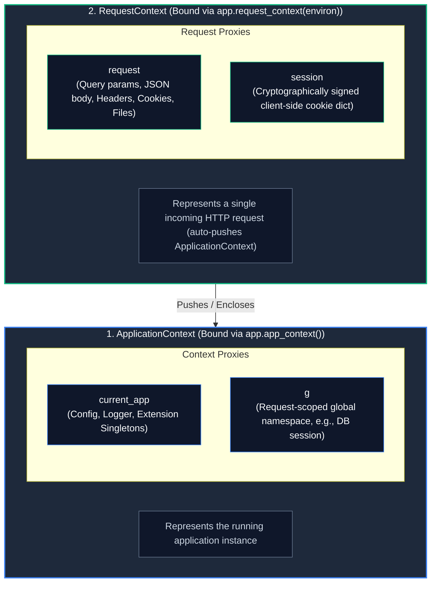
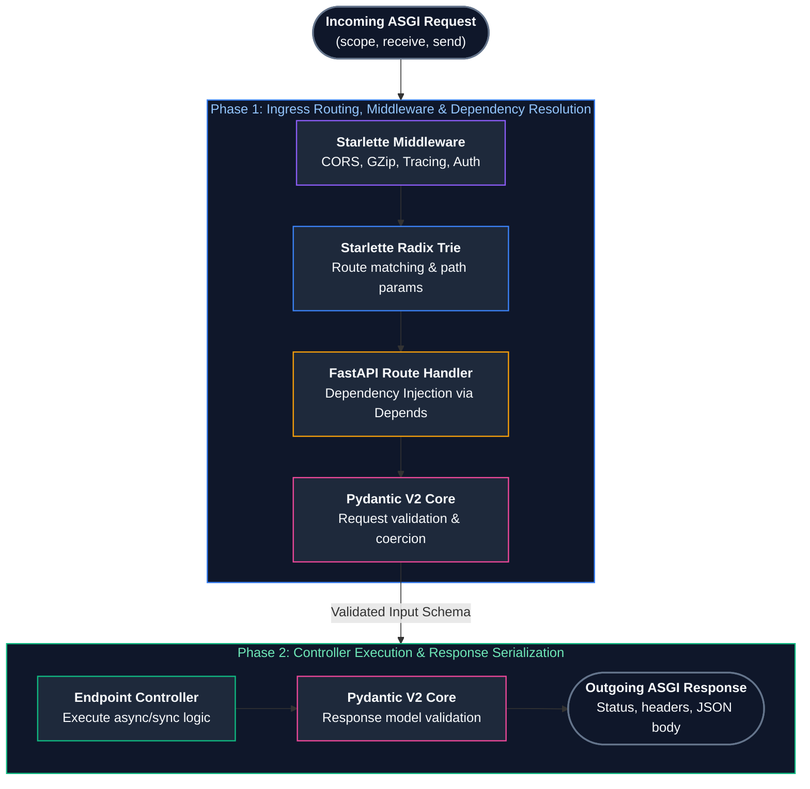
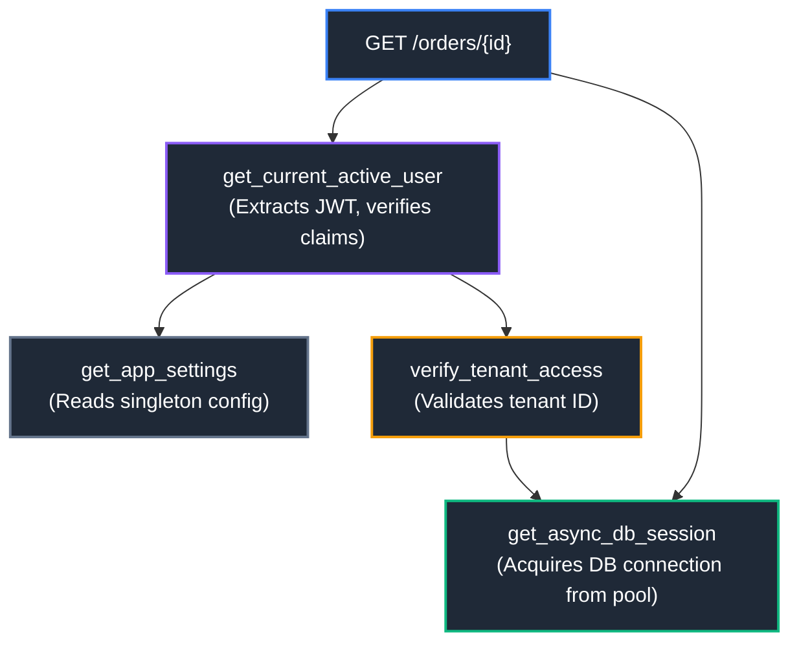
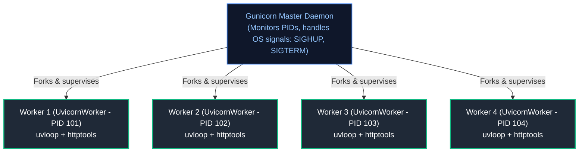
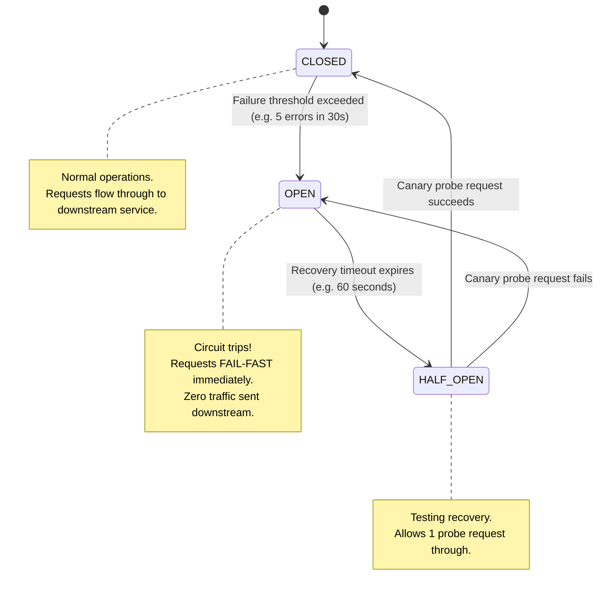
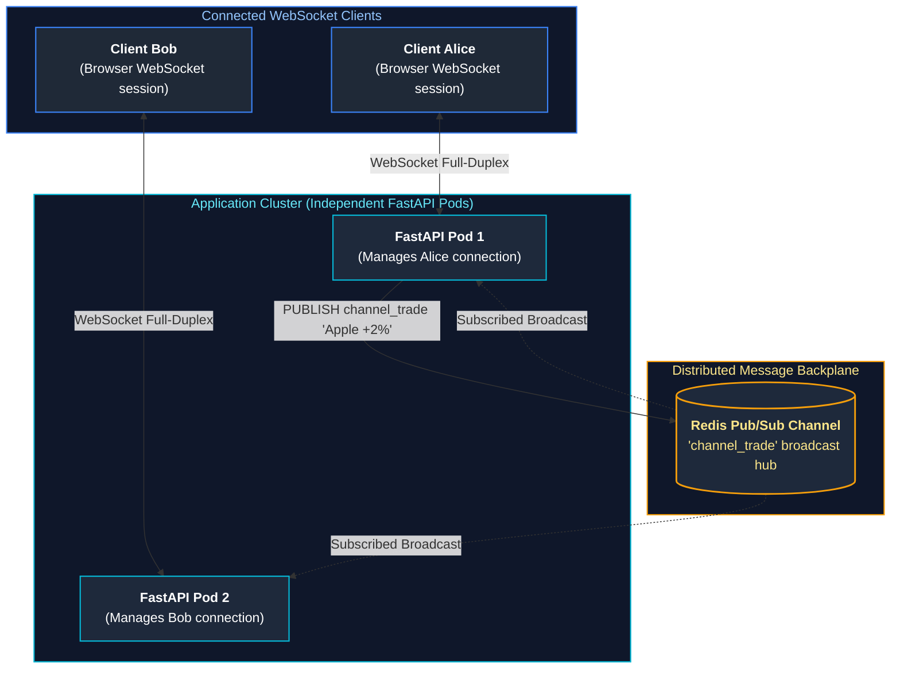

# 05. Web Frameworks (FastAPI/Flask) & Network API Protocols (REST/gRPC/WebSockets)

A comprehensive, production-grade guide to WSGI vs ASGI specifications, Starlette event loop, Flask context locals, FastAPI dependency injection, Pydantic v2 validation, HTTP/2 REST semantics, gRPC protocol buffers, and full-duplex WebSockets.

---

## Architectural Overview: WSGI vs. ASGI Runtime Engines



---

## Table of Contents
1. [WSGI vs. ASGI Specifications: Architectural Evolution](#1-wsgi-vs-asgi-specifications-architectural-evolution)
   - [1.1 PEP 3333 (WSGI): Synchronous Request-Response Callables](#11-pep-3333-wsgi-synchronous-request-response-callables)
   - [1.2 The ASGI Specification: Asynchronous Streaming & Sockets](#12-the-asgi-specification-asynchronous-streaming--sockets)
   - [1.3 Anatomy of an ASGI Callable: `scope`, `receive`, and `send`](#13-anatomy-of-an-asgi-callable-scope-receive-and-send)
2. [Flask Framework Internals & Context Architecture](#5-flask-framework-internals--context-architecture)
   - [5.1 The Application Factory Pattern (`create_app`)](#51-the-application-factory-pattern-create_app)
   - [9.2 Context Mechanics: `ApplicationContext` vs. `RequestContext`](#92-context-mechanics-applicationcontext-vs-requestcontext)
   - [9.3 Under the Hood: Werkzeug `LocalProxy` and Thread-Local Storage](#93-under-the-hood-werkzeug-localproxy-and-thread-local-storage)
   - [11.4 Teardown Callbacks and Resource Cleanup](#114-teardown-callbacks-and-resource-cleanup)
   - [11.5 Modular Route Organization with Blueprints](#115-modular-route-organization-with-blueprints)
3. [FastAPI Framework Internals & The Starlette Engine](#12-fastapi-framework-internals--the-starlette-engine)
   - [12.1 The Starlette ASGI Foundation and Routing Trees](#121-the-starlette-asgi-foundation-and-routing-trees)
   - [12.2 Automatic OpenAPI 3.1 & JSON Schema Generation](#122-automatic-openapi-31--json-schema-generation)
   - [12.3 Comprehensive Parameter Declarations: Path, Query, Header, Cookie, Body, and Form](#123-comprehensive-parameter-declarations-path-query-header-cookie-body-and-form)
   - [12.4 Starlette Middleware Architecture: Pure ASGI vs. `BaseHTTPMiddleware`](#124-starlette-middleware-architecture-pure-asgi-vs-basehttpmiddleware)
   - [12.5 Real-Time Bidirectional WebSockets with Heartbeat Ping/Pong](#125-real-time-bidirectional-websockets-with-heartbeat-pingpong)
4. [Advanced Dependency Injection (DI) in FastAPI](#13-advanced-dependency-injection-di-in-fastapi)
   - [13.1 The Dependency Graph (DAG) and Resolution Order](#131-the-dependency-graph-dag-and-resolution-order)
   - [13.2 Request-Scoped Caching (`use_cache=True`)](#132-request-scoped-caching-use_cachetrue)
   - [13.3 Yield Dependencies for Resource Acquisition and Teardown](#133-yield-dependencies-for-resource-acquisition-and-teardown)
   - [13.4 Hermetic Testing with Dependency Overrides (`app.dependency_overrides`)](#134-hermetic-testing-with-dependency-overrides-appdependency_overrides)
5. [Application Lifespan Handlers (`@asynccontextmanager`)](#17-application-lifespan-handlers-asynccontextmanager)
   - [17.1 Modern Lifespans vs. Deprecated `@app.on_event`](#171-modern-lifespans-vs-deprecated-appon_event)
   - [17.2 Connection Pool Warming, HTTP Client Reuse, and Graceful Draining](#172-connection-pool-warming-http-client-reuse-and-graceful-draining)
6. [Synchronous vs. Asynchronous Route Execution Mechanics](#18-synchronous-vs-asynchronous-route-execution-mechanics)
   - [18.1 The ThreadPool Offloading Trap: Why `def` Runs in Worker Threads](#181-the-threadpool-offloading-trap-why-def-runs-in-worker-threads)
   - [18.2 The Event Loop Starvation Disaster: Blocking Calls in `async def`](#182-the-event-loop-starvation-disaster-blocking-calls-in-async-def)
   - [18.3 Decision Matrix: When to Use `def` vs. `async def`](#183-decision-matrix-when-to-use-def-vs-async-def)
7. [Pydantic v2 Data Modeling & The Rust Core Engine](#19-pydantic-v2-data-modeling--the-rust-core-engine)
   - [19.1 Architecture of `pydantic-core` in Rust](#191-architecture-of-pydantic-core-in-rust)
   - [19.2 Validation Lifecycle: `@field_validator` and `@model_validator`](#192-validation-lifecycle-field_validator-and-model_validator)
   - [19.3 Polymorphic Data Structures: Discriminated Unions](#193-polymorphic-data-structures-discriminated-unions)
   - [19.4 Serialization Optimization: `model_dump()` vs. `model_dump_json()`](#194-serialization-optimization-model_dump-vs-model_dump_json)
   - [19.5 HTTP PATCH Semantics: `exclude_unset=True` vs. Explicit Nulls](#195-http-patch-semantics-exclude_unsettrue-vs-explicit-nulls)
8. [Serving WSGI & ASGI in Production](#20-serving-wsgi--asgi-in-production)
   - [20.1 Worker Architectures: Gunicorn Pre-Forking vs. Uvicorn](#201-worker-architectures-gunicorn-pre-forking-vs-uvicorn)
   - [20.2 Next-Gen Rust Web Servers: Granian](#202-next-gen-rust-web-servers-granian)
   - [20.3 Enterprise Production Deployment Flags & Tuning](#203-enterprise-production-deployment-flags--tuning)
9. [RESTful API Design & HTTP Semantics](#21-restful-api-design--http-semantics)
   - [21.1 Core REST Principles: Resources, Statelessness, and URIs](#211-core-rest-principles-resources-statelessness-and-uris)
   - [21.2 HTTP Method Semantics: Safe vs. Idempotent Operations](#212-http-method-semantics-safe-vs-idempotent-operations)
   - [21.3 Pagination Engineering: Offset vs. Keyset (Cursor-Based) Pagination](#213-pagination-engineering-offset-vs-keyset-cursor-based-pagination)
   - [21.4 Standardized Error Contracts with RFC 7807 Problem Details](#214-standardized-error-contracts-with-rfc-7807-problem-details)
10. [High-Performance Asynchronous HTTP with HTTPX](#22-high-performance-asynchronous-http-with-httpx)
   - [22.1 Architecture: `Client` vs. `AsyncClient`](#221-architecture-client-vs-asyncclient)
   - [22.2 Connection Pooling & Socket Limits (`httpx.Limits`)](#222-connection-pooling--socket-limits-httpxlimits)
   - [22.3 Granular Socket Timeouts: Connect, Read, Write, and Pool](#223-granular-socket-timeouts-connect-read-write-and-pool)
   - [22.4 HTTP/2 Transport Multiplexing](#224-http2-transport-multiplexing)
11. [Client Resilience Engineering: Retries & Circuit Breakers](#23-client-resilience-engineering-retries--circuit-breakers)
   - [23.1 Transient Failures & Exponential Backoff with Full Jitter (`tenacity`)](#231-transient-failures--exponential-backoff-with-full-jitter-tenacity)
   - [23.2 The Circuit Breaker Pattern with `pybreaker`: State Machines & Fail-Fast](#232-the-circuit-breaker-pattern-with-pybreaker-state-machines--fail-fast)
12. [Real-Time Communication: WebSockets & Server-Sent Events (SSE)](#24-real-time-communication-websockets--server-sent-events-sse)
   - [24.1 WebSockets Protocol Upgrade Mechanics (RFC 6455)](#241-websockets-protocol-upgrade-mechanics-rfc-6455)
   - [24.2 FastAPI WebSocket Lifecycle & Heartbeat Pings](#242-fastapi-websocket-lifecycle--heartbeat-pings)
   - [24.3 Multi-Worker WebSocket Broadcast via Redis Pub/Sub Backplane](#243-multi-worker-websocket-broadcast-via-redis-pubsub-backplane)
   - [24.4 Server-Sent Events (SSE) with `StreamingResponse`](#244-server-sent-events-sse-with-streamingresponse)
13. [High-Performance Microservices: gRPC & Protocol Buffers (proto3)](#25-high-performance-microservices-grpc--protocol-buffers-proto3)
   - [25.1 Why gRPC Outperforms REST: HTTP/2 Binary Framing & Protobuf Packing](#251-why-grpc-outperforms-rest-http2-binary-framing--protobuf-packing)
   - [25.2 Defining Schemas & Compiling with `grpc_tools.protoc`](#252-defining-schemas--compiling-with-grpc_toolsprotoc)
   - [25.3 Asynchronous gRPC Server & Client with `grpc.aio`](#253-asynchronous-grpc-server--client-with-grpcaio)
   - [25.4 The Four gRPC Communication Patterns: Unary, Client/Server Streaming, and Duplex](#254-the-four-grpc-communication-patterns-unary-clientserver-streaming-and-duplex)
   - [25.4 Production gRPC Interceptors: Authentication & Distributed Tracing](#254-production-grpc-interceptors-authentication--distributed-tracing)
14. [Enterprise Webhook Architecture](#28-enterprise-webhook-architecture)
   - [28.1 Cryptographic Signature Generation & Verification (HMAC SHA-256)](#281-cryptographic-signature-generation--verification-hmac-sha-256)
   - [28.2 Timing Attack Mitigation with Constant-Time Comparison (`compare_digest`)](#282-timing-attack-mitigation-with-constant-time-comparison-compare_digest)
   - [31.3 Replay Attack Prevention with Timestamps & Nonce Caching](#313-replay-attack-prevention-with-timestamps--nonce-caching)
   - [33.4 Idempotency Keys in Payment & Mutation Webhooks](#334-idempotency-keys-in-payment--mutation-webhooks)
15. [Summary Comparison & Production Engineering Reference Matrix](#34-summary-comparison--production-engineering-reference-matrix)
16. [References & Further Reading](#35-references--further-reading)

---

# 1. WSGI vs. ASGI Specifications: Architectural Evolution

### 1.1 PEP 3333 (WSGI): Synchronous Request-Response Callables

#### Intuitive Analogy: The Single-Lane Toll Booth
Think of the **Web Server Gateway Interface (WSGI)** like a single-lane toll booth for an office park. A car arrives (HTTP request), hands the attendant cash, receives a receipt (HTTP response), and drives through.
If the driver needs to stop to look for a map (the application performs a 5-second database query), the entire lane freezes. No other car can enter or leave until that single transaction is 100% complete.

Defined in **PEP 3333** (2010), WSGI specifies a standardized synchronous interface between Python web applications and web servers (like Apache `mod_wsgi` or Gunicorn):

```python
# The Pure WSGI Application Callable (PEP 3333)
def simple_wsgi_app(environ: dict, start_response) -> list[bytes]:
    """
    environ: Dictionary containing CGI-style environment variables, headers, and request body.
    start_response: Callback function used to send HTTP status and headers.
    """
    status = "200 OK"
    response_headers = [
        ("Content-Type", "application/json"),
        ("Content-Length", "18"),
    ]
    start_response(status, response_headers)
    return [b'{"status": "alive"}']
```

#### The Fatal Flaws of WSGI:
1. **Synchronous & Blocking**: The entire request is processed synchronously inside a single thread. If your application handles 1,000 concurrent clients waiting for database queries, you must spawn 1,000 OS processes or threads, exhausting system RAM and kernel thread tables!
2. **Cannot Support Long-Lived Connections**: WSGI cannot natively handle **WebSockets**, **Server-Sent Events (SSE)**, or HTTP/2 bi-directional multiplexing without grotesque monkey-patching (e.g., Gevent greenlets).

---

### 1.2 The ASGI Specification: Asynchronous Streaming & Sockets

The **Asynchronous Server Gateway Interface (ASGI)** is the modern successor to WSGI. It provides a standardized asynchronous interface capable of handling:
* Standard asynchronous HTTP/1.1 and HTTP/2 request-response cycles.
* Bidirectional, persistent **WebSockets**.
* Long-lived background streaming and Server-Sent Events (SSE).

Instead of a synchronous function returning an iterable of bytes, an ASGI application is an **asynchronous coroutine callable**.

---

### 1.3 Anatomy of an ASGI Callable: `scope`, `receive`, and `send`

Every ASGI application (including FastAPI and Starlette) implements this exact 3-argument signature:

```python
async def asgi_application(scope: dict, receive, send) -> None:
    """
    scope: Dictionary describing the connection (type: 'http' or 'websocket', path, headers, client IP).
    receive: Async callable to receive incoming event dictionaries from the server.
    send: Async callable to send outgoing event dictionaries to the client.
    """
```

#### Writing a Pure ASGI Application from Scratch:
```python
import json

async def pure_asgi_app(scope: dict, receive, send) -> None:

# 2. Inspect the connection scope

if scope["type"] == "http":
        # Wait for the incoming request body event
        request_event = await receive()
        body = request_event.get("body", b"")

        response_payload = json.dumps({
            "message": "Processed via raw ASGI",
            "path": scope["path"],
            "method": scope["method"],
            "received_bytes": len(body),
        }).encode("utf-8")

# 3. Send HTTP Response Start (Status code and Headers)

await send({
            "type": "http.response.start",
            "status": 200,
            "headers": [
                [b"content-type", b"application/json"],
                [b"content-length", str(len(response_payload)).encode("utf-8")],
            ],
        })

# 4. Send HTTP Response Body

await send({
            "type": "http.response.body",
            "body": response_payload,
            "more_body": False,
        })

    elif scope["type"] == "websocket":
        # Handle WebSocket handshake
        while True:
            event = await receive()
            if event["type"] == "websocket.connect":
                await send({"type": "websocket.accept"})
            elif event["type"] == "websocket.receive":
                text = event.get("text", "")
                await send({"type": "websocket.send", "text": f"Echo: {text}"})
            elif event["type"] == "websocket.disconnect":
                break
```
*Key Architectural Insight*: Because `receive` and `send` are asynchronous coroutines, the server can stream 10 gigabytes of data or maintain 100,000 idle WebSocket connections on a single OS thread without blocking other requests!

---

# 5. Flask Framework Internals & Context Architecture

### 5.1 The Application Factory Pattern (`create_app`)

In enterprise Flask applications, **never** instantiate a global `app = Flask(__name__)` at the module level.
Always utilize the **Application Factory Pattern**:

```python
import os
from flask import Flask
from typing import Mapping, Any

def create_app(config_override: Mapping[str, Any] | None = None) -> Flask:
    """
    Application Factory: Instantiates and configures a clean Flask instance.
    Enables isolated unit testing with distinct database environments.
    """
    app = Flask(__name__, instance_relative_config=True)

# 6. Load default baseline configuration

app.config.from_mapping(
        SECRET_KEY=os.environ.get("SECRET_KEY", "dev-insecure-key"),
        SQLALCHEMY_DATABASE_URI=os.environ.get("DATABASE_URL", "sqlite:///dev.db"),
        SQLALCHEMY_TRACK_MODIFICATIONS=False,
    )

# 7. Apply test or runtime overrides

if config_override:
        app.config.from_mapping(config_override)

# 8. Initialize extensions (deferred binding)

# db.init_app(app)
    # migrate.init_app(app, db)

# 9. Register modular blueprints

from .routes.users import users_bp
    from .routes.health import health_bp
    app.register_blueprint(users_bp, url_prefix="/api/v1/users")
    app.register_blueprint(health_bp, url_prefix="/health")

    return app
```

---

### 9.2 Context Mechanics: `ApplicationContext` vs. `RequestContext`

Flask relies on two distinct stacked context layers:



| Context Layer | Activation Scope | Lifecycle / Binding | Global Proxies Exposed |
| :--- | :--- | :--- | :--- |
| **`ApplicationContext`** | App-level config, extensions, database engine pools, CLI tasks | `with app.app_context():` or pushed automatically by `RequestContext` | `current_app`, `g` |
| **`RequestContext`** | Isolated to a single incoming WSGI HTTP request | `with app.request_context(environ):` per client request thread | `request`, `session` |

---

### 9.3 Under the Hood: Werkzeug `LocalProxy` and Thread-Local Storage

How can you write `from flask import request` at the module level, when `request` contains unique data for every concurrent HTTP request?

Flask achieves this via Werkzeug's **`LocalProxy`**:
1. At import time, `request` is **not** an HTTP request object. It is a pointer (`LocalProxy`) that delegates all attribute lookups dynamically.
2. In multi-threaded WSGI servers, Werkzeug historically stored active contexts in `threading.local()` (and in modern versions, `contextvars.ContextVar`).
3. When you access `request.method`, the `LocalProxy` calls:
   ```python
   # Conceptual implementation of Werkzeug LocalProxy lookup
   def __getattr__(self, name):

# 10. Resolve current thread's active context from ContextVar

active_req_context = _cv_request.get()
       if active_req_context is None:
           raise RuntimeError("Working outside of request context.")

# 11. Forward attribute lookup to real Request object

return getattr(active_req_context.request, name)
   ```

---

### 11.4 Teardown Callbacks and Resource Cleanup

To prevent database connection leaks in Flask, register teardown handlers that execute **regardless of whether an uncaught exception occurred**:

```python
from flask import Flask, g
import sqlite3

app = Flask(__name__)

def get_db():
    if "db" not in g:
        g.db = sqlite3.connect("app.db")
        g.db.row_factory = sqlite3.Row
    return g.db

@app.teardown_appcontext
def teardown_db(exception: BaseException | None) -> None:
    """Invoked automatically when the ApplicationContext pops."""
    db = g.pop("db", None)
    if db is not None:
        db.close()
```

---

### 11.5 Modular Route Organization with Blueprints

```python
from flask import Blueprint, jsonify, request, abort

users_bp = Blueprint("users", __name__)

@users_bp.route("/<int:user_id>", methods=["GET"])
def get_user_profile(user_id: int):
    if user_id <= 0:
        abort(400, description="Invalid user identifier")
    return jsonify({"user_id": user_id, "username": f"user_{user_id}"})
```

---

# 12. FastAPI Framework Internals & The Starlette Engine

### 12.1 The Starlette ASGI Foundation and Routing Trees

FastAPI is **not** a web framework built from scratch. It is an architectural orchestration layer built directly on top of:
1. **Starlette**: High-performance ASGI toolkit providing routing, middleware, WebSockets, background tasks, and CORS.
2. **Pydantic**: High-performance validation and serialization engine.



---

### 12.2 Automatic OpenAPI 3.1 & JSON Schema Generation

FastAPI inspects function type annotations, docstrings, and Pydantic models at application startup to construct a complete, standards-compliant **OpenAPI 3.1.0** JSON specification.
* `/docs`: Interactive Swagger UI interface.
* `/redoc`: Clean ReDoc documentation interface.
* `/openapi.json`: Raw machine-readable schema for automated client code generation (e.g., OpenAPI Generator for TypeScript or Go).

---

### 12.3 Comprehensive Parameter Declarations: Path, Query, Header, Cookie, Body, and Form

FastAPI uses explicit metadata markers to differentiate where parameters originate in the HTTP request:

```python
from fastapi import FastAPI, Path, Query, Header, Cookie, Body, Form, File, UploadFile
from pydantic import BaseModel, EmailStr
from typing import Annotated

app = FastAPI(title="Enterprise API")

class AccountUpdatePayload(BaseModel):
    display_name: str
    email: EmailStr

@app.put("/accounts/{account_id}")
async def update_account_profile(
    # Path parameter with integer boundary constraints
    account_id: Annotated[int, Path(ge=1, le=10_000_000, description="Primary Account ID")],
    # Query parameter with regex validation and default
    region: Annotated[str, Query(regex="^[a-z]{2}-[a-z]+-[0-9]$")] = "us-east-1",
    # Mandatory HTTP Request Header
    x_correlation_id: Annotated[str, Header(description="W3C Request Trace ID")] = ...,
    # Optional Cookie
    session_token: Annotated[str | None, Cookie()] = None,
    # Validated JSON Body payload
    payload: Annotated[AccountUpdatePayload, Body()] = ...,
):
    return {
        "account_id": account_id,
        "region": region,
        "trace_id": x_correlation_id,
        "updated_email": payload.email,
    }
```

---

### 12.4 Starlette Middleware Architecture: Pure ASGI vs. `BaseHTTPMiddleware`

Engineers frequently encounter performance bottlenecks by misusing middleware in FastAPI:

#### The `BaseHTTPMiddleware` Pitfall:
Starlette provides `starlette.middleware.base.BaseHTTPMiddleware` allowing a convenient `dispatch(request, call_next)` interface. However:
1. **ContextVar Propagation Issues**: Earlier versions struggled with `contextvars` isolation across concurrent requests.
2. **Streaming Response Buffering**: `BaseHTTPMiddleware` converts streaming responses into buffered responses, consuming massive memory on large file downloads.
3. **Breaks WebSockets**: HTTP middleware wraps the HTTP lifecycle and cannot handle WebSocket connection upgrades.

#### Production Solution: Pure ASGI Middleware
A pure ASGI middleware intercepts the raw `(scope, receive, send)` triplets with zero memory copying or buffering overhead:

```python
import time
from typing import Callable, Any

class HighPerformanceTimingMiddleware:
    """
    Pure ASGI Middleware:
    Zero-overhead request timing and custom header injection.
    Works seamlessly with streaming responses and WebSockets!
    """
    def __init__(self, app: Callable[[dict, Any, Any], Any]) -> None:
        self.app = app

    async def __call__(self, scope: dict, receive: Callable, send: Callable) -> None:
        if scope["type"] != "http":
            # Pass WebSocket or Lifespan scopes straight through without interference
            await self.app(scope, receive, send)
            return

        start_time = time.perf_counter()

        async def send_wrapper(message: dict) -> None:
            if message["type"] == "http.response.start":
                process_time = time.perf_counter() - start_time
                # Convert existing headers list to mutable list of byte tuples
                headers = list(message.get("headers", []))
                headers.append((b"x-process-time", f"{process_time:.6f}".encode("latin-1")))
                message["headers"] = headers
            await send(message)

        await self.app(scope, receive, send_wrapper)

# Registration on FastAPI instance:
# app.add_middleware(HighPerformanceTimingMiddleware)
```

---

### 12.5 Real-Time Bidirectional WebSockets with Heartbeat Ping/Pong

FastAPI provides first-class support for stateful, persistent WebSocket connections. Here is the enterprise pattern for managing active client connections, broadcasting messages, and preventing ghost connections:

```python
from fastapi import FastAPI, WebSocket, WebSocketDisconnect, status
from typing import dict

app = FastAPI()

class ConnectionManager:
    """Manages active WebSocket client sockets and room broadcasts."""
    def __init__(self) -> None:
        # Maps user_id -> active WebSocket socket
        self.active_connections: dict[str, WebSocket] = {}

    async def connect(self, user_id: str, websocket: WebSocket) -> None:
        await websocket.accept()
        self.active_connections[user_id] = websocket

    def disconnect(self, user_id: str) -> None:
        self.active_connections.pop(user_id, None)

    async def send_personal_message(self, message: dict, user_id: str) -> None:
        if websocket := self.active_connections.get(user_id):
            await websocket.send_json(message)

    async def broadcast(self, message: dict) -> None:
        for websocket in list(self.active_connections.values()):
            try:
                await websocket.send_json(message)
            except Exception:
                pass

manager = ConnectionManager()

@app.websocket("/ws/notifications/{user_id}")
async def websocket_notifications_endpoint(websocket: WebSocket, user_id: str):
    await manager.connect(user_id, websocket)
    try:
        while True:
            # Await incoming client ping/messages (prevents socket timeout)
            data = await websocket.receive_text()
            if data == "ping":
                await websocket.send_text("pong")
            else:
                # Handle client event
                await manager.send_personal_message({"echo": data}, user_id)
    except WebSocketDisconnect:
        manager.disconnect(user_id)
        await manager.broadcast({"event": "user_disconnected", "user_id": user_id})
```

---

# 13. Advanced Dependency Injection (DI) in FastAPI

### 13.1 The Dependency Graph (DAG) and Resolution Order

FastAPI features one of the most sophisticated **Dependency Injection (DI)** engines in the Python ecosystem (`fastapi.Depends`).
When an endpoint is invoked, FastAPI builds a **Directed Acyclic Graph (DAG)** of all dependencies, sub-dependencies, and security scopes:



---

### 13.2 Request-Scoped Caching (`use_cache=True`)

Notice that both `Route` and `PermDep` depend on `get_async_db_session`.
By default, **`Depends(..., use_cache=True)` caches the resolved value for the lifetime of that single HTTP request**.
FastAPI calls `get_async_db_session` **exactly once**, sharing the identical database session across all dependencies in the graph!

---

### 13.3 Yield Dependencies for Resource Acquisition and Teardown

To manage transactional database sessions or client lifespans, use Python's generator `yield` syntax:

```python
from collections.abc import AsyncGenerator
from fastapi import FastAPI, Depends, HTTPException, status
import asyncpg

app = FastAPI()

# Simulated database connection pool
async def get_db_pool() -> asyncpg.Pool:
    # In real applications, this pool is stored on app.state
    return app.state.db_pool

async def get_db_connection(
    pool: asyncpg.Pool = Depends(get_db_pool)
) -> AsyncGenerator[asyncpg.Connection, None]:
    """
    Yield Dependency:
    1. Executes BEFORE the route handler (acquires resource).
    2. Yields resource to route.
    3. Executes AFTER the route handler (releases resource, even on uncaught errors!).
    """
    conn = await pool.acquire()
    try:
        yield conn
    finally:
        # Guarantees connection return to pool!
        await pool.release(conn)

@app.get("/items/{item_id}")
async def read_item(
    item_id: int,
    conn: asyncpg.Connection = Depends(get_db_connection)
):
    row = await conn.fetchrow("SELECT * FROM items WHERE id = $1", item_id)
    if not row:
        raise HTTPException(status_code=404, detail="Item not found")
    return dict(row)
```

---

### 13.4 Hermetic Testing with Dependency Overrides (`app.dependency_overrides`)

FastAPI's dependency injection system makes unit and integration testing effortless by allowing you to override any dependency without monkey-patching:

```python
from fastapi.testclient import TestClient
import pytest

# Fake test repository
class FakeDbSession:
    async def fetchrow(self, query: str, *args):
        return {"id": 1, "name": "Mocked Test Item"}

async def override_get_db_connection():
    yield FakeDbSession()

def test_read_item_hermetic():

# 14. Override the production dependency

app.dependency_overrides[get_db_connection] = override_get_db_connection

# 15. Execute test with zero database infrastructure required!

with TestClient(app) as client:
        response = client.get("/items/1")
        assert response.status_code == 200
        assert response.json()["name"] == "Mocked Test Item"

# 16. Clean up overrides

app.dependency_overrides.clear()
```

---

# 17. Application Lifespan Handlers (`@asynccontextmanager`)

### 17.1 Modern Lifespans vs. Deprecated `@app.on_event`

> [!WARNING]
> **Deprecated Pattern**:
> `@app.on_event("startup")` and `@app.on_event("shutdown")` are **deprecated** in Starlette and FastAPI.
> They lack robust error handling and cannot share state cleanly across the startup and shutdown boundary.
---

### 17.2 Connection Pool Warming, HTTP Client Reuse, and Graceful Draining

#### Modern Lifespan Architecture (Python 3.10+):
```python
from contextlib import asynccontextmanager
from fastapi import FastAPI
import httpx
import redis.asyncio as aioredis

@asynccontextmanager
async def application_lifespan(app: FastAPI):
    # ==================== STARTUP PHASE ====================
    print("[Startup] Initializing outbound HTTP connection pool...")
    app.state.http_client = httpx.AsyncClient(timeout=httpx.Timeout(10.0))
    
    print("[Startup] Establishing Redis cluster connection...")
    app.state.redis = aioredis.from_url("redis://localhost:6379/0", decode_responses=True)
    await app.state.redis.ping()
    
    yield  # Application handles incoming HTTP/WebSocket traffic here!

    # ==================== SHUTDOWN PHASE ====================
    print("[Shutdown] Closing HTTP client pool...")
    await app.state.http_client.aclose()
    
    print("[Shutdown] Draining and terminating Redis connections...")
    await app.state.redis.close()

# Pass lifespan directly to FastAPI constructor
app = FastAPI(lifespan=application_lifespan)
```

---

# 18. Synchronous vs. Asynchronous Route Execution Mechanics

### 18.1 The ThreadPool Offloading Trap: Why `def` Runs in Worker Threads

One of the most profound internal architectural features of FastAPI is how it executes **`def` (synchronous)** routes versus **`async def` (asynchronous)** routes:

```python
# Route A: Declared with 'def' (SYNCHRONOUS)
@app.get("/sync-endpoint")
def sync_route():
    # FastAPI does NOT run this directly on the event loop!
    # It offloads execution to an external thread pool: anyio.to_thread.run_sync()
    time.sleep(1.0)
    return {"status": "success"}

# Route B: Declared with 'async def' (ASYNCHRONOUS)
@app.get("/async-endpoint")
async def async_route():
    # FastAPI executes this DIRECTLY on the main event loop thread!
    await asyncio.sleep(1.0)
    return {"status": "success"}
```

---

### 18.2 The Event Loop Starvation Disaster: Blocking Calls in `async def`

> [!CAUTION]
> ### The Single Biggest Production Outage in FastAPI
> If you declare an endpoint with `async def`, and inside that endpoint you execute a **blocking synchronous function** (such as `time.sleep()`, synchronous `requests.get()`, or legacy synchronous ORM queries), **you freeze the entire event loop**!
> 
> Because `async def` runs on the main thread, the entire server stops accepting new connections, fails health checks, and drops active client connections!

```python
# PRODUCTION DISASTER: Freezes all concurrent traffic across the server!
@app.get("/lethal-endpoint")
async def lethal_route():
    # NEVER DO THIS INSIDE async def! Freezes all other requests!
    time.sleep(5.0) 
    return {"status": "doomed"}
```

---

### 18.3 Decision Matrix: When to Use `def` vs. `async def`

#### FastAPI Execution Engine Mechanics: The Event Loop vs. The AnyIO Thread Pool
A subtle design element in FastAPI and Starlette is how the ASGI server schedules endpoint functions. Understanding this mechanism prevents catastrophic thread pool starvation or silent event loop freezes:

1. **`async def` Endpoints (Direct Event Loop Execution):**
   - **Scheduling:** The framework treats the route as a native coroutine and executes it directly on the main single-threaded `asyncio` event loop.
   - **Contract & Peril:** Because it runs on the main event loop thread, **it must never execute blocking operations**. Any blocking call (`time.sleep()`, synchronous `requests.get()`, synchronous ORM calls via `psycopg2`) freezes the entire Python process, stalling all concurrent HTTP connections across the entire server.

2. **Standard `def` Endpoints (Automated AnyIO Thread Pool Offloading):**
   - **Scheduling:** When FastAPI detects a standard synchronous `def` endpoint, it does **not** execute it on the event loop. Instead, it automatically offloads execution to an external background worker thread pool (`anyio.to_thread.run_sync`, defaulting to 40 threads).
   - **Safety:** The blocking call runs inside a worker thread; the main event loop remains completely unblocked and continues processing concurrent network traffic. However, concurrency is bounded by thread pool capacity, incurring OS thread context-switching overhead.

| Endpoint Implementation | Declaration | Execution Mechanism | Performance Characteristic |
| :--- | :--- | :--- | :--- |
| **Pure Async I/O** (asyncpg, httpx, motor) | `async def` | Runs directly on event loop | **Maximum throughput** (10K+ req/sec). |
| **Legacy Synchronous I/O** (psycopg2, requests) | `def` | Offloaded to `anyio.to_thread` pool | Bounded by thread pool size (default 40). Safe from loop freeze. |
| **Heavy CPU Math** (NumPy, cryptography) | `def` | Offloaded to thread pool (or `ProcessPool`) | Keeps event loop responsive. |

---

# 19. Pydantic v2 Data Modeling & The Rust Core Engine

### 19.1 Architecture of `pydantic-core` in Rust

In Pydantic v1, validation was written in pure Python. Validating 100,000 JSON payloads per second was computationally impossible due to Python interpreter overhead.
**Pydantic v2** completely rewrote the internal validation and serialization engine in **Rust (`pydantic-core`)**:
* Parses and validates raw JSON bytes directly in compiled Rust machine code.
* Delivers a **$5\times$ to $20\times$ speedup** over Pydantic v1.

---

### 19.2 Validation Lifecycle: `@field_validator` and `@model_validator`

```python
from pydantic import BaseModel, Field, field_validator, model_validator
from decimal import Decimal

class CreatePaymentRequest(BaseModel):
    amount: Decimal = Field(..., gt=0, decimal_places=2)
    currency: str = Field(..., min_length=3, max_length=3)
    card_number: str

    @field_validator("currency", mode="after")
    @classmethod
    def validate_currency_uppercase(cls, v: str) -> str:
        """Field validator running AFTER default type coercion."""
        return v.upper()

    @field_validator("card_number", mode="before")
    @classmethod
    def strip_card_whitespace(cls, v: str) -> str:
        """Field validator running BEFORE type coercion (cleans raw string)."""
        if isinstance(v, str):
            return v.replace(" ", "").replace("-", "")
        return v

    @model_validator(mode="after")
    def validate_cross_field_rules(self) -> "CreatePaymentRequest":
        """Model validator running after all individual fields are verified."""
        if self.currency == "JPY" and self.amount % 1 != 0:
            raise ValueError("Japanese Yen cannot contain decimal fractional amounts")
        return self
```

---

### 19.3 Polymorphic Data Structures: Discriminated Unions

When an API endpoint must accept or return polymorphic schemas (e.g., different payment method configurations):

```python
from pydantic import BaseModel, Field
from typing import Annotated, Literal, Union

class CreditCardPayment(BaseModel):
    method_type: Literal["credit_card"] = "credit_card"
    card_token: str
    cvv: str

class BankTransferPayment(BaseModel):
    method_type: Literal["bank_transfer"] = "bank_transfer"
    iban: str
    bic: str

# Discriminated Union: Validates in O(1) time using the 'method_type' tag
PaymentPayload = Annotated[
    Union[CreditCardPayment, BankTransferPayment],
    Field(discriminator="method_type")
]

class CheckoutRequest(BaseModel):
    order_id: str
    payment: PaymentPayload
```

---

### 19.4 Serialization Optimization: `model_dump()` vs. `model_dump_json()`

* **`model.model_dump()`**: Serializes the model into native Python dictionaries and lists.
* **`model.model_dump_json()`**: Serializes directly from Rust internal structs into a raw UTF-8 JSON byte string, **bypassing Python dictionary creation entirely**!

```python
# Ultra-fast raw JSON response:
from fastapi import Response

@app.get("/orders/{id}/fast")
async def get_fast_order(id: str):
    order = fetch_order(id)
    # Bypasses Python dict allocations and standard json.dumps!
    return Response(content=order.model_dump_json(), media_type="application/json")
```

---

### 19.5 HTTP PATCH Semantics: `exclude_unset=True` vs. Explicit Nulls

In RESTful APIs, **`PATCH` represents a partial update**. You must distinguish between:
1. A field omitted by the client (do **not** update database).
2. A field explicitly set to `null` / `None` by the client (update database column to `NULL`).

```python
from pydantic import BaseModel
from typing import Optional

class UserPatchRequest(BaseModel):
    username: Optional[str] = None
    bio: Optional[str] = None
    avatar_url: Optional[str] = None

# Case 1: Client sends {"bio": "New Bio"}
payload = UserPatchRequest(bio="New Bio")

# Anti-pattern: model_dump() includes all defaults!
# payload.model_dump() -> {"username": None, "bio": "New Bio", "avatar_url": None}
# This would erroneously wipe out the user's username and avatar in the DB!

# PRODUCTION STANDARD: exclude_unset=True
update_data = payload.model_dump(exclude_unset=True)
print(update_data) # Outputs: {"bio": "New Bio"}

# Only update database columns that were explicitly sent in the request!
```

---

# 20. Serving WSGI & ASGI in Production

### 20.1 Worker Architectures: Gunicorn Pre-Forking vs. Uvicorn

In enterprise deployments, you run **Gunicorn as the master process supervisor** managing multiple **Uvicorn worker processes**:



---

### 20.2 Next-Gen Rust Web Servers: Granian

**Granian** is a modern HTTP server for Python applications written in **Rust** on top of the **Hyper** engine:
* Outperforms Gunicorn + Uvicorn by $20\text{--}40\%$ in raw throughput.
* Handles HTTP/1, HTTP/2, and WebSockets natively in Rust.
* Supports both ASGI and WSGI applications seamlessly.

```bash
# Running FastAPI with Granian
granian --interface asgi --workers 4 --threads 2 app.main:app
```

---

### 20.3 Enterprise Production Deployment Flags & Tuning

```bash
# Production Gunicorn + Uvicorn command
gunicorn app.main:app \
  --workers 4 \
  --worker-class uvicorn.workers.UvicornWorker \
  --bind 0.0.0.0:8000 \
  --timeout 30 \
  --graceful-timeout 30 \
  --keep-alive 5 \
  --max-requests 10000 \
  --max-requests-jitter 1000 \
  --access-logfile - \
  --error-logfile -
```

#### Key Production Flags Explained:
* `--workers`: Typically set to $(2 \times \text{CPU cores}) + 1$ for I/O-bound services, or $1 \times \text{CPU cores}$ in containerized Kubernetes pods.
* `--graceful-timeout 30`: Gives active requests 30 seconds to finish after receiving `SIGTERM` before force-killing with `SIGKILL`.
* `--max-requests 10000 --max-requests-jitter 1000`: Automatically recycles worker processes to combat CPython PyMalloc memory fragmentation and RSS bloat!

---

# 21. RESTful API Design & HTTP Semantics

### 21.1 Core REST Principles: Resources, Statelessness, and URIs

Representational State Transfer (REST) is an architectural style governing distributed hypermedia systems. In modern backend engineering:
* **Resources are Plural Nouns**: Model APIs around nouns representing business entities (`/v1/orders`, `/v1/accounts/acc_123/invoices`), **never** verbs (`/v1/getOrders`, `/v1/cancel_order`).
* **Statelessness**: Every request must encapsulate all authentication credentials and state parameters necessary for execution. The server stores zero client session state in memory.
* **Hierarchical Nesting Ceiling**: Limit sub-resource nesting to a maximum depth of two levels:
  - Good: `/v1/users/{user_id}/orders`
  - Anti-Pattern: `/v1/users/{user_id}/orders/{order_id}/items/{item_id}/taxes/{tax_id}` (use `/v1/order-items/{id}` directly instead).

---

### 21.2 HTTP Method Semantics: Safe vs. Idempotent Operations

Understanding HTTP method semantics is vital for distributed system correctness, caching, and automatic retry policies:

| HTTP Method | RFC 9110 Semantics | Safe? (Read-only) | Idempotent? ($N$ calls = $1$ call) | Cacheable? | Typical Status Codes |
| :--- | :--- | :---: | :---: | :---: | :--- |
| **`GET`** | Retrieve resource representation | **Yes** | **Yes** | **Yes** | 200 OK, 304 Not Modified |
| **`HEAD`** | Retrieve resource headers only | **Yes** | **Yes** | **Yes** | 200 OK |
| **`OPTIONS`**| Query supported capabilities / CORS | **Yes** | **Yes** | No | 204 No Content |
| **`POST`** | Process entity / Create sub-resource | No | **No** | Conditional | 201 Created, 202 Accepted |
| **`PUT`** | Completely replace target resource | No | **Yes** | No | 200 OK, 204 No Content |
| **`PATCH`** | Apply partial modifications | No | **No** (by default) | No | 200 OK, 204 No Content |
| **`DELETE`**| Remove resource | No | **Yes** | No | 200 OK, 204 No Content, 404 |

> [!IMPORTANT]
> **Safe Methods** do not alter server state. They can be pre-fetched, cached, or repeated infinitely without danger.
> **Idempotent Methods** guarantee that executing the identical request multiple times produces the exact same end state on the server. If a network blip occurs during a `PUT` or `DELETE`, the client can safely retry without fear of duplicate billing or orphaned entries!

---

### 21.3 Pagination Engineering: Offset vs. Keyset (Cursor-Based) Pagination

#### The Offset Pagination Pitfall:
```sql
-- Offset Pagination: Degrades to O(N) full-table scans at large offsets!
SELECT id, title, created_at FROM articles ORDER BY created_at DESC LIMIT 50 OFFSET 1000000;
```
*Why this fails*: The database storage engine must read and discard 1,000,000 index entries before returning 50 rows. Furthermore, if a new article is inserted while a user navigates between pages, records drift, causing duplicates or skipped rows.

#### Production Solution: Keyset (Cursor-Based) Pagination
Keyset pagination filters on indexed columns using a strict inequality, executing in constant $O(1)$ B-Tree index lookup time:

```python
from pydantic import BaseModel, Field
from typing import Generic, TypeVar
import base64
import json

T = TypeVar("T")

class CursorPaginationParams(BaseModel):
    limit: int = Field(default=20, ge=1, le=100)
    cursor: str | None = Field(default=None, description="Opaque base64 cursor string")

class PaginatedEnvelope(BaseModel, Generic[T]):
    items: list[T]
    next_cursor: str | None
    has_more: bool

def decode_cursor(cursor: str) -> tuple[int, str]:
    """Decodes opaque cursor into (created_at_epoch, item_id)."""
    raw_bytes = base64.urlsafe_b64decode(cursor.encode("utf-8"))
    payload = json.loads(raw_bytes.decode("utf-8"))
    return payload["t"], payload["id"]

def encode_cursor(created_at_epoch: int, item_id: str) -> str:
    """Encodes (created_at_epoch, item_id) into opaque URL-safe cursor."""
    payload = json.dumps({"t": created_at_epoch, "id": item_id})
    return base64.urlsafe_b64encode(payload.encode("utf-8")).decode("utf-8")
```

---

### 21.4 Standardized Error Contracts with RFC 7807 Problem Details

[RFC 7807](https://datatracker.ietf.org/doc/html/rfc7807) establishes a uniform, machine-readable standard for HTTP API errors:

```json
{
  "type": "https://api.enterprise.com/errors/resource-not-found",
  "title": "Resource Not Found",
  "status": 404,
  "detail": "Customer with ID 'cust_99214' does not exist in tenant 'us-east'.",
  "instance": "/v1/customers/cust_99214",
  "code": "CUSTOMER_NOT_FOUND",
  "timestamp": "2026-10-15T22:45:00Z"
}
```

---

# 22. High-Performance Asynchronous HTTP with HTTPX

### 22.1 Architecture: `Client` vs. `AsyncClient`

When a Python backend communicates with downstream microservices or third-party APIs (Stripe, Twilio, AWS), using the legacy synchronous `requests` library blocks the Python thread during socket waits.
**HTTPX** is the modern standard, offering identical APIs for both synchronous (`httpx.Client`) and asynchronous (`httpx.AsyncClient`) operations, with native support for HTTP/1.1 and HTTP/2.

---

### 22.2 Connection Pooling & Socket Limits (`httpx.Limits`)

Creating a new TCP connection requires a 3-way TCP handshake, and for HTTPS, an additional TLS 1.3 handshake (costing 50 to 150 ms of round-trip latency).
Reusing persistent TCP connections across requests via **Connection Pooling** is critical for low latency:

```python
import httpx

# Enterprise Connection Pool Tuning
connection_limits = httpx.Limits(
    max_connections=100,         # Maximum concurrent sockets open across all hosts
    max_keepalive_connections=20, # Maximum idle persistent sockets kept warm
    keepalive_expiry=30.0,        # Time (seconds) an idle socket remains open
)
```

---

### 22.3 Granular Socket Timeouts: Connect, Read, Write, and Pool

> [!CAUTION]
> **The Indefinite Hang Trap**:
> Omitting socket timeouts will eventually crash your service. If an upstream service freezes, socket buffers fill, worker threads hang indefinitely, and connection pools become exhausted.

HTTPX allows you to configure granular timeouts for every phase of the network lifecycle:

```python
# Granular Socket Timeout Configuration
socket_timeouts = httpx.Timeout(
    timeout=10.0,   # Global fallback timeout
    connect=2.0,    # Maximum time allowed to complete TCP/TLS handshake
    read=5.0,       # Maximum time allowed waiting for server bytes after request sent
    write=3.0,      # Maximum time allowed sending payload bytes to server
    pool=1.0,       # Maximum time allowed waiting to acquire a socket from internal pool
)

# Instantiate long-lived singleton client in application lifespan
client = httpx.AsyncClient(
    limits=connection_limits,
    timeout=socket_timeouts,
    http2=True,     # Enable HTTP/2 multiplexing
)
```

---

### 22.4 HTTP/2 Transport Multiplexing

In HTTP/1.1, each TCP connection handles only one request at a time (head-of-line blocking).
With **HTTP/2**, multiple concurrent requests and responses are multiplexed over a **single TCP socket** via binary frames, reducing latency and socket exhaustion:

```python
import httpx
import asyncio

async def fetch_parallel_metrics(base_url: str):
    # Enable HTTP/2 multiplexing via h2 library
    async with httpx.AsyncClient(http2=True) as client:
        # Multiple concurrent requests share the exact same underlying TCP connection!
        tasks = [client.get(f"{base_url}/metrics/{i}") for i in range(10)]
        responses = await asyncio.gather(*tasks)
        print(f"Multiplexed {len(responses)} requests over HTTP/2")
```

---

# 23. Client Resilience Engineering: Retries & Circuit Breakers

### 23.1 Transient Failures & Exponential Backoff with Full Jitter (`tenacity`)

When a downstream service returns a transient failure (HTTP 429 Too Many Requests, HTTP 502 Bad Gateway, HTTP 503 Service Unavailable, or socket timeouts), clients should retry using **Exponential Backoff with Full Jitter**.

#### Why Full Jitter Matters:
If 10,000 mobile clients fail simultaneously due to a temporary network blip, and they all retry with standard exponential backoff ($2\text{s}, 4\text{s}, 8\text{s}$), they will hit the recovering server in massive, synchronized waves (the **Thundering Herd Problem**).
**Randomized Jitter** spreads the retries across a uniform random window, flattening the traffic spike:

$$\text{Sleep Time} = \text{UniformRandom}(0, \min(\text{max\_wait}, \text{base} \times 2^{\text{attempt}}))$$

```python
import httpx
from tenacity import (
    retry,
    stop_after_attempt,
    wait_random_exponential,
    retry_if_exception_type,
    before_sleep_log,
)
import logging

logger = logging.getLogger("resilience.retry")

# Define retry conditions: Retry only on transient network failures and HTTP 5xx
class TransientServiceError(Exception): pass

def is_retryable_response(exc: BaseException) -> bool:
    if isinstance(exc, (httpx.ConnectError, httpx.ConnectTimeout, httpx.ReadTimeout)):
        return True
    if isinstance(exc, httpx.HTTPStatusError):
        # Retry on HTTP 429, 502, 503, 504
        return exc.response.status_code in (429, 502, 503, 504)
    return False

@retry(
    stop=stop_after_attempt(4),                               # Maximum 4 attempts
    wait=wait_random_exponential(multiplier=0.5, max=10.0),   # Full Jitter backoff
    retry=retry_if_exception_type((httpx.RequestError, httpx.HTTPStatusError)),
    before_sleep=before_sleep_log(logger, logging.WARNING),
    reraise=True,
)
async def resilient_get_partner_data(client: httpx.AsyncClient, url: str) -> dict:
    response = await client.get(url)
    response.raise_for_status()
    return response.json()
```

---

### 23.2 The Circuit Breaker Pattern with `pybreaker`: State Machines & Fail-Fast

When a downstream microservice is suffering a major outage, continuously hammering it with retries will worsen the outage and waste local resources.
The **Circuit Breaker** pattern protects both the caller and the callee by failing fast when an upstream dependency is unhealthy.



#### Implementing Circuit Breakers in Python:
```python
import pybreaker
import httpx
import logging

logger = logging.getLogger("circuit.breaker")

class CircuitBreakerListener(pybreaker.CircuitBreakerListener):
    def state_change(self, cb, old_state, new_state):
        logger.error(f"[CIRCUIT BREAKER STATE CHANGE] '{cb.name}' transitioned from {old_state} -> {new_state}!")

# Configure Circuit Breaker instance
payment_breaker = pybreaker.CircuitBreaker(
    fail_max=5,                 # Trip circuit after 5 consecutive failures
    reset_timeout=30,           # Stay OPEN for 30 seconds before probing (HALF-OPEN)
    listeners=[CircuitBreakerListener()],
    name="PaymentGatewayBreaker",
)

async def call_payment_gateway(client: httpx.AsyncClient, payload: dict) -> dict:
    # Verify circuit state before executing network call
    if not payment_breaker.can_execute():
        # Fail fast: Return cached fallback or degraded error response immediately!
        raise RuntimeError("Payment Gateway Circuit Breaker is OPEN. Downstream service unavailable.")

    try:
        response = await client.post("https://payment.partner.com/charge", json=payload)
        response.raise_for_status()
        payment_breaker.success()
        return response.json()
    except Exception as exc:
        payment_breaker.failure()
        raise exc
```

---

# 24. Real-Time Communication: WebSockets & Server-Sent Events (SSE)

### 24.1 WebSockets Protocol Upgrade Mechanics (RFC 6455)

The **WebSocket protocol** provides full-duplex, bidirectional, low-latency communication over a single TCP connection.
The connection begins as a standard HTTP/1.1 request that negotiates an **Upgrade**:

```http
GET /v1/chat HTTP/1.1
Host: api.enterprise.com
Upgrade: websocket
Connection: Upgrade
Sec-WebSocket-Key: dGhlIHNhbXBsZSBub25jZQ==
Sec-WebSocket-Version: 13
```

The server verifies the key and returns **`101 Switching Protocols`**:
```http
HTTP/1.1 101 Switching Protocols
Upgrade: websocket
Connection: Upgrade
Sec-WebSocket-Accept: s3pPLMBiTxaQ9kYGzzhZRbK+xOo=
```
Once upgraded, the socket transitions from HTTP text headers to compact **binary framing** with minimal per-frame overhead (2 to 14 bytes per frame).

---

### 24.2 FastAPI WebSocket Lifecycle & Heartbeat Pings

```python
from fastapi import FastAPI, WebSocket, WebSocketDisconnect
from typing import Any
import asyncio
import json

app = FastAPI()

class ConnectionManager:
    """Manages active WebSocket connections for a local worker."""
    def __init__(self) -> None:
        self.active_connections: list[WebSocket] = []

    async def connect(self, websocket: WebSocket) -> None:
        # Complete HTTP upgrade handshake
        await websocket.accept()
        self.active_connections.append(websocket)

    def disconnect(self, websocket: WebSocket) -> None:
        if websocket in self.active_connections:
            self.active_connections.remove(websocket)

    async def broadcast_json(self, message: dict[str, Any]) -> None:
        # Broadcast message to all locally connected clients
        for connection in list(self.active_connections):
            try:
                await connection.send_json(message)
            except Exception:
                self.disconnect(connection)

manager = ConnectionManager()

@app.websocket("/ws/market-feed/{ticker}")
async def market_data_feed(websocket: WebSocket, ticker: str):
    await manager.connect(websocket)
    try:
        # Bidirectional loop: receive client pings and stream ticks
        while True:
            # Wait for incoming messages from client (e.g., client heartbeat ping)
            data = await websocket.receive_text()
            payload = json.loads(data)
            
            # Echo or process client command
            if payload.get("action") == "ping":
                await websocket.send_json({"action": "pong", "ticker": ticker})
    except WebSocketDisconnect:
        manager.disconnect(websocket)
```

---

### 24.3 Multi-Worker WebSocket Broadcast via Redis Pub/Sub Backplane

#### The Multi-Worker Dilemma:
In production, your backend runs across 4 Gunicorn worker processes or 20 Kubernetes pods behind a load balancer. Client Alice is connected to Pod 1, while Client Bob is connected to Pod 2.
If Alice sends a chat message, **Pod 1 cannot directly communicate with Pod 2**!

#### Production Solution: Distributed Redis Pub/Sub Backplane
Every worker process subscribes to a centralized Redis channel. When a message arrives at any worker, it publishes to Redis, and all workers broadcast to their respective local WebSocket clients:



```python
import redis.asyncio as aioredis
import asyncio

async def redis_websocket_bridge(redis_url: str, manager: ConnectionManager, channel_name: str):
    """Background task that bridges Redis Pub/Sub events into local WebSocket clients."""
    redis = aioredis.from_url(redis_url, decode_responses=True)
    pubsub = redis.pubsub()
    await pubsub.subscribe(channel_name)

    try:
        async for message in pubsub.listen():
            if message["type"] == "message":
                event_data = json.loads(message["data"])
                # Broadcast across all clients attached to this worker!
                await manager.broadcast_json(event_data)
    finally:
        await pubsub.unsubscribe(channel_name)
        await redis.close()
```

---

### 24.4 Server-Sent Events (SSE) with `StreamingResponse`

When communication is **strictly unidirectional (server to client)**—such as LLM token generation (OpenAI/ChatGPT style), build logs, or stock tickers—**Server-Sent Events (SSE)** are far simpler than WebSockets:
* Runs over standard HTTP/1.1 and HTTP/2 (no custom protocol upgrade required).
* Built-in browser reconnection mechanisms via the `EventSource` web API.
* Seamlessly traverses corporate firewalls and standard HTTP reverse proxies.

```python
from fastapi import FastAPI
from fastapi.responses import StreamingResponse
from collections.abc import AsyncGenerator
import asyncio
import json

app = FastAPI()

async def server_event_generator(job_id: str) -> AsyncGenerator[str, None]:
    for step in range(1, 6):
        await asyncio.sleep(0.5)
        payload = json.dumps({"job_id": job_id, "step": step, "progress": step * 20})
        # SSE Wire Format: "event: <name>\ndata: <json>\n\n"
        yield f"event: job_progress\ndata: {payload}\n\n"

    yield "event: job_complete\ndata: {}\n\n"

@app.get("/jobs/{job_id}/events")
async def stream_job_events(job_id: str):
    return StreamingResponse(
        server_event_generator(job_id),
        media_type="text/event-stream",
        headers={
            "Cache-Control": "no-cache",
            "Connection": "keep-alive",
            "X-Accel-Buffering": "no", # Disables Nginx reverse proxy buffering!
        },
    )
```

---

# 25. High-Performance Microservices: gRPC & Protocol Buffers (proto3)

### 25.1 Why gRPC Outperforms REST: HTTP/2 Binary Framing & Protobuf Packing

In enterprise microservice architectures, using REST/JSON for inter-service communication introduces massive overhead:
1. **JSON String Serialization**: Parsing text JSON consumes extensive CPU cycles.
2. **Verbose Payloads**: Repeating dictionary keys (`"transaction_id"`, `"timestamp"`) wastes network bandwidth.
3. **No Strict Interface Contracts**: Schema changes easily introduce runtime breaking bugs.

**gRPC** solves these challenges using **Protocol Buffers (Protobuf)**:
* Compiles strict `.proto` schemas into native binary encoders.
* Encodes integers with **Varints** and fields with integer tags rather than strings.
* Runs on top of **HTTP/2**, providing multiplexed bidirectional streaming.
* **$5\times$ to $10\times$ faster serialization** and up to **$70\%$ smaller payload sizes** compared to JSON!

---

### 25.2 Defining Schemas & Compiling with `grpc_tools.protoc`

#### Schema Definition (`protos/payment.proto`):
```protobuf
syntax = "proto3";

package payment.v1;

service PaymentService {
  // 1. Unary RPC
  rpc ProcessPayment (PaymentRequest) returns (PaymentResponse);
  
  // 2. Server Streaming RPC
  rpc StreamTransactions (TransactionFilter) returns (stream TransactionRecord);
  
  // 3. Client Streaming RPC
  rpc IngestTelemetry (stream TelemetryPoint) returns (IngestSummary);
  
  // 4. Bidirectional Streaming RPC
  rpc ChatSession (stream ChatMessage) returns (stream ChatMessage);
}

message PaymentRequest {
  string order_id = 1;
  int64 amount_in_cents = 2;
  string currency = 3;
}

message PaymentResponse {
  string transaction_id = 1;
  bool is_successful = 2;
  string authorization_code = 3;
}

message TransactionFilter {
  string customer_id = 1;
  int64 start_epoch = 2;
}

message TransactionRecord {
  string transaction_id = 1;
  int64 amount_in_cents = 2;
  int64 timestamp = 3;
}

message TelemetryPoint {
  string node_id = 1;
  double cpu_load = 2;
}

message IngestSummary {
  int32 total_points_received = 1;
}

message ChatMessage {
  string sender = 1;
  string message = 2;
}
```

#### Compiling Proto Files to Python Code:
```bash
python -m grpc_tools.protoc \
  -I=./protos \
  --python_out=./src/generated \
  --grpc_python_out=./src/generated \
  --pyi_out=./src/generated \
  ./protos/payment.proto
```
*Outputs: `payment_pb2.py` (message classes), `payment_pb2_grpc.py` (service stubs), and `payment_pb2.pyi` (type annotations).*

---

### 25.3 Asynchronous gRPC Server & Client with `grpc.aio`

#### Async gRPC Server Implementation:
```python
import grpc
from concurrent import futures
import asyncio

# Import generated classes
from generated import payment_pb2, payment_pb2_grpc

class PaymentServiceServicer(payment_pb2_grpc.PaymentServiceServicer):
    async def ProcessPayment(
        self, request: payment_pb2.PaymentRequest, context: grpc.aio.ServicerContext
    ) -> payment_pb2.PaymentResponse:
        # Validate request
        if request.amount_in_cents <= 0:
            await context.abort(grpc.StatusCode.INVALID_ARGUMENT, "Amount must be positive")

        print(f"[gRPC Server] Processing Order: {request.order_id} for {request.amount_in_cents} cents")
        
        return payment_pb2.PaymentResponse(
            transaction_id=f"tx_{request.order_id}",
            is_successful=True,
            authorization_code="AUTH_88421",
        )

async def serve_grpc_server(port: int = 50051):
    server = grpc.aio.server()
    payment_pb2_grpc.add_PaymentServiceServicer_to_server(PaymentServiceServicer(), server)
    server.add_insecure_port(f"[::]:{port}")
    print(f"gRPC async server listening on port {port}...")
    await server.start()
    await server.wait_for_termination()

# asyncio.run(serve_grpc_server())
```

#### Async gRPC Client Implementation:
```python
import grpc
from generated import payment_pb2, payment_pb2_grpc

async def execute_grpc_call():
    # Establish async channel
    async with grpc.aio.insecure_channel("localhost:50051") as channel:
        stub = payment_pb2_grpc.PaymentServiceStub(channel)
        
        request = payment_pb2.PaymentRequest(
            order_id="ord_1009",
            amount_in_cents=2500,
            currency="USD",
        )
        
        # Invoke RPC with 2.0s deadline timeout
        response: payment_pb2.PaymentResponse = await stub.ProcessPayment(request, timeout=2.0)
        print(f"[gRPC Client] Transaction ID: {response.transaction_id} | Success: {response.is_successful}")

# asyncio.run(execute_grpc_call())
```

---

### 25.4 The Four gRPC Communication Patterns: Unary, Client/Server Streaming, and Duplex

```python
# Server Streaming RPC Handler (Yielding chunks to client)
async def StreamTransactions(
    self, request: payment_pb2.TransactionFilter, context: grpc.aio.ServicerContext
):
    for i in range(5):
        await asyncio.sleep(0.1)
        yield payment_pb2.TransactionRecord(
            transaction_id=f"tx_stream_{i}",
            amount_in_cents=(i + 1) * 1000,
            timestamp=1700000000 + i,
        )

# Bidirectional Streaming RPC Handler (Full-duplex stream)
async def ChatSession(self, request_iterator, context: grpc.aio.ServicerContext):
    async for message in request_iterator:
        print(f"Received message from {message.sender}: {message.message}")
        yield payment_pb2.ChatMessage(
            sender="ServerBot",
            message=f"Echo: {message.message}",
        )
```

---

### 25.4 Production gRPC Interceptors: Authentication & Distributed Tracing

In enterprise systems, business logic inside Servicers must remain decoupled from cross-cutting concerns (authentication, request logging, and distributed tracing).
In `grpc.aio`, you implement **`ServerInterceptor`**:

```python
import grpc
from typing import Callable, Any

class AsyncAuthLoggingInterceptor(grpc.aio.ServerInterceptor):
    """
    gRPC Server Interceptor:
    1. Inspects incoming gRPC metadata for Bearer API token.
    2. Measures RPC execution duration and logs call status.
    """
    def __init__(self, expected_api_token: str) -> None:
        self.expected_token = expected_api_token

    async def intercept_service(
        self,
        continuation: Callable[[grpc.HandlerCallDetails], Any],
        handler_call_details: grpc.HandlerCallDetails,
    ) -> grpc.RpcMethodHandler:
        # Extract metadata headers (transmitted as list of key-value tuples)
        metadata = dict(handler_call_details.invocation_metadata)
        token = metadata.get("authorization")

# 26. Authentication Gate

if token != f"Bearer {self.expected_token}":
            async def abort_handler(request, context: grpc.aio.ServicerContext):
                await context.abort(
                    grpc.StatusCode.UNAUTHENTICATED, 
                    "Invalid or missing gRPC authorization token"
                )
            return grpc.unary_unary_rpc_method_handler(abort_handler)

# 27. Proceed to real RPC handler

handler = await continuation(handler_call_details)
        if handler is None:
            return None

        # Wrap unary handler with telemetry/logging
        if handler.unary_unary:
            original_fn = handler.unary_unary

            async def timed_handler(request, context):
                method_name = handler_call_details.method
                print(f"[gRPC Request] Inbound RPC: {method_name}")
                try:
                    response = await original_fn(request, context)
                    return response
                except Exception as exc:
                    print(f"[gRPC Error] RPC {method_name} failed with: {exc}")
                    raise

            return grpc.unary_unary_rpc_method_handler(
                timed_handler,
                request_deserializer=handler.request_deserializer,
                response_serializer=handler.response_serializer,
            )

        return handler

# Attach to server at initialization:
# server = grpc.aio.server(interceptors=[AsyncAuthLoggingInterceptor("secret-token-123")])
```

---

# 28. Enterprise Webhook Architecture

### 28.1 Cryptographic Signature Generation & Verification (HMAC SHA-256)

When exposing webhooks to receive external event notifications (e.g., Stripe payment confirmations or GitHub pushes), or when emitting webhooks to enterprise customers:
* The sender signs the raw HTTP request body with a shared secret using **HMAC SHA-256**.
* The signature is transmitted in an HTTP header (e.g., `X-Signature-SHA256`).

---

### 28.2 Timing Attack Mitigation with Constant-Time Comparison (`compare_digest`)

> [!CAUTION]
> **The Timing Attack Vulnerability**:
> Never compare cryptographic signatures using standard equality (`sig_a == sig_b`).
> Standard string comparison terminates early on the first mismatched byte. An attacker can measure nanosecond response latency differences to guess the secret signature byte-by-byte!
> **Always use `hmac.compare_digest`**, which compares strings in constant time.

```python
import hmac
import hashlib
import time
from fastapi import FastAPI, Request, Header, HTTPException, status

app = FastAPI()

WEBHOOK_SIGNING_SECRET = "whsec_live_99214a8b7c6d5e4f3a2b1c"

def verify_webhook_signature(payload_bytes: bytes, signature_header: str, secret: str) -> bool:
    """Verifies HMAC SHA-256 signature against raw bytes."""
    expected_hmac = hmac.new(
        secret.encode("utf-8"),
        payload_bytes,
        hashlib.sha256
    ).hexdigest()
    
    # Constant-time comparison prevents timing attacks!
    return hmac.compare_digest(expected_hmac, signature_header)

@app.post("/v1/webhooks/payments")
async def receive_payment_webhook(
    request: Request,
    x_signature: str = Header(..., description="HMAC SHA-256 Hex Signature"),
):

# 29. Read raw binary body (before any JSON parsing!)

raw_body: bytes = await request.body()

# 30. Verify signature

if not verify_webhook_signature(raw_body, x_signature, WEBHOOK_SIGNING_SECRET):
        raise HTTPException(
            status_code=status.HTTP_401_UNAUTHORIZED,
            detail="Invalid cryptographic webhook signature",
        )

# 31. Process payload safely

payload = await request.json()
    print(f"Processed verified webhook event: {payload.get('event_type')}")
    return {"status": "accepted"}
```

---

### 31.3 Replay Attack Prevention with Timestamps & Nonce Caching

If an attacker intercepts a valid signed webhook payload, they could re-send that exact packet 1,000 times to credit an account repeatedly (a **Replay Attack**).
To mitigate this:
1. **Timestamp Header (`X-Webhook-Timestamp`)**: Reject any webhook whose timestamp differs from current server time by more than 5 minutes ($300\text{ seconds}$).
2. **Unique Nonce (`X-Webhook-ID`)**: Cache incoming webhook IDs in Redis with a 24-hour TTL. If an ID has already been seen, reject it as a duplicate!

```python
import redis.asyncio as aioredis
import time

async def check_replay_and_nonce(redis: aioredis.Redis, webhook_id: str, timestamp_epoch: int) -> bool:
    current_time = int(time.time())

# 32. Timestamp tolerance window check (5 minutes)

if abs(current_time - timestamp_epoch) > 300:
        return False

# 33. Atomic SETNX in Redis to guarantee single execution

# Returns True if key was set (first time seen), False if key already exists (replay!)
    is_unique = await redis.set(
        f"webhook_nonce:{webhook_id}", "processed", ex=86400, nx=True
    )
    return bool(is_unique)
```

---

### 33.4 Idempotency Keys in Payment & Mutation Webhooks

For mission-critical mutating endpoints, support the **`Idempotency-Key`** header (RFC draft).
When a client sends an `Idempotency-Key: <UUID>`, the server caches the resulting HTTP response code and body in Redis. If the network drops and the client retries, the server returns the cached response **without re-executing the transaction**:

```python
from fastapi import Header, HTTPException
import redis.asyncio as aioredis
import json

async def handle_idempotent_mutation(
    redis: aioredis.Redis, idempotency_key: str | None, execute_fn
) -> dict:
    if not idempotency_key:
        return await execute_fn()

    cache_key = f"idempotency:{idempotency_key}"
    
    # Check if this exact operation was already executed
    cached_response = await redis.get(cache_key)
    if cached_response:
        print(f"[Idempotency Hit] Returning cached result for key: {idempotency_key}")
        return json.loads(cached_response)

    # Execute business operation
    result = await execute_fn()

    # Cache result for 24 hours
    await redis.set(cache_key, json.dumps(result), ex=86400)
    return result
```

---

# 34. Summary Comparison & Production Engineering Reference Matrix

| Feature / Dimension | Flask (WSGI) | FastAPI (ASGI) |
| :--- | :--- | :--- |
| **Specification** | PEP 3333 (Synchronous WSGI) | Asynchronous Server Gateway Interface (ASGI) |
| **Concurrency Paradigm** | 1 OS Thread / Process per request | Cooperative AsyncIO Event Loop |
| **WebSockets / SSE Support** | Non-native (requires Gevent/eventlet hacks) | **First-class native async streaming** |
| **Request Validation** | Manual / Marshmallow (high overhead) | **Pydantic V2 Rust Engine (`pydantic-core`)** |
| **Dependency Injection** | Implicit globals (`g`, `LocalProxy`) | **Explicit DAG with `Depends(..., use_cache=True)`** |
| **OpenAPI Documentation** | Flasgger / Manual extensions | **Automated OpenAPI 3.1 & Swagger UI** |
| **Partial Updates (PATCH)** | Manual inspection of `request.json` | **`model_dump(exclude_unset=True)`** |
| **Async Route Trap** | N/A (Standard sync execution) | **Calling blocking sync code in `async def` freezes loop** |
| **Best Production Use Case** | Legacy monolithic web apps, server-rendered HTML | **High-throughput microservices, REST APIs, real-time streaming** |

---

| Dimension / Protocol | REST (HTTP/1.1 & HTTP/2) | WebSockets (RFC 6455) | Server-Sent Events (SSE) | gRPC (HTTP/2 + Protobuf) |
| :--- | :--- | :--- | :--- | :--- |
| **Directionality** | Unidirectional Request-Response | **Full-Duplex Bidirectional** | **Unidirectional Server-to-Client** | **Both Unary & Full-Duplex** |
| **Serialization Format** | JSON (Text) / XML | JSON / Binary (Arbitrary) | Text (`text/event-stream`) | **Protocol Buffers (Binary)** |
| **Transport Layer** | HTTP/1.1 or HTTP/2 | TCP (Upgraded from HTTP) | HTTP/1.1 or HTTP/2 | **HTTP/2 Binary Streams** |
| **Connection Lifespan**| Short-lived / Keep-Alive | **Persistent Long-Lived** | **Persistent Long-Lived** | Persistent Multiplexed |
| **Per-Message Overhead**| Heavy ($200\text{--}800$ bytes headers)| Minimal ($2\text{--}14$ bytes frame) | Light (`data: ...\n\n`) | Minimal ($5$ bytes frame header) |
| **Browser Compatibility**| 100% Native | 100% Native (`WebSocket` API) | 100% Native (`EventSource` API) | Requires `grpc-web` proxy |
| **Multi-Worker Scaling**| Natural (Stateless Load Balancer)| **Requires Redis Pub/Sub Backplane** | Natural (Stateless Load Balancer)| Natural (gRPC Load Balancer) |
| **Primary Production Use**| Public B2B APIs, CRUD Microservices | Real-time chat, trading, games | LLM token streaming, live progress | **High-speed Internal Microservices**|

---

# 35. References & Further Reading

1. **PEP 3333 – Python Web Server Gateway Interface v1.0.1**: [https://peps.python.org/pep-3333/](https://peps.python.org/pep-3333/)
2. **ASGI Specification Documentation**: [https://asgi.readthedocs.io/en/latest/](https://asgi.readthedocs.io/en/latest/)
3. **FastAPI Documentation**: High-performance async web framework: [https://fastapi.tiangolo.com/](https://fastapi.tiangolo.com/)
4. **Starlette ASGI Toolkit**: [https://www.starlette.io/](https://www.starlette.io/)
5. **Pydantic V2 Documentation**: High-speed data validation in Rust: [https://docs.pydantic.dev/latest/](https://docs.pydantic.dev/latest/)
6. **Granian: High-performance Python HTTP server in Rust**: [https://github.com/emmett-framework/granian](https://github.com/emmett-framework/granian)
7. **Related Guides**:
   - See [04. Python Concurrency and Async Programming](03_python_concurrency_and_asyncio.md) for event loop mechanics and `uvloop`.
   - See [08. APIs and Protocols: REST, gRPC, and WebSockets](05_web_frameworks_and_api_protocols.md) for streaming responses and protocol details.
   - See [11. Security, Identity, and Authentication](07_security_and_authentication.md) for JWT and RBAC security scopes.

1. **RFC 9110 – HTTP Semantics**: [https://datatracker.ietf.org/doc/html/rfc9110](https://datatracker.ietf.org/doc/html/rfc9110)
2. **RFC 6455 – The WebSocket Protocol**: [https://datatracker.ietf.org/doc/html/rfc6455](https://datatracker.ietf.org/doc/html/rfc6455)
3. **RFC 7807 – Problem Details for HTTP APIs**: [https://datatracker.ietf.org/doc/html/rfc7807](https://datatracker.ietf.org/doc/html/rfc7807)
4. **HTTPX Documentation**: Next-generation HTTP client for Python: [https://www.python-httpx.org/](https://www.python-httpx.org/)
5. **Tenacity: Retrying library for Python**: [https://tenacity.readthedocs.io/](https://tenacity.readthedocs.io/)
6. **gRPC Python Documentation**: High-performance RPC framework: [https://grpc.io/docs/languages/python/](https://grpc.io/docs/languages/python/)
7. **Protocol Buffers Language Guide (proto3)**: [https://protobuf.dev/programming-guides/proto3/](https://protobuf.dev/programming-guides/proto3/)
8. **Related Guides**:
   - See [07. Web Frameworks: FastAPI and Flask](05_web_frameworks_and_api_protocols.md) for routing, dependency injection, and lifespans.
   - See [11. Security, Identity, and Authentication](07_security_and_authentication.md) for HMAC, OAuth2, and rate limiting.
   - See [09. Microservices, Distributed Systems, and System Design](09_microservices_and_system_design.md) for Saga patterns and API gateways.