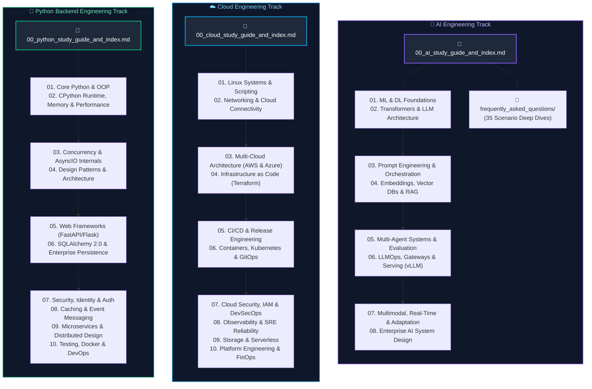

# Supplemental Engineering Tracks

A comprehensive collection of production-grade engineering curricula covering specialized software disciplines: **AI Engineering**, **Cloud Engineering**, and **Python Backend Engineering**.

Each track adheres strictly to the repository's 10-module linear curriculum standard, accompanied by scenario-based interview question deep dives and production failure post-mortems.

For the repository's primary focus tracks and universal interview resources, refer to:
- **Core Engineering Tracks**:
  - [Data Engineering](../Data%20Engineering/00_de_study_guide_and_index.md)
  - [Java Backend Engineering](../Java%20Backend%20Engineering/00_java_study_guide_and_index.md)
- **Universal Interview Preparation**:
  - [Supplemental Resources](../Supplemental%20Resources/README.md) (DSA, System Design HLD/LLD, and Behavioral Leadership)
- **Repository Root**:
  - [Main Repository Overview](../README.md)

---

## Architectural Overview: Specialized Engineering Tracks

---

## 1. [AI Engineering](AI%20Engineering/00_ai_study_guide_and_index.md)

Comprehensive guides covering applied machine learning, neural architectures, generative AI, vector retrieval, autonomous agent architectures, and high-throughput GPU inference serving.

- **Master Track Syllabus**: [00. AI Engineering Study Guide & Master Index](AI%20Engineering/00_ai_study_guide_and_index.md)
- **Core Curriculum Modules**:
  - **Foundations & Neural Architectures**:
    - [`01. ML & Deep Learning Fundamentals`](AI%20Engineering/01_machine_learning_and_deep_learning.md) — Loss surfaces, backpropagation computational graphs, numerical stability, AdamW optimizer mechanics, and regularization.
    - [`02. LLM & Transformer Architecture`](AI%20Engineering/02_llm_and_transformer_architecture.md) — Self-attention matrix equations, Multi-Head vs. GQA/MQA, KV cache memory footprint, Rotary Position Embeddings (RoPE), and Mixture-of-Experts (MoE).
  - **Orchestration & Knowledge Systems**:
    - [`03. Prompt Engineering & Context Design`](AI%20Engineering/03_prompt_engineering_and_context_design.md) — Tokenizer boundaries, Few-shot prompting, structured output enforcement (Instructor/Pydantic), and context window caching.
    - [`04. Embeddings, Vector DBs & RAG`](AI%20Engineering/04_embeddings_vector_databases_and_rag.md) — Dense vs sparse embeddings (ColBERT/SPLADE), HNSW graph indexing, IVF-PQ quantization, rerankers, and hybrid search.
  - **Cognitive Agents & Security**:
    - [`05. AI Agents & Multi-Agent Systems`](AI%20Engineering/05_ai_agents_and_multi_agent_systems.md) — ReAct loops, planning algorithms, state machine harnesses (LangGraph), memory stores, and distributed multi-agent collaboration.
    - [`06. LLM Evaluation & Security`](AI%20Engineering/06_llm_evaluation_and_security.md) — LLM-as-a-judge frameworks, G-Eval, RAG triads, prompt injection mitigations, and red-teaming harnesses.
  - **Operations & Serving Platforms**:
    - [`07. LLMOps & Production Gateways`](AI%20Engineering/07_llmops_and_model_gateways.md) — Model gateways, semantic caching (GPTCache), token-bucket rate limiting, telemetry, and observability.
    - [`08. AI Cloud Infrastructure & Serving`](AI%20Engineering/08_ai_infrastructure_and_serving.md) — GPU kernel optimization, PagedAttention, continuous batching (vLLM, TensorRT-LLM), and Triton inference servers.
  - **Real-Time & Systems Design**:
    - [`09. Multimodal AI & Real-Time Systems`](AI%20Engineering/09_multimodal_and_realtime_ai.md) — Vision Transformers (ViT), cross-attention fusion, text-to-speech, whisper transcription, and WebRTC streaming.
    - [`10. Model Adaptation & Enterprise AI Design`](AI%20Engineering/10_model_adaptation_and_system_design.md) — Parameter-efficient fine-tuning (LoRA, QLoRA), Direct Preference Optimization (DPO), knowledge distillation, and enterprise AI architecture.
- **Interview Question Bank & Deep-Dive Solutions**:
  - [AI Interview FAQs Master Study Guide & Question Bank](AI%20Engineering/frequently_asked_questions/00_ai_faq_study_guide_and_index.md)
  - [`01. ML & Deep Learning Scenario Solutions`](AI%20Engineering/frequently_asked_questions/01_machine_learning_and_deep_learning_faq.md)
  - [`02. LLM & Transformer Architecture Scenario Solutions`](AI%20Engineering/frequently_asked_questions/02_llm_and_transformer_architecture_faq.md)
  - [`03. Prompt Engineering & Context Design Scenario Solutions`](AI%20Engineering/frequently_asked_questions/03_prompt_engineering_and_context_design_faq.md)

---

## 2. [Cloud Engineering](Cloud%20Engineering/00_cloud_study_guide_and_index.md)

Concept-first, production-grade curriculum spanning Linux OS internals, software-defined networking, multi-cloud enterprise paradigms (AWS & Azure), Infrastructure as Code (Terraform), release engineering, Kubernetes & GitOps, DevSecOps, observability, Site Reliability Engineering, distributed databases, serverless architectures, and FinOps.

- **Master Track Syllabus**: [00. Cloud Engineering Study Guide & Master Index](Cloud%20Engineering/00_cloud_study_guide_and_index.md)
- **Core Curriculum Modules**:
  - **Foundations & Networking**:
    - [`01. Linux OS & Shell Scripting`](Cloud%20Engineering/01_linux_systems_and_scripting.md) — Kernel architecture, process scheduling (CFS), virtual memory, file descriptors, `epoll`, and defensive bash scripting.
    - [`02. Networking & Cloud Connectivity`](Cloud%20Engineering/02_networking_and_cloud_connectivity.md) — TCP 3-way handshake, TLS 1.3 cryptographic handshakes, DNS resolution, BGP routing, VPN tunnels, and AWS DirectConnect / Azure ExpressRoute.
  - **Cloud Architecture & IaC**:
    - [`03. Cloud Fundamentals & Multi-Cloud Architecture`](Cloud%20Engineering/03_cloud_foundations_and_multicloud.md) — AWS & Azure landing zones, VPC/VNet peering, hub-and-spoke topologies, and multi-region resilience.
    - [`04. Infrastructure as Code (IaC)`](Cloud%20Engineering/04_infrastructure_as_code.md) — Terraform lifecycle, DAG state resolution, remote locking, state manipulation, and Terragrunt modular patterns.
  - **CI/CD, Containers & Security**:
    - [`05. CI/CD & Release Engineering`](Cloud%20Engineering/05_cicd_and_release_engineering.md) — GitHub Actions, GitLab CI, artifact registries, blue-green & canary deployments, and automated rollbacks.
    - [`06. Containers, Kubernetes & GitOps`](Cloud%20Engineering/06_containers_kubernetes_and_gitops.md) — Linux cgroups & namespaces, OCI runtime mechanics, etcd clustering, kube-scheduler, CNI/CSI, and ArgoCD GitOps.
    - [`07. Cloud Security, IAM & DevSecOps`](Cloud%20Engineering/07_cloud_security_iam_and_devsecops.md) — Least-privilege IAM, STS assumed roles, OIDC federation, secrets management (Vault), and container vulnerability scanning.
  - **Reliability & Platform Operations**:
    - [`08. Observability & SRE Reliability Engineering`](Cloud%20Engineering/08_observability_and_reliability.md) — Metrics (Prometheus), structured logs (OpenSearch), distributed tracing (OpenTelemetry/Jaeger), SLI/SLO error budgets, and chaos engineering.
    - [`09. Distributed Storage & Serverless Architectures`](Cloud%20Engineering/09_cloud_databases_and_storage.md) — Cloud databases (RDS, Aurora, Cosmos DB), object stores (S3, ADLS), serverless execution (AWS Lambda, Azure Functions), and event-driven backplanes.
    - [`10. Platform Engineering & FinOps`](Cloud%20Engineering/10_platform_engineering_and_finops.md) — Internal Developer Platforms (IDPs), Backstage, cloud unit economics, AWS Cost Explorer, reserved instances, and FinOps maturity models.

---

## 3. [Python Backend Engineering](Python%20Backend%20Engineering/00_python_study_guide_and_index.md)

Comprehensive, production-grade curriculum spanning CPython runtime mechanics, object model internals, advanced metaprogramming, high-concurrency AsyncIO, Clean/Hexagonal architecture, web framework internals (FastAPI & Flask), SQLAlchemy 2.0 enterprise persistence, API security, and distributed systems operations.

- **Master Track Syllabus**: [00. Python Backend Engineering Study Guide & Master Index](Python%20Backend%20Engineering/00_python_study_guide_and_index.md)
- **Core Curriculum Modules**:
  - **Language, Runtime & Tooling**:
    - [`01. Core Python & OOP`](Python%20Backend%20Engineering/01_core_python_and_oop.md) — Object model, dynamic dispatch, MRO (C3 Linearization), descriptors, metaclasses, and protocol structural subtyping.
    - [`02. CPython Runtime, Memory & Performance`](Python%20Backend%20Engineering/02_cpython_runtime_and_memory.md) — CPython virtual machine evaluation loop, reference counting, generational cyclic GC, PyMalloc pools, and GIL internals.
  - **Concurrency & Architecture**:
    - [`03. Concurrency & Async Programming`](Python%20Backend%20Engineering/03_python_concurrency_and_asyncio.md) — AsyncIO event loop (`epoll`/`kqueue`), Coroutine state machines, Task cancellation semantics, and Thread/Process Pool executors.
    - [`04. Design Patterns & Architecture`](Python%20Backend%20Engineering/04_design_patterns_and_architecture.md) — Clean & Hexagonal (Ports & Adapters) architectures, Dependency Injection, Domain-Driven Design (DDD), and SOLID implementation.
  - **Web Frameworks & Persistence**:
    - [`05. Web Frameworks & API Protocols`](Python%20Backend%20Engineering/05_web_frameworks_and_api_protocols.md) — ASGI vs WSGI runtime architectures, FastAPI request validation pipelines, Pydantic v2 performance, WebSockets, and gRPC.
    - [`06. Databases & SQLAlchemy ORM`](Python%20Backend%20Engineering/06_databases_and_sqlalchemy_orm.md) — SQLAlchemy 2.0 Core vs ORM, Session lifecycles, Unit of Work pattern, connection pool sizing, and N+1 query optimization.
  - **Security & Event Messaging**:
    - [`07. Security, Identity & Auth`](Python%20Backend%20Engineering/07_security_and_authentication.md) — JWT & OAuth2 flows, password hashing (Argon2/bcrypt), RBAC/ABAC authorization, and OWASP Top 10 defenses.
    - [`08. Caching & Event Messaging`](Python%20Backend%20Engineering/08_caching_redis_and_kafka.md) — Redis caching strategies (Cache-Aside, Write-Through), distributed locking (Redlock), and Kafka/RabbitMQ asynchronous consumers.
  - **Distributed Systems & DevOps**:
    - [`09. Microservices & System Design`](Python%20Backend%20Engineering/09_microservices_and_system_design.md) — Service-to-service communication, circuit breakers, idempotency keys, distributed sagas, and outbox patterns.
    - [`10. Testing, Observability & DevOps`](Python%20Backend%20Engineering/10_testing_docker_and_devops.md) — Pytest fixtures, testcontainers, Docker multi-stage builds, OpenTelemetry instrumentation, and structured logging.

