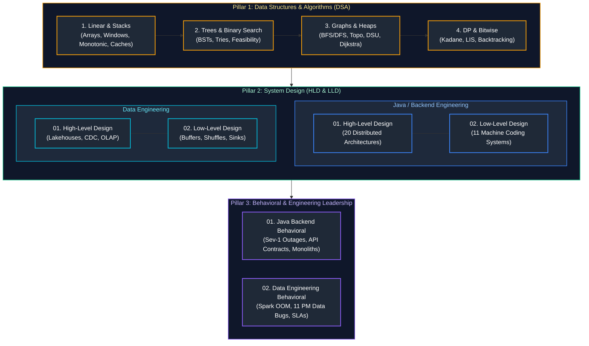

# Interview Foundations: Study Guide & Master Index

A comprehensive, production-grade guide covering universal software engineering foundations: Behavioral & Engineering Leadership, High-Level Design (HLD), Low-Level Design (LLD) & Machine Coding, and Data Structures & Algorithms (DSA), categorized across **Java / Backend Engineering** and **Data Engineering**.

---

## Recommended Chronological Study Order

---

## Foundations Coverage & Directory Overview

### 1. Behavioral & Engineering Leadership
| Guide File | Target Role | Key Scenarios & Production Themes Covered |
| :--- | :--- | :--- |
| [`01_java_backend_behavioral.md`](Behavioral%20&%20Leadership/01_java_backend_behavioral.md) | Java / Backend Engineers | Sev-1 incident command, cascading microservice thread pool exhaustion, JVM memory leaks & GC pauses, database deadlocks & connection pool sizing, pushing back on premature microservices, resolving REST vs. event-driven stalemates, delivering under tight product launch deadlines, expand-contract breaking API changes, and code review conflict resolution. |
| [`02_data_engineering_behavioral.md`](Behavioral%20&%20Leadership/02_data_engineering_behavioral.md) | Data Engineers | Sev-1 Black Friday data skew OOM, 11 PM critical data quality discrepancy before 9 AM board meeting, pipeline failures affecting business revenue, Spark ETL optimization (6.7h to 48m), Spark cluster cost optimization vs. SLAs, distinguishing infra vs. data defects, Azure + Databricks + Snowflake hybrid architectures, and CI/CD for Spark/ADF. |

---

### 2. System Design Track (HLD & LLD)
| Engineering Track | Design Level | Guide File | Key Architectures & Scenarios Covered |
| :--- | :--- | :--- | :--- |
| **Java Backend** | **High-Level Design** | [`01_high_level_design.md`](System%20Design/Java%20Backend%20Engineering/01_high_level_design.md) | Scalable URL Shortener (bit.ly), Multi-Region Active-Active URL Shortener, Distributed API Rate Limiter, Global CDN, 64-bit Snowflake ID Generator, Real-Time Chat (WhatsApp/Slack), Distributed Notification Engine, Video Streaming (YouTube/Netflix), Payments (Stripe), Flash Sale Checkout, Ride-Hailing (Uber), Uber Eats Homepage, Distributed Cache (Redis), File Storage (Dropbox), Autocomplete, Collaborative Docs, Job Scheduler, Generic Workflow Engine, Feed, and Billion-Scale Graph Search. |
| **Java Backend** | **Low-Level Design** | [`02_low_level_design.md`](System%20Design/Java%20Backend%20Engineering/02_low_level_design.md) | Custom Bounded Queue & ThreadPool from scratch (no `ExecutorService`), Concurrent Sorted Linked List (ReadWriteLock), Segmented File Manager with byte-range locking, DAG Job Scheduler with dependency resolution, Playground Player Assignment with anti-starvation, Train & Platform Scheduler, In-Memory Twitter, In-Memory Pull-Based Message Queue, In-Memory Filesystem (`mkdir`, `pwd`, `cd` with wildcards), Rule Engine (AST/Composite), and Spotify LLD. |
| **Data Engineering** | **High-Level Design** | [`01_high_level_design.md`](System%20Design/Data%20Engineering/01_high_level_design.md) | Enterprise Multi-Hop Medallion Lakehouse (Bronze/Silver/Gold), Change Data Capture (CDC) at Petabyte Scale (Debezium + Kafka + Delta Lake), Sub-Second Real-Time OLAP Serving (ClickHouse / Apache Pinot), High-Throughput Geospatial Telemetry Ingestion (100M GPS pings/day), Hybrid Multi-Cloud Data Platforms, and Cross-Region Disaster Recovery (RPO/RTO). |
| **Data Engineering** | **Low-Level Design** | [`02_low_level_design.md`](System%20Design/Data%20Engineering/02_low_level_design.md) | High-Throughput In-Memory Streaming Ring Buffer with Backpressure (Disruptor pattern), Stateful Sliding-Window Deduplication Engine, Custom Shuffle Partitioner & Disk Spill Manager (Spark-style), Columnar Row-Group Reader with Dictionary & Run-Length Encoding (RLE), Schema Evolution Compatibility Validator, and Resilient Database Batch Sink with DLQ. |

---

### 3. Data Structures & Algorithms (DSA Track)
| Module Order | Guide File | Conceptual Focus & Algorithmic Patterns Covered |
| :---: | :--- | :--- |
| **Index** | [`00_dsa_study_guide_and_index.md`](Data%20Structures%20&%20Algorithms/00_dsa_study_guide_and_index.md) | Master syllabus, 8-module progression roadmap, complexity cheat-sheet, and pattern-to-problem matrix. |
| **01** | [`01_linear_structures_and_pointer_patterns.md`](Data%20Structures%20&%20Algorithms/01_linear_structures_and_pointer_patterns.md) | CPU cache line locality, Convergent Two Pointers, Fast & Slow Pointers, Sliding Window, Monotonic Deque, Cyclic Sort, and Prefix Sums. |
| **02** | [`02_linked_lists_stacks_and_monotonic_structures.md`](Data%20Structures%20&%20Algorithms/02_linked_lists_stacks_and_monotonic_structures.md) | Singly/Doubly Linked Lists, in-place reversal, reverse in $k$-groups, Min-Stack, Monotonic Stack/Deque, and complete $O(1)$ LRU & LFU Caches. |
| **03** | [`03_trees_binary_search_trees_and_tries.md`](Data%20Structures%20&%20Algorithms/03_trees_binary_search_trees_and_tries.md) | Binary Trees & BSTs, Inorder/Pre/Post traversals, Zigzag Level-Order BFS, LCA, Tree Serialization/Deserialization, and Multi-Way Prefix Tries. |
| **04** | [`04_binary_search_and_divide_and_conquer.md`](Data%20Structures%20&%20Algorithms/04_binary_search_and_divide_and_conquer.md) | Midpoint overflow, Rotated Sorted Array search, Binary Search on Answer / Feasibility Search, Merge Sort, and QuickSelect ($O(N)$ average). |
| **05** | [`05_heaps_intervals_and_greedy_algorithms.md`](Data%20Structures%20&%20Algorithms/05_heaps_intervals_and_greedy_algorithms.md) | Binary Heaps, $O(N)$ Heapify, Two Heaps (Continuous Running Median + $O(1)$ Loose Median), Top-K Frequent, Sweep-Line Intervals, and Greedy Decisions. |
| **06** | [`06_graphs_topological_sort_and_shortest_paths.md`](Data%20Structures%20&%20Algorithms/06_graphs_topological_sort_and_shortest_paths.md) | Adjacency representations, Bidirectional BFS (Word Ladder), 3-Color DFS Cycle Detection, Kahn's Topo Sort, Alien Dictionary, DSU with Rank, Dijkstra, 0-1 BFS, and Bellman-Ford. |
| **07** | [`07_dynamic_programming_and_state_transitions.md`](Data%20Structures%20&%20Algorithms/07_dynamic_programming_and_state_transitions.md) | Memoization vs Tabulation, State Space Compression, Kadane & Circular Maximum Subarray, Patience LIS ($O(N \log N)$), String DP (LCS & Edit Distance), Word Break, and Knapsack Patterns. |
| **08** | [`08_backtracking_and_bit_manipulation.md`](Data%20Structures%20&%20Algorithms/08_backtracking_and_bit_manipulation.md) | State tree pruning, Combinatorial Search (Subsets, Permutations), N-Queens, XOR algebraic cancellations, Single Number I/II/III, Brian Kernighan bit trick, and Bitmasking. |

---

## Production Problem & Architecture Master Cross-Reference Matrix

| Real-World Production Scenario / Problem | Canonical Pattern / Engineering Solution | Guide Reference |
| :--- | :--- | :--- |
| **Sev-1 Microservice Thread Pool Exhaustion** | Bulkheading, short timeouts, circuit breaker fallback | [`01_java_backend_behavioral.md`](Behavioral%20&%20Leadership/01_java_backend_behavioral.md#q1-mitigating-cascading-microservice-failures--thread-pool-exhaustion) |
| **Sev-1 Black Friday Data Skew / OOM** | Key salting (`floor(rand() * 16)`) and AQE partition coalescing | [`02_data_engineering_behavioral.md`](Behavioral%20&%20Leadership/02_data_engineering_behavioral.md#q1q5-production-incident-response-under-pressure--failure-prevention) |
| **Critical 11 PM Data Discrepancy** | Delta Time Travel snapshot pin + executive disclaimer banner | [`02_data_engineering_behavioral.md`](Behavioral%20&%20Leadership/02_data_engineering_behavioral.md#q6--q7-11-pm-critical-data-quality-outage-before-9-am-executive-report) |
| **Flash Sale Inventory Over-Selling** | 2-Tier in-memory atomic Redis reservation + async payment queue | [`01_high_level_design.md`](System%20Design/Java%20Backend%20Engineering/01_high_level_design.md#q10-design-an-e-commerce-checkout-system) |
| **Global Multi-Region Active-Active URL Redirects**| Partitioned ID ranges per datacenter + Spanner multi-master sync | [`01_high_level_design.md`](System%20Design/Java%20Backend%20Engineering/01_high_level_design.md#q2-multi-region-url-shortener-architecture-with-global-active-active-coordination) |
| **Sub-Second User Analytical Dashboards** | Real-Time OLAP (ClickHouse / Pinot) with sparse primary indexing | [`01_high_level_design.md`](System%20Design/Data%20Engineering/01_high_level_design.md#de-hld-3-sub-second-real-time-olap-serving-architecture-clickhouse--apache-pinot) |
| **Custom ThreadPool & Bounded Queue** | ReentrantLock + `notFull` & `notEmpty` Condition variables | [`02_low_level_design.md`](System%20Design/Java%20Backend%20Engineering/02_low_level_design.md#lld-1-implement-a-thread-safe-bounded-blocking-queue--custom-thread-pool-no-executorservice) |
| **High-Throughput Streaming Backpressure** | Lock-free circular ring buffer with atomic sequence barriers | [`02_low_level_design.md`](System%20Design/Data%20Engineering/02_low_level_design.md#de-lld-1-design-a-high-throughput-in-memory-streaming-ring-buffer-with-backpressure) |
| **$O(1)$ Memory Cache Eviction** | Doubly-linked list with sentinels + HashMap pointer index | [`02_linked_lists_stacks_and_monotonic_structures.md`](Data%20Structures%20&%20Algorithms/02_linked_lists_stacks_and_monotonic_structures.md#51-least-recently-used-lru-cache-implementation) |
| **Continuous Unbounded Stream Median** | Dual Heaps (Max-Heap lower half + Min-Heap upper half) | [`05_heaps_intervals_and_greedy_algorithms.md`](Data%20Structures%20&%20Algorithms/05_heaps_intervals_and_greedy_algorithms.md#21-find-median-from-data-stream-leetcode-295) |
| **Exponential Graph Search Space** | Bidirectional BFS expanding alternating smaller frontiers | [`06_graphs_topological_sort_and_shortest_paths.md`](Data%20Structures%20&%20Algorithms/06_graphs_topological_sort_and_shortest_paths.md#22-bidirectional-bfs-word-ladder-leetcode-127) |
| **Bounded Capacity Resource Sizing** | Binary Search on Answer with monotonic feasibility predicate | [`04_binary_search_and_divide_and_conquer.md`](Data%20Structures%20&%20Algorithms/04_binary_search_and_divide_and_conquer.md#22-capacity-to-ship-packages-within-d-days) |

---

## References & Further Reading
- Martin Kleppmann, *Designing Data-Intensive Applications* (O'Reilly).
- Thomas H. Cormen et al., *Introduction to Algorithms (CLRS)*, 4th Edition (MIT Press).
- Brian Goetz, *Java Concurrency in Practice* (Addison-Wesley).
- Alex Xu, *System Design Interview – An Insider's Guide* (Vol 1 & 2).
- Joe Reis & Matt Housley, *Fundamentals of Data Engineering* (O'Reilly).

