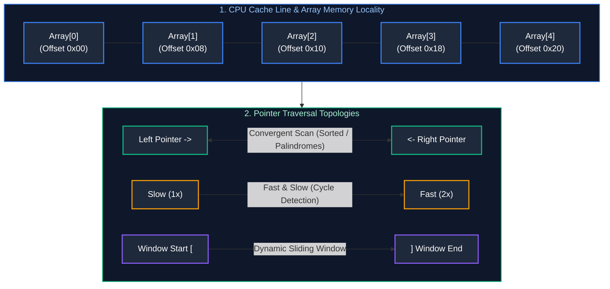

# 01. Linear Structures & Pointer Patterns

A comprehensive, production-grade guide to Arrays, Strings, Two Pointers, Fast & Slow Pointers, Sliding Window, Cyclic Sort, and Prefix Sums / Difference Arrays.

---

## Architectural Overview: Linear Memory Mechanics & Pointer Topologies



---

## Table of Contents
1. [Core Memory Mechanics & Hardware Cache Lines](#1-core-memory-mechanics--hardware-cache-lines)
2. [The Two Pointers Pattern](#2-the-two-pointers-pattern)
   - 2.1 [Convergent Pointers (Pair Sum, Trapping Rain Water)](#21-convergent-pointers)
   - 2.2 [Partitioning & Collision Pointers (Sort Colors, 3-Sum)](#22-partitioning--collision-pointers)
3. [Fast & Slow Pointers (Floyd's Tortoise and Hare)](#3-fast--slow-pointers-floyds-tortoise-and-hare)
4. [The Sliding Window Pattern](#4-the-sliding-window-pattern)
   - 4.1 [Fixed-Size Sliding Window](#41-fixed-size-sliding-window)
   - 4.2 [Dynamic / Variable-Size Sliding Window (At Most K Distinct)](#42-dynamic--variable-size-sliding-window)
   - 4.3 [Monotonic Deque Window (Longest Subarray with Max-Min Limit)](#43-monotonic-deque-window)
5. [The Cyclic Sort Pattern](#5-the-cyclic-sort-pattern)
6. [Prefix Sums & Difference Arrays](#6-prefix-sums--difference-arrays)
7. [Practice Problems by Difficulty Tier](#7-practice-problems-by-difficulty-tier)
8. [Summary & Engineering Reference Matrix](#8-summary--engineering-reference-matrix)
9. [References & Further Reading](#9-references--further-reading)

---

# 1. Core Memory Mechanics & Hardware Cache Lines

In modern computer architectures, an array is a contiguous memory allocation:
$$\text{Address}(A[i]) = \text{BaseAddress} + (i \times \text{ElementSize})$$
Because elements reside contiguously, CPU hardware prefetchers load full **64-byte cache lines** (L1/L2/L3 cache) on access. Traversing an array linearly incurs $O(1)$ amortized memory operations with near-zero cache misses ($L1$ hit $\approx 1\text{ns}$). In contrast, traversing scattered pointer-based structures (like linked lists or trees) incurs pointer chasing and cache misses ($DRAM$ access $\approx 50\text{--}100\text{ns}$).

---

# 2. The Two Pointers Pattern

### 2.1 Convergent Pointers

#### Core Concept
When an array is sorted or exhibits monotonic properties, two pointers initialized at opposite boundaries (`left = 0`, `right = n - 1`) can inspect candidate pairs. Moving `left` rightward increases the sum; moving `right` leftward decreases the sum. This eliminates nested loops, reducing $O(N^2)$ brute force to $O(N)$ linear time.

#### Canonical Implementation: Two Sum II & 3-Sum (Java)
```java
import java.util.*;

public class TwoPointersSolutions {

    // LeetCode 167: Two Sum II (Sorted Array) - Time: O(N), Space: O(1)
    public int[] twoSumSorted(int[] numbers, int target) {
        int left = 0, right = numbers.length - 1;
        while (left < right) {
            int sum = numbers[left] + numbers[right];
            if (sum == target) {
                return new int[]{left + 1, right + 1}; // 1-indexed
            } else if (sum < target) {
                left++; // Increase sum
            } else {
                right--; // Decrease sum
            }
        }
        return new int[]{-1, -1};
    }

    // LeetCode 15: 3-Sum - Time: O(N^2), Space: O(1) (excluding output list)
    public List<List<Integer>> threeSum(int[] nums) {
        Arrays.sort(nums);
        List<List<Integer>> result = new ArrayList<>();

        for (int i = 0; i < nums.length - 2; i++) {
            if (i > 0 && nums[i] == nums[i - 1]) continue; // Skip duplicates for i

            int left = i + 1, right = nums.length - 1;
            while (left < right) {
                int sum = nums[i] + nums[left] + nums[right];
                if (sum == 0) {
                    result.add(Arrays.asList(nums[i], nums[left], nums[right]));
                    while (left < right && nums[left] == nums[left + 1]) left++; // Skip duplicates
                    while (left < right && nums[right] == nums[right - 1]) right--;
                    left++;
                    right--;
                } else if (sum < 0) {
                    left++;
                } else {
                    right--;
                }
            }
        }
        return result;
    }
}
```

#### Trapping Rain Water ($O(1)$ Space Optimization)
Traditional dynamic programming tracks `leftMax[i]` and `rightMax[i]` in $O(N)$ space. Convergent two pointers maintain running `leftMax` and `rightMax` scalars, advancing whichever side is smaller because water height is bottlenecked strictly by the shorter boundary:
```java
// LeetCode 42: Trapping Rain Water - Time: O(N), Space: O(1)
public int trap(int[] height) {
    if (height == null || height.length == 0) return 0;
    int left = 0, right = height.length - 1;
    int leftMax = 0, rightMax = 0;
    int totalWater = 0;

    while (left < right) {
        if (height[left] < height[right]) {
            if (height[left] >= leftMax) {
                leftMax = height[left];
            } else {
                totalWater += leftMax - height[left];
            }
            left++;
        } else {
            if (height[right] >= rightMax) {
                rightMax = height[right];
            } else {
                totalWater += rightMax - height[right];
            }
            right--;
        }
    }
    return totalWater;
}
```

---

# 3. Fast & Slow Pointers (Floyd's Tortoise and Hare)

### Core Concept
Two pointers move across a sequence at differing speeds (typically `slow` moves 1 step; `fast` moves 2 steps).
- **Cycle Detection:** If a cycle exists, the distance between pointers decreases by 1 step per iteration, guaranteeing collision in $O(N)$ time.
- **Cycle Entry Point Proof:** If distance from head to cycle entrance is $L$, distance from entrance to meeting point is $k$, and cycle length is $C$:
  $$2(L + k) = L + k + mC \implies L = mC - k$$
  Advancing one pointer from `head` and one from the `meeting point` at speed 1 guarantees collision exactly at the cycle entrance!

#### Implementation: Find Duplicate Number (LeetCode 287)
```java
// LeetCode 287: Find Duplicate Number (Floyd's Cycle on Array Indices) - Time: O(N), Space: O(1)
public int findDuplicate(int[] nums) {
    int slow = nums[0];
    int fast = nums[0];

    // Phase 1: Locate intersection in cycle
    do {
        slow = nums[slow];
        fast = nums[nums[fast]];
    } while (slow != fast);

    // Phase 2: Find cycle entrance
    slow = nums[0];
    while (slow != fast) {
        slow = nums[slow];
        fast = nums[fast];
    }
    return slow;
}
```

---

# 4. The Sliding Window Pattern

### 4.1 Fixed-Size Sliding Window
A window of fixed length $K$ slides across the array. Elements enter at `right` and leave at `right - K`, updating running state in $O(1)$ per step.

### 4.2 Dynamic / Variable-Size Sliding Window
The window expands rightward (`right++`) until a validity condition is breached, then contracts from the left (`left++`) until valid again.

```java
// Longest Substring with At Most K Distinct Characters - Time: O(N), Space: O(K)
public int lengthOfLongestSubstringKDistinct(String s, int k) {
    if (s == null || k == 0) return 0;
    Map<Character, Integer> counts = new HashMap<>();
    int left = 0, maxLength = 0;

    for (int right = 0; right < s.length(); right++) {
        char rChar = s.charAt(right);
        counts.put(rChar, counts.getOrDefault(rChar, 0) + 1);

        while (counts.size() > k) {
            char lChar = s.charAt(left);
            counts.put(lChar, counts.get(lChar) - 1);
            if (counts.get(lChar) == 0) counts.remove(lChar);
            left++;
        }
        maxLength = Math.max(maxLength, right - left + 1);
    }
    return maxLength;
}
```

### 4.3 Monotonic Deque Window (Longest Subarray with Max-Min Limit)
**Problem:** *Find longest subarray where $\max(\text{window}) - \min(\text{window}) \le \text{limit}$ (LeetCode 1438).*
Using a Monotonic Decreasing Deque (for max) and Monotonic Increasing Deque (for min) gives $O(1)$ queries for window extrema!

```java
import java.util.ArrayDeque;
import java.util.Deque;

public int longestSubarray(int[] nums, int limit) {
    Deque<Integer> maxDeque = new ArrayDeque<>();
    Deque<Integer> minDeque = new ArrayDeque<>();
    int left = 0, maxLength = 0;

    for (int right = 0; right < nums.length; right++) {
        while (!maxDeque.isEmpty() && nums[right] > maxDeque.peekLast()) maxDeque.pollLast();
        while (!minDeque.isEmpty() && nums[right] < minDeque.peekLast()) minDeque.pollLast();
        maxDeque.addLast(nums[right]);
        minDeque.addLast(nums[right]);

        // If max - min exceeds limit, shrink window from left
        while (!maxDeque.isEmpty() && !minDeque.isEmpty() && (maxDeque.peekFirst() - minDeque.peekFirst() > limit)) {
            if (maxDeque.peekFirst() == nums[left]) maxDeque.pollFirst();
            if (minDeque.peekFirst() == nums[left]) minDeque.pollFirst();
            left++;
        }

        maxLength = Math.max(maxLength, right - left + 1);
    }
    return maxLength;
}
```

---

# 5. The Cyclic Sort Pattern

### Core Concept
Applicable when input values lie within a continuous range $[1, N]$ or $[0, N-1]$. Every number $V$ belongs at index $V - 1$. We iterate through the array, swapping each misplaced number to its correct index until every element is in place in $O(N)$ time with $O(1)$ space.

```java
// LeetCode 41: First Missing Positive - Time: O(N), Space: O(1)
public int firstMissingPositive(int[] nums) {
    int n = nums.length;
    int i = 0;
    while (i < n) {
        int correctIdx = nums[i] - 1;
        if (nums[i] > 0 && nums[i] <= n && nums[i] != nums[correctIdx]) {
            int temp = nums[i];
            nums[i] = nums[correctIdx];
            nums[correctIdx] = temp;
        } else {
            i++;
        }
    }

    for (int j = 0; j < n; j++) {
        if (nums[j] != j + 1) return j + 1;
    }
    return n + 1;
}
```

---

# 6. Prefix Sums & Difference Arrays

- **Prefix Sum Array:** $P[i] = P[i-1] + A[i]$. Enables $O(1)$ range sum queries: $\text{sum}(L, R) = P[R] - P[L-1]$.
- **Difference Array:** $D[i] = A[i] - A[i-1]$. Enables $O(1)$ range updates: adding $V$ to range $[L, R]$ requires only $D[L] \mathrel{+}= V$ and $D[R+1] \mathrel{-}= V$.

---

# 7. Practice Problems by Difficulty Tier

| Difficulty | Problem Name | Core Pattern | LeetCode Link | Complexity |
| :---: | :--- | :--- | :---: | :---: |
| **Easy** | Two Sum II | Convergent Two Pointers | LC 167 | $O(N) \text{ time}, O(1) \text{ space}$ |
| **Easy** | Move Zeroes | Fast & Slow Pointers | LC 283 | $O(N) \text{ time}, O(1) \text{ space}$ |
| **Medium** | 3-Sum | Sorted Array + Two Pointers | LC 15 | $O(N^2) \text{ time}, O(1) \text{ space}$ |
| **Medium** | Longest Substring Without Repeating Characters | Dynamic Sliding Window | LC 3 | $O(N) \text{ time}, O(\min(N, \Sigma)) \text{ space}$ |
| **Medium** | Container With Most Water | Convergent Two Pointers | LC 11 | $O(N) \text{ time}, O(1) \text{ space}$ |
| **Medium** | Longest Subarray with Max-Min Diff Limit | Monotonic Deque Window | LC 1438 | $O(N) \text{ time}, O(N) \text{ space}$ |
| **Hard** | Trapping Rain Water | Two Pointers (Boundary Max) | LC 42 | $O(N) \text{ time}, O(1) \text{ space}$ |
| **Hard** | First Missing Positive | Cyclic Sort In-Place | LC 41 | $O(N) \text{ time}, O(1) \text{ space}$ |
| **Hard** | Minimum Window Substring | Sliding Window with Char Counts | LC 76 | $O(N + M) \text{ time}, O(\Sigma) \text{ space}$ |

---

# 8. Summary & Engineering Reference Matrix

| Algorithmic Pattern | When to Apply | Pointer Invariant | Complexity | Common Trap |
| :--- | :--- | :--- | :--- | :--- |
| **Convergent Pointers** | Sorted array, palindromes, container bounds | `left` and `right` converge | $O(N) \text{ time}, O(1) \text{ space}$ | Forgetting to sort array first; off-by-one boundary |
| **Fast & Slow** | Cycle detection, middle of list, duplicate number | `slow` advances 1, `fast` advances 2 | $O(N) \text{ time}, O(1) \text{ space}$ | Null pointer exception on `fast.next.next` |
| **Sliding Window** | Contiguous subarrays/substrings, min/max length | Expand `right`, contract `left` | $O(N) \text{ time}, O(K) \text{ space}$ | Forgetting to update hash frequency counts on shrink |
| **Monotonic Deque** | Window min/max queries under dynamic constraints | Elements in deque remain monotonically ordered | $O(N) \text{ time}, O(K) \text{ space}$ | Polling elements not matching `left` pointer index |
| **Cyclic Sort** | Numbers bounded in $[1, N]$ or $[0, N-1]$ | Number belongs at `nums[i] - 1` | $O(N) \text{ time}, O(1) \text{ space}$ | Infinite loop when swapping identical duplicate numbers |
| **Prefix Sums** | Static range sum queries, subarray sum equals $K$ | $P[R] - P[L-1]$ | $O(1) \text{ query}, O(N) \text{ precompute}$ | Integer overflow on sum; 1-based indexing misalignment |

---

# 9. References & Further Reading
- Cormen, Leiserson, Rivest, Stein, *Introduction to Algorithms (CLRS)*, 4th Edition (MIT Press).
- Robert Sedgewick & Kevin Wayne, *Algorithms*, 4th Edition (Addison-Wesley).
- Jon Bentley, *Programming Pearls: Column 8 (Algorithm Design Techniques)*.

