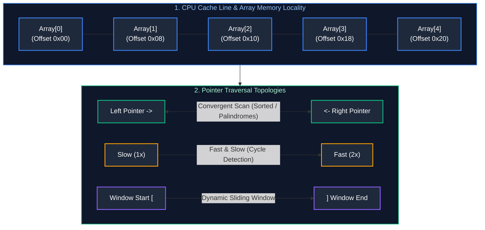
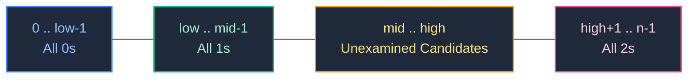

# 01. Linear Structures & Pointer Patterns

A comprehensive, production-grade guide to Arrays, Strings, Two Pointers, Fast & Slow Pointers, Sliding Window, Cyclic Sort, and Prefix Sums / Difference Arrays.

---

## Architectural Overview: Linear Memory Mechanics & Pointer Topologies



---

## Table of Contents
1. [Core Memory Mechanics & Hardware Cache Lines](#1-core-memory-mechanics--hardware-cache-lines)
2. [The Two Pointers Pattern](#2-the-two-pointers-pattern)
   - 2.1 [Convergent Pointers (Pair Sum, Trapping Rain Water)](#21-convergent-pointers-pair-sum-trapping-rain-water)
   - 2.2 [Partitioning & Collision Pointers (Dutch National Flag & Sort Colors)](#22-partitioning--collision-pointers-dutch-national-flag--sort-colors)
3. [Fast & Slow Pointers (Floyd's Tortoise and Hare)](#3-fast--slow-pointers-floyds-tortoise-and-hare)
4. [The Sliding Window Pattern](#4-the-sliding-window-pattern)
   - 4.1 [Fixed-Size Sliding Window](#41-fixed-size-sliding-window)
   - 4.2 [Dynamic / Variable-Size Sliding Window (At Most K Distinct)](#42-dynamic--variable-size-sliding-window-at-most-k-distinct)
   - 4.3 [Monotonic Deque Window (Longest Subarray with Max-Min Limit)](#43-monotonic-deque-window-longest-subarray-with-max-min-limit)
5. [The Cyclic Sort Pattern](#5-the-cyclic-sort-pattern)
6. [Prefix Sums & Difference Arrays](#6-prefix-sums--difference-arrays)
7. [Practice Problems by Difficulty Tier](#7-practice-problems-by-difficulty-tier)
8. [Summary & Engineering Reference Matrix](#8-summary--engineering-reference-matrix)
9. [References & Further Reading](#9-references--further-reading)

---

# 1. Core Memory Mechanics & Hardware Cache Lines

Understanding linear data structures begins at the hardware level. In modern computing architectures (x86_64 and ARM64), an array represents a single contiguous block of physical or virtual memory:

$$\text{Address}(A[i]) = \text{BaseAddress} + (i \times \text{ElementSize})$$

Because memory is contiguous, index calculation is a pure $O(1)$ arithmetic operation. However, the true performance advantage of arrays over pointer-based collections (such as linked lists or trees) stems from **CPU cache hierarchies and memory locality**:

1. **Hardware Cache Lines & Spatial Locality:** Modern CPUs transfer memory between main memory (DRAM) and CPU caches (L1, L2, L3) in fixed-size blocks called **cache lines**—almost universally **64 bytes** in width. When an instruction reads `A[0]`, the hardware prefetcher pulls the entire 64-byte boundary enclosing `A[0]` into the L1 data cache. If each integer is 4 bytes, accessing `A[0]` automatically primes `A[1]` through `A[15]` directly inside the L1 cache.
2. **Access Latency Disparity:**
   - **L1 Data Cache Hit:** $\approx 1\text{ to }1.5\text{ ns}$ (4 CPU cycles).
   - **L2 Cache Hit:** $\approx 3\text{ to }4\text{ ns}$ (12 CPU cycles).
   - **L3 Unified Cache Hit:** $\approx 10\text{ to }15\text{ ns}$ (40 CPU cycles).
   - **Main Memory DRAM Access:** $\approx 50\text{ to }100\text{ ns}$ (200+ CPU cycles).
3. **Sequential Stride vs. Pointer Chasing:** Sequential array iteration (`A[i]`, then `A[i+1]`) operates at maximum hardware efficiency. The hardware stream prefetcher detects unit-stride memory access patterns and aggressively prefetches downstream cache lines into L2/L1 before the instruction pipeline even requests them. Conversely, traversing nodes in a linked list or binary tree requires dereferencing scattered memory addresses ("pointer chasing"), triggering frequent L1/L2 cache misses that stall CPU execution pipelines.
4. **Dynamic Resizing & Amortized Complexity:** Resizable arrays (e.g., `ArrayList` in Java, `std::vector` in C++, or `list` in Python) reserve capacity beyond their immediate size. When capacity is exhausted, the runtime allocates a new memory block of geometrically scaled size (typically $1.5\times$ in Java or $2.0\times$ in Python/C++), copies existing elements, and releases the old buffer. While an individual expansion requires $O(N)$ copies, appending $N$ sequential elements incurs $O(N)$ total copy operations, yielding a guaranteed **$O(1)$ amortized insertion time**.

---

# 2. The Two Pointers Pattern

The Two Pointers pattern replaces nested loops ($O(N^2)$ brute force) with coordinated pointer traversals operating in $O(N)$ linear time. The technique relies on identifying a monotonic property or boundary invariant that allows eliminating entire sub-ranges of search candidates in constant time.

### 2.1 Convergent Pointers (Pair Sum, Trapping Rain Water)

#### Theoretical Foundations & Invariant Elimination
In convergent two-pointer traversals, two pointers are initialized at opposite ends of a sequence: `left = 0` and `right = n - 1`. The pointers march inward toward each other until they meet.

Consider a sorted array $A$ where we seek two indices such that $A[\text{left}] + A[\text{right}] = \text{target}$:
- If $A[\text{left}] + A[\text{right}] < \text{target}$: Because $A$ is sorted monotonically, for the current `left`, any index $k \le \text{right}$ would produce $A[\text{left}] + A[k] \le A[\text{left}] + A[\text{right}] < \text{target}$. Thus, index `left` cannot pair with **any** remaining candidate to satisfy the target. We can safely increment `left++`, eliminating an entire row of combinations in $O(1)$ time.
- If $A[\text{left}] + A[\text{right}] > \text{target}$: Symmetrically, for the current `right`, any index $j \ge \text{left}$ yields $A[j] + A[\text{right}] \ge A[\text{left}] + A[\text{right}] > \text{target}$. We can safely decrement `right--`.

#### Production Implementation: Two Sum II & 3-Sum (Java)
```java
import java.util.*;

public class TwoPointersSolutions {

    // LeetCode 167: Two Sum II (Sorted Array) - Time: O(N), Space: O(1)
    public int[] twoSumSorted(int[] numbers, int target) {
        if (numbers == null || numbers.length < 2) return new int[]{-1, -1};
        int left = 0, right = numbers.length - 1;

        while (left < right) {
            int sum = numbers[left] + numbers[right];
            if (sum == target) {
                return new int[]{left + 1, right + 1}; // 1-indexed specification
            } else if (sum < target) {
                left++; // Sum is too small; advance left boundary to larger values
            } else {
                right--; // Sum is too large; advance right boundary to smaller values
            }
        }
        return new int[]{-1, -1};
    }

    // LeetCode 15: 3-Sum - Time: O(N^2), Space: O(1) (excluding output storage)
    public List<List<Integer>> threeSum(int[] nums) {
        if (nums == null || nums.length < 3) return Collections.emptyList();
        Arrays.sort(nums); // Prerequisite: Sorting establishes monotonic invariant
        List<List<Integer>> result = new ArrayList<>();

        for (int i = 0; i < nums.length - 2; i++) {
            // Early pruning: If smallest remaining value > 0, three positives cannot sum to 0
            if (nums[i] > 0) break;

            // Deduplication: Avoid evaluating identical outer values
            if (i > 0 && nums[i] == nums[i - 1]) continue;

            int left = i + 1, right = nums.length - 1;
            while (left < right) {
                int sum = nums[i] + nums[left] + nums[right];
                if (sum == 0) {
                    result.add(Arrays.asList(nums[i], nums[left], nums[right]));
                    // Skip identical elements to prevent duplicate triplets in result
                    while (left < right && nums[left] == nums[left + 1]) left++;
                    while (left < right && nums[right] == nums[right - 1]) right--;
                    left++;
                    right--;
                } else if (sum < 0) {
                    left++;
                } else {
                    right--;
                }
            }
        }
        return result;
    }
}
```

#### Trapping Rain Water ($O(1)$ Space Optimization)
In Trapping Rain Water (LeetCode 42), the volume of water trapped above index $i$ depends strictly on the minimum of the highest boundaries to its left and right:

$$\text{Water}(i) = \max\Big(0, \min(\text{leftMax}(i), \text{rightMax}(i)) - \text{height}[i]\Big)$$

Standard dynamic programming precomputes `leftMax` and `rightMax` arrays in $O(N)$ space. Convergent two pointers reduce auxiliary space to $O(1)$:
- Maintain running scalars `leftMax` and `rightMax`.
- At each step, if `height[left] < height[right]`, then `leftMax < height[right] <= rightMax`. The bottleneck for index `left` is guaranteed to be `leftMax`, regardless of any taller bars further to the right. We compute water at `left` and advance `left++`. Symmetrically, if `height[right] <= height[left]`, water at `right` is governed by `rightMax`, and we advance `right--`.

```java
// LeetCode 42: Trapping Rain Water - Time: O(N), Space: O(1)
public int trap(int[] height) {
    if (height == null || height.length == 0) return 0;
    int left = 0, right = height.length - 1;
    int leftMax = 0, rightMax = 0;
    int totalWater = 0;

    while (left < right) {
        if (height[left] < height[right]) {
            if (height[left] >= leftMax) {
                leftMax = height[left]; // Update highest left elevation seen so far
            } else {
                totalWater += leftMax - height[left]; // Trap water bounded by leftMax
            }
            left++;
        } else {
            if (height[right] >= rightMax) {
                rightMax = height[right]; // Update highest right elevation seen so far
            } else {
                totalWater += rightMax - height[right]; // Trap water bounded by rightMax
            }
            right--;
        }
    }
    return totalWater;
}
```

---

### 2.2 Partitioning & Collision Pointers (Dutch National Flag & Sort Colors)

#### Algorithmic Principle: 3-Way In-Place Partitioning
Dijkstra's Dutch National Flag algorithm partitions an array containing three distinct keys (e.g., 0, 1, and 2 in LeetCode 75) in a single pass using three pointers: `low`, `mid`, and `high`.

The algorithm maintains four distinct memory regions throughout traversal:
1. `nums[0 .. low - 1]`: Contains strictly elements equal to `0`.
2. `nums[low .. mid - 1]`: Contains strictly elements equal to `1`.
3. `nums[mid .. high]`: Unexamined elements undergoing evaluation.
4. `nums[high + 1 .. n - 1]`: Contains strictly elements equal to `2`.



#### Production Implementation: Sort Colors (Java)
```java
// LeetCode 75: Sort Colors (Dutch National Flag) - Time: O(N), Space: O(1)
public void sortColors(int[] nums) {
    if (nums == null || nums.length <= 1) return;

    int low = 0;             // Boundary for 0s
    int mid = 0;             // Active exploration pointer
    int high = nums.length - 1; // Boundary for 2s

    while (mid <= high) {
        if (nums[mid] == 0) {
            // Swap current 0 with low boundary and advance both
            swap(nums, low, mid);
            low++;
            mid++;
        } else if (nums[mid] == 1) {
            // Element 1 is already in its designated middle region; advance mid
            mid++;
        } else { // nums[mid] == 2
            // Swap current 2 with high boundary and decrement high.
            // Note: Do NOT increment mid, as swapped element from high is unexamined!
            swap(nums, mid, high);
            high--;
        }
    }
}

private void swap(int[] nums, int i, int j) {
    int temp = nums[i];
    nums[i] = nums[j];
    nums[j] = temp;
}
```

---

# 3. Fast & Slow Pointers (Floyd's Tortoise and Hare)

### Mathematical Invariants & Cycle Detection Mechanics
The Fast & Slow Pointers (or Tortoise and Hare) pattern uses two pointers moving at different velocities across a sequence. In the standard configuration:
- `slow` advances **1 step** per iteration.
- `fast` advances **2 steps** per iteration.

#### 1. Cycle Detection Proof
If a linear sequence contains a cycle of length $C$, once both pointers enter the cycle, the relative speed difference between `fast` and `slow` is $2 - 1 = 1\text{ step per iteration}$. Because the distance between `fast` and `slow` decreases monotonically by 1 in modulo arithmetic, `fast` is mathematically guaranteed to collide with `slow` in at most $C$ iterations after entering the loop. No infinite cycling is possible.

#### 2. Cycle Entrance Point Proof
Let:
- $L$ = distance from head to the cycle start node.
- $k$ = distance from cycle start node to the collision point.
- $C$ = total perimeter length of the cycle.
- $m$ = integer number of full loops completed by `fast`.

At collision:
$$\text{Distance}(\text{slow}) = L + k$$
$$\text{Distance}(\text{fast}) = L + k + mC$$

Since `fast` travels at double the speed of `slow`:
$$2(L + k) = L + k + mC \implies L + k = mC \implies L = mC - k$$

This equation establishes that the distance from the `head` to the cycle entrance ($L$) is identical to moving $mC - k$ steps from the collision point. Therefore, if we reset `slow` back to `head` while keeping `fast` at the meeting point, and advance **both pointers at speed 1**, they will intersect precisely at the cycle entrance!

#### Production Implementation: Find Duplicate Number (LeetCode 287)
In an array of length $N+1$ containing integers in the range $[1, N]$, by the Pigeonhole Principle at least one duplicate exists. By mapping each index $i$ to its value `nums[i]`, we treat the array as a directed functional graph where a duplicate value creates an incoming node degree $> 1$ (a cycle entrance).

```java
// LeetCode 287: Find Duplicate Number (Floyd's Cycle on Indices) - Time: O(N), Space: O(1)
public int findDuplicate(int[] nums) {
    if (nums == null || nums.length < 2) return -1;

    int slow = nums[0];
    int fast = nums[0];

    // Phase 1: Detect cycle collision point
    do {
        slow = nums[slow];           // 1 step
        fast = nums[nums[fast]];     // 2 steps
    } while (slow != fast);

    // Phase 2: Locate exact cycle entrance
    slow = nums[0];                  // Reset slow to start
    while (slow != fast) {
        slow = nums[slow];           // 1 step
        fast = nums[fast];           // 1 step
    }
    return slow;
}
```

---

# 4. The Sliding Window Pattern

The Sliding Window pattern is used to process contiguous sub-arrays or substrings. By maintaining a running state across the window, it avoids recomputing sums, frequencies, or extrema from scratch, transforming $O(N \cdot K)$ naive scans into $O(N)$ linear-time algorithms.

### 4.1 Fixed-Size Sliding Window
When the window size $K$ is invariant:
1. Initialize the running state with the first $K$ elements.
2. Advance the window one element at a time from index $K$ to $N - 1$.
3. At each step, incorporate the incoming element `nums[i]` and evict the outgoing element `nums[i - K]` in $O(1)$ time.

```java
// Maximum Sum Subarray of Size K - Time: O(N), Space: O(1)
public int maxSubArraySumFixed(int[] nums, int k) {
    if (nums == null || nums.length < k || k <= 0) return 0;
    int windowSum = 0;

    for (int i = 0; i < k; i++) {
        windowSum += nums[i];
    }
    int maxSum = windowSum;

    for (int i = k; i < nums.length; i++) {
        windowSum += nums[i] - nums[i - k]; // Ingest incoming, evict outgoing
        maxSum = Math.max(maxSum, windowSum);
    }
    return maxSum;
}
```

---

### 4.2 Dynamic / Variable-Size Sliding Window (At Most K Distinct)
In dynamic windows, the window size expands and contracts based on problem-specific validity predicates:
- **Expansion Phase:** Increment the `right` pointer, incorporating `s.charAt(right)` into the state (e.g., character frequency map).
- **Contraction Phase:** When the state violates the validity invariant (e.g., distinct characters exceed $K$), increment `left`, decrementing frequencies and removing keys until the invariant is restored.

```java
import java.util.HashMap;
import java.util.Map;

// LeetCode 340: Longest Substring with At Most K Distinct Characters - Time: O(N), Space: O(K)
public int lengthOfLongestSubstringKDistinct(String s, int k) {
    if (s == null || s.isEmpty() || k <= 0) return 0;
    Map<Character, Integer> freqMap = new HashMap<>();
    int left = 0, maxLength = 0;

    for (int right = 0; right < s.length(); right++) {
        char rChar = s.charAt(right);
        freqMap.put(rChar, freqMap.getOrDefault(rChar, 0) + 1);

        // Violates invariant: contract from left until unique characters <= k
        while (freqMap.size() > k) {
            char lChar = s.charAt(left);
            freqMap.put(lChar, freqMap.get(lChar) - 1);
            if (freqMap.get(lChar) == 0) {
                freqMap.remove(lChar);
            }
            left++;
        }

        maxLength = Math.max(maxLength, right - left + 1);
    }
    return maxLength;
}
```

---

### 4.3 Monotonic Deque Window (Longest Subarray with Max-Min Limit)
When a dynamic window requires tracking running minimums and maximums simultaneously, standard priority queues (heaps) incur $O(\log N)$ update overhead and cannot remove outgoing elements in $O(1)$. 

By pairing a **monotonic decreasing deque** (whose front element is always the window maximum) with a **monotonic increasing deque** (whose front element is always the window minimum), we achieve amortized **$O(1)$ extrema queries**.

```java
import java.util.ArrayDeque;
import java.util.Deque;

// LeetCode 1438: Longest Continuous Subarray With Absolute Diff <= Limit - Time: O(N), Space: O(N)
public int longestSubarray(int[] nums, int limit) {
    if (nums == null || nums.length == 0) return 0;
    Deque<Integer> maxDeque = new ArrayDeque<>(); // Monotonically decreasing
    Deque<Integer> minDeque = new ArrayDeque<>(); // Monotonically increasing
    int left = 0, maxLength = 0;

    for (int right = 0; right < nums.length; right++) {
        // Maintain monotonic decreasing invariant for maxDeque
        while (!maxDeque.isEmpty() && nums[right] > maxDeque.peekLast()) {
            maxDeque.pollLast();
        }
        // Maintain monotonic increasing invariant for minDeque
        while (!minDeque.isEmpty() && nums[right] < minDeque.peekLast()) {
            minDeque.pollLast();
        }
        maxDeque.addLast(nums[right]);
        minDeque.addLast(nums[right]);

        // If max - min exceeds limit, contract window from left
        while (!maxDeque.isEmpty() && !minDeque.isEmpty() && (maxDeque.peekFirst() - minDeque.peekFirst() > limit)) {
            if (maxDeque.peekFirst() == nums[left]) maxDeque.pollFirst();
            if (minDeque.peekFirst() == nums[left]) minDeque.pollFirst();
            left++;
        }

        maxLength = Math.max(maxLength, right - left + 1);
    }
    return maxLength;
}
```

---

# 5. The Cyclic Sort Pattern

### Theoretical Principle & Complexity Proof
Cyclic Sort applies to problems where the input array contains $N$ numbers bounded within a known contiguous range:
- Range $[1, N]$: Every value $V$ belongs at index $V - 1$.
- Range $[0, N-1]$: Every value $V$ belongs at index $V$.

Instead of executing comparison sorts ($O(N \log N)$), Cyclic Sort swaps misplaced elements directly into their target indices.

#### Amortized $O(N)$ Time Complexity Proof:
Although the algorithm uses a `while` loop with nested conditions, each swap places at least one element into its final, permanent index position. Since there are $N$ elements, at most $N - 1$ swaps can occur across the entire traversal. Elements already in place are skipped with `i++` (at most $N$ increments). Thus, the total number of operations is strictly bounded by $2N = O(N)$ time with $O(1)$ auxiliary space.

```java
// LeetCode 41: First Missing Positive - Time: O(N), Space: O(1)
public int firstMissingPositive(int[] nums) {
    if (nums == null || nums.length == 0) return 1;
    int n = nums.length;
    int i = 0;

    // Cyclic placement: Place nums[i] at index nums[i] - 1 if within [1, n]
    while (i < n) {
        int correctIdx = nums[i] - 1;
        if (nums[i] > 0 && nums[i] <= n && nums[i] != nums[correctIdx]) {
            int temp = nums[i];
            nums[i] = nums[correctIdx];
            nums[correctIdx] = temp;
        } else {
            i++;
        }
    }

    // Identify first index that does not contain expected integer i + 1
    for (int j = 0; j < n; j++) {
        if (nums[j] != j + 1) {
            return j + 1;
        }
    }
    return n + 1;
}
```

---

# 6. Prefix Sums & Difference Arrays

### Mathematical Formulations & Range Query Operations
Prefix Sums and Difference Arrays exploit cumulative transformations to optimize static range queries and batch updates:

1. **Prefix Sum Array ($P$):**
   $$P[i] = \sum_{k=0}^{i} A[k] = P[i-1] + A[i], \quad P[-1] = 0$$
   Allows querying the sum of any contiguous sub-range $[L, R]$ in $O(1)$ time:
   $$\text{Sum}(L, R) = P[R] - P[L-1]$$

2. **Prefix Sum + HashMap for Target Sum Subarrays (LeetCode 560):**
   To find the number of subarrays summing to $K$, we maintain a running prefix sum $P$. If $P - K$ has been seen previously with frequency $F$, exactly $F$ subarrays ending at the current index sum to $K$. This reduces an $O(N^2)$ scan to $O(N)$ time and $O(N)$ space.

```java
import java.util.HashMap;
import java.util.Map;

// LeetCode 560: Subarray Sum Equals K - Time: O(N), Space: O(N)
public int subarraySum(int[] nums, int k) {
    if (nums == null || nums.length == 0) return 0;
    Map<Integer, Integer> prefixFreq = new HashMap<>();
    prefixFreq.put(0, 1); // Base case: prefix sum of 0 occurs once before array starts

    int runningSum = 0;
    int totalCount = 0;

    for (int num : nums) {
        runningSum += num;
        if (prefixFreq.containsKey(runningSum - k)) {
            totalCount += prefixFreq.get(runningSum - k);
        }
        prefixFreq.put(runningSum, prefixFreq.getOrDefault(runningSum, 0) + 1);
    }
    return totalCount;
}
```

3. **Difference Array ($D$):**
   $$D[i] = A[i] - A[i-1], \quad D[0] = A[0]$$
   Allows applying range increments ($\text{add } V \text{ to all elements in } [L, R]$) in $O(1)$ time without updating each element individually:
   $$D[L] \mathrel{+}= V, \quad D[R+1] \mathrel{-}= V \quad (\text{if } R + 1 < N)$$
   After all updates are accumulated, the final array is restored in a single $O(N)$ prefix sum pass: $A[i] = A[i-1] + D[i]$.

---

# 7. Practice Problems by Difficulty Tier

The table below catalogs canonical interview problems for linear structures and pointer patterns, categorized by difficulty tier. When tackling linear problems in technical interviews, follow this systematic identification process:
1. **Sorted Input / Monotonic Sequence:** Evaluate Convergent Two Pointers ($O(1)$ space) before defaulting to hash sets or hash maps.
2. **Linked Structures / Index Transitions:** Use Fast & Slow Pointers if cycles, loop lengths, or midpoints must be identified in $O(1)$ memory.
3. **Contiguous Subarrays or Substrings:** Apply the Sliding Window pattern. If extrema (running $\min/\max$) are needed, combine the window with a Monotonic Deque.
4. **Permutations Bounded in Range $[1, N]$:** Immediately consider Cyclic Sort to achieve in-place linear time without auxiliary allocation.
5. **Repeated Range Queries / Batch Range Updates:** Deploy Prefix Sums for $O(1)$ queries or Difference Arrays for $O(1)$ interval updates.

| Difficulty | Problem Name | Core Pattern | LeetCode Link | Complexity |
| :---: | :--- | :--- | :---: | :---: |
| **Easy** | Two Sum II | Convergent Two Pointers | LC 167 | $O(N) \text{ time}, O(1) \text{ space}$ |
| **Easy** | Move Zeroes | Fast & Slow Pointers | LC 283 | $O(N) \text{ time}, O(1) \text{ space}$ |
| **Medium** | 3-Sum | Sorted Array + Two Pointers | LC 15 | $O(N^2) \text{ time}, O(1) \text{ space}$ |
| **Medium** | Longest Substring Without Repeating Characters | Dynamic Sliding Window | LC 3 | $O(N) \text{ time}, O(\min(N, \Sigma)) \text{ space}$ |
| **Medium** | Container With Most Water | Convergent Two Pointers | LC 11 | $O(N) \text{ time}, O(1) \text{ space}$ |
| **Medium** | Longest Subarray with Max-Min Diff Limit | Monotonic Deque Window | LC 1438 | $O(N) \text{ time}, O(N) \text{ space}$ |
| **Hard** | Trapping Rain Water | Two Pointers (Boundary Max) | LC 42 | $O(N) \text{ time}, O(1) \text{ space}$ |
| **Hard** | First Missing Positive | Cyclic Sort In-Place | LC 41 | $O(N) \text{ time}, O(1) \text{ space}$ |
| **Hard** | Minimum Window Substring | Sliding Window with Char Counts | LC 76 | $O(N + M) \text{ time}, O(\Sigma) \text{ space}$ |

---

# 8. Summary & Engineering Reference Matrix

Linear data structures represent the bedrock of high-performance systems engineering. Contiguous memory layouts maximize CPU cache line utilization and hardware prefetching, allowing algorithms that manipulate indices in-place to outperform pointer-heavy architectures by orders of magnitude in production runtimes. 

The reference matrix below synthesizes the core pointer topologies, their invariants, complexity characteristics, and key engineering pitfalls:

| Algorithmic Pattern | When to Apply | Pointer Invariant | Complexity | Common Trap |
| :--- | :--- | :--- | :--- | :--- |
| **Convergent Pointers** | Sorted array, palindromes, container bounds | `left` and `right` converge | $O(N) \text{ time}, O(1) \text{ space}$ | Forgetting to sort array first; off-by-one boundary |
| **Fast & Slow** | Cycle detection, middle of list, duplicate number | `slow` advances 1, `fast` advances 2 | $O(N) \text{ time}, O(1) \text{ space}$ | Null pointer exception on `fast.next.next` |
| **Sliding Window** | Contiguous subarrays/substrings, min/max length | Expand `right`, contract `left` | $O(N) \text{ time}, O(K) \text{ space}$ | Forgetting to update hash frequency counts on shrink |
| **Monotonic Deque** | Window min/max queries under dynamic constraints | Elements in deque remain monotonically ordered | $O(N) \text{ time}, O(K) \text{ space}$ | Polling elements not matching `left` pointer index |
| **Cyclic Sort** | Numbers bounded in $[1, N]$ or $[0, N-1]$ | Number belongs at `nums[i] - 1` | $O(N) \text{ time}, O(1) \text{ space}$ | Infinite loop when swapping identical duplicate numbers |
| **Prefix Sums** | Static range sum queries, subarray sum equals $K$ | $P[R] - P[L-1]$ | $O(1) \text{ query}, O(N) \text{ precompute}$ | Integer overflow on sum; 1-based indexing misalignment |

---

# 9. References & Further Reading
- Cormen, Leiserson, Rivest, Stein, *Introduction to Algorithms (CLRS)*, 4th Edition (MIT Press).
- Robert Sedgewick & Kevin Wayne, *Algorithms*, 4th Edition (Addison-Wesley).
- Jon Bentley, *Programming Pearls: Column 8 (Algorithm Design Techniques)*.
