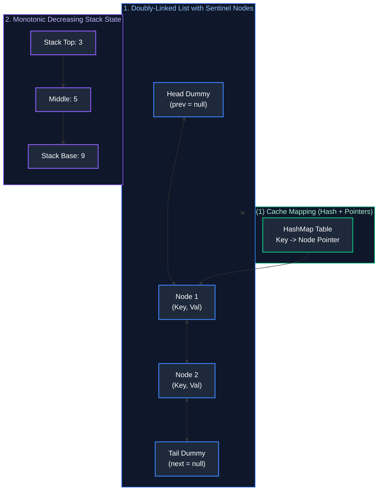

# 02. Linked Lists, Stacks & Monotonic Structures

A comprehensive, production-grade guide to Singly and Doubly Linked Lists, Stacks, Queues, Monotonic Stacks, Monotonic Deques, and $O(1)$ Invariant Cache Architectures (LRU & LFU).

---

## Architectural Overview: Pointer Manipulation & LIFO/FIFO Mechanics



---

## Table of Contents
1. [Linked List Fundamentals & Pointer Manipulation](#1-linked-list-fundamentals--pointer-manipulation)
   - 1.1 [In-Place Reversal of Singly Linked List](#11-in-place-reversal-of-singly-linked-list)
   - 1.2 [Reverse Nodes in k-Group](#12-reverse-nodes-in-k-group)
   - 1.3 [Merge K Sorted Lists](#13-merge-k-sorted-lists)
2. [Stack & Queue Primitives](#2-stack--queue-primitives)
   - 2.1 [Min-Stack ($O(1)$ Extra State Space)](#21-min-stack-o1-extra-state-space)
3. [The Monotonic Stack Pattern](#3-the-monotonic-stack-pattern)
   - 3.1 [Next Greater Element](#31-next-greater-element)
   - 3.2 [Largest Rectangle in Histogram](#32-largest-rectangle-in-histogram)
4. [The Monotonic Deque Pattern](#4-the-monotonic-deque-pattern)
   - 4.1 [Sliding Window Maximum](#41-sliding-window-maximum)
5. [Production Cache Systems Design ($O(1)$ Invariant)](#5-production-cache-systems-design-o1-invariant)
   - 5.1 [Least Recently Used (LRU) Cache Implementation](#51-least-recently-used-lru-cache-implementation)
   - 5.2 [Least Frequently Used (LFU) Cache Implementation](#52-least-frequently-used-lfu-cache-implementation)
6. [Practice Problems by Difficulty Tier](#6-practice-problems-by-difficulty-tier)
7. [Summary & Engineering Reference Matrix](#7-summary--engineering-reference-matrix)
8. [References & Further Reading](#8-references--further-reading)

---

# 1. Linked List Fundamentals & Pointer Manipulation

### 1.1 In-Place Reversal of Singly Linked List
Reversing pointers iteratively requires three pointers: `prev`, `curr`, and `nextTemp`.
- Initial: `prev = null, curr = head`
- Iteration: Save `curr.next`, redirect `curr.next = prev`, shift `prev = curr`, advance `curr = nextTemp`.
- Return `prev` as the new head. Time: $O(N)$, Space: $O(1)$.

### 1.2 Reverse Nodes in k-Group (LeetCode 25)
Reversing groups of size $k$ requires counting whether $k$ nodes exist before reversing. If fewer than $k$ nodes remain, leave them intact.

```java
public class LinkedListAlgorithms {
    public static class ListNode {
        public int val;
        public ListNode next;
        public ListNode(int val) { this.val = val; }
    }

    public ListNode reverseKGroup(ListNode head, int k) {
        ListNode curr = head;
        int count = 0;
        while (curr != null && count < k) {
            curr = curr.next;
            count++;
        }

        if (count == k) {
            ListNode reversedHead = reverseKGroup(curr, k); // Recurse on remaining list
            while (count-- > 0) {
                ListNode nextTemp = head.next;
                head.next = reversedHead;
                reversedHead = head;
                head = nextTemp;
            }
            head = reversedHead;
        }
        return head;
    }
}
```

### 1.3 Merge K Sorted Lists (LeetCode 23)
Use a **Min-Heap (PriorityQueue)** holding the current head of each list. Polling the minimum and advancing that list's pointer gives $O(N \log K)$ time where $N$ is total elements and $K$ is number of lists.

---

# 2. Stack & Queue Primitives

### 2.1 Min-Stack ($O(1)$ Extra State Space)
```java
import java.util.ArrayDeque;
import java.util.Deque;

public class MinStack {
    private final Deque<Long> stack = new ArrayDeque<>();
    private long minVal;

    public void push(int val) {
        if (stack.isEmpty()) {
            stack.push(0L);
            minVal = val;
        } else {
            stack.push((long) val - minVal);
            if (val < minVal) minVal = val;
        }
    }

    public void pop() {
        if (stack.isEmpty()) return;
        long diff = stack.pop();
        if (diff < 0) minVal = minVal - diff; // Restore previous minimum
    }

    public int top() {
        long diff = stack.peek();
        return diff < 0 ? (int) minVal : (int) (minVal + diff);
    }

    public int getMin() {
        return (int) minVal;
    }
}
```

---

# 3. The Monotonic Stack Pattern

### 3.1 Next Greater Element
A Monotonic Decreasing Stack keeps elements in descending order. When an incoming element exceeds the stack top, the incoming element is the "Next Greater Element" for the popped items!

```java
public int[] nextGreaterElement(int[] nums) {
    int[] result = new int[nums.length];
    Arrays.fill(result, -1);
    Deque<Integer> stack = new ArrayDeque<>(); // Stores indices

    for (int i = 0; i < nums.length; i++) {
        while (!stack.isEmpty() && nums[i] > nums[stack.peek()]) {
            int prevIdx = stack.pop();
            result[prevIdx] = nums[i];
        }
        stack.push(i);
    }
    return result;
}
```

### 3.2 Largest Rectangle in Histogram (LeetCode 84)
Maintain a Monotonic Increasing Stack of indices. When an incoming bar is shorter than the bar at stack top, pop the top and calculate area using the popped height and the width between current index and the new stack top:
$$\text{Width} = \text{stack.isEmpty}() \ ? \ i : (i - \text{stack.peek}() - 1)$$

---

# 4. The Monotonic Deque Pattern

### 4.1 Sliding Window Maximum (LeetCode 239)
Using a Monotonic Decreasing Deque:
- Maintain indices in the deque such that values are strictly decreasing.
- When an incoming element is larger than `deque.peekLast()`, poll from last.
- Discard indices from `deque.peekFirst()` that fall outside the $[i - k + 1, i]$ window.
- The maximum in the window is always at `nums[deque.peekFirst()]`. Time: $O(N)$, Space: $O(K)$.

---

# 5. Production Cache Systems Design ($O(1)$ Invariant)

### 5.1 Least Recently Used (LRU) Cache Implementation

#### Low-Level Invariants
1. A **Doubly-Linked List** with dummy `head` and `tail` sentinels allows $O(1)$ splicing and insertion.
2. A **HashMap** maps `Key -> NodePointer`, allowing $O(1)$ key lookup.
3. Every `get` or `put` splices the node and moves it to the head (most recently used).
4. When capacity is exceeded, the node before dummy `tail` is evicted in $O(1)$ time.

#### Complete Production Implementation (Java)
```java
import java.util.HashMap;
import java.util.Map;

public class LRUCache {
    private static class Node {
        int key;
        int value;
        Node prev;
        Node next;
        Node(int key, int value) { this.key = key; this.value = value; }
    }

    private final int capacity;
    private final Map<Integer, Node> map;
    private final Node head;
    private final Node tail;

    public LRUCache(int capacity) {
        this.capacity = capacity;
        this.map = new HashMap<>(capacity);
        this.head = new Node(0, 0); // Sentinel head
        this.tail = new Node(0, 0); // Sentinel tail
        head.next = tail;
        tail.prev = head;
    }

    public synchronized int get(int key) {
        Node node = map.get(key);
        if (node == null) return -1;
        moveToHead(node);
        return node.value;
    }

    public synchronized void put(int key, int value) {
        Node node = map.get(key);
        if (node != null) {
            node.value = value;
            moveToHead(node);
        } else {
            if (map.size() >= capacity) {
                Node lru = tail.prev;
                removeNode(lru);
                map.remove(lru.key);
            }
            Node newNode = new Node(key, value);
            map.put(key, newNode);
            addNode(newNode);
        }
    }

    private void addNode(Node node) {
        node.next = head.next;
        node.prev = head;
        head.next.prev = node;
        head.next = node;
    }

    private void removeNode(Node node) {
        node.prev.next = node.next;
        node.next.prev = node.prev;
    }

    private void moveToHead(Node node) {
        removeNode(node);
        addNode(node);
    }
}
```

---

### 5.2 Least Frequently Used (LFU) Cache Implementation

#### Low-Level Invariants
1. `keyToVal`: Maps key to value.
2. `keyToCount`: Maps key to access frequency.
3. `countToLRU`: Maps each frequency to an ordered doubly-linked list of keys.
4. `minFrequency`: Running integer tracking the lowest frequency bucket to evict in $O(1)$ time.

```java
import java.util.*;

public class LFUCache {
    private final int capacity;
    private int minFreq = 0;
    private final Map<Integer, Integer> keyToVal = new HashMap<>();
    private final Map<Integer, Integer> keyToFreq = new HashMap<>();
    private final Map<Integer, LinkedHashSet<Integer>> freqToKeys = new HashMap<>();

    public LFUCache(int capacity) {
        this.capacity = capacity;
    }

    public synchronized int get(int key) {
        if (!keyToVal.containsKey(key)) return -1;
        incrementFreq(key);
        return keyToVal.get(key);
    }

    public synchronized void put(int key, int value) {
        if (capacity <= 0) return;

        if (keyToVal.containsKey(key)) {
            keyToVal.put(key, value);
            incrementFreq(key);
            return;
        }

        if (keyToVal.size() >= capacity) {
            int evictKey = freqToKeys.get(minFreq).iterator().next();
            freqToKeys.get(minFreq).remove(evictKey);
            keyToVal.remove(evictKey);
            keyToFreq.remove(evictKey);
        }

        keyToVal.put(key, value);
        keyToFreq.put(key, 1);
        freqToKeys.computeIfAbsent(1, k -> new LinkedHashSet<>()).add(key);
        minFreq = 1;
    }

    private void incrementFreq(int key) {
        int freq = keyToFreq.get(key);
        keyToFreq.put(key, freq + 1);
        freqToKeys.get(freq).remove(key);

        if (freqToKeys.get(freq).isEmpty()) {
            freqToKeys.remove(freq);
            if (minFreq == freq) minFreq++;
        }
        freqToKeys.computeIfAbsent(freq + 1, k -> new LinkedHashSet<>()).add(key);
    }
}
```

---

# 6. Practice Problems by Difficulty Tier

| Difficulty | Problem Name | Core Pattern | LeetCode Link | Complexity |
| :---: | :--- | :--- | :---: | :---: |
| **Easy** | Reverse Linked List | Iterative 3-Pointer Reversal | LC 206 | $O(N) \text{ time}, O(1) \text{ space}$ |
| **Easy** | Valid Parentheses | LIFO Stack Bracket Matching | LC 20 | $O(N) \text{ time}, O(N) \text{ space}$ |
| **Medium** | Reverse Nodes in k-Group | Recursive Sublist Reversal | LC 25 | $O(N) \text{ time}, O(1) \text{ space}$ |
| **Medium** | Daily Temperatures | Monotonic Decreasing Stack | LC 739 | $O(N) \text{ time}, O(N) \text{ space}$ |
| **Medium** | LRU Cache | Doubly-Linked List + HashMap | LC 146 | $O(1) \text{ all operations}$ |
| **Hard** | Sliding Window Maximum | Monotonic Deque | LC 239 | $O(N) \text{ time}, O(K) \text{ space}$ |
| **Hard** | Largest Rectangle in Histogram | Monotonic Stack Area Calculation | LC 84 | $O(N) \text{ time}, O(N) \text{ space}$ |
| **Hard** | LFU Cache | Frequency Buckets + LinkedHashSet | LC 460 | $O(1) \text{ all operations}$ |

---

# 7. Summary & Engineering Reference Matrix

| Data Structure / Pattern | Key Mechanics | Invariant Maintained | Amortized Time | Space Complexity |
| :--- | :--- | :--- | :--- | :--- |
| **Singly-Linked List** | Unidirectional pointers | `head` to `tail` traversal | $O(1)$ push/pop head; $O(N)$ random access | $O(N)$ |
| **Doubly-Linked List** | Sentinel `head`/`tail` nodes | $O(1)$ node splicing given pointer | $O(1)$ insert/delete node | $O(N)$ |
| **Monotonic Stack** | Pop smaller/larger on insert | Strictly monotonic values in stack | $O(N)$ total (each item pushed/popped once) | $O(N)$ |
| **Monotonic Deque** | Double-ended monotonic queue | First element is always window optimum | $O(N)$ total | $O(K)$ |
| **LRU Cache** | Doubly-linked list + HashMap | Recency of access ordered head-to-tail | $O(1)$ get & put | $O(\text{Capacity})$ |
| **LFU Cache** | Frequency buckets + LRU sublists | Evict min frequency, tie-break by recency | $O(1)$ get & put | $O(\text{Capacity})$ |

---

# 8. References & Further Reading
- Cormen, Leiserson, Rivest, Stein, *Introduction to Algorithms (CLRS)* (MIT Press).
- Robert Sedgewick & Kevin Wayne, *Algorithms* (Addison-Wesley).
- Brian Goetz, *Java Concurrency in Practice* (Cache Synchronization).

