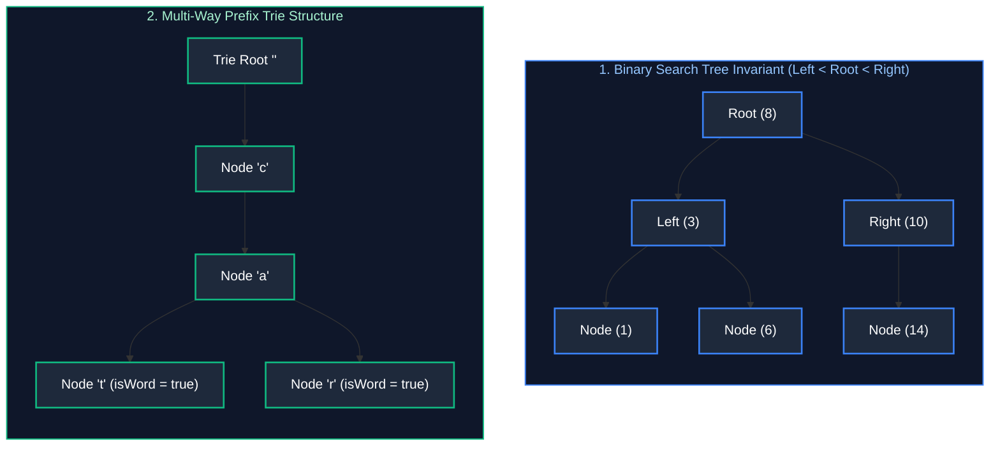

# 03. Trees, Binary Search Trees & Trie Architectures

A comprehensive, production-grade guide to Binary Trees, Binary Search Trees (BST), Lowest Common Ancestor (LCA), Tree Serialization/Deserialization, and Trie (Prefix Tree) Architectures.

---

## Architectural Overview: Hierarchical Pointers & Trie Prefixes



---

## Table of Contents
1. [Binary Tree Traversals (Recursive vs. Iterative)](#1-binary-tree-traversals-recursive-vs-iterative)
   - 1.1 [DFS Traversals (Inorder, Preorder, Postorder)](#11-dfs-traversals-inorder-preorder-postorder)
   - 1.2 [BFS & Zigzag Level-Order Traversal](#12-bfs--zigzag-level-order-traversal)
2. [Binary Search Tree (BST) Mechanics & Invariants](#2-binary-search-tree-bst-mechanics--invariants)
   - 2.1 [Validate Binary Search Tree](#21-validate-binary-search-tree)
   - 2.2 [Lowest Common Ancestor (LCA)](#22-lowest-common-ancestor-lca)
3. [Tree Serialization & Deserialization (LeetCode 297)](#3-tree-serialization--deserialization-leetcode-297)
4. [Trie (Prefix Tree) Architectures](#4-trie-prefix-tree-architectures)
   - 4.1 [Core Trie Implementation](#41-core-trie-implementation)
   - 4.2 [Word Search II (Trie + 2D Backtracking)](#42-word-search-ii-trie--2d-backtracking)
5. [Practice Problems by Difficulty Tier](#5-practice-problems-by-difficulty-tier)
6. [Summary & Engineering Reference Matrix](#6-summary--engineering-reference-matrix)
7. [References & Further Reading](#7-references--further-reading)

---

# 1. Binary Tree Traversals (Recursive vs. Iterative)

### 1.1 DFS Traversals (Inorder, Preorder, Postorder)
Every recursive DFS traversal executes in $O(N)$ time, but consumes $O(H)$ call stack space ($H = \log N$ balanced, $H = N$ skewed).
- **Iterative Inorder Traversal (Without Recursion):**
  Using an explicit `Deque<TreeNode> stack`, push all left children until reaching `null`. Pop, process, and shift to `curr.right`.

```java
import java.util.*;

public class TreeTraversals {
    public static class TreeNode {
        public int val;
        public TreeNode left;
        public TreeNode right;
        public TreeNode(int val) { this.val = val; }
    }

    public List<Integer> inorderTraversalIterative(TreeNode root) {
        List<Integer> result = new ArrayList<>();
        Deque<TreeNode> stack = new ArrayDeque<>();
        TreeNode curr = root;

        while (curr != null || !stack.isEmpty()) {
            while (curr != null) {
                stack.push(curr);
                curr = curr.left;
            }
            curr = stack.pop();
            result.add(curr.val);
            curr = curr.right;
        }
        return result;
    }
}
```

### 1.2 BFS & Zigzag Level-Order Traversal (LeetCode 103)
Level-order traversal uses a FIFO queue. For zigzag order, toggle a boolean flag `leftToRight` and insert each level's values into a `LinkedList` via `addLast()` or `addFirst()`.

```java
public List<List<Integer>> zigzagLevelOrder(TreeNode root) {
    List<List<Integer>> result = new ArrayList<>();
    if (root == null) return result;

    Queue<TreeNode> queue = new ArrayDeque<>();
    queue.offer(root);
    boolean leftToRight = true;

    while (!queue.isEmpty()) {
        int levelSize = queue.size();
        LinkedList<Integer> currentLevel = new LinkedList<>();

        for (int i = 0; i < levelSize; i++) {
            TreeNode node = queue.poll();
            if (leftToRight) {
                currentLevel.addLast(node.val);
            } else {
                currentLevel.addFirst(node.val);
            }

            if (node.left != null) queue.offer(node.left);
            if (node.right != null) queue.offer(node.right);
        }
        result.add(currentLevel);
        leftToRight = !leftToRight;
    }
    return result;
}
```

---

# 2. Binary Search Tree (BST) Mechanics & Invariants

### 2.1 Validate Binary Search Tree (LeetCode 98)
**Invariant:** Every node in the left subtree must be strictly less than root; every node in the right subtree must be strictly greater than root. Passing bounds `[min, max]` down recursively guarantees the global invariant:

```java
public boolean isValidBST(TreeNode root) {
    return validate(root, null, null);
}

private boolean validate(TreeNode node, Integer lower, Integer upper) {
    if (node == null) return true;
    if (lower != null && node.val <= lower) return false;
    if (upper != null && node.val >= upper) return false;
    return validate(node.left, lower, node.val) && validate(node.right, node.val, upper);
}
```

### 2.2 Lowest Common Ancestor (LCA)
- **In a Binary Search Tree (LC 235):** If both $p$ and $q$ are smaller than root, LCA is in left subtree. If both are larger, LCA is in right subtree. If root splits $p$ and $q$, root IS the LCA! Time: $O(H)$, Space: $O(1)$.
- **In an Arbitrary Binary Tree (LC 236):**
```java
public TreeNode lowestCommonAncestor(TreeNode root, TreeNode p, TreeNode q) {
    if (root == null || root == p || root == q) return root;

    TreeNode left = lowestCommonAncestor(root.left, p, q);
    TreeNode right = lowestCommonAncestor(root.right, p, q);

    if (left != null && right != null) return root; // p and q split across subtrees
    return left != null ? left : right;
}
```

---

# 3. Tree Serialization & Deserialization (LeetCode 297)

### DFS Preorder Serialization with Sentinels
Serialize the tree into a comma-delimited string using `#` to represent null pointers:
$$\text{Tree} \implies \text{"1,2,#,#,3,4,#,#,5,#,#"}$$

```java
public class Codec {
    private static final String NULL_SENTINEL = "#";
    private static final String DELIMITER = ",";

    // Encodes a tree to a single string
    public String serialize(TreeNode root) {
        StringBuilder sb = new StringBuilder();
        buildString(root, sb);
        return sb.toString();
    }

    private void buildString(TreeNode node, StringBuilder sb) {
        if (node == null) {
            sb.append(NULL_SENTINEL).append(DELIMITER);
        } else {
            sb.append(node.val).append(DELIMITER);
            buildString(node.left, sb);
            buildString(node.right, sb);
        }
    }

    // Decodes encoded string to tree
    public TreeNode deserialize(String data) {
        Queue<String> nodes = new ArrayDeque<>(Arrays.asList(data.split(DELIMITER)));
        return buildTree(nodes);
    }

    private TreeNode buildTree(Queue<String> nodes) {
        String val = nodes.poll();
        if (val.equals(NULL_SENTINEL)) return null;

        TreeNode node = new TreeNode(Integer.parseInt(val));
        node.left = buildTree(nodes);
        node.right = buildTree(nodes);
        return node;
    }
}
```

---

# 4. Trie (Prefix Tree) Architectures

### 4.1 Core Trie Implementation (LeetCode 208)
```java
public class Trie {
    private static class TrieNode {
        final TrieNode[] children = new TrieNode[26];
        boolean isEndOfWord = false;
    }

    private final TrieNode root = new TrieNode();

    public void insert(String word) {
        TrieNode curr = root;
        for (int i = 0; i < word.length(); i++) {
            int idx = word.charAt(i) - 'a';
            if (curr.children[idx] == null) {
                curr.children[idx] = new TrieNode();
            }
            curr = curr.children[idx];
        }
        curr.isEndOfWord = true;
    }

    public boolean search(String word) {
        TrieNode node = findPrefixNode(word);
        return node != null && node.isEndOfWord;
    }

    public boolean startsWith(String prefix) {
        return findPrefixNode(prefix) != null;
    }

    private TrieNode findPrefixNode(String prefix) {
        TrieNode curr = root;
        for (int i = 0; i < prefix.length(); i++) {
            int idx = prefix.charAt(i) - 'a';
            if (curr.children[idx] == null) return null;
            curr = curr.children[idx];
        }
        return curr;
    }
}
```

### 4.2 Word Search II (Trie + 2D Backtracking) (LeetCode 212)
Inserting the target word dictionary into a Trie allows pruning DFS grid searches early when the current prefix does not exist in the Trie, reducing search space from $O(M \times N \times 4^L)$ to an efficient pruned search!

---

# 5. Practice Problems by Difficulty Tier

| Difficulty | Problem Name | Core Pattern | LeetCode Link | Complexity |
| :---: | :--- | :--- | :---: | :---: |
| **Easy** | Maximum Depth of Binary Tree | Recursive DFS | LC 104 | $O(N) \text{ time}, O(H) \text{ space}$ |
| **Easy** | Invert Binary Tree | Recursive DFS / BFS | LC 226 | $O(N) \text{ time}, O(H) \text{ space}$ |
| **Medium** | Validate Binary Search Tree | Bound Propagation | LC 98 | $O(N) \text{ time}, O(H) \text{ space}$ |
| **Medium** | Lowest Common Ancestor (Binary Tree) | Bottom-Up Subtree Postorder | LC 236 | $O(N) \text{ time}, O(H) \text{ space}$ |
| **Medium** | Binary Tree Zigzag Level Order | BFS + Deque | LC 103 | $O(N) \text{ time}, O(N) \text{ space}$ |
| **Medium** | Implement Trie (Prefix Tree) | 26-Way Node Pointers | LC 208 | $O(L) \text{ time per query}$ |
| **Hard** | Serialize and Deserialize Binary Tree | Preorder Sentinel Encoding | LC 297 | $O(N) \text{ time}, O(N) \text{ space}$ |
| **Hard** | Word Search II | Trie + 2D Grid Backtracking | LC 212 | $O(M \cdot N \cdot 4^L) \text{ pruned}$ |

---

# 6. Summary & Engineering Reference Matrix

| Data Structure | Lookup Time | Insertion Time | Space Overhead | Key Production Nuance |
| :--- | :--- | :--- | :--- | :--- |
| **Balanced BST** | $O(\log N)$ | $O(\log N)$ | $O(N)$ (Left/Right pointers) | Rebalancing (AVL / Red-Black) required on continuous monotonic inserts |
| **Skewed Tree** | $O(N)$ | $O(N)$ | $O(N)$ | Causes JVM `StackOverflowError` on deep recursive DFS |
| **Level-Order BFS** | $O(N)$ | — | $O(W)$ ($W \approx N/2$ max leaves) | High queue memory usage on wide trees |
| **Prefix Trie** | $O(L)$ | $O(L)$ | $O(26 \times \text{TotalNodes})$ | Sparse arrays waste memory; use `HashMap` or Radix Tree in production |

---

# 7. References & Further Reading
- Robert Sedgewick & Kevin Wayne, *Algorithms: Chapter 3 (Searching & BSTs)*.
- Donald Knuth, *The Art of Computer Programming, Volume 3: Sorting and Searching*.
- LeetCode Curated 75: Tree & Trie Exploration Track.

