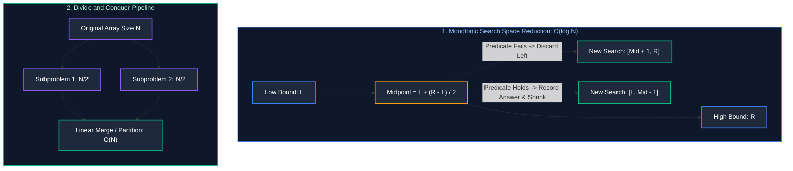

# 04. Binary Search & Divide-and-Conquer

A comprehensive, production-grade guide to Binary Search, Boundary Searches, Search in Rotated Arrays, Binary Search on Answer (Feasibility Search), and Divide-and-Conquer Algorithms (Merge Sort & QuickSelect).

---

## Architectural Overview: Logarithmic Search Space & Feasibility Predicates



---

## Table of Contents
1. [Binary Search Foundations & Invariant Proofs](#1-binary-search-foundations--invariant-proofs)
   - 1.1 [Midpoint Overflow Prevention & Boundary Traps](#11-midpoint-overflow-prevention--boundary-traps)
   - 1.2 [Lower Bound vs. Upper Bound (First & Last Occurrence)](#12-lower-bound-vs-upper-bound-first--last-occurrence)
   - 1.3 [Search in Rotated Sorted Array](#13-search-in-rotated-sorted-array)
2. [Binary Search on Answer (Feasibility Search)](#2-binary-search-on-answer-feasibility-search)
   - 2.1 [The Monotonic Predicate Framework](#21-the-monotonic-predicate-framework)
   - 2.2 [Capacity to Ship Packages Within D Days](#22-capacity-to-ship-packages-within-d-days)
   - 2.3 [Median of Two Sorted Arrays ($O(\log(\min(M, N)))$)](#23-median-of-two-sorted-arrays)
3. [Divide-and-Conquer Algorithms](#3-divide-and-conquer-algorithms)
   - 3.1 [Merge Sort Internals](#31-merge-sort-internals)
   - 3.2 [QuickSelect (Kth Largest Element in $O(N)$ Average Time)](#32-quickselect-kth-largest-element-in-on-average-time)
4. [Practice Problems by Difficulty Tier](#4-practice-problems-by-difficulty-tier)
5. [Summary & Engineering Reference Matrix](#5-summary--engineering-reference-matrix)
6. [References & Further Reading](#6-references--further-reading)

---

# 1. Binary Search Foundations & Invariant Proofs

### 1.1 Midpoint Overflow Prevention & Boundary Traps
Computing `mid = (low + high) / 2` triggers severe integer overflow bugs in Java/C++ when `low + high > Integer.MAX_VALUE` ($2^{31}-1$), producing a negative number.
Always compute midpoint using unsigned subtraction:
$$\text{mid} = \text{low} + \frac{\text{high} - \text{low}}{2} = \text{low} + ((\text{high} - \text{low}) \gg 1)$$

### 1.2 Lower Bound vs. Upper Bound (First & Last Occurrence)
- **Lower Bound (First index where $A[\text{mid}] \ge \text{target}$):**
  When $A[\text{mid}] == \text{target}$, record `ans = mid` and shrink rightward: `high = mid - 1`.
- **Upper Bound (Last index where $A[\text{mid}] \le \text{target}$):**
  When $A[\text{mid}] == \text{target}$, record `ans = mid` and expand leftward: `low = mid + 1`.

### 1.3 Search in Rotated Sorted Array (LeetCode 33)
In a rotated sorted array without duplicates, for any `mid`, **at least one half (left or right) is guaranteed to be strictly sorted**:
1. If `nums[low] <= nums[mid]`, the left half is sorted:
   - If `target` lies within `[nums[low], nums[mid])`, search left: `high = mid - 1`.
   - Else search right: `low = mid + 1`.
2. Else, the right half is sorted:
   - If `target` lies within `(nums[mid], nums[high]]`, search right: `low = mid + 1`.
   - Else search left: `high = mid - 1`.

---

# 2. Binary Search on Answer (Feasibility Search)

### 2.1 The Monotonic Predicate Framework
Whenever the problem asks to find the **minimum capacity**, **maximum speed**, or **minimum largest sum** satisfying a condition, define a boolean predicate function:
$$\text{feasible}(X) \to \{\text{true}, \text{false}\}$$
If $\text{feasible}(X)$ is monotonic (e.g. `[false, false, false, true, true, true]`), we binary search directly over the value space $[X_{\min}, X_{\max}]$!

### 2.2 Capacity to Ship Packages Within D Days (LeetCode 1011)
- Lower bound: $\max(\text{weights})$ (a ship must carry at least the heaviest single item).
- Upper bound: $\sum \text{weights}$ (one ship carrying all items in 1 day).

```java
public class CapacityToShip {
    public int shipWithinDays(int[] weights, int days) {
        int low = 0, high = 0;
        for (int w : weights) {
            low = Math.max(low, w);
            high += w;
        }

        int answer = high;
        while (low <= high) {
            int mid = low + (high - low) / 2;
            if (canShip(weights, days, mid)) {
                answer = mid; // Feasible, try smaller capacity
                high = mid - 1;
            } else {
                low = mid + 1; // Infeasible, must increase capacity
            }
        }
        return answer;
    }

    private boolean canShip(int[] weights, int maxDays, int capacity) {
        int daysUsed = 1;
        int currentLoad = 0;
        for (int w : weights) {
            if (currentLoad + w > capacity) {
                daysUsed++;
                currentLoad = 0;
            }
            currentLoad += w;
        }
        return daysUsed <= maxDays;
    }
}
```

### 2.3 Median of Two Sorted Arrays (LeetCode 4)
Binary search on the smaller array ($A$ of size $M$) to find a partition $i$ such that total elements on left half equals total elements on right half:
$$\text{Partition } A: [A_0 \dots A_{i-1}] \ | \ [A_i \dots A_{M-1}]$$
$$\text{Partition } B: [B_0 \dots B_{j-1}] \ | \ [B_j \dots B_{N-1}]$$
Invariant holds when $A_{i-1} \le B_j$ and $B_{j-1} \le A_i$. Time: $O(\log(\min(M, N)))$, Space: $O(1)$.

---

# 3. Divide-and-Conquer Algorithms

### 3.1 Merge Sort Internals
Divide array into two halves, recursively sort each half, and merge in $O(N)$ linear time using an auxiliary buffer.
- Recurrence: $T(N) = 2T(N/2) + O(N) \implies O(N \log N)$ by Master Theorem.
- Space Complexity: $O(N)$ auxiliary memory.

### 3.2 QuickSelect (Kth Largest Element in $O(N)$ Average Time)
Using Lomuto or Hoare partitioning, choose a pivot and partition elements. If pivot index equals $K$, return `nums[pivot]`. Otherwise, recurse into **only one partition**!
- Average Time: $T(N) = T(N/2) + O(N) = O(N)$.
- Worst-Case Time: $O(N^2)$ (mitigated using randomized pivot selection).

```java
import java.util.Random;

public class QuickSelect {
    private final Random rand = new Random();

    public int findKthLargest(int[] nums, int k) {
        int targetIdx = nums.length - k; // Convert Kth largest to (N-k)th smallest index
        return quickSelect(nums, 0, nums.length - 1, targetIdx);
    }

    private int quickSelect(int[] nums, int left, int right, int targetIdx) {
        if (left == right) return nums[left];

        int pivotIdx = left + rand.nextInt(right - left + 1);
        pivotIdx = partition(nums, left, right, pivotIdx);

        if (pivotIdx == targetIdx) {
            return nums[pivotIdx];
        } else if (pivotIdx < targetIdx) {
            return quickSelect(nums, pivotIdx + 1, right, targetIdx);
        } else {
            return quickSelect(nums, left, pivotIdx - 1, targetIdx);
        }
    }

    private int partition(int[] nums, int left, int right, int pivotIdx) {
        int pivotVal = nums[pivotIdx];
        swap(nums, pivotIdx, right);
        int storeIdx = left;

        for (int i = left; i < right; i++) {
            if (nums[i] < pivotVal) {
                swap(nums, storeIdx, i);
                storeIdx++;
            }
        }
        swap(nums, storeIdx, right);
        return storeIdx;
    }

    private void swap(int[] nums, int i, int j) {
        int t = nums[i]; nums[i] = nums[j]; nums[j] = t;
    }
}
```

---

# 4. Practice Problems by Difficulty Tier

| Difficulty | Problem Name | Core Pattern | LeetCode Link | Complexity |
| :---: | :--- | :--- | :---: | :---: |
| **Easy** | Binary Search | Monotonic Exact Match | LC 704 | $O(\log N) \text{ time}, O(1) \text{ space}$ |
| **Easy** | First Bad Version | Binary Search Boundary | LC 278 | $O(\log N) \text{ time}, O(1) \text{ space}$ |
| **Medium** | Search in Rotated Sorted Array | One-Half Sorted Invariant | LC 33 | $O(\log N) \text{ time}, O(1) \text{ space}$ |
| **Medium** | Find Minimum in Rotated Sorted Array | Boundary Transition Search | LC 153 | $O(\log N) \text{ time}, O(1) \text{ space}$ |
| **Medium** | Capacity to Ship Packages Within D Days | Binary Search on Answer | LC 1011 | $O(N \log(\sum W)) \text{ time}, O(1) \text{ space}$ |
| **Medium** | Koko Eating Bananas | Feasibility Search | LC 875 | $O(N \log(\max A)) \text{ time}, O(1) \text{ space}$ |
| **Medium** | Kth Largest Element in an Array | QuickSelect Partitioning | LC 215 | $O(N) \text{ avg time}, O(1) \text{ space}$ |
| **Hard** | Median of Two Sorted Arrays | Dual Array Partition Cut | LC 4 | $O(\log(\min(M, N))) \text{ time}, O(1) \text{ space}$ |
| **Hard** | Split Array Largest Sum | Min-Max Feasibility Search | LC 410 | $O(N \log(\sum A)) \text{ time}, O(1) \text{ space}$ |

---

# 5. Summary & Engineering Reference Matrix

| Algorithm | Search Space | Stopping Condition | Convergence Guarantee |
| :--- | :--- | :--- | :--- |
| **Exact Binary Search** | Sorted Array | `low <= high`, exit on `nums[mid] == target` | Search space halves each step: $N \to N/2 \to 1$ |
| **Lower Bound** | Sorted Array | `low <= high`, record `mid` on $\ge \text{target}$ | Halves search space while tightening upper bound |
| **Search on Answer** | Numerical Range $[L, R]$ | Monotonic predicate `feasible(mid)` | $O(\log(R - L) \times \text{CostOfPredicate})$ |
| **QuickSelect** | Unsorted Array | Pivot index equals target index | Average $O(N)$; drops half remaining partition each step |
| **Merge Sort** | Unsorted Array | Base case: subarray length $\le 1$ | Deterministic $O(N \log N)$ across all input distributions |

---

# 6. References & Further Reading
- Jon Bentley, *Programming Pearls: Writing Correct Programs (Binary Search Proofs)*.
- Thomas H. Cormen et al., *Introduction to Algorithms (CLRS): Chapter 2 & 9*.
- TopCoder Algorithm Tutorials: *Binary Search & Monotonic Predicates*.

