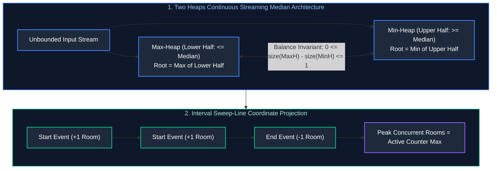

# 05. Heaps, Intervals & Greedy Algorithms

A comprehensive, production-grade guide to Binary Heaps, Priority Queues, Two Heaps Streaming Patterns, Interval Sweep-Line Algorithms, and Greedy Optimization.

---

## Architectural Overview: Heap Memory Invariants & Interval Sweep-Line



---

## Table of Contents
1. [Binary Heap Internals & Mathematical Invariants](#1-binary-heap-internals--mathematical-invariants)
   - 1.1 [Array Memory Representation & Sift-Up/Sift-Down](#11-array-memory-representation--sift-upsift-down)
   - 1.2 [The $O(N)$ Heapify Proof](#12-the-on-heapify-proof)
2. [The Two Heaps Pattern](#2-the-two-heaps-pattern)
   - 2.1 [Find Median from Data Stream (LeetCode 295)](#21-find-median-from-data-stream-leetcode-295)
   - 2.2 [Loose Median in Constant $O(1)$ Time & Space](#22-loose-median-in-constant-o1-time--space)
   - 2.3 [Kth Largest Element in a Stream](#23-kth-largest-element-in-a-stream)
3. [Top-K Elements & K-Way Merge](#3-top-k-elements--k-way-merge)
   - 3.1 [Top K Frequent Elements (Min-Heap vs. Bucket Sort $O(N)$)](#31-top-k-frequent-elements-min-heap-vs-bucket-sort-on)
   - 3.2 [Merge K Sorted Lists](#32-merge-k-sorted-lists)
4. [Interval Scheduling & Sweep-Line Algorithms](#4-interval-scheduling--sweep-line-algorithms)
   - 4.1 [Merge Intervals](#41-merge-intervals)
   - 4.2 [Minimum Meeting Rooms II & Sweep-Line Variants](#42-minimum-meeting-rooms-ii--sweep-line-variants)
5. [Greedy Decision Making](#5-greedy-decision-making)
   - 5.1 [Jump Game I & II](#51-jump-game-i--ii)
   - 5.2 [Task Scheduler with Cool-Down Invariant](#52-task-scheduler-with-cool-down-invariant)
6. [Practice Problems by Difficulty Tier](#6-practice-problems-by-difficulty-tier)
7. [Summary & Engineering Reference Matrix](#7-summary--engineering-reference-matrix)
8. [References & Further Reading](#8-references--further-reading)

---

# 1. Binary Heap Internals & Mathematical Invariants

### 1.1 Array Memory Representation & Sift-Up/Sift-Down
A Complete Binary Tree can be stored in a contiguous array without pointers:
- Root is at index `0`.
- For any node at index `i`:
  $$\text{Parent}(i) = \lfloor (i - 1) / 2 \rfloor$$
  $$\text{LeftChild}(i) = 2i + 1, \quad \text{RightChild}(i) = 2i + 2$$
- **Min-Heap Invariant:** For every node $i > 0$, $A[\text{Parent}(i)] \le A[i]$.

### 1.2 The $O(N)$ Heapify Proof
Building a heap by inserting $N$ elements takes $O(N \log N)$. However, building bottom-up via `heapify()` (running sift-down starting from $\lfloor N/2 \rfloor - 1$ down to 0) takes $O(N)$ linear time!
- Nodes at height $h$ number at most $\lceil N / 2^{h+1} \rceil$.
- Total swaps bounded by:
  $$\sum_{h=0}^{\lfloor \log N \rfloor} \frac{N}{2^{h+1}} \times O(h) = \frac{N}{2} \sum_{h=0}^{\infty} \frac{h}{2^h} = \frac{N}{2} \times 2 = O(N)$$

---

# 2. The Two Heaps Pattern

### 2.1 Find Median from Data Stream (LeetCode 295)

#### Core Invariants
- `maxHeap`: Stores lower half of elements ($A \le \text{median}$).
- `minHeap`: Stores upper half of elements ($B \ge \text{median}$).
- **Balance Invariant:** $\text{maxHeap.size}() == \text{minHeap.size}()$ OR $\text{maxHeap.size}() == \text{minHeap.size}() + 1$.
- **Median Calculation:**
  - If sizes equal: $(\text{maxHeap.peek}() + \text{minHeap.peek}()) / 2.0$.
  - Else: $\text{maxHeap.peek}()$.

#### Complete Production Implementation (Java)
```java
import java.util.Collections;
import java.util.PriorityQueue;

public class MedianFinder {
    private final PriorityQueue<Integer> maxHeap; // Lower half
    private final PriorityQueue<Integer> minHeap; // Upper half

    public MedianFinder() {
        this.maxHeap = new PriorityQueue<>(Collections.reverseOrder());
        this.minHeap = new PriorityQueue<>();
    }

    public void addNum(int num) {
        // Step 1: Add to maxHeap
        maxHeap.offer(num);

        // Step 2: Ensure maxHeap root <= minHeap root
        minHeap.offer(maxHeap.poll());

        // Step 3: Maintain size invariant (maxHeap can have at most 1 more element than minHeap)
        if (minHeap.size() > maxHeap.size()) {
            maxHeap.offer(minHeap.poll());
        }
    }

    public double findMedian() {
        if (maxHeap.size() > minHeap.size()) {
            return maxHeap.peek();
        } else {
            return (maxHeap.peek() + minHeap.peek()) / 2.0;
        }
    }
}
```

---

### 2.2 Loose Median in Constant $O(1)$ Time & Space
**Problem:** *In massive high-speed telemetry streams where tracking exact dual heaps in memory is prohibitive, estimate a "loose median" in $O(1)$ space and $O(1)$ time.*

#### Algorithm: Stochastic Reservoir Approximator
Maintain a single running scalar estimate `medianEstimate` and an adaptive step size $\alpha$:
- If incoming `value > medianEstimate`, increment: `medianEstimate += alpha`.
- If incoming `value < medianEstimate`, decrement: `medianEstimate -= alpha`.
Over time, because 50% of values lie above and 50% lie below the true median, the scalar stabilizes around the true median in $O(1)$ time and $O(1)$ space! (Used in high-frequency trading and hardware telemetry).

---

### 2.3 Kth Largest Element in a Stream (LeetCode 703)
Maintain a **Min-Heap of strictly size $K$**.
- When a new element arrives, add to heap. If heap size exceeds $K$, poll the minimum.
- The root of the Min-Heap is always the $K$-th largest element in $O(\log K)$ time.

---

# 3. Top-K Elements & K-Way Merge

### 3.1 Top K Frequent Elements (Min-Heap vs. Bucket Sort $O(N)$)
While a Min-Heap of size $K$ takes $O(N \log K)$ time, **Bucket Sort** achieves optimal $O(N)$ linear time by using frequencies as array indices:

```java
import java.util.*;

public class TopKFrequentElements {
    public int[] topKFrequent(int[] nums, int k) {
        Map<Integer, Integer> frequencyMap = new HashMap<>();
        for (int n : nums) frequencyMap.put(n, frequencyMap.getOrDefault(n, 0) + 1);

        // Buckets where index = frequency, value = list of numbers with that frequency
        List<Integer>[] buckets = new List[nums.length + 1];
        for (int key : frequencyMap.keySet()) {
            int freq = frequencyMap.get(key);
            if (buckets[freq] == null) buckets[freq] = new ArrayList<>();
            buckets[freq].add(key);
        }

        int[] result = new int[k];
        int count = 0;
        for (int f = buckets.length - 1; f >= 0 && count < k; f--) {
            if (buckets[f] != null) {
                for (int num : buckets[f]) {
                    result[count++] = num;
                    if (count == k) return result;
                }
            }
        }
        return result;
    }
}
```

---

# 4. Interval Scheduling & Sweep-Line Algorithms

### 4.1 Merge Intervals (LeetCode 56)
Sort intervals by `start` time. Iterate through: if `current.start <= prev.end`, merge by setting `prev.end = max(prev.end, current.end)`. Time: $O(N \log N)$, Space: $O(N)$.

### 4.2 Minimum Meeting Rooms II & Sweep-Line Variants
**Problem:** *Given an array of meeting intervals `[start, end]`, return the minimum number of conference rooms required.*

#### The Sweep-Line Coordinate Projection Framework
Deconstruct each interval `[start, end]` into two distinct discrete events:
1. `(start, +1)`: Meeting starts, requiring 1 room.
2. `(end, -1)`: Meeting ends, releasing 1 room.
Sort all events chronologically. If `start` and `end` occur at the identical timestamp, place the `end` event (`-1`) first to reuse the room immediately!

```java
import java.util.Arrays;

public class MeetingRoomsII {
    public int minMeetingRooms(int[][] intervals) {
        int n = intervals.length;
        int[] startTimes = new int[n];
        int[] endTimes = new int[n];

        for (int i = 0; i < n; i++) {
            startTimes[i] = intervals[i][0];
            endTimes[i] = intervals[i][1];
        }

        Arrays.sort(startTimes);
        Arrays.sort(endTimes);

        int roomsNeeded = 0;
        int endPtr = 0;

        for (int i = 0; i < n; i++) {
            if (startTimes[i] < endTimes[endPtr]) {
                roomsNeeded++; // Active meeting still ongoing, need additional room
            } else {
                endPtr++; // Meeting finished, room reused
            }
        }
        return roomsNeeded;
    }
}
```

---

# 5. Greedy Decision Making

### 5.1 Jump Game I & II
- **Jump Game I (Can Reach End?):** Maintain running `maxReachable = max(maxReachable, i + nums[i])`. If `i > maxReachable`, return `false`. Return `true` if `maxReachable >= n - 1`. Time: $O(N)$, Space: $O(1)$.
- **Jump Game II (Minimum Jumps):** Use BFS-style level frontiers `[currentEnd, furthest]`. When index reaches `currentEnd`, increment jumps and update `currentEnd = furthest`. Time: $O(N)$, Space: $O(1)$.

### 5.2 Task Scheduler with Cool-Down Invariant (LeetCode 621)
Given CPU tasks with cooldown $n$, the bottleneck is determined by the task with the maximum frequency $f_{\max}$:
$$\text{MinSlots} = \max(\text{tasks.length}, (f_{\max} - 1) \times (n + 1) + \text{countWithMaxFreq})$$

---

# 6. Practice Problems by Difficulty Tier

| Difficulty | Problem Name | Core Pattern | LeetCode Link | Complexity |
| :---: | :--- | :--- | :---: | :---: |
| **Easy** | Kth Largest Element in a Stream | Min-Heap Size K | LC 703 | $O(\log K) \text{ per add}$ |
| **Easy** | Meeting Rooms | Interval Sort & Overlap | LC 252 | $O(N \log N) \text{ time}, O(1) \text{ space}$ |
| **Medium** | Top K Frequent Elements | Bucket Sort / Min-Heap | LC 347 | $O(N) \text{ time}, O(N) \text{ space}$ |
| **Medium** | Merge Intervals | Interval Sort & Extend | LC 56 | $O(N \log N) \text{ time}, O(N) \text{ space}$ |
| **Medium** | Meeting Rooms II | Sweep-Line / Two Pointers | LC 253 | $O(N \log N) \text{ time}, O(N) \text{ space}$ |
| **Medium** | Task Scheduler | Frequency Greedy Formula | LC 621 | $O(N) \text{ time}, O(1) \text{ space}$ |
| **Medium** | Jump Game II | Greedy BFS Level Frontier | LC 45 | $O(N) \text{ time}, O(1) \text{ space}$ |
| **Hard** | Find Median from Data Stream | Dual Heaps (Max/Min) | LC 295 | $O(\log N) \text{ add}, O(1) \text{ median}$ |
| **Hard** | Merge K Sorted Lists | PriorityQueue K-Way Merge | LC 23 | $O(N \log K) \text{ time}, O(K) \text{ space}$ |
| **Hard** | Employee Free Time | Interval Merge & Gap Scan | LC 759 | $O(N \log K) \text{ time}, O(K) \text{ space}$ |

---

# 7. Summary & Engineering Reference Matrix

| Algorithmic Pattern | Data Structure | Invariant | Time Complexity | Space Complexity |
| :--- | :--- | :--- | :--- | :--- |
| **Two Heaps (Median)** | Max-Heap + Min-Heap | Lower half $\le$ Upper half; $\Delta \text{size} \le 1$ | $O(\log N)$ insert, $O(1)$ peek | $O(N)$ |
| **Top-K Frequent** | Bucket Sort Array of Lists | Index equals item occurrence frequency | $O(N)$ linear | $O(N)$ |
| **Sweep-Line Intervals**| Sorted Coordinate Arrays | Discrete $+1$ on start, $-1$ on end | $O(N \log N)$ | $O(N)$ |
| **Greedy Intervals** | Sorted Interval Array | Extend current boundary until disjoint | $O(N \log N)$ | $O(1)$ |
| **Greedy Forward Scan**| Single Running Max Scalar | Locally optimal choice guarantees global optimum | $O(N)$ | $O(1)$ |

---

# 8. References & Further Reading
- Cormen, Leiserson, Rivest, Stein, *Introduction to Algorithms (CLRS): Chapter 6 (Heapsort) & Chapter 16 (Greedy Algorithms)*.
- Robert Sedgewick & Kevin Wayne, *Algorithms: Priority Queues & Disjoint Sets*.
- LeetCode Curated 75: Heap & Interval Practice Sets.

