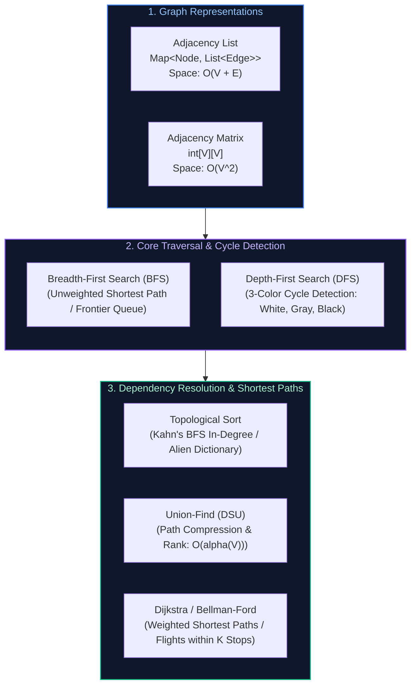

# 06. Graphs, Topological Sort & Shortest Paths

A comprehensive, production-grade guide to Graph Representations, BFS & Bidirectional Search, DFS & Cycle Detection, Topological Sort (Course Schedule & Alien Dictionary), Disjoint Set Union (Union-Find), and Shortest Path Algorithms (Dijkstra, 0-1 BFS, and Bellman-Ford).

---

## Architectural Overview: Graph Topologies & Traversal Mechanics



---

## Table of Contents
1. [Graph Representations & Memory Trade-offs](#1-graph-representations--memory-trade-offs)
2. [Breadth-First Search & Bidirectional Traversal](#2-breadth-first-search--bidirectional-traversal)
   - 2.1 [Unweighted Shortest Path & Number of Islands](#21-unweighted-shortest-path--number-of-islands)
   - 2.2 [Bidirectional BFS: Word Ladder (LeetCode 127)](#22-bidirectional-bfs-word-ladder-leetcode-127)
3. [Depth-First Search & Cycle Detection](#3-depth-first-search--cycle-detection)
   - 3.1 [3-Color DFS Cycle Detection (Directed Graphs)](#31-3-color-dfs-cycle-detection-directed-graphs)
   - 3.2 [Clone Graph with Random / Arbitrary Pointers](#32-clone-graph-with-random--arbitrary-pointers)
4. [Topological Sort & Dependency Resolution](#4-topological-sort--dependency-resolution)
   - 4.1 [Kahn's Algorithm (BFS In-Degree Queue)](#41-kahns-algorithm-bfs-in-degree-queue)
   - 4.2 [Alien Dictionary (Lexicographical Character Ordering)](#42-alien-dictionary-lexicographical-character-ordering)
5. [Disjoint Set Union (Union-Find)](#5-disjoint-set-union-union-find)
   - 5.1 [Path Compression & Union by Rank Invariants](#51-path-compression--union-by-rank-invariants)
   - 5.2 [Redundant Connection & Dynamic Connectivity](#52-redundant-connection--dynamic-connectivity)
6. [Shortest Path Algorithms](#6-shortest-path-algorithms)
   - 6.1 [Dijkstra's Algorithm ($O((V + E) \log V)$)](#61-dijkstras-algorithm)
   - 6.2 [0-1 BFS with Deque ($O(V + E)$)](#62-0-1-bfs-with-deque)
   - 6.3 [Bellman-Ford: Cheapest Flights Within K Stops (LeetCode 787)](#63-bellman-ford-cheapest-flights-within-k-stops)
7. [Practice Problems by Difficulty Tier](#7-practice-problems-by-difficulty-tier)
8. [Summary & Engineering Reference Matrix](#8-summary--engineering-reference-matrix)
9. [References & Further Reading](#9-references--further-reading)

---

# 1. Graph Representations & Memory Trade-offs

- **Adjacency List:** `Map<Integer, List<Integer>>` or `List<Integer>[]`. Consumes $O(V + E)$ memory. Highly cache-efficient for sparse graphs ($E \ll V^2$).
- **Adjacency Matrix:** 2D boolean array `boolean[V][V]`. Consumes $O(V^2)$ memory. Enables $O(1)$ edge existence checks, but wastes memory and takes $O(V^2)$ to find neighbors.

---

# 2. Breadth-First Search & Bidirectional Traversal

### 2.1 Unweighted Shortest Path & Number of Islands (LeetCode 200)
BFS traverses node frontiers level-by-level using a FIFO queue, guaranteeing that the first time a target node is visited, the path taken is the shortest possible path.

### 2.2 Bidirectional BFS: Word Ladder (LeetCode 127)
Expanding standard BFS from `beginWord` to `endWord` across word length $L$ and alphabet size 26 yields a branching factor $b \approx 26 \times L$.
- Unidirectional BFS expands to depth $D$: Explores $b^D$ nodes.
- **Bidirectional BFS:** Expands simultaneously from `beginSet` and `endSet`. Always expanding whichever frontier is smaller meets in the middle at depth $D/2$:
  $$\text{Nodes Explored} = 2 \times b^{D/2} \ll b^D$$
  This reduces memory and execution time by **several orders of magnitude**!

#### Complete Production Implementation (Java)
```java
import java.util.*;

public class WordLadderBidirectional {
    public int ladderLength(String beginWord, String endWord, List<String> wordList) {
        Set<String> wordSet = new HashSet<>(wordList);
        if (!wordSet.contains(endWord)) return 0;

        Set<String> beginSet = new HashSet<>();
        Set<String> endSet = new HashSet<>();
        Set<String> visited = new HashSet<>();

        beginSet.add(beginWord);
        endSet.add(endWord);
        int steps = 1;

        while (!beginSet.isEmpty() && !endSet.isEmpty()) {
            // Always expand smaller frontier to minimize branching
            if (beginSet.size() > endSet.size()) {
                Set<String> temp = beginSet;
                beginSet = endSet;
                endSet = temp;
            }

            Set<String> nextFrontier = new HashSet<>();
            for (String word : beginSet) {
                char[] chars = word.toCharArray();
                for (int i = 0; i < chars.length; i++) {
                    char originalChar = chars[i];
                    for (char c = 'a'; c <= 'z'; c++) {
                        if (c == originalChar) continue;
                        chars[i] = c;
                        String target = String.valueOf(chars);

                        if (endSet.contains(target)) {
                            return steps + 1; // Frontiers met!
                        }

                        if (wordSet.contains(target) && visited.add(target)) {
                            nextFrontier.add(target);
                        }
                    }
                    chars[i] = originalChar;
                }
            }

            beginSet = nextFrontier;
            steps++;
        }
        return 0;
    }
}
```

---

# 3. Depth-First Search & Cycle Detection

### 3.1 3-Color DFS Cycle Detection (Directed Graphs)
In directed graphs, tracking simple `visited` booleans is insufficient because cross-edges can look like cycles. Instead, use a **3-Color State Machine**:
- **WHITE (0):** Unvisited node.
- **GRAY (1):** Currently in active DFS recursion call stack (visiting).
- **BLACK (2):** Fully processed and all descendants validated (visited).
**Invariant:** If DFS encounters an adjacent node that is currently **GRAY**, a **Back-Edge** exists, proving a directed cycle!

```java
public boolean hasCycle(int numCourses, int[][] prerequisites) {
    List<List<Integer>> adj = new ArrayList<>();
    for (int i = 0; i < numCourses; i++) adj.add(new ArrayList<>());
    for (int[] p : prerequisites) adj.get(p[1]).add(p[0]);

    int[] colors = new int[numCourses]; // 0: White, 1: Gray, 2: Black

    for (int i = 0; i < numCourses; i++) {
        if (colors[i] == 0) {
            if (dfsCycle(i, adj, colors)) return true;
        }
    }
    return false;
}

private boolean dfsCycle(int u, List<List<Integer>> adj, int[] colors) {
    colors[u] = 1; // Mark Gray (active call stack)
    for (int v : adj.get(u)) {
        if (colors[v] == 1) return true; // Cycle detected!
        if (colors[v] == 0 && dfsCycle(v, adj, colors)) return true;
    }
    colors[u] = 2; // Mark Black (completed)
    return false;
}
```

---

# 4. Topological Sort & Dependency Resolution

### 4.1 Kahn's Algorithm (BFS In-Degree Queue)
1. Compute the in-degree (number of incoming edges) for every vertex.
2. Enqueue all vertices with `inDegree == 0` into a FIFO queue.
3. While the queue is not empty, poll vertex $u$, append it to the topological order, and decrement the in-degree of all adjacent nodes $v$. If any $v$ reaches `inDegree == 0`, enqueue it.
4. If total vertices processed $< V$, a cycle exists! Time: $O(V + E)$, Space: $O(V + E)$.

### 4.2 Alien Dictionary (LeetCode 269)
Given a sorted dictionary of an alien language, derive the alphabetical ordering of characters:
1. Compare adjacent words: find the first mismatching character `c1` and `c2`. This defines a directed edge `c1 -> c2`.
2. Construct graph and run Kahn's algorithm or DFS postorder topological sort.
3. Boundary edge case: If word $B$ is a prefix of word $A$ (e.g., `["apple", "app"]`), the dictionary ordering is invalid (return empty string).

---

# 5. Disjoint Set Union (Union-Find)

### 5.1 Path Compression & Union by Rank Invariants
DSU maintains disjoint partitions supporting two operations:
- `find(x)`: Traverses parents to locate canonical representative root. **Path Compression** flattens the tree so all visited nodes point directly to the root: `parent[x] = find(parent[x])`.
- `union(x, y)`: Attaches smaller tree under root of larger tree (**Union by Rank**), bounding maximum tree height to $O(\log V)$.
Combined, any sequence of $M$ operations on $N$ elements executes in $O(M \cdot \alpha(N))$ time, where $\alpha$ is the Inverse Ackermann function ($\alpha(N) \le 4$ for all practical universe scales).

#### Complete Production Implementation (Java)
```java
public class DisjointSetUnion {
    private final int[] parent;
    private final int[] rank;
    private int components;

    public DisjointSetUnion(int n) {
        this.parent = new int[n];
        this.rank = new int[n];
        this.components = n;
        for (int i = 0; i < n; i++) parent[i] = i;
    }

    public int find(int x) {
        if (parent[x] != x) {
            parent[x] = find(parent[x]); // Path Compression
        }
        return parent[x];
    }

    public boolean union(int x, int y) {
        int rootX = find(x);
        int rootY = find(y);
        if (rootX == rootY) return false; // Already in same component (cycle detected)

        if (rank[rootX] < rank[rootY]) {
            parent[rootX] = rootY;
        } else if (rank[rootX] > rank[rootY]) {
            parent[rootY] = rootX;
        } else {
            parent[rootY] = rootX;
            rank[rootX]++;
        }
        components--;
        return true;
    }

    public int getComponentCount() { return components; }
}
```

---

# 6. Shortest Path Algorithms

### 6.1 Dijkstra's Algorithm ($O((V + E) \log V)$)
Greedy single-source shortest path for non-negative edge weights using a Min-Heap.
- Maintain `dist[u]`, initialized to $\infty$, `dist[src] = 0`.
- Poll `(d, u)` with minimum distance. If `d > dist[u]`, skip (outdated heap entry).
- Relax all outgoing edges: if `dist[u] + weight < dist[v]`, update `dist[v]` and offer `(dist[v], v)`.

### 6.2 0-1 BFS with Deque ($O(V + E)$)
When edge weights are strictly binary (0 or 1):
- Use a `Deque<Integer>`.
- If traversing a weight-0 edge, push to **front** of deque (`addFirst`).
- If traversing a weight-1 edge, push to **back** of deque (`addLast`).
This achieves linear $O(V + E)$ time without PriorityQueue heap log-factors!

### 6.3 Bellman-Ford: Cheapest Flights Within K Stops (LeetCode 787)
Find the cheapest flight from `src` to `dst` with at most `K` stops:
Run Bellman-Ford relaxation for exactly $K + 1$ iterations. In each iteration, use a cloned copy of the previous distance array `prevDist` so updates in the current step do not cascade across multiple stops!

```java
import java.util.Arrays;

public class CheapestFlightsWithinKStops {
    public int findCheapestPrice(int n, int[][] flights, int src, int dst, int k) {
        int[] dist = new int[n];
        Arrays.fill(dist, Integer.MAX_VALUE);
        dist[src] = 0;

        for (int i = 0; i <= k; i++) {
            int[] tempDist = Arrays.copyOf(dist, n);
            for (int[] flight : flights) {
                int u = flight[0], v = flight[1], price = flight[2];
                if (dist[u] != Integer.MAX_VALUE && dist[u] + price < tempDist[v]) {
                    tempDist[v] = dist[u] + price;
                }
            }
            dist = tempDist;
        }

        return dist[dst] == Integer.MAX_VALUE ? -1 : dist[dst];
    }
}
```

---

# 7. Practice Problems by Difficulty Tier

| Difficulty | Problem Name | Core Pattern | LeetCode Link | Complexity |
| :---: | :--- | :--- | :---: | :---: |
| **Easy** | Find if Path Exists in Graph | BFS / DSU | LC 1971 | $O(V + E) \text{ time}, O(V) \text{ space}$ |
| **Medium** | Number of Islands | Grid BFS / DFS | LC 200 | $O(M \cdot N) \text{ time}, O(M \cdot N) \text{ space}$ |
| **Medium** | Course Schedule II | Kahn's Topo Sort (BFS) | LC 210 | $O(V + E) \text{ time}, O(V + E) \text{ space}$ |
| **Medium** | Redundant Connection | DSU Cycle Detection | LC 684 | $O(N \cdot \alpha(N)) \text{ time}, O(N) \text{ space}$ |
| **Medium** | Network Delay Time | Dijkstra's Algorithm | LC 743 | $O((V + E) \log V) \text{ time}, O(V) \text{ space}$ |
| **Medium** | Cheapest Flights Within K Stops | Bellman-Ford (K Steps) | LC 787 | $O(K \cdot E) \text{ time}, O(V) \text{ space}$ |
| **Hard** | Word Ladder | Bidirectional BFS | LC 127 | $O(M \cdot N \cdot 26) \text{ time}, O(M \cdot N) \text{ space}$ |
| **Hard** | Alien Dictionary | Topo Sort with Prefix Validation | LC 269 | $O(C) \text{ time}, O(U + \min(U^2, N)) \text{ space}$ |

---

# 8. Summary & Engineering Reference Matrix

| Algorithm | Graph Type | Primary Data Structure | Time Complexity | Space Complexity |
| :--- | :--- | :--- | :--- | :--- |
| **BFS** | Unweighted | FIFO Queue | $O(V + E)$ | $O(V)$ |
| **Bidirectional BFS** | Unweighted | Two HashSets (Alternating) | $O(b^{D/2})$ | $O(b^{D/2})$ |
| **3-Color DFS** | Directed | Color Array / Call Stack | $O(V + E)$ | $O(V)$ |
| **Kahn's Algorithm** | Directed Acyclic Graph (DAG) | In-Degree Array + FIFO Queue | $O(V + E)$ | $O(V)$ |
| **Union-Find (DSU)** | Undirected / Dynamic Edges | Parent & Rank Arrays | $O(M \cdot \alpha(N))$ | $O(N)$ |
| **Dijkstra** | Non-Negative Weights | Min-Heap (PriorityQueue) | $O((V + E) \log V)$ | $O(V)$ |
| **Bellman-Ford** | Negative Weights Allowed | 1D Array Relaxation | $O(V \cdot E)$ | $O(V)$ |

---

# 9. References & Further Reading
- Cormen, Leiserson, Rivest, Stein, *Introduction to Algorithms (CLRS): Chapters 22, 23, 24*.
- Robert Tarjan, *Depth-First Search and Linear Graph Algorithms*.
- Edsger W. Dijkstra, *A Note on Two Problems in Connexion with Graphs*.

