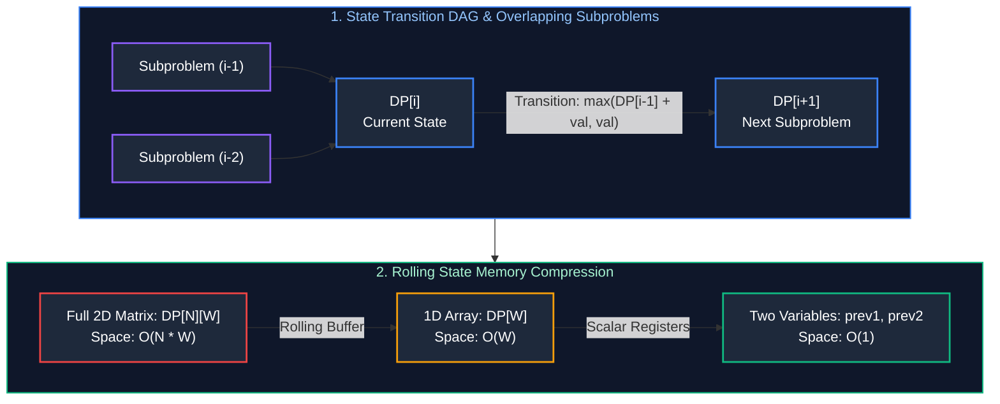

# 07. Dynamic Programming & State Transitions

A comprehensive, production-grade guide to Dynamic Programming (DP), Memoization vs. Tabulation, State-Space Compression, Kadane Variations (Circular Subarrays), Longest Increasing Subsequence (Patience Sorting), String DP (LCS & Edit Distance), Word Break, and Knapsack Patterns.

---

## Architectural Overview: State Transition Graphs & Space Optimization



---

## Table of Contents
1. [Dynamic Programming Foundations](#1-dynamic-programming-foundations)
   - 1.1 [Optimal Substructure & Overlapping Subproblems](#11-optimal-substructure--overlapping-subproblems)
   - 1.2 [Memoization (Top-Down) vs. Tabulation (Bottom-Up)](#12-memoization-top-down-vs-tabulation-bottom-up)
   - 1.3 [State Space Reduction to $O(1)$ Scalars](#13-state-space-reduction-to-o1-scalars)
2. [1D Array & Subarray Patterns](#2-1d-array--subarray-patterns)
   - 2.1 [Kadane's Algorithm for Maximum Subarray Sum](#21-kadanes-algorithm-for-maximum-subarray-sum)
   - 2.2 [Maximum Sum Circular Subarray (LeetCode 918)](#22-maximum-sum-circular-subarray-leetcode-918)
   - 2.3 [House Robber I & II](#23-house-robber-i--ii)
3. [Subsequence Optimization & Patience Sorting](#3-subsequence-optimization--patience-sorting)
   - 3.1 [Longest Increasing Subsequence ($O(N^2) \to O(N \log N)$)](#31-longest-increasing-subsequence-on2-to-on-log-n)
4. [String Dynamic Programming](#4-string-dynamic-programming)
   - 4.1 [Longest Common Subsequence (LCS)](#41-longest-common-subsequence-lcs)
   - 4.2 [Edit Distance (Levenshtein Distance)](#42-edit-distance-levenshtein-distance)
   - 4.3 [Word Break Problem (DP with HashSet & Prefix Trie)](#43-word-break-problem-dp-with-hashset--prefix-trie)
5. [The Knapsack Patterns](#5-the-knapsack-patterns)
   - 5.1 [0/1 Knapsack & Target Sum](#51-01-knapsack--target-sum)
   - 5.2 [Unbounded Knapsack: Coin Change I & II](#52-unbounded-knapsack-coin-change-i--ii)
6. [Practice Problems by Difficulty Tier](#6-practice-problems-by-difficulty-tier)
7. [Summary & Engineering Reference Matrix](#7-summary--engineering-reference-matrix)
8. [References & Further Reading](#8-references--further-reading)

---

# 1. Dynamic Programming Foundations

### 1.1 Optimal Substructure & Overlapping Subproblems
- **Optimal Substructure:** An optimal solution to the problem can be constructed from optimal solutions to its subproblems.
- **Overlapping Subproblems:** The same subproblems are solved repeatedly throughout the recursive tree.

### 1.2 Memoization vs. Tabulation
- **Memoization (Top-Down):** Recursively explores the state tree, storing calculated subproblems in an auxiliary cache table. (Intuitive to write; consumes $O(N)$ recursion call stack space).
- **Tabulation (Bottom-Up):** Iteratively fills a state table starting from the base cases. (Eliminates recursion overhead and enables space compression).

### 1.3 State Space Reduction to $O(1)$ Scalars
When a recurrence relation depends only on a fixed number of preceding states (e.g., $DP[i] = DP[i-1] + DP[i-2]$), the full $O(N)$ table can be discarded. Storing only two scalar variables (`prev1` and `prev2`) reduces space complexity from $O(N)$ to $O(1)$!

---

# 2. 1D Array & Subarray Patterns

### 2.1 Kadane's Algorithm for Maximum Subarray Sum (LeetCode 53)
**State Definition:** `dp[i]` is the maximum subarray sum ending strictly at index `i`.
$$\text{dp}[i] = \max(A[i], \text{dp}[i-1] + A[i])$$
Since `dp[i]` depends only on `dp[i-1]`, we maintain two scalars: `currentMax` and `globalMax`. Time: $O(N)$, Space: $O(1)$.

### 2.2 Maximum Sum Circular Subarray (LeetCode 918)
In a circular array, the maximum subarray either:
1. **Does not wrap around:** Handled by standard Kadane's algorithm: $\text{maxKadane}$.
2. **Wraps around:** Inverts the problem! The wrapped maximum equals:
   $$\text{TotalSum} - \text{minKadane}$$
   *(where $\text{minKadane}$ is the minimum subarray sum found using inverted Kadane logic)*.
3. **Corner Case:** If all numbers are negative, $\text{TotalSum} - \text{minKadane} == 0$. Return $\text{maxKadane}$.

```java
public class CircularSubarrayMax {
    public int maxSubarraySumCircular(int[] nums) {
        int totalSum = 0;
        int currMax = 0, maxKadane = nums[0];
        int currMin = 0, minKadane = nums[0];

        for (int x : nums) {
            currMax = Math.max(x, currMax + x);
            maxKadane = Math.max(maxKadane, currMax);

            currMin = Math.min(x, currMin + x);
            minKadane = Math.min(minKadane, currMin);

            totalSum += x;
        }

        // If all numbers are negative, maxKadane is the maximum negative number
        if (maxKadane < 0) return maxKadane;

        return Math.max(maxKadane, totalSum - minKadane);
    }
}
```

---

# 3. Subsequence Optimization & Patience Sorting

### 3.1 Longest Increasing Subsequence ($O(N^2) \to O(N \log N)$) (LeetCode 300)

- Standard DP: $\text{dp}[i] = 1 + \max_{j < i, A[j] < A[i]} \text{dp}[j] \implies O(N^2)$ time.
- **Patience Sorting with Binary Search ($O(N \log N)$):**
  Maintain an array `tails`, where `tails[len]` stores the **smallest tail element** of all increasing subsequences of length `len + 1`.
  - For each element $x$:
    - Use binary search (`Arrays.binarySearch`) to locate where $x$ fits into `tails`.
    - If $x$ is larger than all elements in `tails`, append it (increments LIS length).
    - Else, overwrite the first element in `tails` that is $\ge x$ (lowers the boundary for future candidates).

```java
import java.util.Arrays;

public class LongestIncreasingSubsequence {
    public int lengthOfLIS(int[] nums) {
        int[] tails = new int[nums.length];
        int size = 0;

        for (int x : nums) {
            int i = 0, j = size;
            while (i < j) {
                int mid = i + (j - i) / 2;
                if (tails[mid] < x) {
                    i = mid + 1;
                } else {
                    j = mid;
                }
            }
            tails[i] = x;
            if (i == size) size++;
        }
        return size;
    }
}
```

---

# 4. String Dynamic Programming

### 4.1 Longest Common Subsequence (LCS) (LeetCode 1143)
$$\text{dp}[i][j] = \begin{cases} 1 + \text{dp}[i-1][j-1] & \text{if } s_1[i-1] == s_2[j-1] \\ \max(\text{dp}[i-1][j], \text{dp}[i][j-1]) & \text{if } s_1[i-1] \neq s_2[j-1] \end{cases}$$
Time: $O(M \cdot N)$, Space: $O(\min(M, N))$ using two rolling rows.

### 4.2 Edit Distance (Levenshtein Distance) (LeetCode 72)
$$\text{dp}[i][j] = \begin{cases} \text{dp}[i-1][j-1] & \text{if } s_1[i-1] == s_2[j-1] \\ 1 + \min(\text{dp}[i][j-1] \text{ [insert]}, \text{dp}[i-1][j] \text{ [delete]}, \text{dp}[i-1][j-1] \text{ [replace]}) & \text{otherwise} \end{cases}$$

### 4.3 Word Break Problem (LeetCode 139)
**State Definition:** `dp[i]` is true if the prefix substring $S[0 \dots i-1]$ can be segmented into dictionary words.
$$\text{dp}[i] = \bigvee_{j=0}^{i-1} (\text{dp}[j] \wedge (S[j \dots i-1] \in \text{Dict}))$$

```java
import java.util.HashSet;
import java.util.List;
import java.util.Set;

public class WordBreakSolution {
    public boolean wordBreak(String s, List<String> wordDict) {
        Set<String> dict = new HashSet<>(wordDict);
        boolean[] dp = new boolean[s.length() + 1];
        dp[0] = true; // Base case: empty string

        int maxWordLen = 0;
        for (String w : wordDict) maxWordLen = Math.max(maxWordLen, w.length());

        for (int i = 1; i <= s.length(); i++) {
            // Optimization: Only check prefixes up to maxWordLen
            for (int j = i - 1; j >= Math.max(0, i - maxWordLen); j--) {
                if (dp[j] && dict.contains(s.substring(j, i))) {
                    dp[i] = true;
                    break;
                }
            }
        }
        return dp[s.length()];
    }
}
```

---

# 5. The Knapsack Patterns

### 5.1 0/1 Knapsack & Target Sum
Each item can be chosen **at most once**.
- When compressing to a 1D array `dp[w]`, we **must iterate backwards** from capacity $W$ down to item weight $w_i$:
  $$\text{dp}[w] = \max(\text{dp}[w], \text{dp}[w - w_i] + v_i)$$
  *(Iterating backwards ensures each item is evaluated only once, preventing duplicate reuse)*.

### 5.2 Unbounded Knapsack: Coin Change I & II
Each item can be chosen **infinitely many times**.
- **Coin Change I (Minimum Coins to make Amount):**
  Iterate forwards: $\text{dp}[a] = \min(\text{dp}[a], 1 + \text{dp}[a - \text{coin}])$.
- **Coin Change II (Number of Unique Combinations):**
  Outer loop over coins, inner loop over amounts (prevents counting permutations like $[1, 2]$ and $[2, 1]$ as distinct combinations).

---

# 6. Practice Problems by Difficulty Tier

| Difficulty | Problem Name | Core Pattern | LeetCode Link | Complexity |
| :---: | :--- | :--- | :---: | :---: |
| **Easy** | Climbing Stairs | 1D Fibonacci DP | LC 70 | $O(N) \text{ time}, O(1) \text{ space}$ |
| **Easy** | Maximum Subarray | Kadane's Algorithm | LC 53 | $O(N) \text{ time}, O(1) \text{ space}$ |
| **Medium** | Maximum Sum Circular Subarray | Dual Kadane (Max/Min) | LC 918 | $O(N) \text{ time}, O(1) \text{ space}$ |
| **Medium** | Longest Increasing Subsequence | Patience Sort / Binary Search | LC 300 | $O(N \log N) \text{ time}, O(N) \text{ space}$ |
| **Medium** | Word Break | Prefix DP with HashSet | LC 139 | $O(N \cdot L) \text{ time}, O(N) \text{ space}$ |
| **Medium** | Coin Change | Unbounded Knapsack | LC 322 | $O(N \cdot \text{Amount}) \text{ time}, O(\text{Amount}) \text{ space}$ |
| **Medium** | Longest Common Subsequence | 2D Grid DP | LC 1143 | $O(M \cdot N) \text{ time}, O(\min(M, N)) \text{ space}$ |
| **Hard** | Edit Distance | 2D Levenshtein Transition | LC 72 | $O(M \cdot N) \text{ time}, O(\min(M, N)) \text{ space}$ |
| **Hard** | Trapping Rain Water | DP Left/Right Max Bounds | LC 42 | $O(N) \text{ time}, O(1) \text{ space}$ |

---

# 7. Summary & Engineering Reference Matrix

| DP Pattern | Loop Direction | State Representation | Space Optimization |
| :--- | :--- | :--- | :--- |
| **Kadane Subarray** | Forward $0 \to N-1$ | `dp[i]`: Max ending at index $i$ | $O(1)$ single scalar `currMax` |
| **Patience LIS** | Forward $0 \to N-1$ | `tails[len]`: Smallest tail element | $O(N \log N)$ via Binary Search |
| **0/1 Knapsack** | Backwards $W \to w_i$ | `dp[w]`: Max value at capacity $w$ | $O(W)$ 1D array |
| **Unbounded Knapsack** | Forwards $w_i \to W$ | `dp[w]`: Min coins at capacity $w$ | $O(W)$ 1D array |
| **2D String DP** | Forward $1 \to M, 1 \to N$ | `dp[i][j]`: Alignment of prefixes | $O(\min(M, N))$ rolling 2 rows |

---

# 8. References & Further Reading
- Richard Bellman, *Dynamic Programming* (Princeton University Press).
- Cormen, Leiserson, Rivest, Stein, *Introduction to Algorithms (CLRS): Chapter 15*.
- Sanjoy Dasgupta, Christos Papadimitriou, Umesh Vazirani, *Algorithms: Chapter 6*.

