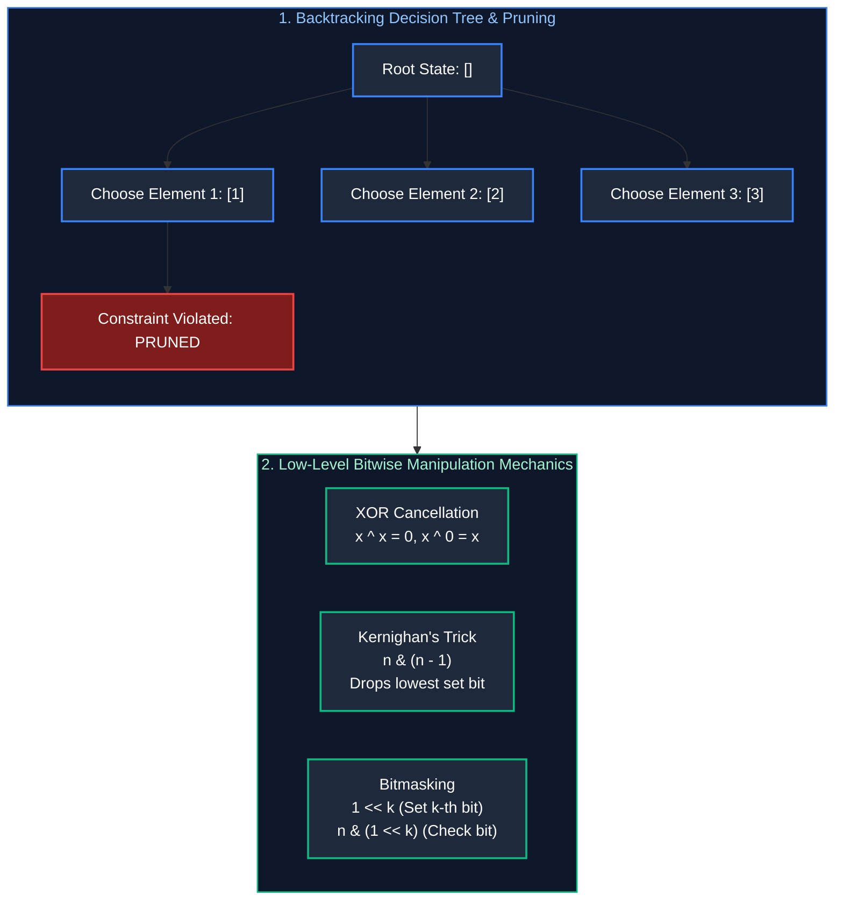

# 08. Backtracking & Bit Manipulation

A comprehensive, production-grade guide to Backtracking, State-Space Tree Pruning, Combinatorial Search (Subsets, Permutations, Combinations), Constraint Satisfaction (N-Queens & Sudoku), and Bit Manipulation Mechanics (XOR properties, Brian Kernighan's Algorithm, and Bitmasking).

---

## Architectural Overview: Combinatorial Search Space & Bitwise Operations



---

## Table of Contents
1. [The Backtracking Framework](#1-the-backtracking-framework)
   - 1.1 [The 3 Pillars: Choice, Constraints & Goal](#11-the-3-pillars-choice-constraints--goal)
   - 1.2 [State Space Tree Pruning](#12-state-space-tree-pruning)
2. [Combinatorial Search Patterns](#2-combinatorial-search-patterns)
   - 2.1 [Subsets I & II (Handling Duplicates)](#21-subsets-i--ii-handling-duplicates)
   - 2.2 [Permutations I & II](#22-permutations-i--ii)
   - 2.3 [Combination Sum I & II](#23-combination-sum-i--ii)
3. [Constraint Satisfaction Problems](#3-constraint-satisfaction-problems)
   - 3.1 [N-Queens (Bitmask Optimized)](#31-n-queens-bitmask-optimized)
   - 3.2 [Sudoku Solver](#32-sudoku-solver)
4. [Bit Manipulation Mechanics](#4-bit-manipulation-mechanics)
   - 4.1 [XOR Algebraic Invariants](#41-xor-algebraic-invariants)
   - 4.2 [Single Number I, II & III](#42-single-number-i-ii--iii)
   - 4.3 [Brian Kernighan's Algorithm (`n & (n - 1)`)](#43-brian-kernighans-algorithm-n--n---1)
   - 4.4 [Bitmask State Representation for Subsets](#44-bitmask-state-representation-for-subsets)
5. [Practice Problems by Difficulty Tier](#5-practice-problems-by-difficulty-tier)
6. [Summary & Engineering Reference Matrix](#6-summary--engineering-reference-matrix)
7. [References & Further Reading](#7-references--further-reading)

---

# 1. The Backtracking Framework

### 1.1 The 3 Pillars: Choice, Constraints & Goal
Backtracking is a systematic, depth-first traversal of a combinatorial state tree:
1. **Choice:** What is the next valid action? (e.g., place queen at $(r, c)$, add `nums[i]` to path).
2. **Constraints:** Is the choice valid given preceding state? (e.g., no queens on same column/diagonal).
3. **Goal:** Have we reached a complete solution? (e.g., path length equals $N$).
4. **Backtrack (Undo):** Revert the state change so subsequent branches can explore alternatives cleanly.

### 1.2 State Space Tree Pruning
Sorting inputs prior to backtracking allows **pruning entire subtrees**:
If `currentSum + nums[i] > target`, because the array is sorted, every subsequent $j > i$ will also violate the constraint. Breaking the loop immediately saves thousands of recursive invocations.

---

# 2. Combinatorial Search Patterns

### 2.1 Subsets I & II (Handling Duplicates) (LeetCode 78 & 90)
In Subsets II (with duplicate numbers), sort the array first. When iterating through candidate elements at the current depth, skip duplicate numbers:
`if (i > start && nums[i] == nums[i - 1]) continue;`

```java
import java.util.*;

public class SubsetsSolutions {
    public List<List<Integer>> subsetsWithDup(int[] nums) {
        Arrays.sort(nums);
        List<List<Integer>> result = new ArrayList<>();
        backtrack(nums, 0, new ArrayList<>(), result);
        return result;
    }

    private void backtrack(int[] nums, int start, List<Integer> current, List<List<Integer>> result) {
        result.add(new ArrayList<>(current)); // Record valid subset

        for (int i = start; i < nums.length; i++) {
            if (i > start && nums[i] == nums[i - 1]) continue; // Skip duplicate branch
            current.add(nums[i]);
            backtrack(nums, i + 1, current, result);
            current.remove(current.size() - 1); // Backtrack
        }
    }
}
```

### 2.2 Permutations I & II (LeetCode 46 & 47)
Unlike subsets (which advance `start` index), permutations explore all remaining unvisited elements using a `boolean[] used` array. For Permutations II (with duplicates):
`if (used[i] || (i > 0 && nums[i] == nums[i - 1] && !used[i - 1])) continue;`

---

# 3. Constraint Satisfaction Problems

### 3.1 N-Queens (Bitmask Optimized) (LeetCode 51)
Traditional N-Queens tracks columns and diagonals using sets or arrays. Using **Bitmasks** stores column, main diagonal ($\backslash$), and anti-diagonal ($/$) occupied states in three 32-bit integer registers:
- `cols`: `cols | (1 << col)`
- `diag1`: `diag1 | (1 << (row + col))`
- `diag2`: `diag2 | (1 << (row - col + n))`
Checking if a position is safe executes in a single bitwise operation:
$$\text{isSafe} = ((\text{cols} \ | \ \text{diag1} \ | \ \text{diag2}) \ \& \ (1 \ll \text{col})) == 0$$

---

# 4. Bit Manipulation Mechanics

### 4.1 XOR Algebraic Invariants
- Commutative: $A \oplus B = B \oplus A$
- Associative: $A \oplus (B \oplus C) = (A \oplus B) \oplus C$
- Identity: $A \oplus 0 = A$
- Self-Inverse: $A \oplus A = 0$

### 4.2 Single Number I, II & III
- **Single Number I (Every element appears twice except one):**
  XOR all elements together. Identical pairs cancel out to 0:
  $$\text{Result} = X_1 \oplus X_1 \oplus X_2 \oplus X_2 \dots \oplus U = U$$
- **Single Number III (Two unique elements, all others appear twice):**
  1. XOR all numbers $\implies X = U_1 \oplus U_2$.
  2. Because $U_1 \neq U_2$, at least one bit in $X$ is 1. Isolate the lowest set bit using `diff = X & (-X)`.
  3. Partition all numbers into two groups based on whether that bit is set. XOR each group independently to isolate $U_1$ and $U_2$!

```java
public int[] singleNumberIII(int[] nums) {
    int xor = 0;
    for (int n : nums) xor ^= n;

    int lowestSetBit = xor & (-xor); // Isolates lowest 1-bit

    int[] result = new int[2];
    for (int n : nums) {
        if ((n & lowestSetBit) == 0) {
            result[0] ^= n;
        } else {
            result[1] ^= n;
        }
    }
    return result;
}
```

### 4.3 Brian Kernighan's Algorithm (`n & (n - 1)`)
Subtracting 1 from a binary number flips all bits from the rightmost set bit to the end:
$$n = 10100_2, \quad n - 1 = 10011_2 \implies n \ \& \ (n - 1) = 10000_2$$
`n & (n - 1)` drops the lowest set bit in a single CPU instruction!
- **Power of Two Check:** `n > 0 && (n & (n - 1)) == 0`.
- **Counting Set Bits:** Loops exactly as many times as there are 1-bits ($O(\text{setBits})$).

### 4.4 Bitmask State Representation for Subsets
For an array of length $N$, iterate integer $mask$ from $0$ to $2^N - 1$. The $k$-th bit of $mask$ indicates whether `nums[k]` is included in the current subset:
$$\text{Included} = (mask \ \& \ (1 \ll k)) \neq 0$$
Generates all $2^N$ subsets iteratively with zero recursion overhead!

---

# 5. Practice Problems by Difficulty Tier

| Difficulty | Problem Name | Core Pattern | LeetCode Link | Complexity |
| :---: | :--- | :--- | :---: | :---: |
| **Easy** | Single Number | XOR Cancellation | LC 136 | $O(N) \text{ time}, O(1) \text{ space}$ |
| **Easy** | Number of 1 Bits | Brian Kernighan `n & (n - 1)` | LC 191 | $O(\text{setBits}) \text{ time}, O(1) \text{ space}$ |
| **Easy** | Counting Bits | DP on Bit Shifts | LC 338 | $O(N) \text{ time}, O(N) \text{ space}$ |
| **Medium** | Subsets II | Backtracking with Duplicate Pruning | LC 90 | $O(N \cdot 2^N) \text{ time}, O(N) \text{ space}$ |
| **Medium** | Permutations II | Visited Array Duplicate Defense | LC 47 | $O(N \cdot N!) \text{ time}, O(N) \text{ space}$ |
| **Medium** | Combination Sum | Backtracking with Reuse | LC 39 | $O(N^{\text{target}/M}) \text{ time}$ |
| **Medium** | Single Number III | XOR Lowest Set Bit Partition | LC 260 | $O(N) \text{ time}, O(1) \text{ space}$ |
| **Hard** | N-Queens | Bitmask Diagonal Constraints | LC 51 | $O(N!) \text{ time}, O(N) \text{ space}$ |
| **Hard** | Sudoku Solver | 3-Constraint Backtracking | LC 37 | $O(9^{81}) \text{ heavily pruned}$ |

---

# 6. Summary & Engineering Reference Matrix

| Technique | Invariant | Time Complexity | Memory Footprint |
| :--- | :--- | :--- | :--- |
| **Subsets Backtracking** | Advance `start` index $i+1$ | $O(N \cdot 2^N)$ | $O(N)$ recursion depth |
| **Permutations Backtracking**| Iterate all unvisited via `used[]` | $O(N \cdot N!)$ | $O(N)$ recursion depth |
| **Bitmask Subsets** | Integer loop $0 \to 2^N - 1$ | $O(N \cdot 2^N)$ | $O(1)$ auxiliary memory |
| **XOR Bit Cancellation** | $A \oplus A = 0$ | $O(N)$ single pass | $O(1)$ scalar |
| **Kernighan's Bit Drop** | $N \ \& \ (N - 1)$ clears lowest set bit | $O(\text{Bits Set})$ | $O(1)$ scalar |

---

# 7. References & Further Reading
- Donald Knuth, *The Art of Computer Programming, Volume 4A: Combinatorial Algorithms & Bitwise Tricks*.
- Henry S. Warren Jr., *Hacker's Delight*, 2nd Edition (Addison-Wesley).
- Cormen, Leiserson, Rivest, Stein, *Introduction to Algorithms (CLRS)*.

