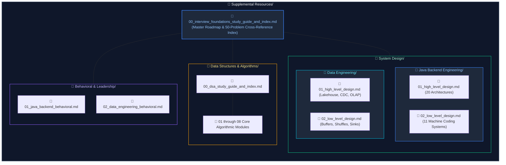

# Supplemental Resources: Universal Interview Preparation

This directory serves as the centralized knowledge base for universal software engineering interview preparation across three core pillars: **Data Structures & Algorithms (DSA)**, **System Design (High-Level Design & Low-Level Machine Coding)**, and **Behavioral & Engineering Leadership**.

For domain-specific engineering tracks across the repository, refer to:
- **Core Engineering Tracks**:
  - [Data Engineering](../Data%20Engineering/00_de_study_guide_and_index.md)
  - [Java Backend Engineering](../Java%20Backend%20Engineering/00_java_study_guide_and_index.md)
- **Supplemental Engineering Tracks**:
  - [Supplemental Engineering Tracks Overview](../Supplemental%20Engineering%20Tracks/README.md) (AI Engineering, Cloud Engineering, and Python Backend Engineering)
- **Repository Root**:
  - [Main Repository Overview](../README.md)

---

## Master Interview Syllabus & Cross-Reference Index

- **Master Track Syllabus**: [00. Interview Foundations Study Guide & Master Index](00_interview_foundations_study_guide_and_index.md)

The master syllabus maps out recommended chronological study orders, architectural blueprints, and a 50-problem canonical production-solution cross-reference matrix connecting theoretical patterns directly to real-world production incident response.

---

## 1. [Data Structures & Algorithms (DSA)](Data%20Structures%20&%20Algorithms/00_dsa_study_guide_and_index.md)

An 8-module progressive curriculum emphasizing memory layouts, hardware cache line locality, runtime complexity proofs ($O(N)$ derivations), core algorithmic patterns, and categorized LeetCode problem solutions:

- **Master Syllabus**: [`00. DSA Study Guide & Master Index`](Data%20Structures%20&%20Algorithms/00_dsa_study_guide_and_index.md)
- [`01. Linear Structures & Pointer Patterns`](Data%20Structures%20&%20Algorithms/01_linear_structures_and_pointer_patterns.md) — Array memory contiguous layouts, Convergent Two Pointers, Fast & Slow Pointers, Sliding Window, Monotonic Deque, Cyclic Sort, and Prefix Sums.
- [`02. Linked Lists, Stacks & Monotonic Structures`](Data%20Structures%20&%20Algorithms/02_linked_lists_stacks_and_monotonic_structures.md) — Singly/Doubly Linked Lists, in-place reversal, reverse in $k$-groups, Min-Stack, Monotonic Stack/Deque, and complete $O(1)$ LRU & LFU Caches.
- [`03. Trees, Binary Search Trees & Trie Architectures`](Data%20Structures%20&%20Algorithms/03_trees_binary_search_trees_and_tries.md) — Binary Trees & BSTs, Inorder/Pre/Post traversals, Zigzag Level-Order BFS, LCA, Tree Serialization/Deserialization, and Multi-Way Prefix Tries.
- [`04. Binary Search & Divide-and-Conquer`](Data%20Structures%20&%20Algorithms/04_binary_search_and_divide_and_conquer.md) — Midpoint overflow prevention, Rotated Sorted Array search, Binary Search on Answer / Feasibility Search, Merge Sort, and QuickSelect ($O(N)$ average).
- [`05. Heaps, Intervals & Greedy Algorithms`](Data%20Structures%20&%20Algorithms/05_heaps_intervals_and_greedy_algorithms.md) — Binary Heaps, $O(N)$ Heapify, Two Heaps (Continuous Running Median + $O(1)$ Loose Median), Top-K Frequent, Sweep-Line Intervals, and Greedy Decisions.
- [`06. Graphs, Topological Sort & Shortest Paths`](Data%20Structures%20&%20Algorithms/06_graphs_topological_sort_and_shortest_paths.md) — Adjacency representations, Bidirectional BFS (Word Ladder), 3-Color DFS Cycle Detection, Kahn's Topo Sort, Alien Dictionary, DSU with Rank, Dijkstra, 0-1 BFS, and Bellman-Ford.
- [`07. Dynamic Programming & State Transitions`](Data%20Structures%20&%20Algorithms/07_dynamic_programming_and_state_transitions.md) — Memoization vs Tabulation, State Space Compression, Kadane & Circular Maximum Subarray, Patience LIS ($O(N \log N)$), String DP (LCS & Edit Distance), Word Break, and Knapsack Patterns.
- [`08. Backtracking & Bit Manipulation`](Data%20Structures%20&%20Algorithms/08_backtracking_and_bit_manipulation.md) — State tree pruning, Combinatorial Search (Subsets, Permutations), N-Queens, XOR algebraic cancellations, Single Number I/II/III, Brian Kernighan bit trick, and Bitmasking.

---

## 2. System Design Track (HLD & LLD)

Tailored into two distinct engineering tracks covering 20 High-Level distributed architectures and 17 Low-Level design/machine coding systems:

### Java / Backend Engineering
- [`01. High-Level System Design (HLD)`](System%20Design/Java%20Backend%20Engineering/01_high_level_design.md) — 20 distributed architectures: URL Shortener, Multi-Region Active-Active Redirects, API Rate Limiter, Global CDN, 64-bit Snowflake ID Generator, Real-Time Chat (WhatsApp/Slack), Notification Engine, Video Streaming (YouTube/Netflix), Payments (Stripe), Flash Sale Checkout, Ride-Hailing (Uber), Uber Eats Homepage, Distributed Cache (Redis), File Storage (Dropbox), Autocomplete, Collaborative Docs, Job Scheduler, Workflow Engine, Feed System, and Billion-Scale Graph Search.
- [`02. Low-Level Design (LLD) & Machine Coding`](System%20Design/Java%20Backend%20Engineering/02_low_level_design.md) — 11 concurrency & machine coding challenges: Custom Bounded Queue & ThreadPool from scratch (no `ExecutorService`), Concurrent Sorted Linked List (ReadWriteLock), Segmented File Manager with byte-range locking, DAG Job Scheduler with dependency resolution, Playground Player Assignment with anti-starvation, Train & Platform Scheduler, In-Memory Twitter, In-Memory Pull-Based Message Queue, In-Memory Filesystem (`mkdir`, `pwd`, `cd` with wildcards), Rule Engine (AST/Composite), and Spotify LLD.

### Data Engineering
- [`01. High-Level System Design (HLD)`](System%20Design/Data%20Engineering/01_high_level_design.md) — Enterprise Multi-Hop Medallion Lakehouse (Bronze/Silver/Gold), Change Data Capture (CDC) at Petabyte Scale (Debezium + Kafka + Delta Lake), Sub-Second Real-Time OLAP Serving (ClickHouse / Apache Pinot), High-Throughput Geospatial Telemetry Ingestion (100M GPS pings/day), Hybrid Multi-Cloud Data Platforms, and Cross-Region Disaster Recovery (RPO/RTO).
- [`02. Low-Level Design (LLD) & Component Internals`](System%20Design/Data%20Engineering/02_low_level_design.md) — High-Throughput In-Memory Streaming Ring Buffer with Backpressure (Disruptor pattern), Stateful Sliding-Window Deduplication Engine, Custom Shuffle Partitioner & Disk Spill Manager (Spark-style), Columnar Row-Group Reader with Dictionary & Run-Length Encoding (RLE), Schema Evolution Compatibility Validator, and Resilient Database Batch Sink with DLQ.

---

## 3. Behavioral & Engineering Leadership

Role-tailored production scenario guides covering incident command, technical pushback, cross-functional triage, and architectural compromise:

- [`01. Java & Backend Engineering Behavioral`](Behavioral%20&%20Leadership/01_java_backend_behavioral.md) — Sev-1 incident command, cascading microservice thread pool exhaustion, JVM memory leaks & GC pauses, database deadlocks & connection pool sizing, pushing back on premature microservices, resolving REST vs. event-driven stalemates, delivering under tight product launch deadlines, expand-contract breaking API changes, and code review conflict resolution.
- [`02. Data Engineering Behavioral`](Behavioral%20&%20Leadership/02_data_engineering_behavioral.md) — Sev-1 Black Friday data skew OOM, 11 PM critical data quality discrepancy before 9 AM board meeting, pipeline failures affecting business revenue, Spark ETL optimization (6.7h to 48m), Spark cluster cost optimization vs. SLAs, distinguishing infra vs. data defects, Azure + Databricks + Snowflake hybrid architectures, and CI/CD for Spark/ADF.

---

## Summary Directory Map

