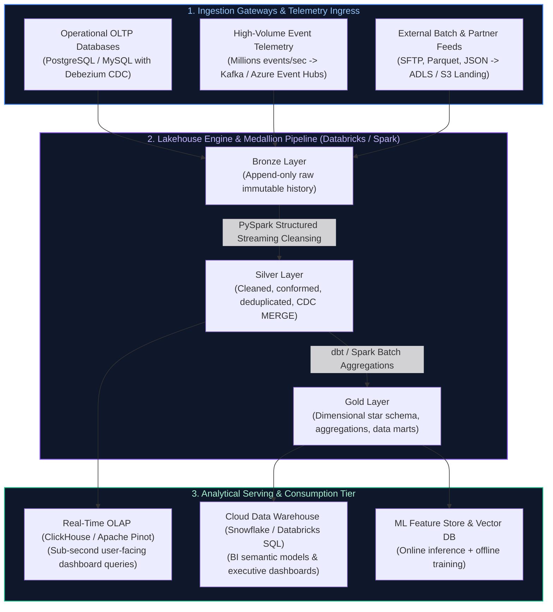
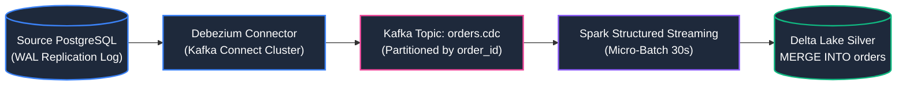
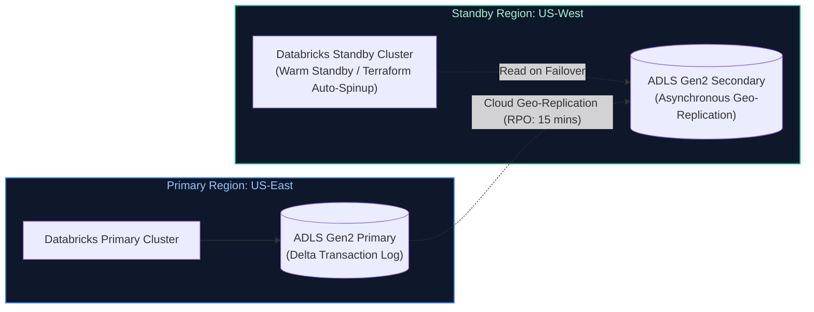

# 01. Data Engineering: High-Level System Design (HLD)

A comprehensive, production-grade guide to enterprise Data Platform High-Level Design, streaming Lakehouses, real-time CDC, sub-second analytical OLAP architectures, multi-cloud warehousing, and disaster recovery tailored for Senior, Staff, and Principal Data Engineers.

---

## Architectural Overview: Enterprise Multi-Tier Real-Time Lakehouse



---

## Table of Contents & Scenario Mapping

1. **High-Throughput Lakehouse Architectures (The Medallion Pattern)**
   - [DE-HLD 1. Enterprise Multi-Hop Medallion Lakehouse Architecture](#de-hld-1-enterprise-multi-hop-medallion-lakehouse-architecture)
   - [DE-HLD 2. Change Data Capture (CDC) at Petabyte Scale (Debezium + Kafka + Delta Lake)](#de-hld-2-change-data-capture-cdc-at-petabyte-scale-debezium--kafka--delta-lake)
2. **Real-Time Streaming & Sub-Second Analytical Serving**
   - [DE-HLD 3. Sub-Second Real-Time OLAP Serving Architecture (ClickHouse / Apache Pinot)](#de-hld-3-sub-second-real-time-olap-serving-architecture-clickhouse--apache-pinot)
   - [DE-HLD 4. High-Throughput Geospatial Telemetry Ingestion (100M GPS Pings/Day)](#de-hld-4-high-throughput-geospatial-telemetry-ingestion-100m-gps-pingsday)
3. **Multi-Cloud Warehousing, Disaster Recovery & Governance**
   - [DE-HLD 5. Hybrid Multi-Cloud Data Platform (Azure Synapse + Databricks + Snowflake)](#de-hld-5-hybrid-multi-cloud-data-platform-azure-synapse--databricks--snowflake)
   - [DE-HLD 6. Cross-Region Disaster Recovery & Active-Active Data Replication](#de-hld-6-cross-region-disaster-recovery--active-active-data-replication)

---

# 1. High-Throughput Lakehouse Architectures (The Medallion Pattern)

---

### DE-HLD 1. Enterprise Multi-Hop Medallion Lakehouse Architecture
**Core Mechanics:** Raw Immutable Storage (Bronze) $\to$ Curated Conformed Entities (Silver) $\to$ Aggregated Business Marts (Gold).

#### Architectural Walkthrough
1. **Bronze (Raw Zone):**
   - Ingests data from Kafka, Event Hubs, and cloud storage via Databricks Auto Loader (`cloudFiles`).
   - Retains exact source schema, raw binary payloads, ingestion timestamps, and file metadata.
   - Strictly append-only; zero schema validation failure rejections (raw bytes preserved for auditability).
2. **Silver (Curated Zone):**
   - Enforces Great Expectations quality contracts (`expect_or_drop`, `expect_or_fail`).
   - Cleanses, standardizes data types, deduplicates on natural keys, masks PII (GDPR/HIPAA compliance), and performs CDC `MERGE INTO` operations with ACID guarantees.
3. **Gold (Serving Zone):**
   - Modeled using Kimball dimensional modeling (Facts and Dimensions with SCD Type 2 tracking).
   - Optimized with Z-Ordering and clustering keys on high-cardinality query slicers.

> [!TIP]
> **Deep-Dive Interview Scenario(s):**
> - For granular late-arriving data strategies, watermarks, and stateful deduplication, see [Data Engineering: 10. System Design Master Guide](../../../Data%20Engineering/10_system_design_for_data_engineering.md#anchor) and [DE FAQ 10: Enterprise System Design Capstone](../../../Data%20Engineering/frequently_asked_questions/10_system_design_for_data_engineering_faq.md#q4-enterprise-system-design-capstone-global-real-time-analytics-lakehouse).

---

### DE-HLD 2. Change Data Capture (CDC) at Petabyte Scale (Debezium + Kafka + Delta Lake)
**Core Mechanics:** Transaction Log Mining, Ordered Event Streams, Idempotent Delta MERGE.



1. **Transaction Log Mining:** Debezium reads PostgreSQL Write-Ahead Logs (WAL) or MySQL binlogs directly without issuing SQL `SELECT` queries, avoiding performance overhead on OLTP workloads.
2. **Ordering Guarantee:** CDC events must be partitioned on the source primary key (`order_id`) so all mutation events (`INSERT`, `UPDATE`, `DELETE`) for a specific entity arrive in strict monotonic sequence within a single Kafka partition.
3. **Idempotent Silver Merge:**
   ```sql
   MERGE INTO orders_silver target
   USING (
       SELECT * FROM (
           SELECT *, ROW_NUMBER() OVER (PARTITION BY order_id ORDER BY cdc_timestamp DESC) as rnk
           FROM cdc_microbatch_stage
       ) WHERE rnk = 1
   ) source
   ON target.order_id = source.order_id
   WHEN MATCHED AND source.op = 'D' THEN DELETE
   WHEN MATCHED AND source.cdc_timestamp > target.last_updated_at THEN UPDATE SET *
   WHEN NOT MATCHED AND source.op != 'D' THEN INSERT *;
   ```

---

# 2. Real-Time Streaming & Sub-Second Analytical Serving

---

### DE-HLD 3. Sub-Second Real-Time OLAP Serving Architecture (ClickHouse / Apache Pinot)
**Core Mechanics:** Columnar Vectorization, Real-Time Ingestion from Kafka, In-Memory Sparse Indexes.

#### Why Cloud Data Warehouses (Snowflake/Redshift) Fail at Real-Time User Facing Dashboards
- Snowflake and Databricks SQL excel at internal batch reporting (query latency 1–5 seconds across gigabytes).
- User-facing applications (e.g. Uber passenger surge pricing, financial portfolio live charts) require **5,000+ QPS with sub-50ms latency**, which would cost hundreds of thousands of dollars on Snowflake compute credits.
- **The Solution:** Stream curated Silver events into a specialized **Real-Time OLAP engine (ClickHouse or Apache Pinot)**:
  - Vectorized SIMD execution engines.
  - Direct ingestion from Kafka brokers without intermediate file writes.
  - Primary sparse indexes sorted by `(tenant_id, event_date, event_type)` ensuring minimal block reads from disk.

---

### DE-HLD 4. High-Throughput Geospatial Telemetry Ingestion (100M GPS Pings/Day)
**Core Mechanics:** Hexagonal Discrete Global Grid Systems (Uber H3), Sliding Window Aggregation, Tile Caching.

1. **Ingress Tier:** 100M daily pings ($\approx 1,200$ pings/sec average, 10,000 peak) are received via edge HTTP Load Balancers and pushed into Kafka partitioned by `vehicle_id`.
2. **Spatial Indexing Worker:** Spark Streaming workers parse GPS coordinates, project them into **Uber H3 resolution 8 cells**, and compute instantaneous speed, heading delta, and distance traveled.
3. **Serving Tier:** Real-time vehicle positions are written to Redis Geospatial indexes for mobile client dispatch, while analytical historical pings are appended to Delta Lake partitioned by `date` and clustered by `h3_index`.

---

# 3. Multi-Cloud Warehousing, Disaster Recovery & Governance

---

### DE-HLD 5. Hybrid Multi-Cloud Data Platform (Azure Synapse + Databricks + Snowflake)
**Core Mechanics:** Storage Decoupling, Unified Governance (Unity Catalog / Apache Polaris), Inter-Cloud Change Streams.

#### Architecture Blueprint
- **Landing & Ingestion:** Azure Data Factory and Event Hubs landing raw events in ADLS Gen2 object storage.
- **Lakehouse Processing:** Azure Databricks running PySpark for heavy ETL, data science, and ML training.
- **Enterprise Warehousing:** Curated Gold marts staged to Snowflake via external stages, enabling business analysts to query data using ANSI SQL with zero warehouse maintenance overhead.

---

### DE-HLD 6. Cross-Region Disaster Recovery & Active-Active Data Replication
**Core Mechanics:** Asynchronous Object Store Replication (RA-GRS), Metastore Synchronization, Delta Standby Clusters.



1. **RPO & RTO Invariants:**
   - **Recovery Point Objective (RPO):** Maximum tolerable data loss. Set to $< 15\text{ minutes}$ via cloud storage asynchronous cross-region replication.
   - **Recovery Time Objective (RTO):** Maximum tolerable downtime. Set to $< 30\text{ minutes}$ using pre-configured Terraform IaC scripts that provision compute clusters in the secondary region on demand.
2. **Delta Lake Transaction Log Consistency:** Because Delta Lake uses an atomic append-only JSON transaction log (`_delta_log/`), partial file syncs during an outage never corrupt table state. The standby cluster simply queries the last completely synced version snapshot.

---

## Summary & Data Engineering High-Level Design Reference Matrix

| Architectural Pattern | Primary Engine | Storage Format | Typical Latency SLA | Key Production Failure Mode |
| :--- | :--- | :--- | :--- | :--- |
| **Medallion Lakehouse** | Apache Spark / Databricks | Delta Lake / Parquet | 5–15 minutes (Micro-batch) | Small file problem; uncompacted transaction logs |
| **CDC Pipeline** | Debezium + Kafka | Delta ACID MERGE | 10–30 seconds | Out-of-order mutations breaking entity state |
| **Real-Time OLAP** | ClickHouse / Apache Pinot | Columnar Sparse Index | $< 50\text{ milliseconds}$ | Memory exhaustion on wide unindexed group-by scans |
| **Geospatial Telemetry** | Spark + Redis Geo | H3 Hexagons / Parquet | $< 500\text{ milliseconds}$ | Full table spatial scan without discrete hexagonal indexing |
| **Disaster Recovery** | Cross-region cloud storage | RA-GRS Delta Storage | RPO: 15m, RTO: 30m | Incomplete metastore sync or cloud quota exhaustion |

---

## References & Further Reading
- Martin Kleppmann, *Designing Data-Intensive Applications* (O'Reilly).
- Joe Reis & Matt Housley, *Fundamentals of Data Engineering* (O'Reilly).
- Michael Armbrust et al., *Lakehouse: A New Generation of Open Platforms that Unify Data Warehousing and Advanced Analytics* (CIDR).
- Alexey Milovidov, *ClickHouse: Ultra-fast Columnar Database for Real-Time Analytics*.

