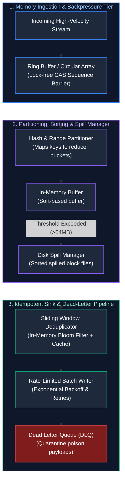

# 02. Data Engineering: Low-Level Design (LLD) & Component Internals

A comprehensive, production-grade guide answering real-world Data Engineering Low-Level Design (LLD), streaming memory internals, shuffle partitioners, columnar format mechanics, and custom pipeline component implementations for Senior, Staff, and Principal Data Engineers.

---

## Architectural Overview: Component Internals of a Streaming Data Engine



---

## Table of Contents & Scenario Mapping

1. **Streaming Memory Buffers & Concurrency Control**
   - [DE-LLD 1. Design a High-Throughput In-Memory Streaming Ring Buffer with Backpressure](#de-lld-1-design-a-high-throughput-in-memory-streaming-ring-buffer-with-backpressure)
   - [DE-LLD 2. Stateful Stream Deduplication Engine with Sliding Time Window](#de-lld-2-stateful-stream-deduplication-engine-with-sliding-time-window)
2. **Shuffle Mechanics & Spill Management**
   - [DE-LLD 3. Custom Shuffle Partitioner & Disk Spill Manager (Spark-Style)](#de-lld-3-custom-shuffle-partitioner--disk-spill-manager-spark-style)
3. **Data Encoding & Storage Format Internals**
   - [DE-LLD 4. Columnar Storage Row-Group Reader with Dictionary & Run-Length Encoding (RLE)](#de-lld-4-columnar-storage-row-group-reader-with-dictionary--run-length-encoding-rle)
   - [DE-LLD 5. Schema Evolution Compatibility Validator (Backward, Forward & Full)](#de-lld-5-schema-evolution-compatibility-validator-backward-forward--full)
4. **Resilient Sinks & Error Handling**
   - [DE-LLD 6. Rate-Limited Database Batch Sink with Exponential Backoff & Dead Letter Queue (DLQ)](#de-lld-6-rate-limited-database-batch-sink-with-exponential-backoff--dead-letter-queue-dlq)

---

# 1. Streaming Memory Buffers & Concurrency Control

---

### DE-LLD 1. Design a High-Throughput In-Memory Streaming Ring Buffer with Backpressure
**Design Focus:** Lock-Free Ring Buffers, Sequence Barriers, False Sharing Prevention, Backpressure Signaling.

#### Complete Production Implementation (Java)
```java
import java.util.concurrent.atomic.AtomicLong;
import java.util.concurrent.locks.LockSupport;

public class StreamingRingBuffer<T> {
    private final Object[] ring;
    private final int capacity;
    private final int mask;

    private final AtomicLong writeSequence = new AtomicLong(-1);
    private final AtomicLong readSequence = new AtomicLong(-1);

    public StreamingRingBuffer(int capacity) {
        if (Integer.bitCount(capacity) != 1) {
            throw new IllegalArgumentException("Capacity must be a power of 2 for fast modulo masking");
        }
        this.capacity = capacity;
        this.mask = capacity - 1;
        this.ring = new Object[capacity];
    }

    public void publish(T event) {
        long currentWrite;
        long nextWrite;

        // Apply backpressure if buffer is full
        while (true) {
            currentWrite = writeSequence.get();
            nextWrite = currentWrite + 1;
            long currentRead = readSequence.get();

            if (nextWrite - currentRead <= capacity) {
                if (writeSequence.compareAndSet(currentWrite, nextWrite)) {
                    break; // Claimed sequence slot
                }
            } else {
                // Backpressure wait (100 microseconds park)
                LockSupport.parkNanos(100_000);
            }
        }

        int index = (int) (nextWrite & mask);
        ring[index] = event;
    }

    @SuppressWarnings("unchecked")
    public T poll() {
        while (true) {
            long currentRead = readSequence.get();
            long nextRead = currentRead + 1;
            long currentWrite = writeSequence.get();

            if (nextRead <= currentWrite) {
                if (readSequence.compareAndSet(currentRead, nextRead)) {
                    int index = (int) (nextRead & mask);
                    T item = (T) ring[index];
                    ring[index] = null; // Prevent memory leak
                    return item;
                }
            } else {
                return null; // Empty buffer
            }
        }
    }
}
```

---

### DE-LLD 2. Stateful Stream Deduplication Engine with Sliding Time Window
**Design Focus:** Event-Time Ordering, Watermarking, In-Memory Sliding TTL State Store.

```java
import java.util.Iterator;
import java.util.LinkedHashMap;
import java.util.Map;

public class SlidingWindowDeduplicator {
    private final long windowDurationMillis;
    // LinkedHashMap with access-order preserves arrival timestamps for eviction
    private final LinkedHashMap<String, Long> seenMessageIds = new LinkedHashMap<>(1000, 0.75f, false);

    public SlidingWindowDeduplicator(long windowDurationMillis) {
        this.windowDurationMillis = windowDurationMillis;
    }

    public synchronized boolean isDuplicate(String messageId, long eventTimestampMillis) {
        evictExpiredEntries(eventTimestampMillis);

        if (seenMessageIds.containsKey(messageId)) {
            return true; // Duplicate detected
        }

        seenMessageIds.put(messageId, eventTimestampMillis);
        return false;
    }

    private void evictExpiredEntries(long currentWatermarkMillis) {
        long expirationThreshold = currentWatermarkMillis - windowDurationMillis;
        Iterator<Map.Entry<String, Long>> it = seenMessageIds.entrySet().iterator();

        while (it.hasNext()) {
            Map.Entry<String, Long> entry = it.next();
            if (entry.getValue() < expirationThreshold) {
                it.remove(); // Evict entry older than sliding window
            } else {
                break; // Because elements are time-ordered, break on first unexpired entry
            }
        }
    }
}
```

---

# 2. Shuffle Mechanics & Spill Management

---

### DE-LLD 3. Custom Shuffle Partitioner & Disk Spill Manager (Spark-Style)
**Design Focus:** Hash Partitioning, In-Memory Row Buffers, Spilling to Disk on Threshold.

```java
import java.io.*;
import java.util.*;

public class ShuffleSpillManager<K, V> {
    public static class Record<K, V> implements Serializable {
        final K key;
        final V value;
        public Record(K key, V value) { this.key = key; this.value = value; }
    }

    private final int numPartitions;
    private final long maxMemoryBytes;
    private final List<Record<K, V>> inMemoryBuffer = new ArrayList<>();
    private final List<File> spilledFiles = new ArrayList<>();
    private long currentMemoryUsage = 0;

    public ShuffleSpillManager(int numPartitions, long maxMemoryBytes) {
        this.numPartitions = numPartitions;
        this.maxMemoryBytes = maxMemoryBytes;
    }

    public int getPartition(K key) {
        return Math.abs(key.hashCode()) % numPartitions;
    }

    public synchronized void append(K key, V value, long estimatedBytes) throws IOException {
        if (currentMemoryUsage + estimatedBytes > maxMemoryBytes) {
            spillToDisk();
        }
        inMemoryBuffer.add(new Record<>(key, value));
        currentMemoryUsage += estimatedBytes;
    }

    private void spillToDisk() throws IOException {
        // Sort in-memory records by partition ID before spilling
        inMemoryBuffer.sort(Comparator.comparingInt(r -> getPartition(r.key)));

        File spillFile = File.createTempFile("spark_shuffle_spill_", ".bin");
        spillFile.deleteOnExit();

        try (ObjectOutputStream oos = new ObjectOutputStream(new BufferedOutputStream(new FileOutputStream(spillFile)))) {
            for (Record<K, V> record : inMemoryBuffer) {
                oos.writeObject(record);
            }
        }

        spilledFiles.add(spillFile);
        inMemoryBuffer.clear();
        currentMemoryUsage = 0;
        System.out.println("Spilled " + spillFile.length() + " bytes to executor disk: " + spillFile.getAbsolutePath());
    }
}
```

---

# 3. Data Encoding & Storage Format Internals

---

### DE-LLD 4. Columnar Storage Row-Group Reader with Dictionary & Run-Length Encoding (RLE)
**Design Focus:** Column-Oriented Serialization, Dictionary Decoding, Run-Length Decoding.

```java
import java.util.*;

public class ColumnarChunkReader {
    public static class EncodedColumnChunk {
        final List<String> dictionary; // Unique string mapping (Index -> String)
        final List<Integer> rleLengths; // Counts for repeated indexes
        final List<Integer> rleValues;  // Dictionary index repeated

        public EncodedColumnChunk(List<String> dictionary, List<Integer> rleLengths, List<Integer> rleValues) {
            this.dictionary = dictionary;
            this.rleLengths = rleLengths;
            this.rleValues = rleValues;
        }
    }

    public List<String> decompressColumn(EncodedColumnChunk chunk) {
        List<String> decompressed = new ArrayList<>();

        for (int i = 0; i < chunk.rleValues.size(); i++) {
            int dictIndex = chunk.rleValues.get(i);
            int repeatCount = chunk.rleLengths.get(i);
            String value = chunk.dictionary.get(dictIndex);

            for (int r = 0; r < repeatCount; r++) {
                decompressed.add(value);
            }
        }

        return decompressed;
    }
}
```

---

### DE-LLD 5. Schema Evolution Compatibility Validator (Backward, Forward & Full)
**Design Focus:** Avro/Protobuf Schema Registry Rules, Breaking Change Detection.

```java
import java.util.*;

public class SchemaCompatibilityValidator {
    public enum CompatibilityMode { BACKWARD, FORWARD, FULL }

    public static class SchemaField {
        final String name;
        final String type;
        final boolean hasDefault;

        public SchemaField(String name, String type, boolean hasDefault) {
            this.name = name;
            this.type = type;
            this.hasDefault = hasDefault;
        }
    }

    public boolean validateCompatibility(List<SchemaField> oldSchema, List<SchemaField> newSchema, CompatibilityMode mode) {
        Map<String, SchemaField> oldFields = new HashMap<>();
        for (SchemaField f : oldSchema) oldFields.put(f.name, f);

        Map<String, SchemaField> newFields = new HashMap<>();
        for (SchemaField f : newSchema) newFields.put(f.name, f);

        if (mode == CompatibilityMode.BACKWARD || mode == CompatibilityMode.FULL) {
            // New schema can read data written by old schema:
            // Every deleted field in new schema must have had a default value in old schema,
            // and every new field in new schema must have a default value!
            for (SchemaField nf : newSchema) {
                if (!oldFields.containsKey(nf.name) && !nf.hasDefault) {
                    return false; // New field without default breaks backward compatibility
                }
            }
        }

        if (mode == CompatibilityMode.FORWARD || mode == CompatibilityMode.FULL) {
            // Old schema can read data written by new schema:
            // Every deleted field must have a default value in old schema!
            for (SchemaField of : oldSchema) {
                if (!newFields.containsKey(of.name) && !of.hasDefault) {
                    return false; // Deleted field without default breaks forward compatibility
                }
            }
        }

        return true;
    }
}
```

---

# 4. Resilient Sinks & Error Handling

---

### DE-LLD 6. Rate-Limited Database Batch Sink with Exponential Backoff & Dead Letter Queue (DLQ)
**Design Focus:** Batch Flushes, Throttling, Idempotent Upserts, Poison Message Isolation.

```java
import java.util.*;

public class ResilientBatchSink<T> {
    private final int batchSize;
    private final int maxRetries;
    private final List<T> buffer = new ArrayList<>();
    private final List<T> deadLetterQueue = new ArrayList<>();

    public interface DatabaseWriter<T> {
        void writeBatch(List<T> batch) throws Exception;
    }

    private final DatabaseWriter<T> writer;

    public ResilientBatchSink(int batchSize, int maxRetries, DatabaseWriter<T> writer) {
        this.batchSize = batchSize;
        this.maxRetries = maxRetries;
        this.writer = writer;
    }

    public synchronized void addRecord(T record) {
        buffer.add(record);
        if (buffer.size() >= batchSize) {
            flush();
        }
    }

    public synchronized void flush() {
        if (buffer.isEmpty()) return;

        int attempts = 0;
        long backoffMillis = 100;

        while (attempts < maxRetries) {
            try {
                writer.writeBatch(buffer);
                buffer.clear();
                return; // Success
            } catch (Exception e) {
                attempts++;
                System.err.println("Batch write failed (Attempt " + attempts + "): " + e.getMessage());
                try {
                    Thread.sleep(backoffMillis);
                } catch (InterruptedException ie) {
                    Thread.currentThread().interrupt();
                    break;
                }
                backoffMillis *= 2; // Exponential backoff
            }
        }

        // On terminal failure: Quarantine poison batch to Dead Letter Queue
        System.err.println("Batch failed after " + maxRetries + " attempts. Diverting " + buffer.size() + " records to DLQ.");
        deadLetterQueue.addAll(buffer);
        buffer.clear();
    }

    public List<T> getDeadLetterQueue() { return Collections.unmodifiableList(deadLetterQueue); }
}
```

---

## Summary & Data Engineering Low-Level Design Reference Matrix

| Component | Design Pattern | Core Concurrency Primitive | Production Failure Mode |
| :--- | :--- | :--- | :--- |
| **Streaming Ring Buffer** | Circular Ring Buffer | Atomic CAS sequence counters | Buffer overrun / subscriber backpressure collapse |
| **Sliding Deduplicator** | Time-Ordered LinkedHashMap | Access-order eviction iterator | Unbounded memory growth from out-of-order late events |
| **Shuffle Spill Manager** | Partition-Indexed Sorter | Temporary file I/O streams | Executor disk saturation (100% full partition error) |
| **Columnar Reader** | Dictionary & Run-Length Encoding | Bit-packing / Offset pointers | Decompression buffer overflow on corrupted file headers |
| **Schema Validator** | Contract Compatibility | Set difference & field inspection | Silent data corruption from un-defaulted new columns |
| **Resilient Sink** | Batch Flush with DLQ | Exponential backoff timer | Database connection pool exhaustion / silent dropped batches |

---

## References & Further Reading
- Martin Kleppmann, *Designing Data-Intensive Applications* (O'Reilly).
- LMAX Disruptor Architecture: *High Performance Alternative to Bounded Queues*.
- Apache Spark Internals: *Shuffle Block Fetching & ExternalSorter*.
- Apache Parquet File Format Specification: *Encodings and Column Chunks*.

