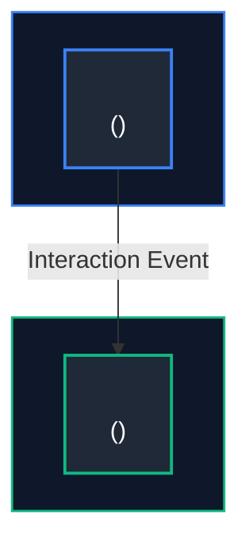
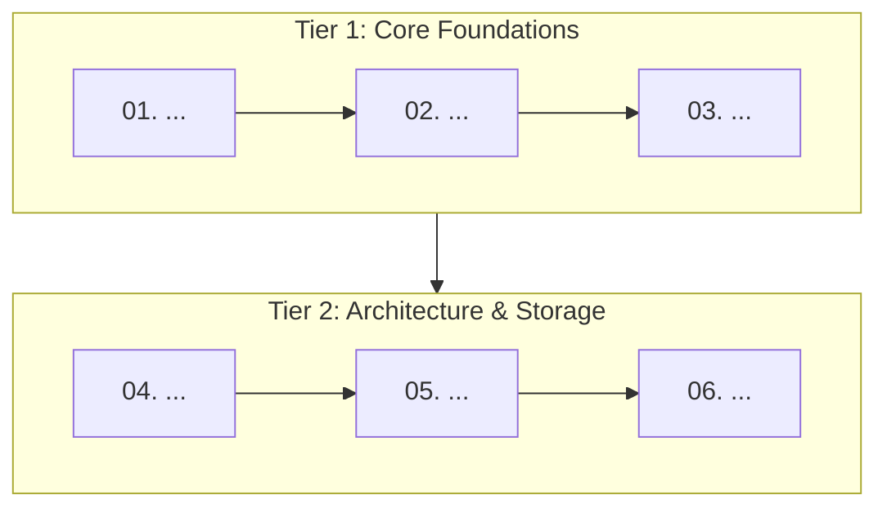
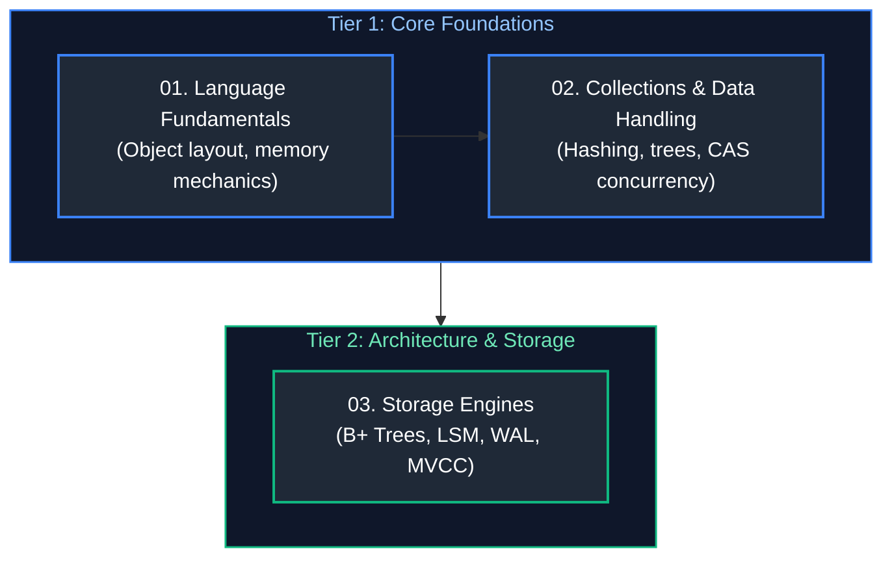
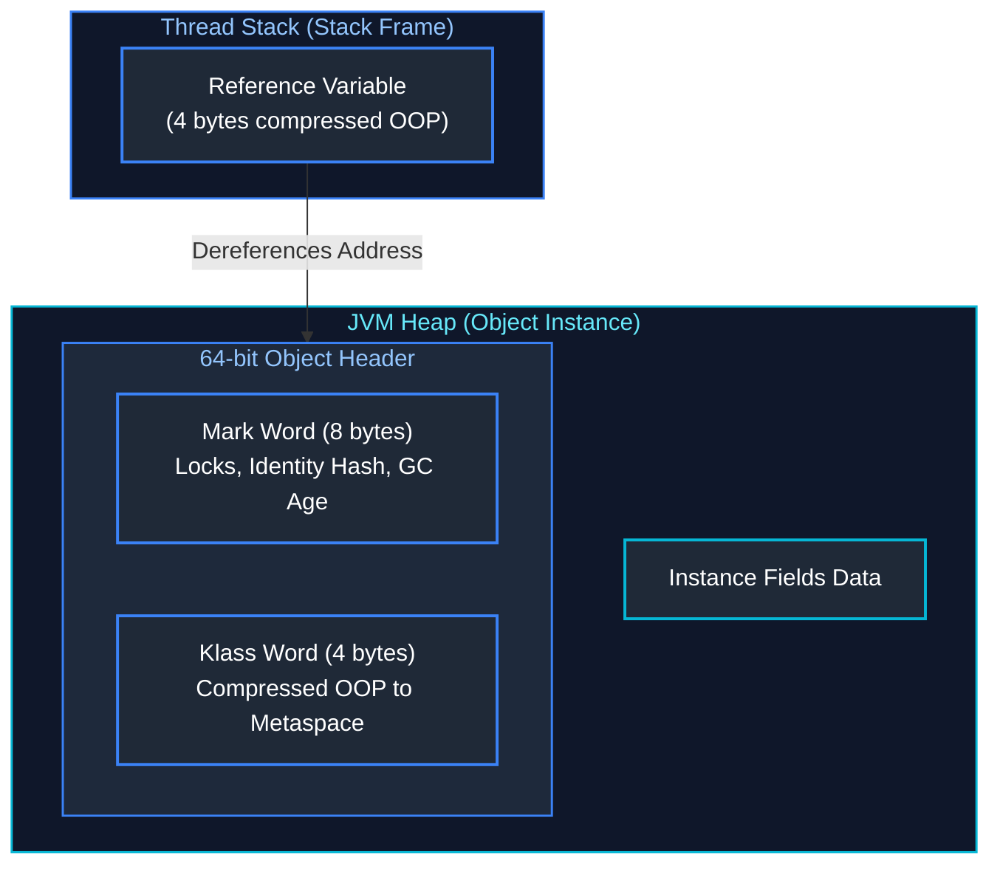

# Topic Structure & Style Guidelines for AI Agents

This guide defines the authoritative repository architecture, curriculum structure, visual design system, and technical writing standards for authoring or expanding any engineering topic/track in this knowledge base. All future AI agents and contributors must strictly adhere to these specifications.

---

## 1. Directory Tree & Architecture

Each engineering track must reside in a dedicated root directory containing exactly **15 numbered core curriculum modules**, a **master study guide & index**, and a **`frequently_asked_questions/`** directory containing **10 to 12 scenario-based interview guides**:

```text
<Discipline Name>/                                    # Title Case with spaces (e.g., Data Engineering)
├── 00_<track>_study_guide_and_index.md              # Master syllabus, 5-tier roadmap & 50-problem matrix
├── 01_<topic_slug>.md                               # Tier 1 foundational concept
├── 02_<topic_slug>.md                               # Strict linear chronological progression
├── ...                                              # (03 through 14)
├── 15_<topic_slug>.md                               # Tier 5 capstone / systems design module
└── frequently_asked_questions/                      # Strictly lowercase snake_case
    ├── 00_<track>_faq_study_guide_and_index.md      # FAQ chronological roadmap & question mapping
    ├── <track>_interview_questions.md               # Raw source question backlog (strict snake_case, no spaces)
    ├── 01_<faq_slug>.md                             # Concise slug (no '_interview_questions_and_answers' suffix)
    ├── 02_<faq_slug>.md
    └── ...                                          # (10 to 12 FAQ guides)
```

### 1.1 Standard File Naming Rules
1. **Core Curriculum Modules:** Two-digit zero-padded numbers `01_` through `15_` followed by a snake_case topic slug (e.g., `01_core_java_and_oop.md`).
2. **Master Track Index:** `00_<track_slug>_study_guide_and_index.md` (e.g., `00_de_study_guide_and_index.md`, `00_java_study_guide_and_index.md`).
3. **FAQ Directory:** Exactly `frequently_asked_questions/` (all lowercase snake_case).
4. **FAQ Master Index:** `00_<track_slug>_faq_study_guide_and_index.md`.
5. **Raw Question Source File:** `<track_slug>_interview_questions.md` (e.g., `data_engineering_interview_questions.md`, `java_backend_interview_questions.md` — never use spaces).
6. **FAQ Scenario Modules:** Numbered `01_` through `10_` (or `12_`) using **concise slugs** (e.g., `01_core_java_oop_and_algorithms.md`, `02_collections_framework.md`). Do **not** append redundant `_interview_questions_and_answers.md` suffixes.

---

## 2. Core Curriculum Module Specification (`01_*.md` to `15_*.md`)

Every core module must follow a uniform, sequential structure:

### 2.1 Header & Overview
```markdown
# NN. <Topic Title>

A comprehensive, production-grade guide to <scope summary>, covering <key subtopics>, memory and hardware mechanics, production patterns, and troubleshooting playbooks tailored for <Target Roles>.

---
```

### 2.2 Hero Architecture Diagram
Place the top-level architectural overview diagram **immediately after the overview paragraph and before the Table of Contents**:

```markdown
## Architectural Overview: <Architecture Name>


---
```

### 2.3 Table of Contents
Strictly numbered with verified GitHub markdown anchors:

```markdown
## Table of Contents
1. [<Major Section 1>](#1-major-section-1)
   - [1.1 <Subsection 1>](#11-standard-file-naming-rules)
   - [1.2 <Subsection 2>](#12-subsection-2)
2. [<Major Section 2>](#2-major-section-2)
...
9. [Summary Comparison & Engineering Reference Matrix](#9-summary-comparison--engineering-reference-matrix)
10. [References & Further Reading](#10-references--further-reading)

---
```

### 2.4 Subsections Blueprint (`# 1.` through `# 8.`)
Every numbered major section (`# 1.`) and subsection (`### 1.1`) must contain:
1. **Low-Level Theory & Runtime Mechanics:** Explain engine internals, memory layout, CPU scheduling, buffer pools, or byte-level structures.
2. **Visual / Memory Representation:** ASCII memory layouts or Mermaid state/sequence diagrams for complex interactions.
3. **Production Implementation:**
   - Real-world, non-trivial code (no placeholder `TODO` or synthetic `foo/bar`).
   - Detailed inline comments explaining each line and rationale.
4. **Key Points & Edge-Case Mitigation:**
   - Defensive engineering patterns and boundary hazards.
   - Strategic GitHub alerts:
     - `> [!CAUTION]` for data corruption, memory leaks, or concurrency bugs.
     - `> [!IMPORTANT]` for architectural invariants or contracts.
     - `> [!TIP]` for performance optimizations.
5. **Cross-References:** Explicit Markdown links to companion modules (e.g., `see [04. Database Internals](04_database_internals_and_performance.md#anchor)`).

### 2.5 Closing Sections (Mandatory)
Every core guide must conclude with:
1. **`# 9. Summary Comparison & Engineering Reference Matrix`:** A multi-dimensional comparison table of key features, complexity, and production rules.
2. **`# 10. References & Further Reading`:** Markdown links to authoritative sources (official documentation, JSRs, RFCs, Baeldung).

---

## 3. Master Study Guide & Index Specification (`00_*_study_guide_and_index.md`)

Each track root must contain a master curriculum guide containing:

### 3.1 5-Tier Chronological Mermaid Roadmap
Modules must strictly follow linear numbering across tiers:
* **Tier 1 (Modules 01–03):** Core Languages & Low-Level Foundations
* **Tier 2 (Modules 04–06):** Storage Engines, Architecture & Data Modeling
* **Tier 3 (Modules 07–09):** Core Frameworks, Runtimes & Execution Engines
* **Tier 4 (Modules 10–12):** Ingestion, Caching, Streaming & Persistence
* **Tier 5 (Modules 13–15):** Distributed Systems, Cloud, Ops & System Design



### 3.2 Curriculum Coverage Table
| Study Order | Guide File | Conceptual Domain | Corresponding Interview Guide | Key Topics & Production Scenarios Covered |
| :---: | :--- | :--- | :--- | :--- |
| **01** | [`01_...md`](01_...md) | ... | [`01_...md`](frequently_asked_questions/01_...md) | ... |

### 3.3 50-Problem Production-Solution Cross-Reference Index
A canonical matrix mapping 50 real-world production failures to their solutions and exact file anchors:
| Problem | Canonical Solution | Module Reference |
| :--- | :--- | :--- |
| **Data Skew / OOM** | Key salting & AQE partition coalescing | [`08_...md`](08_...md#anchor) |

### 3.4 Practical Interview Track Overview
Summary links to all scenario files within `frequently_asked_questions/`.

---

## 4. Interview FAQ Guide Specification (`frequently_asked_questions/NN_*.md`)

### 4.1 Header & Clustered TOC
```markdown
# NN. <Topic Title>: Interview Questions & Deep-Dive Solutions

A comprehensive, production-grade guide answering real-world <Topic> interview scenarios.

---

## Table of Contents & Question Mapping

1. **<Thematic Cluster 1>**
   - [Q1. <Question Title>](#q1-question-title)
   - [Q2 & Q3. <Grouped Question Title>](#q2--q3-grouped-question-title)
...
---
```

### 4.2 Standard Question Entry Blueprint
```markdown
### Q<N>. <Question Title>
*(If questions are grouped: Grouped together: <Reason for grouping>)*  
**Topic Covered:** <Domain & Core Mechanism>  
**Question:** <Full verbatim question>

#### Definition & Core Concepts
<In-depth theoretical explanation of how the engine/runtime processes this under the hood.>

#### Visual Flow
<Mermaid flowchart or sequence diagram depicting state flow, failure mode, or lifecycle.>

#### Production Implementation / Code Solution
```<language>
// Production code with edge-case handling and inline comments
```
- **Time Complexity:** $O(...) $
- **Space Complexity:** $O(...) $

#### Engineering Implications & Production Pitfalls
1. **<Anti-Pattern / Hazard>:** <Why naive solutions fail in high-throughput production.>
2. **<Interview Talking Point>:** <Key trade-off or nuance that demonstrates senior expertise.>
```

---

## 5. Diagram Color & Visual Style Specifications

All diagrams throughout the repository use **Mermaid** with a strict, dark-mode-first color palette and visual layout standard. AI agents must follow these rules to ensure visual consistency across all tracks and modules.

### 5.1 Diagram Types & Directional Conventions

| Diagram Purpose | Mermaid Type | Direction | Convention |
| :--- | :--- | :---: | :--- |
| **Tier Roadmaps & Curricula** | `flowchart TD` | Top-to-Bottom | Hierarchical tiers arranged vertically from foundational to capstone. |
| **System & Memory Architectures** | `flowchart TD` | Top-to-Bottom | Subgraphs representing memory areas (Stack, Heap, Metaspace) or infrastructure boundaries. |
| **Data Pipelines & Ingestion Streams** | `flowchart LR` | Left-to-Right | Source $\rightarrow$ Ingestion $\rightarrow$ Transform $\rightarrow$ Sink dataflow progression. |
| **Execution Order & Diagnostic Protocols** | `flowchart TD` | Top-to-Bottom | Sequential numbered steps ($1 \rightarrow 2 \rightarrow 3$). |
| **Lifecycle & Component Interactions** | `sequenceDiagram` | — | Actor/Service interactions with activation boxes and explicit response labels. |

---

### 5.2 Standard Hex Color Palette & Semantic Roles

Every node and subgraph must be explicitly styled using the repository's semantic hex palette:

| Semantic Domain / Tier | Subgraph `fill` | Subgraph `stroke` | Subgraph Text (`color`) | Node `fill` | Node `stroke` | Node Text (`color`) |
| :--- | :---: | :---: | :---: | :---: | :---: | :---: |
| **Tier 1: Foundations & Stack** | `#0f172a` | `#3b82f6` (Blue) | `#93c5fd` | `#1f2937` | `#3b82f6` | `#ffffff` |
| **Tier 2: Storage, Schemas & Output** | `#0f172a` | `#10b981` (Emerald) | `#6ee7b7` | `#1f2937` | `#10b981` | `#ffffff` |
| **Tier 3: Engines, Runtimes & Processing** | `#0f172a` | `#f59e0b` (Amber) | `#fde68a` | `#1f2937` | `#f59e0b` | `#ffffff` |
| **Tier 4: Streaming, Pipelines & Metadata**| `#0f172a` | `#8b5cf6` (Purple) | `#c084fc` | `#1f2937` | `#8b5cf6` | `#ffffff` |
| **Tier 5: Cloud, Ops & System Design** | `#0f172a` | `#ec4899` (Pink) | `#f472b6` | `#1f2937` | `#ec4899` | `#ffffff` |
| **Memory / Heap / Allocations** | `#0f172a` | `#06b6d4` (Cyan) | `#67e8f9` | `#1f2937` | `#06b6d4` | `#ffffff` |
| **Critical Errors, Limits & Termination** | `#0f172a` | `#ef4444` (Red) | `#fca5a5` | `#1f2937` | `#ef4444` | `#ffffff` |
| **Nested Containers (Level 2 Subgraphs)**| `#1e293b` | `#06b6d4` / `#10b981` | `#e2e8f0` | `#1f2937` | Match parent | `#ffffff` |

---

### 5.3 Typography, Labeling & Node Geometry Rules

1. **Node Geometry:**
   - Use standard rectangular nodes: `NodeId["..."]`.
   - Avoid circular `((...))` or asymmetrical `>...]` shapes unless specifically depicting state machine terminators.
2. **Two-Line Labeling Pattern:**
   Every significant node should feature a bold/clear title followed by a `<br/>` with concise secondary metadata (memory size, low-level mechanism, or responsibility):
   ```text
   RefVar["Object Reference Variable<br/>(4 bytes compressed OOP)"]
   MarkWord["Mark Word (8 bytes)<br/>Hashcode, GC Age, Biased/Lock Flags"]
   Catalyst["Catalyst Optimizer<br/>(Analysis -> Logical -> Physical -> CodeGen)"]
   ```
3. **Link Styles & Annotation:**
   - **Solid transition:** `A --> B`
   - **Annotated interaction:** `A -->|"Points to Heap Address"| B`
   - **Weak / Metadata / Logical link:** `A -.->|"Internal value ref"| B`
   - Always enclose link text in double quotes (`-->|"Label"|`) to avoid parsing errors.
4. **Subgraph Styling Standards:**
   - Outer subgraphs: `stroke-width:1.5px`
   - Inner nodes: `stroke-width:2px`
   - Always assign explicit IDs and quote titles: `subgraph StackFrame ["Thread Stack (Stack Frame)"]`

---

### 5.4 Concrete Reference Examples

#### Example 1: Multi-Tier Roadmap Styling


#### Example 2: Memory / Component Architecture Styling


---

## 6. Pre-Commit Verification Checklist for Future Agents

Before marking any new topic or track complete, verify:
- [ ] Exactly 15 core curriculum files (`01_` to `15_`) in the track root, numbered in strict reading order.
- [ ] `00_<track>_study_guide_and_index.md` contains the 5-tier roadmap, curriculum table, and 50-problem matrix.
- [ ] Subdirectory is named `frequently_asked_questions/` (lowercase snake_case).
- [ ] `frequently_asked_questions/00_<track>_faq_study_guide_and_index.md` exists with an interview study roadmap.
- [ ] Raw question backlog is named `<track>_interview_questions.md` without spaces.
- [ ] FAQ files use concise slugs (e.g., `01_core_java_oop_and_algorithms.md`).
- [ ] Hero architecture diagram appears **before** the Table of Contents in each core guide.
- [ ] Code blocks contain step-by-step inline comments; complexities use KaTeX ($O(1)$, $O(N)$).
- [ ] All intra-repository links (`[text](file.md#anchor)`) resolve without broken anchors.

